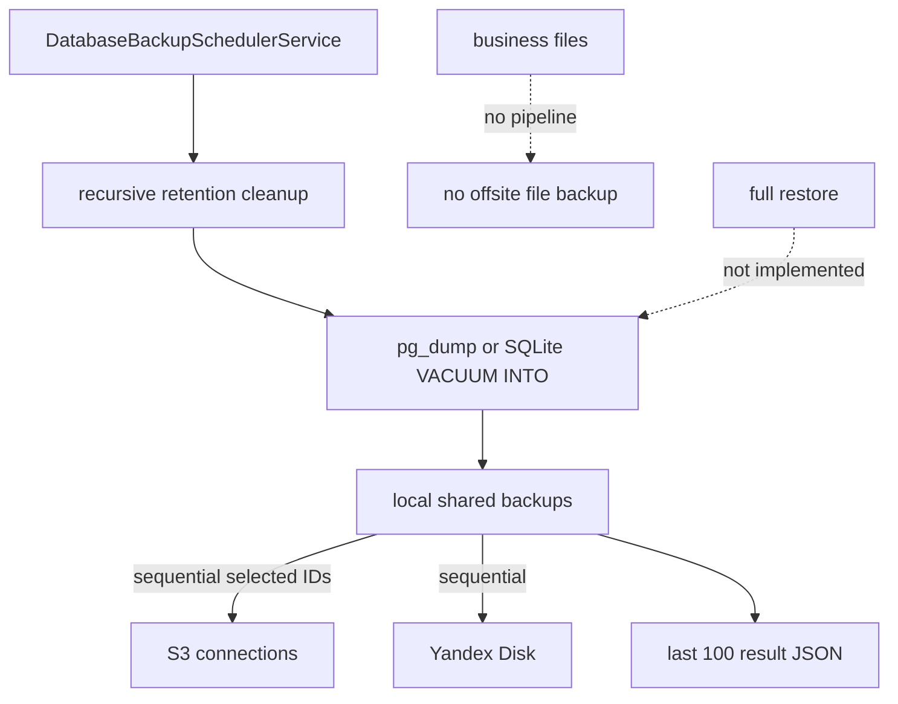
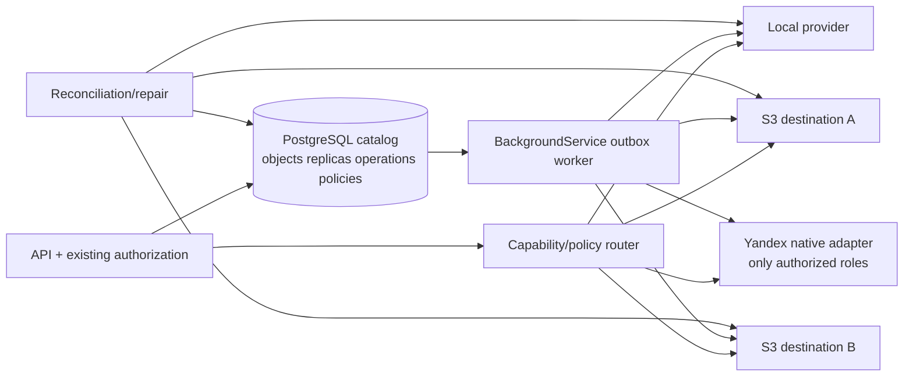
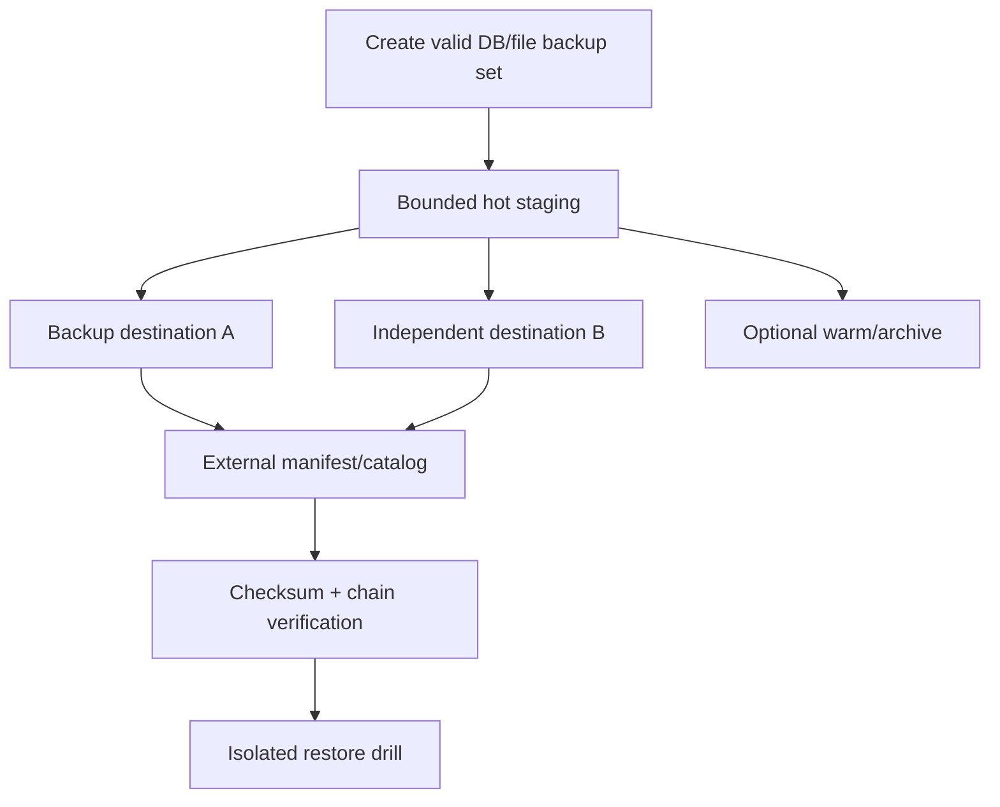
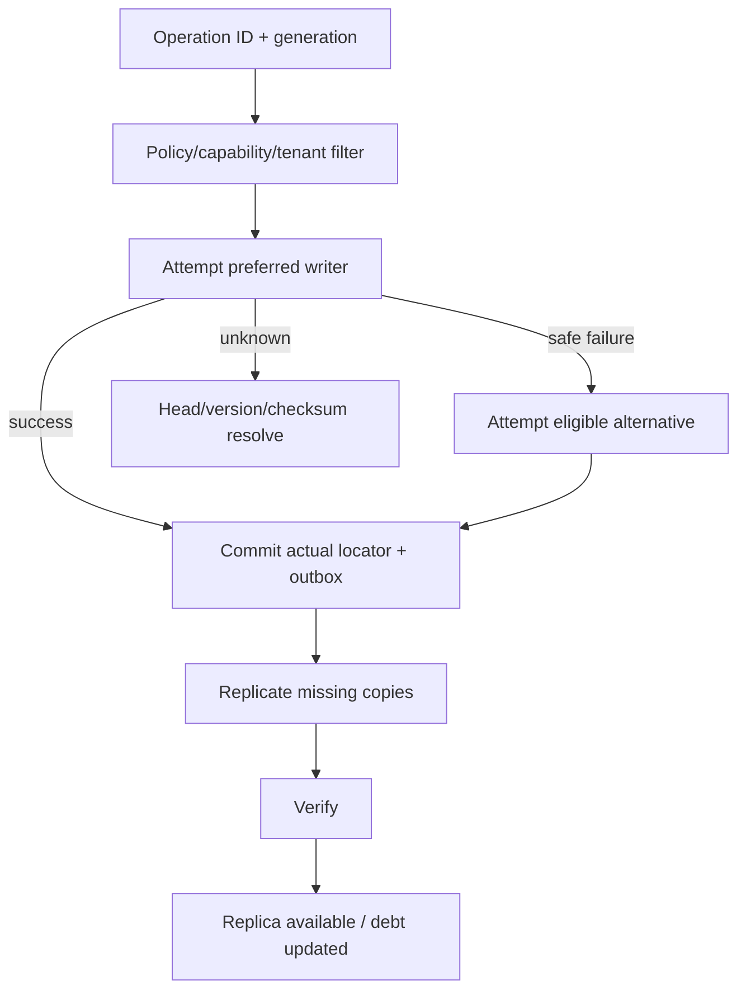
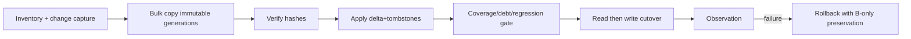
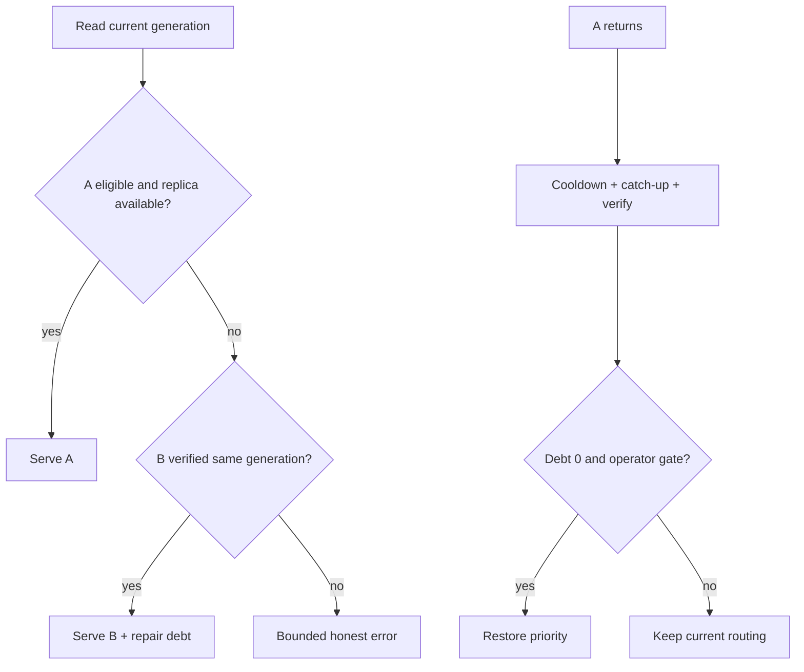

# Полный аудит хранилищ PayPlanner

Версия 1.1, 2026-09-22. Исходные разделы ниже фиксируют baseline аудита до реализации. Кодовая база локально доработана после аудита; production, VPS и реальные storage accounts не изменялись.

## Дополнение по реализации от 2026-09-22

Локально реализована безопасно выключенная по умолчанию основа отказоустойчивого хранения: каталог объектов, поколений и реплик, durable-операции с lease/retry/dead-letter, policy routing, локальный primary, адаптеры существующих S3 и Яндекс Диска, circuit breaker, сверка и восстановление реплик, tombstone/retention/legal hold, а также административные API наблюдения и управления. Исторические файлы можно регистрировать в каталоге управляемыми порциями через dry-run/apply без удаления или перемещения исходников.

Контур резервного копирования дополнен manifest/checksum, резервированием persistent-файлов и проверкой комплектности. Для SQLite доступен реальный restore drill в одноразовом каталоге; PostgreSQL по умолчанию проходит только валидацию, а реальное восстановление требует отдельного включения, allowlist целевой БД и confirmation token. Пути фотографий, электронных подписей и ключей Data Protection вынесены в persistent storage; S3-секреты защищаются Data Protection, а пользовательские endpoint проходят SSRF/TLS-проверку.

Новые routing/worker-механизмы остаются выключенными настройками до отдельного canary и приёмки. Реальные провайдеры, production backfill и production restore не запускались. Текущий статус и оставшиеся внешние шаги зафиксированы в `docs/storage-resilience-roadmap-2026-09-22.md`, эксплуатационные процедуры — в `docs/storage-resilience-runbook.md`.

## 1. Executive Summary

PayPlanner — local-first система хранения рабочих файлов. PostgreSQL хранит metadata/paths, а task/case/chat/messenger bytes находятся на одном persistent filesystem VPS. S3-compatible и Yandex Disk реализованы как отдельные административные/интеграционные сервисы; database backup может отправлять dump в несколько S3 connections и Yandex Disk, но рабочие файлы автоматически туда не реплицируются (EVID-010..022, EVID-040, EVID-060, EVID-080..084).

Главный риск — отсутствие доказанного полного восстановления DB+files+keys. Потеря VPS может оставить cloud DB dump без пользовательских документов. Кроме того, profile/e-signature paths находятся внутри deploy tree, S3 secrets хранятся plaintext, а multi-storage read/write failover, replica catalog, reconciliation и durable repair отсутствуют (RISK-001,004..010).

Исторический read-only snapshot предыдущего аудита показал два active incidents: S3 `UserSuspended` и падение backup scheduler на permissions. В текущем запросе production не опрашивался, поэтому их текущий статус — `NOT VERIFIED`; они остаются P0 operator gates (EVID-123/124).

Рекомендуемая архитектура не требует нового broker/оркестратора: additive PostgreSQL catalog + outbox/jobs + существующий `BackgroundService`, local/S3 provider adapters и сохранённый native Yandex service. Сначала — restore foundation и file backup, затем catalog/routing, после этого historical backfill и только затем включение failover.

## 2. Repository/Service Map, baseline и границы

- Branch/commit: `main`, `09ae8b58e74787a20d7f7d2361331b83731ab8b4` (EVID-001).
- Backend: ASP.NET Core/.NET 9, EF Core PostgreSQL+SQLite, one deploy unit.
- Frontend: React/Vite/TypeScript.
- Jobs: in-process hosted services; external broker/Hangfire/Quartz не обнаружены.
- CI/CD: GitHub Actions deploy, tests/lint/encoding/build, SSH deployment.
- Storage adapters: local filesystem, S3-compatible via AWSSDK.S3 4.0.23.5, Yandex Disk REST via `HttpClient`.
- Excluded from systematic reading: generated migration designers, `node_modules`, `bin/obj`, `dist`; manifests/runtime integration points reviewed.
- Outside scope/NOT VERIFIED: managed VPS snapshots, provider account policies/billing, real quotas, off-repo operator automation, current production health.
- Prior untracked user artifact preserved: `docs/storage-s3-backup-audit-2026-09-22.md`; not modified in this run.

## 3. Data Classification Matrix

| Data Class | Producer/Consumer | Source of Truth | Criticality / PII | Size/pattern | Current location | Replica/backup/retention | RPO/RTO | Restore | Evidence |
|---|---|---|---|---|---|---|---|---|---|
| Task files | task cards/API | DB row + file | HIGH / possible PII | ≤25MB, frequent work reads | local `task-files` | none; hard delete | current RPO unbounded on disk loss; RTO unknown | manual file+DB only | EVID-012/013/016 |
| Case documents/templates | case UI/portal/approvals | DB row + file | CRITICAL / legal+PII | ≤25MB, versions | local `case-documents` | task-linked duplicate is not managed replica | same | no tested method | EVID-014..016/020 |
| Internal chat attachments | chat members | DB row + file | HIGH / PII | ≤20MB, max 10/message | local `internal-chat-files` | physical delete with message | same | none | EVID-017/018 |
| Messenger snapshots | delivery service/public link | DB delivery + immutable snapshot | HIGH / legal/PII | ≤25MB, limited reads | local messenger dir | SHA-256; retention unclear | RPO local-only | none | EVID-019 |
| External approval attachments | external approval | case doc + grant/hash | HIGH / legal | selected doc | same case file | SHA verification | inherits case risk | none | EVID-020 |
| E-signature originals/evidence | e-sign service | DB + absolute path | CRITICAL / legal | PDF ≤25MB | default release tree | SHA-256, archive years metadata | unsafe persistence | evidence package only, no DR | EVID-021/091 |
| Profile photos | profile API | `Users.PhotoUrl` + file | MEDIUM / personal | ≤4MB | release `wwwroot` | no backup | observed missing link | none | EVID-022/126 |
| Legal entity logos | settings | DB data URL | MEDIUM / business | ≤12M chars | PostgreSQL | covered only by DB dump | DB RPO | DB restore only | EVID-023 |
| Generated exports | controllers | regenerable business DB | LOW-MEDIUM | transient memory | RAM/HTTP | not needed unless saved | N/A | regenerate | EVID-025 |
| Imports | admin/import APIs | resulting DB rows | HIGH / business | current flow buffers bytes | RAM | source not retained generally | DB RPO | reimport if source exists | EVID-024 |
| S3 manager objects | admin S3 UI | remote object/key | varies | up to 50GB | selected S3 bucket | provider controls NOT VERIFIED | unknown | no catalog/runbook | EVID-040..049 |
| Yandex manager/CRM sync | Yandex UI/controllers | Yandex native object/path + sync state | varies/PII possible | remote REST | Yandex Disk | revisions/retention NOT VERIFIED | unknown | native/manual | EVID-060..068 |
| PostgreSQL DB | application | PostgreSQL | CRITICAL / extensive PII | historical 306MB snapshot | DB server | dumps local+configured cloud | schedule 6h historically; now status unknown | not tested | EVID-080..092/120 |
| DB backup files | backup service | local dump + copy result JSON | CRITICAL | ~15MB historical dump | shared backups + destinations | local 8d historical; cloud policy unverified | restore RPO not proven | no automated drill | EVID-080..086/122 |
| Data Protection keys | ASP.NET protection | key ring | CRITICAL secret dependency | small | shared dataprotection path runtime | offsite NOT VERIFIED | loss breaks protected fields/tokens | no documented restore | EVID-062; prior runtime audit |
| Logs/job state | app/journal/SystemSettings | journal + DB state | MEDIUM ops | append/current state | VPS/DB | retention varies | not DR source | regenerate/lose history | EVID-006/007/086 |
| Deploy artifacts | CI deploy | release files | MEDIUM | GB scale historically | deploy-backups | keep 10 automatic | rollback only | restore code, not data | EVID-089/090 |

No video/audio/ML artifacts or mail MIME attachment store was found as persistent storage. Email attachments are generated/loaded transiently; this is not a mail archive.

## 4. Storage Provider Matrix

| ID | Backend/Adapter | Locator | Role/tier | Operations | Credentials | Failure domain | Actual usage | Evidence |
|---|---|---|---|---|---|---|---|---|
| LOCAL-SHARED | `LocalCaseDocumentStorage` + direct FileStream | relative path under `FileStorage:RootPath` | runtime hot primary | stream put/open/delete/PhysicalFile | OS permissions | single VPS/disk | task/case/chat/messenger | EVID-010..020 |
| LOCAL-RELEASE | direct filesystem | `wwwroot/user-photos`, `storage/electronic-signatures` | unintended runtime | put/read/delete | OS permissions | release rsync/VPS | profile/e-signature | EVID-021/022/091 |
| S3-CONNECTION-* | `S3StorageService`/AWSSDK.S3 | endpoint+bucket+prefix+key | admin files; DB backup destination | CRUD/list/copy/move/text | static key plaintext DB | account/provider/region/credentials | explicit selected connection | EVID-040..049 |
| YD-CONNECTION-* | `YandexDiskService` REST | OAuth account + `disk:/root/path` | native file manager/CRM sync/DB backup | list/folder/copy/move/trash/delete/upload/download | protected OAuth token | Yandex account/OAuth app/network | native UI and doc sync | EVID-060..068 |
| LOCAL-DB-BACKUP | filesystem | backup relative path | hot staging/local backup | create/list/delete/download | OS permissions | same VPS/disk as app | scheduled/manual dump | EVID-080..086 |
| DEPLOY-BACKUP | filesystem | release backup directory | code rollback, not data backup | copy/prune/restore release | OS/SSH | same VPS | deploy rollback | EVID-089/090 |

Нет доказательств NFS/SMB/FUSE/rclone mounts. Один и тот же S3 account/bucket под разными aliases нельзя считать независимыми copies; production independence сейчас NOT VERIFIED.

## 5. Current Runtime Architecture

```mermaid
flowchart LR
  UI[React UI] --> API[ASP.NET API]
  API --> DB[(PostgreSQL metadata)]
  API --> L[/shared files\ntask case chat messenger]
  API --> R[release tree\nprofile e-sign]
  API --> S3[S3 admin selected connection]
  API --> YD[Yandex Disk native REST]
  API --> GEN[generated exports in RAM]
```

Upload business file: authorization → local stream → DB metadata; linked task/case may create two copies without replica identity. Download: DB authorization/path → local `PhysicalFile`. Delete: DB mutation then best-effort physical delete. Background replication/reconciliation отсутствуют.

S3/Yandex admin operations are explicit by connection and do not participate in business-file availability. Direct client-to-storage upload/download отсутствует; frontend downloads blobs through backend.

## 6. Current Backup/Restore Architecture



Creation and delivery are coupled in one method. A cloud failure is recorded without invalidating local dump, but retry is manual and history bounded. Restore endpoint/drill/catalog are absent. Deploy backup protects release artifacts, not data.

## 7. Storage Policy Matrix

`Current` has no explicit policy engine; target recommendation is marked `PROPOSED`.

| Data class | Runtime pool | Write policy | Read policy | Required/desired | Backup | Tier/retention | Integrity/access |
|---|---|---|---|---|---|---|---|
| User files | local | current single; target DEC-004 | current local; target verified fallback | target 1/2 | file backup ≥2 independent | hot 30d PROPOSED | SHA-256; proxy/presign by capability |
| Legal evidence | release/local | target 2 confirmed or explicit pending | exact generation | target 2/2 | immutable independent | legal retention owner gate | hash+version, no stale fallback |
| S3/Yandex native files | selected native | preserve explicit target | selected native | 1 unless opted-in | optional | native policy | retain native IDs/OAuth/contracts |
| DB backups | local staging then inline copy | target durable delivery | restore selector only | target 2 independent verified | itself | recent hot; older tier gated | manifest+checksum+restore status |
| Generated/temp | none/staging | transient/bounded | none | 0 | none | short TTL | no false durability claim |

## 8. Backup Tier Matrix

| Backup type | Source | Hot copy | Independent copy | Warm/cold/archive | Retention | RTO | Verification/restore |
|---|---|---|---|---|---|---|---|
| DB current | pg_dump | local VPS | configured S3/Yandex, operational status NOT VERIFIED | none proven | local 8d historical | unknown | upload status only; no restore |
| DB target | BackupSet | local bounded staging + cloud A | cloud B independent account/provider | deferred until provider facts | hourly 48h/daily 30d/monthly 12m PROPOSED | ≤4h PROPOSED | checksum + monthly restore |
| Files current | shared FS | runtime copy only | none | none | business lifetime | unknown | none |
| Files target | inventory+objects | runtime replicas | independent backup pool | optional after RTO gate | owner/legal policy | ≤4h PROPOSED | manifest/reconciliation/restore |
| E-sign evidence target | legal objects | runtime hot | immutable independent | possible archive after legal gate | configured archive years | owner-approved | evidence hash + restore sample |

Cold/archive provider capability, retrieval delay and cost are NOT VERIFIED; no selection is made.

## 9. Multi-storage and automatic failover

Current:

- N configured S3/Yandex connections: `IMPLEMENTED / VERIFIED BY TEST`.
- Simultaneous DB backup attempts to multiple S3 + Yandex: `PARTIALLY IMPLEMENTED / VERIFIED BY TEST`.
- Per-object runtime copies, read/write failover, generation, durable retry, repair: `NOT IMPLEMENTED`.
- Backup destination automatic fallback: attempts all configured destinations sequentially, but no durable independent progress/retry/protection policy; `PARTIALLY IMPLEMENTED`.

Scenario `A SUCCESS, B FAILED, C SUCCESS` current DB backup: each result is stored, method continues. Logical protection requirement is not modelled, B retry is manual, history can be truncated, restart durability is limited. Runtime files do not support this scenario.

Target: write is available after one policy-authorized durable primary copy plus catalog/outbox commit; protection remains `degraded/pending` until required verified copies. If policy requires 2 copies synchronously, one copy cannot return ordinary success. Alternative writer is allowed only by data-class/tenant/capability policy.

## 10. Data Integrity and Reconciliation

Strong checksums exist only in messenger/e-sign/external approval. Task/case/S3 backup do not maintain canonical SHA-256. No scan compares DB, local files and providers. Current production point-in-time task/case consistency was good (EVID-121), but that is not continuous control.

Target reconciliation stages: DB expected inventory → cheap HEAD/size/version → scheduled strong hash samples/full scans → quarantine corrupt replica → idempotent repair from verified generation. Repair pauses on mass corruption/compromise and is rate-limited.

## 11. Upload/Download Architecture

- Task/case/chat/profile: proxy upload; local stream. No replay across destinations.
- S3: proxy upload single PutObject; proxy download buffers all bytes; no multipart/presign/Range.
- Yandex: backend obtains upload/download URL; frontend still talks to backend; download buffers all bytes.
- DB backup/internal chat local downloads have Range; task/case Range behavior not explicitly enabled.

Target: bounded proxy streaming for common paths; re-openable spool only when failover/size policy allows; S3 multipart above measured threshold; S3 short-lived presign for large downloads; stable logical endpoint for retry. A started response is never spliced between providers.

## 12. Delete, Retention, Immutability

Most files hard-delete immediately. Chat message keeps a tombstone but attachment bytes/rows are removed. S3 delete is immediate; Yandex supports trash vs permanent. DB backup local retention is time-based but independent of verified copies. S3 versioning/Object Lock/lifecycle and Yandex revisions are NOT VERIFIED.

Target delete: logical tombstone/generation → durable per-replica delete operations → runtime copies deleted after policy delay → backup copies retain independently. Partial delete retries only missing destination. Incomplete multipart cleanup is a provider lifecycle/operator gate.

## 13. Backup Analysis

Implementation status: DB backup `PARTIALLY IMPLEMENTED`; file backup `NOT IMPLEMENTED`; hot/independent/immutable classification `NOT VERIFIED`. No common DB+files recovery point, external catalog or automatic restore test. A local dump on the same VPS is not DR. Historical cloud upload success is not proof that object is retrievable or restorable.

Backup source failure and destination failure must be separate: invalid `pg_dump` cannot be rescued by B. Once a verified staging artifact exists, A failure must not block B/C. Per-copy states and `BackupId` survive restart. Required protection and desired debt are distinct.

## 14. Restore and DR Analysis

| Loss scenario | Current result | Target control |
|---|---|---|
| App release | deploy rollback possible; shared files remain | verified revision rollback, no data change |
| VPS/disk | DB/files/keys may be lost; full restore unproven | independent DB+file+key backup/catalog |
| PostgreSQL | app unusable; dump may exist | isolated verified restore + catalog |
| local files | metadata without bytes | verified runtime replica/file backup |
| one S3/Yandex | native objects there unavailable; other workloads mostly continue | per-pool degradation/fallback |
| catalog/DB unavailable | no safe authority for current generation | restore catalog/DB; do not invent new truth |
| credentials/key lost | cloud/protected data inaccessible | external secret/key recovery procedure |
| all destinations | no legitimate success | bounded pending if policy allows, else controlled error |

Actual RPO/RTO remain NOT VERIFIED until restore drill.

## 15. Migration Capability

Only legacy `App_Data -> /shared/files` copy exists. No general inventory/dry-run/checkpoint/delta/resume. Target migration must start change capture/object registration before bulk copy, preserve immutable generations and tombstones, and never delete source. Maintenance-window variant is acceptable if simpler and owner approves; online plan otherwise requires delta capture.

## 16. Security Findings

- HIGH plaintext S3 secrets (RISK-005).
- MEDIUM configurable endpoint SSRF surface (RISK-016).
- IAM, public access, encryption, Object Lock, lifecycle, data residency NOT VERIFIED.
- Positive: controller permissions/audit, path normalization, Yandex token protection, no tracked production secrets found.
- Fallback must reapply business authorization and tenant constraints; provider availability cannot bypass ACL.
- Data Protection keys are restore dependency and need protected independent recovery.

## 17. Performance and Cost Drivers

Current drivers: S3/Yandex whole-file buffering, 50GB S3 request limit, spreadsheet byte arrays, sequential backup uploads, duplicate task+case files, first-1000 S3 list. Target async mirroring reduces UI latency but creates measurable replication lag/window. Cross-provider repair/migration adds egress/API calls. Cost model must collect: bytes/object count/growth, read/write/list calls, cross-provider egress, staging peak, backup retention and restore retrieval; current values are insufficient for price claims.

## 18. Observability

Generic job state/logs exist; no storage readiness, protection/debt, per-operation breaker or restore-age metric. `/api/health` cannot detect storage/DB failures. Target metrics/alerts follow REQ-014 and must not make optional archive outage kill liveness.

## 19. Gap Analysis

| Capability | Implementation | Evidence level |
|---|---|---|
| Local runtime storage | IMPLEMENTED | OBSERVED RUN EVIDENCE historical |
| S3 native admin | IMPLEMENTED; historical runtime BROKEN | VERIFIED BY TEST + prior observed evidence |
| Yandex native integration | IMPLEMENTED | VERIFIED BY TEST; real account NOT VERIFIED current run |
| Provider capability matrix at runtime | NOT IMPLEMENTED | code review |
| Separate pools/policies | NOT IMPLEMENTED | code review |
| Runtime per-replica catalog | NOT IMPLEMENTED | code review |
| Durable async replication | NOT IMPLEMENTED | code review |
| Read failover | NOT IMPLEMENTED | code review |
| Write failover/UNKNOWN resolution | NOT IMPLEMENTED | code review |
| Backup multi-destination attempts | PARTIALLY IMPLEMENTED | VERIFIED BY TEST |
| Durable backup fallback/protection | NOT IMPLEMENTED | code review |
| File backup | NOT IMPLEMENTED | code review |
| DB backup | PARTIALLY IMPLEMENTED | code+test; current operation NOT VERIFIED |
| Restore procedure/test | NOT IMPLEMENTED / NOT VERIFIED | code/docs review |
| Strong checksums | PARTIALLY IMPLEMENTED | code review |
| Direct download/upload | NOT IMPLEMENTED for storage | code review |
| Proxy bounded streaming | PARTIALLY IMPLEMENTED local; BROKEN for large cloud | code review |
| Range | PARTIALLY IMPLEMENTED | code review |
| Multipart/resume | NOT IMPLEMENTED | code review |
| Soft delete/retention | PARTIALLY IMPLEMENTED | code review |
| Versioning/immutability | NOT VERIFIED provider; not modelled app | code + no provider access |
| Migration dry-run/resume/delta | NOT IMPLEMENTED | code review |
| Health/alerts | PARTIALLY IMPLEMENTED generic only | code review |
| Least privilege | NOT VERIFIED provider; app roles implemented | code/current limits |
| DR runbook | PARTIALLY IMPLEMENTED deploy rollback only | docs review |

## 20. Recommended Target Architecture











## 21. Recommended RPO/RTO

These are `PROPOSED`, not current guarantees:

- PostgreSQL: RPO ≤1h (or PITR later if business requires), RTO ≤4h.
- User files: availability after one durable writer; desired replica lag ≤15m; file-backup RPO ≤24h until continuous backup is implemented; RTO ≤4h.
- Legal evidence: required 2 verified copies before protected success; owner to confirm degraded behavior/retention.
- Runtime failover decision: ≤15s within request budget; started streams may require client restart.
- Current actual values: NOT VERIFIED; scheduler/provider incidents must be cleared first.

## 22. Recommended Implementation Order

`STG-00 baseline → STG-01 restore/backup foundation → STG-02 paths/secrets → STG-03 catalog/abstraction → STG-04 routing/failover → STG-05 backup sets/files → STG-06 backfill/migration → STG-07 streaming/frontend → STG-08 observability/rollout → STG-09 acceptance`.

Full dependencies/task cards: `STORAGE_IMPLEMENTATION_ROADMAP.md`.

## 23. Unknowns / NOT VERIFIED

- Current production incidents EVID-123/124.
- Real provider IAM, versioning, encryption, lifecycle, Object Lock, quotas, cost, region/data residency.
- Yandex revisions/range/large-upload limits for actual account.
- Managed VPS/DB snapshots outside repo.
- Legal retention/RPO/RTO and allowed degraded success.
- Independent second destination/account and budget.
- Full data volumes/growth/read/write distribution.
- Successful end-to-end restore.

## 24. Final statuses

- Runtime storage: `IMPLEMENTED local / single-node`.
- Multi-storage runtime: `NOT IMPLEMENTED`.
- DB backup: `PARTIALLY IMPLEMENTED`; operational status current run `NOT VERIFIED`.
- File backup: `NOT IMPLEMENTED`.
- Hot backup: local exists in design/history; independent hot protection `NOT VERIFIED`.
- Cold/archive: `NOT IMPLEMENTED / capability NOT VERIFIED`.
- Restore: `NOT IMPLEMENTED / NOT VERIFIED`.
- Migration: legacy copy only; general `NOT IMPLEMENTED`.
- Security: app permissions good; secrets/provider controls incomplete.
- HA boundary: storage changes do not solve PostgreSQL/catalog/app/VPS HA.

## 25. Provider Capability and Compatibility Matrices

### Capability Matrix

Legend `API / adapter / account-verified`.

| Capability | Local | S3-compatible | Yandex Disk REST |
|---|---|---|---|
| Read/write/delete/list | supported/implemented/observed historical | supported/implemented/account current NOT VERIFIED | supported/implemented/account current NOT VERIFIED |
| Stable locator | relative path | bucket+key | `disk:/path`; remote IDs not central in current model |
| Streaming | local implemented | API supported / adapter download buffers | upload stream, download buffers |
| Range | FS/HTTP possible; partial endpoints | API supported / adapter absent / provider compat NOT VERIFIED | NOT VERIFIED |
| Multipart/resumable | N/A | AWS API supported / adapter absent / provider compat NOT VERIFIED | upload URL workflow; resume NOT VERIFIED |
| Checksum/version | app-dependent | AWS supported / adapter not captured | adapter not captured; native support NOT VERIFIED |
| Conditional write | local CreateNew in places | AWS supported / adapter absent | NOT VERIFIED |
| Copy/move/trash | filesystem rename not generalized | same bucket copy; move copy+delete | native implemented incl trash/permanent |
| Presigned/native URL | N/A | AWS supported / adapter absent | temporary links internal to adapter; not returned to client |
| Versioning/immutability/tier | filesystem external only | account NOT VERIFIED | NOT VERIFIED / not assumed |
| OAuth | N/A | static key | native OAuth protected |

Official API capability does not prove a S3-compatible provider enables it.

### Existing Integration Compatibility Matrix

| Integration | Existing contract | Planned touchpoints | Regression gate | Gap |
|---|---|---|---|---|
| Local task/case | paths/versions/permissions/cards | orchestration wrapper, nullable object ID | TEST-101 + both task cards + case/portal tests | no checksum/replicas |
| Internal chat | membership, 10 files, blacklist, Range | object reference/delete workflow | existing controller tests + TEST-113 | hard delete attachments |
| Messenger | snapshot/hash/one-time token | storage provider under snapshot | messenger service tests | backup/retention |
| E-signature | PDF/hash/evidence package | persistent provider path | e-sign service/controller tests | release path |
| Profile | image formats/public URL | persistent endpoint/mapping | profile tests + legacy URL read | missing historical file |
| S3 admin | settings/IDs/CRUD/list/test/file UI | adapter extraction/secrets/streaming | TEST-103 | no failover/catalog |
| Yandex Disk | OAuth/connections/files/copy/move/trash/sync/logs | capability wrapper for authorized backup role | TEST-102 and existing backend/frontend suite | no generic replica semantics |
| DB backup admin | create/list/retry/delete/download/settings | BackupSet/catalog/worker | existing tests + TEST-110/111 | no durable protection/restore |

## 26. Failover/Recovery Matrix

| Data/operation | Preferred | Alternatives | Trigger/deadline | Required version/copies | Result/state | Repair/failback | Alert / Test |
|---|---|---|---|---|---|---|---|
| User file read current | actual primary replica | verified runtime replicas only | retryable before response, ≤15s PROPOSED | committed generation / 1 | bytes or honest error | repair missing; cooldown gate | TEST-107/108 |
| New user write | local preferred | policy S3 writer | breaker/timeout before final ack | 1 available, desired 2 | available+protection pending | async mirror | TEST-104/106 |
| Unknown write | attempted destination | no blind fallback | lost response | same operation/generation | UNKNOWN durable | Head/hash resolve then continue | TEST-105 |
| Update | new immutable generation | eligible writer | same | optimistic row version | publish once | old retained per policy | TEST-116 |
| Delete | catalog tombstone | per-replica jobs | logical commit | tombstone generation | deleted logically | retry failures, no resurrection | TEST-113 |
| Direct download | S3 verified replica | new URL from another replica via stable endpoint | client retry | same generation | new short URL | repair separately | TEST-107/114 |
| Proxy stream | selected replica | next only before bytes | retryable pre-header | same hash/generation | stream or restart error | no midstream splice | TEST-114 |
| DB backup delivery | hot destination A | allowed B/C | A failure; independent budgets | same BackupId/manifest; required 2 PROPOSED | copy states/protection degraded | catch-up A | TEST-110 |
| Restore source | latest complete hot | independent then cold/archive | source unavailable | full compatible chain | selected explicit point | no silent older fallback | TEST-111 |
| Recovery/failback | current actual locations | restored preferred | cooldown+verify | debt 0/corrupt 0 | retain B reads until ready | operator global gate | TEST-108 |
| All failed | none | bounded staging only if enabled | deadline exhausted | required policy | PENDING or error, never success | alert/operator | TEST-109 |

## 27. Native preservation, chain continuity and gates

Yandex remains native: its OAuth, root path, copy/move/trash, UI, CRM sync and backup role are preserved. It is not declared S3-equivalent or automatic runtime destination until a policy explicitly authorizes a compatible data class and tests its native semantics. S3 admin routes also remain explicit and backward compatible.

Backup fallback is valid only when the same verified `BackupId`/manifest and all required chain parts are accessible. Current full dumps avoid WAL-chain complexity, but future PITR cannot split an incomplete chain silently across providers. Recovery never makes former primary authoritative merely because it returned; it catches up B-only generations and tombstones first.

Provisioning/owner gates: independent destinations, secret references, capacity/quotas, encryption/retention/immutability, RPO/RTO and legal retention. Until these are confirmed and historical backfill is verified, no claim of complete failover or DR is allowed.
