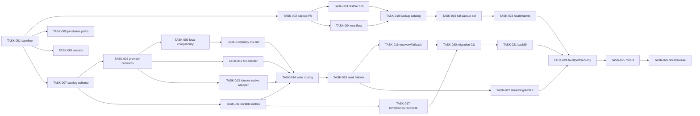

# Дорожная карта внедрения отказоустойчивого хранения PayPlanner

TASK-014/020/022, статус очереди известных загрузок дела, 30 сентября: добавлены waiting/retrying/failed по долговечной publication queue, обязательная регистрация worker и фактические flags для обещания автоматического завершения; wrong key/generation не подтверждают назначение. Metadata read ограничен 50 keys, provider I/O и повторный POST отсутствуют. Для terminal queue, прочитанной после старого commit, выполняется одно bounded refresh перед receipt check: PostgreSQL worker публикует между чтениями, ответ подтверждает свежий документ без дубликатов. Pending batch — три metadata query, готовый receipt — прежние три; refresh race с receipt — пять. Первые адресные 55/55 и расширенные 443/443 прошли до refresh; первый refresh repeat 17/18 отказал только на unassigned notification recipient fixture. Назначен synthetic получатель с реальными правами, строгое ожидание +1 notification сохранено. Финальная сборка API/tests без ошибок/предупреждений, окончательные 444/444 без пропусков за 8 мин 23 с, 18 новых queue-status cases; .codex-build/case-queue-20260930/case-queue-status-expanded-final.trx. Frontend API/attempt registry/обе карточки дела 320/320, tsc/eslint, encoding2515 и diff-check прошли. Первый Vitest запуск не смог запустить workers во время тяжёлой компиляции; отдельный повтор прошёл без изменения проверок. Исходные отчёты с отказами сохранены. Локальная версия 1.14.47; schema/default flags не менялись. Далее discovery/polling/failure UI, operator backlog/deadLetter/retry и остальные writers; полный release gate и production/manual acceptance открыты. Хранение 8/26 (31%), messenger 30/31 (97%); без commit/push/VPS/YouGile.

TASK-014/020/022, долговечная очередь публикации документов дела, 30 сентября: локально квалифицирован consumer за отдельным выключенным по умолчанию AutoCaseDocumentPublicationEnabled. Producer сохраняет operation атомарно с commit; bounded scheduler подхватывает старые pending intents и исключает task-file case copies. Общий worker использует fenced lease; обязательные копии, исходные параметры, текущие права автора и flag/lease проверяются перед публикацией и перед domain commit. Условное settlement не меняет чужую lease, receipt восстанавливает lost commit ACK без повторной записи и проверяет исходные имя/время автора. Сборка API/tests без ошибок/предупреждений; адресный набор 46/46, расширенный 823/824 без пропусков (16/16 новых queue cases, включая concurrent PostgreSQL backfill). Единственный отказ — timeout загрузки браузерной страницы modern/replay до file POST; отдельный повтор всех пяти сценариев этого метода 5/5. Исходные TRX сохранены в .codex-build/case-queue-20260930/; это не единый зелёный полный release gate. Локальная 1.14.47 подготовлена, schema/default flags не изменены. Далее queue-aware status, discovery/polling/failure UI, operator retry/backlog и остальные writers; реальная browser/VPS приёмка и полный gate открыты. Общий прогресс хранения 8/26 (31%), messenger 30/31 (97%); без commit/push/VPS/YouGile.

Подпункт TASK-014/020/022, общие записи публикации документа, 30 сентября: выбор получателей вынесен в `CaseNotificationRecipients`, уведомления документа — в `CaseDocumentNotificationService`, история/audit и managed upload persist — в `CaseDocumentPublicationRecords`. HTTP writer подключён к общей записи с явными actor/local clock и transaction guard; формат истории/audit и оба прежних пути уведомлений сохранены. Вызов без HTTP-контекста проверяет исходное имя автора (при другом текущем имени), переданное местное время, свежую историю и реальный notification module; ранний отказ без транзакции/при несовпадении дела не пишет документы/audit/уведомления. Первый build отказал на копировании DLL при временно полном C:, место восстановилось без удаления кода/БД/отчётов. Повторная полная компиляция API без shared compiler прошла; fixture configuration access исправлен после CS0122, итоговая сборка API/tests без ошибок/предупреждений. Адресная квалификация **34/34 за 1 мин 3 с**, расширенная регрессия всех CasesV2/managed uploads/deadline reminders/audit **364/364 без пропусков за 6 мин 29 с**, включая owned PostgreSQL/SQLite, прежние rollback/lost-ACK/context cases и actual HTTP. TRX `.codex-build/case-publication-20260930/`; schema/API/frontend/default flags не менялись. Это предпосылка consumer, не полный release gate: существующая немедленная SignalR/Web Push доставка до внешнего commit отдельно записана как открытый риск. Далее controlled live rollback/commit/lost-ACK и долговечная post-commit доставка, затем automatic case consumer/queue/lease/copy gate без повторного File, discovery и остальные writers. Общий прогресс **8/26 (31%)**, messenger **30/31 (97%)**; без commit/push/VPS/YouGile.

Подпункт TASK-014/020/022, подготовка автоматической публикации документов дела, 30 сентября: общий transaction/tracking boundary вынесен из HTTP-контроллера в `CaseDocumentAtomicSave`; прежние upload/version/template/work-order writers делегируют ему. Сохранены scalar/original values, pending insert/update, temporary keys и выборочное отсоединение неудавшегося графа; потерянный commit ACK не приводит к удалению файла. Две начальные попытки сборки выявили отсутствующий импорт `CascadeTiming` (первая правка не совпала с LF); импорт восстановлен с проверкой, финальная полная пересборка прошла без ошибок/предупреждений. Адресная UOW/managed upload/status/HTTP/audit регрессия **125/127**, два отказа только на `DROP DATABASE` при очистке owned PostgreSQL; во время прогона наблюдалось ожидание `ProcSignalBarrier`. Повтор всех двух затронутых методов — **26/26 без пропусков**, 6 мин 33 с. Два остатка точно сопоставлены с GUID текущего TRX, проверены на ноль подключений и удалены без FORCE. Отчёты `.codex-build/case-publication-20260930/`; encoding **2503**, diff-check прошли. Это квалифицированная техническая предпосылка, не новый полный release gate и не реализация фонового case consumer. Общий domain publisher истории/audit/уведомлений, durable queue/lease/rights/copy gate без повторного browser File, discovery и остальные writers остаются открытыми. Общий прогресс **8/26 (31%)**, messenger **30/31 (97%)**; без commit/push/VPS/YouGile.

Bounded reconciliation checkpoint `[x]`, 29 сентября: поток идентификаторов в приватные DeleteOnClose spools, страницы объектов/поколений 100 и копий 200, пакетные binding-conditional UPDATE, одна агрегированная история repair и выборка delete keys на порцию. Подробные issues ограничены 1000, общие counters/kind totals не обрезаются; scanId связывает временные файлы с конкретным запуском. Обнаруживаются изменения объектов/поколений/состава и маршрутизации копий; current generation/replica absence и live+tombstone conflict больше не выглядят здоровыми. Первичные 58/58 (2 мин 46 с): 1201 replicas, 104 objects/205 versions, exact one HEAD, 7 healthy UPDATE вместо 1201, 6 repair history batches, truncation/full totals, status/locator/generation/additions. Расширенные 466/467 (5 мин 4 с), единственная ошибка — ожидание отсутствия штатного ObjectAuditEvent при сохранении клиента; product изменять не потребовалось. После исправления прошли **81/81 за 1 мин 58 с**, `storage-paging-final-20260929.trx`, including archive/managed restore/health и current paging cases; после test-only усиления cleanup и устранения xUnit warning прошли **5/5 за 18 с**, `storage-paging-cleanup-final-20260929.trx`. Within-batch mutation не перезаписывает concurrent status/error/time; следующая проверка назначает ремонт. Tracking bounded и unrelated client/audit сохранены. Cleanup квалифицирован до/после физического создания targets spool. Actual owned PostgreSQL migrations/grouped history executed (34,14 с в расширении); legacy local/S3/PG repair и PG restore regression также исполнялись. Encoding2440/JSON1038/scoped diff прошли; combined 1.14.38 extended. No commit/push/VPS/YouGile. Ни full TASK-016, ни native Yandex/UNKNOWN, Linux permissions/retained cleanup/global failback/release/rollout не закрыты; **8/26 (31%)**. Нижние checkpoint — история предыдущих шагов.

Long-operation lease checkpoint, 29 сентября: fresh per-execution owner + claim immediately before execution, no preclaimed batch aging. Independent context-factory heartbeat extends only matching unexpired running owner/object/generation/type/provider/connection, bounds renewal command/factory wait, cancels I/O on loss/failure and stops before terminal metadata. Terminal physical-operation receipts/failure/unknown/retention deferral use short lease-row locks; stale tracked modifications cannot leak into unrelated SaveChanges. Late retry/result time is current, not operation start. Metadata-only publication keeps its own intent/lease checks. Initial 78/78, expanded **341/341 без пропусков за 2 мин 33 с** (`storage-lease-final-20260929.trx`), then test-only ordinary DI factory qualification **17/17 за 1 мин 16 с** (`storage-lease-di-qualified-20260929.trx`). Actual SQLite and PostgreSQL long transfer outlived original lease with competing worker and exact single target PUT per job; disposable PostgreSQL migrations ran. Factory fault/deadline, identity/terminal/expired, stop/dispose/user cancellation, blocked I/O and late stale metadata cases passed. Encoding2439/JSON1038/diff passed, combined 1.14.38 extended. No schema/API changes, no commit/push/VPS/YouGile. This lease prerequisite locally closed; whole TASK-016, bounded scan/global failback, native Yandex/UNKNOWN, Linux/retained debt/full gate/rollout remain open. **8/26 (31%)**.

Legacy corrupt repair checkpoint, 29 сентября: старые pending/failed/unknown задания с original target теперь после доказанного повреждения и полной проверки источника сохраняют отдельный deterministic repair plan в короткой transaction до PUT. Object/generation/source/original/lease locks + fresh authority; original bytes, operation ID/key/CreatedAt/attempt history preserved. Tracker baseline refresh after durable plan, orphan detach on rollback, durable plan readback after lost commit ACK, no blind overwrite or automatic DeadLetter reopen. Final **222/222 без пропусков за 2 мин 31 с**, `legacy-repair-upgrade-final-20260929.trx`, включая actual PostgreSQL legacy two-cycle/race 19,80/17,34 с и actual local/AWS wire legacy 23,22/62,59 с. Initial 64/67 exposed fixture retry limit; 73/77 exposed wrong synthetic legacy key, both corrected without weakening product guards. Encoding2437/JSON1038/scoped diff-check passed. No new migration, no commit/push/VPS/YouGile; combined 1.14.38 draft extended. Old repair upgrade locally closed; TASK-016 whole still open for native Yandex/UNKNOWN, Linux, long-file lease, retained damage cleanup, bounded scan/global failback/full gate/rollout. **8/26 (31%)**. Older checkpoint below are historical results, not current missing-work claims.

Connected-locator authority checkpoint, 29 сентября: worker/scanner/managed reader/backup теперь проверяют фактическую locator connection против зарегистрированной ConnectionId до remote I/O, repair source повторно после чтения. Native S3/Yandex parser uniform; opaque/local unchanged. Target mismatch подавляет repair/replicate/verify/delete, scanner сохраняет прежнюю metadata state и issue, reader quarantines mismatch/falls back, backup rejects null/empty/wrong connection without read/verified copy. 19/19 initial, затем 23/24 выявили реальное изменение configured reader order на alphabetical. Policy evaluator теперь сохраняет нормализованный заданный write/read порядок после capability/registration filtering, с dictionary lookup (без N²); display decisions остаются sorted. 28/28 targeted; final **208/208 без пропусков за 2 мин 32 с**, `storage-connection-order-final-20260929.trx`, включая actual PostgreSQL и real local/AWS loopback wire. Encoding2437/JSON1038/scoped diff-check passed; combined 1.14.38 дополнена. No new migration/public DTO change; no commit/push/VPS/YouGile. Connection-correspondence подпункт closed locally, whole TASK-016 remains open: old repair upgrade, native Yandex wire/UNKNOWN, Linux/long-file lease, retained debt cleanup/bounded scan/global failback/full gate/rollout. **8/26 (31%)**.

Isolated corrupt replacement checkpoint, 29 сентября: для новых repair implemented provider-owned deterministic recovery locator + durable `repairPending`; повреждённый оригинал не перезаписывается, после проверенного receipt остаётся `retainedCorrupt` issue, не считается рабочей копией и не запускает бесконечный repair. Short metadata transaction locks object/generation/replicas/lease; SaveChanges/commit failures rollback publication, lost commit ACK reconciles durable receipt without duplicate PUT or stale tracked SaveChanges. Receipt не требует источника после успешной записи; новый PUT требует verified source. Targeted **14/14**, final related regression **150/150 без пропусков за 1 мин 14 с**, `isolated-corrupt-repair-final-20260929.trx`. Four actual PostgreSQL migration/two-cycle/race cases реально выполнены; real local files/AWS SDK loopback S3 wire/read replacement проверены. Source exclusion в wire — catalog-only, физическая потеря source проверена отдельно processor-тестом. Encoding2436/JSON1038/diff passed, общая 1.14.38 дополнена. No new schema migration, no commit/push/VPS/YouGile. TASK-016 open: old corrupt repair payload upgrade, ConnectionId/connected-locator correspondence, native Yandex/UNKNOWN, Linux permissions, long-file lease renewal, retained damage cleanup, bounded catalog scan, global failback/full release/rollout. **8/26 (31%)**. Нижние checkpoint — история до нового пути, не текущая оценка его наличия.

Repair source/authority gate, 29 сентября: verified bounded-memory DeleteOnClose spool доказывает исходные size/SHA до PUT, точная live operation/payload/generation/source/target/lease/tombstone authority повторно проверяется после чтения. Unverifiable target suppresses writing; неправильный ACK locator/size/hash не означает success и не требует второго PUT после подтверждающего HEAD. Потерянная lease/target tracker snapshot не портятся поздним SaveChanges. Source/temp cleanup/non-seeking/cancellation квалифицированы. Unix 0600 задан при создании; Linux permission branch ещё входит в final qualification. Baseline 8 failed/1 passed, далее 16/16,66/66,69/69, финал **71/71 без пропусков за 40 с**, `repair-source-authority-final-20260929.trx`; actual PostgreSQL cases 29,63/10,41 с, с owned migrations и двумя real repairs. 17 negative/boundary scenarios; промежуточная expression-tree compile ошибка исправлена до финального запуска. No schema/API contract change; JSON1038/encoding2435/diff passed, общая 1.14.38 дополнена. Prerequisite локально verified, **Overwrite:false не изменён, safe existing-corrupt replacement ещё открыт**. Native providers/UNKNOWN/atomic or non-destructive replacement, large-catalog batching, global failback/full release/rollout остаются, **8/26 (31%)**. Commit/push/VPS/YouGile не менялись.

Repeated missing-copy recovery, 29 сентября: детерминированные циклы по aggregate завершённой истории снимают вечный запрет после первого succeeded repair, не переоткрывая старые операции или dead-letter. Дедупликация concurrent SaveChanges проверяет точную собственную запись и сохраняет несвязанные tracked changes. Baseline 1 failure/5 passed, затем 21/21 и итоговый **54/54 за 40 с**, `storage-repair-cycles-qualified-20260929.trx`, включая actual PostgreSQL 30,55/10,10 с с миграциями owned DB, двумя реальными repair/byte verification и unique-race recovery. No migrations/model changes; encoding2435/JSON1038/diff passed, общая 1.14.38 дополнена. Scope локально закрытого подпункта — повторная пропажа копии. Новый риск TASK-016: существующая повреждённая копия получает Conflict из-за Overwrite:false; безопасная замена/исходные байты/tombstone/UNKNOWN ещё не реализованы. Полный каталог/per-target query batching/global failback/full release/rollout остаются открыты, **8/26 (31%)**; commit/push/VPS/YouGile не менялись. Нижние checkpoint сохраняют историю до этого исправления.

Reconciliation evidence gate, 29 сентября: устранена ложная классификация недоступного/неопределённого HEAD как повреждения. `verificationUnavailable` сохраняет прежний replica state/error/verified time и не назначает repair; подтверждённые size/SHA mismatch и NotFound сохраняют repair semantics. Без SHA при неверном размере повреждение всё ещё подтверждено. Корректный baseline воспроизвёл 8 failures/4 successes; после исправления и двух дополнительных size-boundary cases прошли **45/45 за 12 с**, `storage-reconcile-evidence-qualified-20260929.trx`. Per-generation repair-target list устраняет повторный scan всего issues; JSON/encoding2434/diff passed, общая 1.14.38 дополнена. Новые открытые риски TASK-016: старый succeeded repair key запрещает новый ремонт того же target; весь каталог ещё загружается сразу с per-target operation lookup. Нужны повторные циклы без дублей/с сохранением dead-letter и bounded scanning. Unverified issues не означают zero debt/failback readiness. Миграций нет; итоговый release gate/rollout и **8/26 (31%)** остаются открыты.

Browser live qualification, 29 сентября: итоговый **8/8 без пропусков за 2 мин 25 с**, `upload-live-qualified-20260929.trx`. Обе карточки получают actual WebSocket notification при закрытой карточке без reload, открывают точную задачу, отмечают уведомление прочитанным и скачивают исходные байты без нового POST. Test-only loopback gateway проксирует API в обычный synthetic backend, проверяет его JWT и текущую запись сотрудника production transformer, использует реальные hubs/scoped publisher; anonymous/invalid JWT получают 401. Browser queue consumer пока manual, настоящий hosted worker доказан отдельно тремя cases того же набора. Также прошли три ordinary-runtime/working-upload cases; ошибок/внешних запросов нет, Email/BackgroundServices/DB email=false. Первичный legacy Vite navigation timeout до входа не принят как успех: отдельный повтор прошёл, после auth-уточнения весь набор зелёный без изменения таймаутов. Encoding 2434, node syntax/scoped diff-check прошли. UI live subitem закрыт локально; единый production startup/full release/rollout и parent milestones открыты, **8/26 (31%)**. Изменения только test/docs, без новой release entry/commit/push/VPS/YouGile. Ниже — история предыдущих checkpoint, не актуальное доказательство отсутствия UI live.

Hosted live backend qualification, 29 сентября: **312/312 за 51 с без пропусков**. Реальный StorageOperationWorker, scoped NotificationService/SignalR publisher и NotificationsHub на synthetic loopback Kestrel доставляют success/failure через настоящий WebSocket без status/inbox polling. Три live cases также проверяют type suppression, второго authenticated actor без чужого события, отказ unauthenticated connect, exact upload key/result, persisted unread ID, terminal outbox и отсутствие дублей/replay. Worker scopes действительно вызывают production processor; наблюдатель лишь останавливает owned worker после подтверждённого завершения. Email/общие background/DB email false, запрещающие sender proxy, локальные providers, отдельная synthetic DB и отсутствие host errors подтверждены. Scoped publisher соответствует Program. Это не UI/обычный JWT/CORS и не полный production startup: тестовый auth ограничен двумя synthetic actors. Серверный подэтап закрыт локально; browser popup/navigation при закрытой карточке обеих версий, общий release gate и rollout открыты. Производственный код/миграции в этом шаге не менялись, поэтому новой пользовательской release entry не требуется; overall **8/26 (31%)**.

Discovery performance qualification, 29 сентября: **136/136 за 1 мин 30 с без пропусков** после финальной сборки. PostgreSQL partial commit-key prefix index отдельно мигрируется без изменения данных; SQLite не меняется. Actual EXPLAIN на 20 000 посторонних operations + 20 000 objects подтверждает indexed page и indexed exact-key queue batch без полного обхода больших таблиц. Первый индексный прогон **23/24** выявил сохранявшийся correlated queue scan — заменён bounded batch. Terminal receipt, изменившийся между чтениями, перечитывается по точным ID; текущий доменный файл важнее stale queue failure. Wrong key/object/generation и два deterministic race cases, clean/upgrade, ACL и processor regression квалифицированы. Промежуточный race-набор **23/24** не принят как готовность; после пересборки прошли 2/2 и итоговый 136/136. EF snapshots consistent, encoding 2433, JSON 1038, scoped diff пройдены. Release note/runbook дополнены; production/YouGile/commit/push не изменялись. Query-plan subitem закрыт локально; live delivery/full release/rollout открыты, overall **8/26 (31%)**.

Cursor discovery checkpoint, 29 сентября: повреждённая исходная порция больше не обрывает список ожидающих загрузок. Ограниченная raw-порция 51 даёт next cursor; pivot проверяется в actor/task scope до pending-фильтра, опубликованная опора и concurrent новые записи не сдвигают старые страницы. Общий panel обеих карточек сбрасывает курсор при refresh/revision/task и отвергает late aborted response; poll остаётся адресным batch. 19 выполненных SQLite/status проверок, **1/1 actual PostgreSQL HTTP за 1 мин 23 с** на отдельной owned БД и **443/443 frontend за 158,88 с** прошли. Первоначальный PostgreSQL green был ранним выходом без env, не принят как доказательство; повтор использовал проверенные loopback-настройки и штатно удалил только свою БД. Eslint/tsc/encoding 2431/scoped diff/JSON 1038/build 6,90 с пройдены; общая release entry дополнена. Corrupt/concurrent pagination закрыта локально, query plans/live delivery/full release/rollout остаются открытыми; overall **8/26 (31%)**.

Final copy checkpoint, 29 сентября: eslint/tsc/encoding 2431/node/scoped diff-check и повторный build **6,57 с** прошли после уточнения сообщения без изменения поведения. Status-save failure **341/341 + browser 2/2** квалифицирован локально; overall **8/26 (31%)**, live delivery/pagination/query plans/full release/rollout остаются открытыми.

- Status-save failure qualification, 29 сентября: падающие тесты обеих карточек подтвердили потерю диалога после поглощённого API failure. Родительские save callbacks возвращают явный success; отказ API/валидации не очищает result/files. WeakMap published receipt повторно проверяется по live файлам и правам, missing/foreign/403 fail closed без POST; несколько опубликованных completion файлов разделяют один свежий files GET. **341/341** полная регрессия затронутого журнала/handler/panel за **164,75 с** без пропусков; **2/2** actual browser/HTTP/S3/manual queue за **1 мин 59 с**: controlled первый PATCH 503 оставляет dialog/input, повторный PATCH сохраняет done/исходный result, multipart один, download byte-exact, no outside/console/backend errors. Eslint/tsc/encoding 2431/node/diff/build 8,60 с пройдены; последний copy fix убирает предложение перезагрузки с несохранённым результатом. Нет migrations/production mutations; local Email/background/DB-email disabled, новые owned roots очищены. Общая release entry дополнена. Live SignalR/browser onApproval/corrupt pagination/query plans/full release/rollout остаются открытыми; **8/26 (31%)**.

- Финальная адресная квалификация creation/completion, 29 сентября: **34/34** handler/panel + **7/7** targeted component checks, eslint/tsc, build **6,68 с** прошли. Предыдущие HTTP/S3/replay/completion **5/5** сохраняются; новые реальные creation сценарии сначала выявили неточный подсчёт system history в fixture (общий прогон 5 passed/2 failed). После разделения comment/system и проверки единственного file history исправленные creation **2/2 за 1 мин 54 с** без пропусков: один UI-created task, initial comment, ожидающий файл, две независимые копии, одна пара domain documents, byte-exact download, no outside/console/backend errors. Проверки только synthetic DB/loopback providers, no hosted services/email; shared handler сохраняет обычный retry неподтверждённого upload. Live SignalR/browser onApproval/query plans/corrupt pagination/full release/rollout не квалифицированы. В активном индексе добавлен следующий риск: поглощённая ошибка самого status-save может очищать результатный диалог; отдельный regression/fix ещё открыт. Общий прогресс **8/26 (31%)**.

- Создание/завершение pending task-file, 29 сентября: исправлен повторный multipart при ошибке чтения состояния уже принятого файла. Подтверждённое ожидание требует проверяемого receipt либо явного manualRetry, а неподтверждённый первичный HTTP сбой сохраняет обычный повтор. Обработчик/panel **32/32**, адресные creation/completion/approval проверки обеих карточек **7/7**, eslint/tsc/encoding 2431/node/diff прошли. Реальные synthetic HTTP/S3/browser сценарии completion и прежнего missed replay прошли **5/5 без пропусков за 3 мин 39 с**: до queue нет done/result, после queue одна пара документов и сохранённый result/done, POST один даже при недоступном GET status. Отдельный реальный browser creation добавлен и проверяется; подблок, parent TASK-014/020/022, live SignalR, общий release gate и rollout остаются открытыми. Email/background явно выключены, внешние обращения запрещены. **8/26 (31%)**.

Версия 1.1, 2026-09-22. Базовая ревизия: `main@09ae8b58e74787a20d7f7d2361331b83731ab8b4` (EVID-001). После этапа аудита выполнена локальная реализация; production rollout и приёмка реальных провайдеров остаются отдельными управляемыми этапами.

## 1. Статус и правило ведения

- Browser missed-result/replay qualification завершена локально, 29 сентября: saved TRX **6/6 за 2 мин 36 с без пропусков**, включая API-only queue и обе настоящие карточки, прежний ordinary runtime и lost-ACK. Закрытие штатной кнопкой, одна запись inbox/replayed toast, разрешённый task action после загрузки прав, PATCH read 200, byte-exact download, no repeat file POST/outside/error/double publication проверены. **71/71** UI/date/navigation + eslint/tsc/encoding 2431/node/diff и production build 8,15 с прошли. Пауза SignalR не эмулируется browser event injection: ручной producer использует NoOp realtime, actual inbox replay остаётся самостоятельным результатом, не live delivery. Product fixes — UTC parse и permissions-ready gating; stdin deadlock исправлен только в harness. Fresh owned roots очищены, три исторических temporary roots отмечены в индексном roadmap; активных synthetic API-процессов не найдено. Далее pending creation/completion, live SignalR и query/pagination qualification; full release gate/rollout/parent milestones ещё открыты. **8/26 (31%)**, production/commit/push/YouGile не менялись.

- Уточнение browser qualification, 29 сентября: actual inbox `taskId=1`, toast=true, но action fallback подтвердил race до загрузки прав. Existing `permissionsLoaded` управляет ready-gate подключения/replay, без ослабления server ACL. **71/71** component/date/navigation tests + eslint/tsc прошли. Modern UI завершил все функциональные assertions и выдал browser OK; timeout оказался stdin lifecycle тестового процесса. stdin закрывается с обеих сторон, прежний 90s deadline сохранён. Повторный 6-case HTTP/browser набор сейчас в работе, сохранённый TRX является доказательством его результата. Live SignalR/creation/completion/full release/rollout ещё не закрыты; encoding 2431/node/diff-check прошли, **8/26 (31%)**.

- В работе browser missed-result/replay, 29 сентября: реальный pending API intent, приватная координация child stdout/stdin и ручной consumer на owned DB без hosted jobs/debug endpoint/SignalR injection. Первый набор 1/3 выявил missed toast; отдельный unit-test воспроизвёл naive UTC → local offset потерю сообщения. Повторно используется существующий `parseInstant`, **57/57** component/date tests + targeted eslint/tsc прошли, combined 1.14.38 дополнена. Toast после исправления появился; переход/скачивание в browser и загрузка action handlers ещё квалифицируются. Parent scope не закрыт; **8/26 (31%)**, no production/push/YouGile.

- Финальная HTTP/S3 qualification, 29 сентября: **41/41 без пропусков за 1 мин 58 с**, включая новые known/unknown/negative/false-zero boundaries и empty-input checksum fix, actual HTTP/S3/manual queue/inbox/download/replay, прежний processor/S3 service и обе browser working-upload/lost-ACK карточки. Кодировка 2431/JSON 1038/node syntax/scoped diff-check пройдены; отдельная миграция не требуется, synthetic runtime создаёт clean SQLite через штатные миграции. Следующий browser closed-card missed-result/replay и live SignalR пока открыты. Нижний HTTP/S3 checkpoint — история промежуточных результатов, повторная проверка теперь завершена. No external buckets/credentials/mail/jobs; production/commit/push/YouGile не менялись. Parent milestones и полный release gate остаются открытыми: **8/26 (31%)**.

- HTTP/S3 wire qualification, 29 сентября: actual multipart pending POST → две независимые local/S3 пары → ручной штатный consumer → task/case publication → durable result → авторизованный notification inbox API → byte-exact download/replay прошли **2/2 за 32 с** на synthetic disposable SQLite и ограниченном loopback S3 endpoint с реальным AWS SDK. Исправлено скрытие известной длины hashing stream без полного memory buffer и без отключения checksum. Расширенно **38/39 за 1 мин 59 с**: пустой non-seekable input потребовал отдельного EOF-guard/Stream.Null пути; отрицательная длина и ложный ноль не отправляются. Повторная квалификация этих границ выполняется. NoOp realtime publisher в ручном harness означает, что live закрытая карточка/SignalR пока не доказаны; parent TASK-014/020/022, full release и rollout не закрыты. Email/background=false, no production providers/secrets, **8/26 (31%)**.

- Worker availability qualification, 29 сентября: воспроизведён и исправлен false waiting при отключённой обработке. Status reader проверяет live WorkerEnabled и immutable snapshot регистрации hosted worker, captured один раз с service descriptors в Program; отсутствие snapshot fail-closed как paused. Без новых SQL/network операций, без включения почты/фоновых служб, с сохранением uploaded/failure/manual-retry precedence. Адресно **19/19**, расширенно **104/104 за 1 мин 23 с** с actual PostgreSQL/ordinary HTTP; последние ordinary runtime и legacy/modern browser **3/3 за 1 мин 53 с**, panel **6/6**. Браузерный pending каталог синтетический, не заменяет real quorum/queue/result delivery proof. Encoding 2428, JSON 1038, node syntax/diff-check пройдены; общая release note 1.14.38 дополнена. Production/full release gate/commit/push/YouGile/VPS не менялись. Предыдущий checkpoint ниже сохраняет историю обнаружения риска, а не текущий нерешённый дефект. **8/26 (31%)**.

- Browser lost-ACK qualification, 29 сентября: новый owned ordinary runtime с реальным `Program`, synthetic SQLite и отключёнными email/background службами поддерживает настоящий браузерный интерфейс. Admin mode переключатель в БД квалифицирован для legacy/modern: обычная загрузка из view card, фактический server 201 с подменой браузерного ответа на 503, exact-key GET recovery, один POST/одна пара task/case файлов/одна publication operation, скачивание исходных байтов. Последняя редакция всей новой fixture-группы **3/3 за 1 мин 50 с**, без console/page/backend ошибок и outside requests; encoding 2427, node syntax/diff-check пройдены. Pending/quorum, creation/completion, actual queue result при закрытой карточке, reopen, corrupted pagination/query plan, full release gate/rollout ещё открыты. Выявлен отдельный риск ложного waiting при отключённом WorkerEnabled/BackgroundServices: status reader пока не учитывает доступность consumer; требуется тест и исправление без ослабления local mail/job safety. **8/26 (31%)**. VPS/YouGile/commit/push не менялись.

- Последняя notification редакция 29 сентября: стандартные каналы существующего типа проверены **15/15** адресно без ошибок/пропусков за 11 с. После расширенного **145/145** менялись только pause guard и наследование channels, оба проверены адресно; повтор полного release gate всех dirty изменений ещё впереди. Всё локально, без YouGile/commit/push/VPS. **8/26 (31%)**, browser/live acceptance и rollout открыты.

- Итог notification qualification, 29 сентября: **145/145** расширенно с actual PostgreSQL, затем **15/15** адресно с guard pause во время receipt; rollback/lost commit ACK/invalid source-generation/lease/preferences/realtime ACK покрыты. После зелёного прогона убрано переопределение Channels: authoritative остаются существующие тип/роль/личные настройки; адресный повтор этой редакции выполняется. **47/47** toast и **2/2** legacy/modern refresh без конкурирующего локального toast, eslint/tsc, кодировка2424 и production build24,15 с пройдены. Собственные PGDB/папки0/0. Всё локально; full release gate, real-browser delivery и rollout открыты, **8/26 (31%)**.

- 29 сентября, durable result notification: существующая очередь получает отдельную работу атомарно с terminal publication CAS; consumer использует прежний NotificationService с уникальным EventKey и актуальной проверкой доступа. Pending/disabled не считаются успехом, ручной успешный retry после DeadLetter учитывается по проверенному receipt, утраченный доступ/удалённый бывший success не раскрывают сведения. Dispatch metadata jobs не загружает replica graph; тип включён в claim CAS. Первичные 8/8 и расширенные 125/125 (включая actual PostgreSQL center/preferences), 47 toast проверок пройдены. Дополнительная квалификация rollback/lost completion ACK/lease и final dispatch revision выполняется. Новая схема/production flags не менялись; **8/26 (31%)** и rollout открыты.

- Итог receipt checkpoint 29 сентября: **128/128** без ошибок/пропусков за 1 мин 21 с, включая actual PostgreSQL revoked-after-success, очередь, права и HTTP upload. Новый regression red 0/3 сменился green; восемь повреждённых receipts и pending без записи проверены. FK fixture исправлен настоящим actor с существующей ролью, не отключением ограничений. Production build прошёл 25,14 с. Это также закрывает неопределённый результат прежнего клиентского build, но не full release gate/production rollout; общий прогресс **8/26 (31%)**.

- 29 сентября, очередь после успешной публикации: revoked-after-success воспроизведён 0/3 до исправления. Worker теперь отдельно проверяет read-only receipt точного committed файла и его case pair/bindings/generation/owner/SHA, не предоставляя отключённому actor право Resume или нового прикрепления. Lease CAS сохранён; pending receipt ничего не пишет. Проверяются lost ACK, повреждённые связи и actual PostgreSQL. Итоговый прогон ещё выполняется; **8/26 (31%)** без закрытия parent задач и без rollout.

- Checkpoint 29 сентября, upload recovery во всех пользовательских путях: общий helper проверяет точный ключ после 500/503, не обходит 400/401/403/409, подтверждает published ID в текущем списке файлов. Accepted pending при создании оставляет карточку открытой, при завершении/согласовании блокирует действие до прикрепления выбранного результата. Повтор читает состояние до multipart и не пересылает уже принятую загрузку. Полные четыре клиентских модуля 447/447; последняя revision-привязка legacy/modern окна 22/22 адресно, eslint/tsc пройдены. Build проверяется отдельно; закрытая карточка/постоянное уведомление, browser/visual и discovery query-plan ещё открыты. Общий прогресс остаётся **8/26 (31%)**.

- UI checkpoint 29 сентября: общий panel ожидания подключён в legacy/modern карточках. Discovery читает pending страницы по 50, затем poll обращается одним batch только к известным активным keys. Точная публикация обновляет файлы/историю и вызывает локальное сообщение; отсутствие metadata не выдаётся за успех, abort/отзыв доступа очищают имена. 14/14 серверных и 11/11 адресных клиентских проверок, eslint/tsc и кодировка прошли. Пользовательский сценарий остаётся в работе: отдельные upload пути создания/завершения, постоянное уведомление при закрытой карточке, визуальный контроль и query-plan discovery ещё открыты. Не закрывать TASK-014/020/022: **8/26 (31%)**.

- Checkpoint server upload status, 29 сентября: read-only endpoint и клиентский abortable/no-store метод квалифицированы локально. 99/99 расширенно, затем 13/13 последней редакции (SQLite metadata/ACL и actual PostgreSQL HTTP); клиентский API-набор 132/132, eslint/tsc и кодировка пройдены. В ответе только собственные actor/task intents, канонический ключ, проверенные owner/generation и доменный file ID, без внутренних ошибок/путей. Перед UI ещё нужны безопасное наблюдение/уведомление, обработка длинной истории и PostgreSQL query-plan qualification. Это не закрытие TASK-014/020/022, full release gate и rollout не выполнены; прогресс **8/26 (31%)**.

- Последняя проверка queue finalization, 29 сентября: 147/147 без пропусков за 2 мин 26 с после исправления case-insensitive подсчёта готовых копий. Набор включает core/worker/resolver, реальные конкурирующие PostgreSQL claims и регрессию фото/привязок/чтения. Предыдущий checkpoint ниже описывает промежуточное состояние до этого повторного прогона. Серверные подпункты очереди квалифицированы локально; клиентский статус/уведомления, полный release gate и rollout не завершены. Общий прогресс остаётся **8/26 (31%)**.

- Checkpoint 29 сентября, queue finalization: добавлены отдельный default-off flag, атомарная publication operation в task-file catalog commit, bounded repair старых назначений, metadata quorum preflight, lease-aware ResumeAsync с актуальным resolver и защищённое завершение собственной lease. Первые адресные/расширенные прогоны 68/68 и 263/263 (1 мин 50 с) прошли. Дополнительный mixed-case provider тест воспроизвёл вечный pending; core replay изменён на case-insensitive distinct подсчёт, последний повтор выполняется. Доменная идемпотентность, lost commit ACK, crash before case registration, old scheduling gap, disabled mode, invalid payload, stale rights/task/case и два фактически пересекающихся PostgreSQL claimant проверяются вместе. Уведомления/клиентский статус/финальный release gate ещё открыты; TASK-014/020/022 не закрыты, прогресс **8/26 (31%)**, production и YouGile не изменены.

- Checkpoint 29 сентября, общий resolver публикации: `TaskFilePublicationAuthorizationService` и общий predicate сотрудничества подключены к повторной проверке HTTP managed upload; живые роль/permission/видимость и approval не берутся из intent или старых claims. Пройдены 45/45 адресных и **222/222 расширенных теста без пропусков за 2 мин 36 с**, включая actual PostgreSQL concurrent ResumeAsync с реальным resolver, запрет после role downgrade/unapproval и recoverable soft-deleted task. Кодировка 2418 файлов пройдена. Часть предыдущего checkpoint о ещё отсутствующем resolver закрыта; durable queue/reconciliation/уведомления остаются открытыми. Общий прогресс **8/26 (31%)**, production и YouGile не изменены, full release gate не выполнен.

- Checkpoint 29 сентября, незавершённые task uploads: подготовлен `ResumeAsync` из durable intent/проверенной копии без браузерного File с обязательной актуальной авторизацией до чтения и под task lock. Первый адресный прогон 26/26, кодировка 2416 файлов пройдена. Расширенный PostgreSQL/regression прогон: 77/78, один сбой прежнего conflicting same-key HTTP сценария — победитель успевал передать owner до core replay проигравшего, а несовпадающий intent приводил к exception вместо 409. Добавлены узкая обработка подтверждённого несовпадения и детерминированный тест winner-before-replay для одинаковых/разных байтов, без ослабления assertions. Повторный расширенный прогон прошёл **80/80 без пропусков за 1 мин 39 с**; SQLite/actual PostgreSQL resume, duplicate prevention, permission callbacks, invalid/stale intent и core/worker/HTTP regression квалифицированы локально. Release JSON 1038 записей проверен. Queued finalization/reconciliation, общий resolver прав и уведомление о результате ещё не реализованы; TASK-014/020/022 не закрыты, production не изменён. Подробности в текущем блоке активного индекса.

- Прогресс реализации: **8/26 задач (31%)**, как в активном индексе `docs/storage-resilience-roadmap-2026-09-22.md`. Завершены TASK-007..013 и TASK-017; TASK-020 остаётся в работе: CLI catalog, copy/verify и EndId scope уже локально квалифицированы, но tenant scope, capacity и подтверждение полного переноса ещё открыты. 16 задач в работе; TASK-021/025 требуют отдельной production-приёмки. Production и реальные provider accounts не изменялись.
- Статусы: `[ ]` не начато, `[~]` в работе, `[x]` реализовано и проверено, `[!]` заблокировано, `[decision]` требуется бизнес-решение, `[acceptance]` требуется приёмка на реальной среде.
- Нельзя отмечать задачу `[x]`, пока не выполнены её тесты, проверка миграций/кодировки и указанный gate.
- После каждого рабочего сеанса обновлять статус, evidence, фактические команды, отклонения и `Checkpoint` в конце файла. Не удалять старые ID или результаты.
- Любое включение production-функции выполняется отдельным подтверждённым change window. Этот документ сам по себе не разрешает deployment или доступ к production.

## 2. Целевые этапы

| Этап | Результат | Задачи | Gate выхода |
|---|---|---|---|
| STG-00 | Воспроизводимый baseline и зафиксированные решения | TASK-001 | Все текущие контракты охарактеризованы; владельцы UNKNOWN назначены |
| STG-01 | Восстановление и резервирование перестают быть недоказанными | TASK-002..004 | Успешный disposable restore; безопасная retention; manifest |
| STG-02 | Персистентные пути и секреты безопасны | TASK-005..006 | Deploy не удаляет bytes; новые секреты не сохраняются открыто |
| STG-03 | Каталог объектов и provider abstraction | TASK-007..010 | Additive schema, legacy compatibility, policy dry-run |
| STG-04 | Надёжная запись, чтение и failover | TASK-011..017 | Durable operations, UNKNOWN semantics, repair/delete/failback |
| STG-05 | Полный backup set и restore DB+files+keys | TASK-018..019 | Две независимые проверенные копии и полный restore drill |
| STG-06 | Миграция существующих данных | TASK-020..021 | Dry-run, resume, reconcile; 100% catalog coverage |
| STG-07 | Потоковая передача и совместимый UX/API | TASK-022 | Нет больших MemoryStream; legacy/native UX сохранён |
| STG-08 | Наблюдаемость, тесты и управляемое включение | TASK-023..025 | Fault/security/perf gates и поэтапный rollout |
| STG-09 | Документация и выпуск | TASK-026 | Runbooks, «Что нового», acceptance, rollback pack |

## 3. Карточки задач

### TASK-001 — Зафиксировать baseline и решения

- **Статус/приоритет:** `[ ]`, P0. **Связи:** REQ-001,016,018,020; RISK-020,021,024,027; DEC-001..012. **Зависимости:** нет.
- **Результат:** characterization tests описывают фактические local/S3/Yandex/backup/API контракты; владельцы отвечают на UNKNOWN из `STORAGE_AUDIT.md`.
- **Точки кода:** `backend/Services/Storage/*`, `backend/Services/DatabaseBackupService.cs`, `backend/Controllers/TasksController.cs`, `backend/Controllers/V2/CasesV2Controller.cs`, `backend/PayPlanner.Api.Tests/*`, `src/components/S3Storage/*`, `src/components/YandexDisk/*`.
- **Действия/контракты:** закрепить URL, permission, delete, filename, range, OAuth, CRM sync и retry semantics; утвердить RPO/RTO, required copy count, data classes, provider independence, legal retention и допустимый bounded staging.
- **Данные/config:** изменений нет; решения записать как DEC с владельцем/датой. Секреты не копировать в fixtures/logs.
- **Проверка:** текущие targeted tests TEST-001; добавить characterization tests для всех существующих endpoints и legacy rows. Команды: filtered `dotnet test`, релевантные `vitest`, `npm run lint`, `npx tsc --noEmit`.
- **Готово:** baseline green; нет неявного изменения native S3/Yandex и legacy URL; все blocking UNKNOWN имеют owner/date.
- **Стоп/откат/output:** при расхождении кода и документации останавливается проектирование конкретного контракта; код не менять. Output: signed decision log и test inventory.

### TASK-002 — Закрыть P0 резервного копирования

- **Статус/приоритет:** `[~]`, P0, локальная часть реализована; production qualification требует отдельного разрешения. **Связи:** REQ-008,011,016; RISK-002,003,019,026; EVID-081..092,123,124. **Зависимости:** TASK-001.
- **Результат:** scheduler не падает из-за одного недоступного каталога; cleanup не удаляет последнюю пригодную копию; S3 destination либо подтверждён, либо явно `DEGRADED/FAILED`.
- **Точки кода:** `DatabaseBackupService.cs`, `DatabaseBackupSchedulerService.cs`, `DatabaseAdminController.cs`, backup tests; внешне — permissions/quotas/account state.
- **Действия:** preflight write/rename/delete; per-destination error isolation; retention только после verified copy policy; manual retry idempotent; alert с BackupId/destination без секрета.
- **Данные/config:** существующий SystemSettings читается обратно совместимо; новые status fields additive. Внешний владелец проверяет каталог и HostKey `UserSuspended` отдельным change ticket.
- **Проверка:** TEST-110,115; permission denied, disk full, suspended provider, timeout, partial upload, concurrent scheduler, cleanup boundary. Disposable paths only.
- **Готово:** scheduler продолжает работу после isolated failure; последняя verified копия защищена; инциденты имеют фактический статус.
- **Стоп/откат/output:** не удалять локальные dumps при неполной cloud verification; feature flag отключает новый cleanup. Output: incident evidence + safer scheduler patch.

### TASK-003 — Создать безопасный restore-drill harness

- **Статус/приоритет:** `[~]`, P0; SQLite restore выполняется в disposable каталоге, PostgreSQL validation-only безопасен по умолчанию, реальный PostgreSQL drill требует отдельной тестовой БД. **Связи:** REQ-009,016; RISK-001,011,026; DEC-008. **Зависимости:** TASK-002.
- **Результат:** оператор может восстановить выбранную копию только в новую disposable DB/директорию и получить отчёт целостности.
- **Точки:** новый backend admin/CLI service рядом с `DatabaseBackupService`; tests; `scripts/` для локального orchestration; без production endpoint по умолчанию.
- **Действия:** validate manifest/version; restore PostgreSQL/SQLite отдельно; запрет target=current DB/path; timeout/cancel; post-restore counts/FK/hash; dry-run default.
- **Config:** отдельные restore credentials/target allowlist; destructive confirmation token для будущего controlled mode.
- **Проверка:** TEST-111,112; clean DB path, incompatible version, corrupt dump, missing key/file, wrong target. Команды используют disposable local/test DB с email/background services disabled.
- **Готово:** clean restore воспроизводим; исходная БД неизменна; RPO/RTO замерены.
- **Стоп/откат/output:** любое совпадение target с active connection блокирует операцию. Output: machine-readable drill report/runbook draft.

### TASK-004 — Ввести manifest и инвентаризацию backup

- **Статус/приоритет:** `[~]`, P0; DB manifest и verify реализованы, полный BackupSet относится к TASK-018/019. **Связи:** REQ-008,009,019; RISK-001,003,011,019; DEC-007. **Зависимости:** TASK-002.
- **Результат:** каждый BackupId имеет immutable manifest с DB dump, required file classes, checksum, size, timestamps, app/schema version, encryption/key reference и copy states.
- **Точки:** `DatabaseBackupService.cs`, backup settings/results models, EF entities/migration при выбранной схеме, controller DTOs/tests.
- **Действия:** manifest written last after parts; incomplete never restorable; canonical JSON/hash; inventory API pagination; backward compatibility для legacy dump as `LEGACY_UNVERIFIED`.
- **Проверка:** TEST-110..112; manifest tamper, missing part, duplicate retry, multi-destination divergence.
- **Готово:** restore выбирает только complete compatible manifest; status отражает каждую copy.
- **Стоп/откат/output:** dual-read legacy/new; migration reversible до использования новых rows. Output: schema/API contract and tests.

### TASK-005 — Перенести release-local пользовательские файлы в persistent storage

- **Статус/приоритет:** `[~]`, P0; persistent roots/dual-read/deploy migration реализованы, production acceptance не выполнялась. **Связи:** REQ-002,012; RISK-004,005; EVID-021,022,090,091,126. **Зависимости:** TASK-001.
- **Результат:** profile photos и e-signature bytes не находятся под deploy tree и не зависят от `rsync --delete`.
- **Точки:** `ProfileController.cs`, `ElectronicSignatureService.cs`, startup/static file config, `.github/workflows/deploy.yml`, модели URL/path, tests.
- **Действия:** configurable persistent roots; dual-read old/new; atomic copy+hash; URL compatibility; deploy mount/preflight; после verify — lazy/explicit migration.
- **Config/data:** новые roots вне release; backup class assignment; traversal/symlink protection. Не удалять old bytes до acceptance+retention.
- **Проверка:** TEST-103,116; deploy simulation, old URL, concurrent upload, duplicate filename, traversal, rollback.
- **Готово:** fresh deploy не теряет файлы; legacy records читаются; bytes включаемы в manifest.
- **Стоп/откат/output:** flag возвращает legacy read-first; no delete. Output: persistent-path patch + migration evidence.

### TASK-006 — Защитить S3 credentials и endpoints

- **Статус/приоритет:** `[~]`, P0; encryption/migrate-on-read и endpoint/SSRF policy реализованы, внешняя custody/rotation key ring требует решения владельца. **Связи:** REQ-013,018; RISK-006,013,014,023; DEC-006. **Зависимости:** TASK-001.
- **Результат:** новые секреты хранятся через protected secret reference; API никогда не возвращает secret; endpoint проходит SSRF policy.
- **Точки:** `S3StorageService.cs`, `S3StorageController.cs`, settings/admin DTOs, DataProtection/secret service, audit logs, tests/UI masked fields.
- **Действия:** encrypt-at-rest/migrate-on-read с key ID; rotate/test without reveal; HTTPS default; deny loopback/link-local/private unless explicit admin allowlist; DNS rebinding checks; least privilege guide.
- **Данные/config:** reversible dual decrypt for legacy plaintext; key backup/restore rule; no logging request headers/query signatures.
- **Проверка:** TEST-115; serialization, key rotation, invalid ciphertext, malicious endpoints/redirects, permission denial.
- **Готово:** no new plaintext; old connections operate/migrate; secret scan clean.
- **Стоп/откат/output:** не очищать legacy value до verified decrypt/reference; disable creation on missing key ring. Output: migration and security evidence.

### TASK-007 — Добавить каталог объектов/реплик/операций

- **Статус/приоритет:** `[x]`, P0; SQLite/PostgreSQL clean/upgrade migrations и invariants проверены локально. **Связи:** REQ-001..007,012,019; RISK-007..010,017,018; DEC-002..005,009. **Зависимости:** TASK-001.
- **Результат:** additive PostgreSQL schema для `StorageObject`, immutable `ObjectGeneration`, `ObjectReplica`, `StorageOperation`, `StorageTombstone` и policy snapshot.
- **Точки:** `backend/Data/PaymentContext.cs`, `backend/Models`, `backend/Migrations`, service interfaces, model/migration tests.
- **Действия:** stable ObjectId; owner/data class; logical name/MIME/size/hash; generation/version; provider/locator/etag/providerVersion/status; unique idempotency key; optimistic concurrency; tombstone wins.
- **Data/indexes:** indexes owner+class, object+generation, replica+status, operation+status+nextAttempt; bounded payload, no secret; legacy source reference.
- **Проверка:** TEST-102,105,113,116; upgrade and clean DB, rollback-before-use, duplicates/concurrency, index plans.
- **Готово:** migration applies both paths; no existing row rewritten; invariants enforced.
- **Стоп/откат/output:** rollout schema-only first; feature disabled. Output: ERD/migration/evidence.

### TASK-008 — Определить capability-based provider contracts

- **Статус/приоритет:** `[x]`, P0; contracts/registry/typed outcomes реализованы и проверены. **Связи:** REQ-003,004,017; RISK-012,022; DEC-001,011. **Зависимости:** TASK-007.
- **Результат:** registry различает core object IO и optional capabilities, не объявляя Yandex S3-совместимым.
- **Точки:** новые `backend/Services/Storage` interfaces/DTOs; DI registration; fake providers/tests.
- **Действия:** Put/OpenRead/Head/Delete; capabilities range, multipart, conditional, versioning, presign, server-copy, trash; typed outcomes `Succeeded/NotFound/Conflict/Unavailable/Unknown`.
- **Контракты:** cancellation/deadline; retry classification; provider-neutral locator opaque; stream ownership explicit.
- **Проверка:** TEST-101,104,105,107; contract suite runs against fakes and optional adapters.
- **Готово:** policy may query capabilities; unsupported fails before IO; native provider methods remain accessible separately.
- **Стоп/откат/output:** no controllers switched yet. Output: interfaces/capability matrix/tests.

### TASK-009 — Реализовать local provider и legacy compatibility

- **Статус/приоритет:** `[x]`, P0; local и read-only legacy-local providers готовы, traversal/delete safety и legacy fallback проверены. **Связи:** REQ-002,012,017; RISK-004,008,009; DEC-001,002. **Зависимости:** TASK-008.
- **Результат:** текущие task/case/chat/messenger/e-sign/profile paths читаются через local adapter без изменения внешнего поведения.
- **Точки:** existing storage/controllers/services from EVID-010..025; new adapter/resolver; tests.
- **Действия:** normalized safe path; no traversal/symlink escape; atomic temp+rename; streaming hash; legacy locator resolver; delete only under owned root.
- **Проверка:** TEST-103,114,116; all data classes, missing files, zero/large files, Unicode names, concurrent reads, legacy URLs.
- **Готово:** dual-read is byte-identical; writes can shadow-register catalog under flag.
- **Стоп/откат/output:** flag preserves direct legacy implementation. Output: compatibility report.

### TASK-010 — Реализовать policy engine в dry-run

- **Статус/приоритет:** `[x]`, P1; deterministic evaluator/explain endpoint готовы, defaults local-only, routing off. **Связи:** REQ-004,016,019; RISK-015,020,021,024; DEC-003,012. **Зависимости:** TASK-009.
- **Результат:** versioned policy selects eligible providers/copy count/write/read/retention per data class, initially observation-only.
- **Точки:** policy models/service, admin settings/controller/UI, audit events/tests.
- **Действия:** deterministic evaluation; capability/capacity/compliance filters; explain endpoint; policy snapshot on generation; reject impossible policy.
- **Config:** defaults remain local-only; feature flags per tenant/class; no provider auto-enabled.
- **Проверка:** TEST-104,109; table-driven rules, missing provider, conflicting retention, permission/capacity degraded.
- **Готово:** dry-run differences visible; zero actual routing change.
- **Стоп/откат/output:** one flag disables evaluator. Output: policy schema/explanations.

### TASK-011 — Добавить durable outbox/worker

- **Статус/приоритет:** `[x]`, P0; lease/retry/UNKNOWN/dead-letter/tombstone logic и admin retry реализованы и проверены. **Связи:** REQ-005,006,010,015; RISK-007,010,018; DEC-004,005. **Зависимости:** TASK-007.
- **Результат:** replication/verify/delete/repair operations survive restart and are idempotent.
- **Точки:** EF models/migration, `BackgroundService`, DI/startup, admin retry/status API, tests.
- **Действия:** transactional enqueue; lease/heartbeat; exponential jitter; max attempts/dead-letter; operation/generation idempotency; cancellation; per-provider concurrency budgets.
- **Config:** global/per-provider limits, timeouts, pause switch; background services remain explicitly disabled in local safety runs.
- **Проверка:** TEST-106,108,113; crash between IO/commit, duplicate workers, expired lease, poison item, shutdown.
- **Готово:** no duplicate generation/delete resurrection; backlog bounded and observable.
- **Стоп/откат/output:** pause workers without losing rows. Output: durable state machine evidence.

### TASK-012 — Усилить S3 adapter

- **Статус/приоритет:** `[x]`, P1; compatibility wrapper и streaming download подключены, native API сохранён; multipart остаётся честно unsupported. **Связи:** REQ-003,005,007,014,017; RISK-007,010,012,016,025; DEC-001,004,011. **Зависимости:** TASK-006,008,011.
- **Результат:** S3 adapter поддерживает streaming, Head, conditional create, multipart, abort, range и version/checksum capture там, где capability подтверждена.
- **Точки:** `S3StorageService.cs`, AWS SDK config/models, controller/API tests; сохранить admin native routes/UI.
- **Действия:** bounded streams; threshold multipart; upload IDs persisted; complete/abort; `If-None-Match`/version only when supported; Head reconciliation; continuation pagination; presign policy.
- **Проверка:** TEST-104..107,114; AWS-compatible emulator/test account only by explicit env gate; non-AWS HostKey capabilities remain UNKNOWN until certified.
- **Готово:** interrupted multipart cleaned/recoverable; no full-memory large transfer; existing list/copy/delete remain compatible.
- **Стоп/откат/output:** per-connection capability override/disable multipart. Output: adapter conformance report.

### TASK-013 — Обернуть Yandex Disk без потери native функций

- **Статус/приоритет:** `[x]`, P1; native wrapper и streaming download подключены opt-in, OAuth/native API сохранены. **Связи:** REQ-003,017; RISK-012,022; DEC-001,011. **Зависимости:** TASK-008,011.
- **Результат:** optional provider wrapper uses native REST upload/download/metadata while OAuth, root, copy/move/trash, CRM sync and UI continue unchanged.
- **Точки:** `YandexDiskService.cs`, controller, UI, new adapter, tests.
- **Действия:** translate native errors; stream upload/download; resource path opaque; retry upload-URL acquisition safely; retain trash vs permanent delete semantics.
- **Проверка:** TEST-101,104,107,113; existing Yandex tests plus fake HTTP faults/token expiry/rate limits.
- **Готово:** native regression suite green; no claim of S3 semantics; provider participation opt-in per class.
- **Стоп/откат/output:** wrapper flag off leaves current service untouched. Output: native compatibility evidence.

### TASK-014 — Включить write routing с честным UNKNOWN

- **Case resume prerequisite, 30 сентября:** внутренние `ResumeAsync`/`VerifyPublishedAsync` используют сохранённый commit intent/проверенную копию без browser File; исходные автор/clock/version, required-copy gate и atomic document/history/audit/notification/binding сохраняются. Структура/key/owner/generation/size/SHA проверяются до provider I/O, текущие права и внешняя authority до/после и под lock, intent повторно сверяется после I/O. Immutable receipt подтверждается без повторного чтения файла. Финальная сборка без ошибок/предупреждений, расширенные **419/419 без пропусков за 5 мин 27 с**, включая 25 новых SQLite/PostgreSQL resume/receipt/permission/lost-ACK сценариев, encoding2514/diff-check прошли. Schema/API/frontend/default flags не менялись, нового пользовательского выпуска нет. Это не durable queue consumer: его scheduling/реальные leases/readiness/settlement/discovery, operator backlog/deadLetter tooling, остальные writers и общий release gate остаются открытыми. Parent `[~]`, **8/26 (31%)**.

- **Post-commit уведомления документов, 30 сентября:** CaseDocument сохраняет dispatch row в той же транзакции, а SignalR inbox update выполняется после commit через bounded fast path/worker. Silent/InApp-only каталог сохранён, Web Push не отправляется. Новый контекст восстанавливает очередь; fresh rights/document metadata, потерянные commit/transport ACK, PostgreSQL competing/replaced leases и clean/upgrade SQLite/PostgreSQL миграции квалифицированы в **394/394 без пропусков за 5 мин 22 с**, `case-notification-dispatch-expanded-final.trx`; сборка без ошибок/предупреждений, локальная 1.14.46. Transport retry использует прежний notification ID, строго однократная внешняя доставка не заявляется. Automatic case resume/consumer/discovery, operator backlog/deadLetter tooling, actual browser, полный release gate и VPS приёмка остаются открытыми; parent `[~]`, **8/26 (31%)**.

- **Case upload status/receipt prerequisite, 30 сентября:** own actor/case exact-key batch <=50, fresh access до/после, no-store и null fields; pending reserve виден до catalog commit. Client проверяет SHA File и исходные метаданные/target, затем exact domain receipt; успех без второго multipart, 4xx не подменяются, timeout 5 с. Расширенно **474/474** до финальной формы DTO, после полной пересборки **63/63**, frontend API/auth/обе карточки дела **322/322**; lint/tsc/build/encoding2502/JSON1045 прошли. Дополнительные tests: actual PostgreSQL revoke-during-read и 50-key SQLite/PostgreSQL constant metadata query count (3; pending-only без domain query), actual HTTP serialization/no-store. Исходные frontend 289/292 и промежуточный CS1061 описаны в активном индексе; итоговые проверки успешны. Локальная 1.14.45, без schema/default flag изменения/выпуска. Discovery/polling/автоматическая case publication, явная новая попытка и реальный case browser recovery остаются открытыми; это не закрывает parent **8/26 (31%)**.

Дополнительная qualification общего резерва ручных документов дела: **199/199 без пропусков** messenger/e-sign/copy operations/lease/policy, финальный byte-exact HTTP repeat **2/2**, release JSON 1044 уникальных записей, encoding 2500/diff-check. Общий release gate после schema/API/frontend изменений остаётся открытым; **8/26 (31%)**.

- **Prerequisite standalone case writer, 30 сентября:** закрыта локальная защита позднего `SaveChanges` после отказа upload/version/template/work-order: baseline 0/4, итоговая регрессия **441/441** SQLite/PostgreSQL (owned EnsureCreated databases), включая шесть границ, исходные pending insert/update и повтор без очистки tracking. Неопределённый commit/rollback сохраняет байты. Этот prerequisite ещё не включал managed writer; последующее подключение ручных upload/version описано ниже. Квалификация в активном индексе, release 1.14.43 ещё не опубликован.

- **Самостоятельная ручная загрузка и версии дела, 30 сентября:** opt-in маршрут реализован; устойчивый `X-Upload-Key`, durable intent (nullable JSON только primary local reservation), copy gate и atomic domain/binding publication. Исправления общих task/photo writers сохраняют первоначальные параметры после local ACK loss. Расширенная регрессия **565/565**, qualification **49/49** (включая реальные HTTP multipart/25 МБ, новую version/replay, две пересекающиеся PostgreSQL попытки и прежние браузерные сценарии обеих task cards), frontend **269/269**, ESLint/tsc/build/encoding 2500 прошли. Исходные отказы 149/152 сохранены, три причины исправлены без ослабления assertions. Шаблоны, заказ-наряды, chat attachments, автоматическая case publication/status и управление новой попыткой после окончательного конфликта ещё открыты. Подготовлена локальная 1.14.44; parent **8/26 (31%)**, выпуск не выполнен.
- **Статус/приоритет:** `[~]`, P0; orchestration write, idempotent commit и durable mirror queue готовы opt-in. Подключены task-file (и связанный case-document), ручная загрузка самостоятельного case-document/версий, profile-photo, подготовка messenger-delivery и исходный PDF esign-original; остальные writers ещё не подключены. Все новые пути требуют долговечный резерв, сохраняют один intent при local UNKNOWN и не публикуют link до обязательных copies. Квалификация messenger writer 30 сентября **271/271** SQLite/реальная PostgreSQL, включая общий writer, task/photo regression и двухкопийный gate; подробности и неизменённый scope в активном индексе. Concurrent prepare остальных путей, native Linux/cloud и полный release gate остаются открытыми. **Связи:** REQ-004..006,015; RISK-007,008,010,015,018; DEC-003..005. **Зависимости:** TASK-010..013.
- **Результат:** new writes select policy-compliant destination, commit catalog atomically, enqueue mirrors and never convert ambiguous timeout to false success/fallback duplicate.
- **Точки:** storage orchestration service; task/case/chat/messenger/e-sign/profile call sites behind flags; API DTO/error mapping/tests.
- **Действия:** idempotency key; streaming hash/temp generation; primary outcome; UNKNOWN persisted; Head/hash reconciliation; ack only at required durability; degraded status explicit.
- **Проверка:** TEST-104..106,109,116; failure before/during/after provider commit and DB commit; retry/restart/concurrency.
- **Готово:** no lost acknowledged write and no split generation; all-failed is error/PENDING.
- **Стоп/откат/output:** shadow mode then one low-risk class; legacy writer remains rollback path until backfill. Output: transition matrix evidence.

### TASK-015 — Реализовать read selection/failover

- **Статус/приоритет:** `[~]`, P0; same-generation verified fallback и stable admin download готовы; подключение всех продуктовых download endpoints остаётся за per-class flags. **Связи:** REQ-007,014,017; RISK-008,009,016; DEC-003,010. **Зависимости:** TASK-014.
- **Результат:** stable application endpoint selects a verified same-generation replica; direct URLs can be regenerated; proxy fallback occurs only before response bytes.
- **Точки:** download endpoints in task/case/chat/messenger/e-sign/profile, resolver, API/UI tests.
- **Действия:** rank health/locality/cost; Head/hash/size validation; range forwarding; signed URL short TTL; mark suspect replica and enqueue repair; audit chosen source.
- **Проверка:** TEST-107,114,116; missing/corrupt primary, range, client retry, provider down midstream, authorization.
- **Готово:** byte-identical fallback with no authorization bypass; p95 measured.
- **Стоп/откат/output:** per-class read flag returns legacy resolver. Output: read-failover evidence.

### TASK-016 — Реализовать recovery, catch-up и safe failback

- **Статус/приоритет:** `[~]`, P0; circuit breaker, cooldown, reconciliation и debt report готовы; глобальный failback требует operator approval и provider qualification. **Связи:** REQ-006,010,015; RISK-008,010,018,026; DEC-003..005. **Зависимости:** TASK-015,017.
- **Результат:** recovered preferred provider does not become primary until all newer generations/tombstones reconcile and cooldown passes.
- **Точки:** health/circuit breaker, reconciliation worker/admin controls, audit/metrics/tests.
- **Действия:** breaker states; provider epoch; scan catalog debt; copy+verify; tombstone replay; zero-debt gate; canary reads/writes; manual global approve.
- **Проверка:** TEST-108,109,113; flapping provider, B-only writes, stale primary, corrupt catch-up, restart.
- **Готово:** no stale reads/resurrection; failback report proves debt=0/corrupt=0.
- **Стоп/откат/output:** remain on current healthy provider; no automated global failback. Output: recovery report.

### TASK-017 — Tombstone, delete и reconciliation

- **Статус/приоритет:** `[x]`, P0; tombstone, retention/legal hold, delete queue и no-resurrection reconciliation проверены локально. **Связи:** REQ-010,019; RISK-009,017; DEC-002,005,009. **Зависимости:** TASK-011,014.
- **Результат:** logical delete is immediate/authorized; physical deletion follows retention/hold across replicas; repair cannot resurrect deleted objects.
- **Точки:** delete endpoints/services, catalog/outbox, retention worker, admin reconcile API/tests.
- **Действия:** tombstone generation; legal hold; per-replica delete state; orphan/missing/corrupt scans; dry-run/action modes; immutable audit.
- **Проверка:** TEST-113; delete during outage, retry, old generation, hold, orphan, race with upload/read.
- **Готово:** deterministic deletion and reconciliation reports; no path outside owned roots.
- **Стоп/откат/output:** physical deletion disabled independently; tombstone remains. Output: delete/reconcile evidence.

### TASK-018 — Каталог BackupSet/copies/fallback

- **Статус/приоритет:** `[~]`, P0; manifest/parts/copy result inventory и manifest-last upload готовы, отдельный durable BackupSet catalog остаётся незавершённым. **Связи:** REQ-008,009,011; RISK-001..003,011,019; DEC-007,008. **Зависимости:** TASK-003,004,007.
- **Результат:** backup set lifecycle and independent copy states are durable; fallback preserves identical BackupId/manifest, never silently chooses incomplete chain.
- **Точки:** backup entities/migrations/service/controller/UI/tests.
- **Действия:** states Preparing/Uploading/Verifying/Complete/Degraded/Failed/Expired; required copies; retry per destination; protection until newer complete set; explicit restore-point selection.
- **Проверка:** TEST-110..112; destination divergence, retention race, concurrent backup, stale state, legacy import.
- **Готово:** UI/API explains restorable vs copied; cleanup respects protection.
- **Стоп/откат/output:** old history remains readable; new scheduler can be disabled. Output: backup catalog evidence.

### TASK-019 — Полный backup DB+files+keys

- **Статус/приоритет:** `[~]`, P0; DB+persistent file roots входят в проверяемый комплект, cloud parts и manifest выгружаются в правильном порядке; две независимые production-копии не подтверждены. **Связи:** REQ-008,009,012,013; RISK-001,004,005,011,019,023; DEC-007,008. **Зависимости:** TASK-005,006,018.
- **Результат:** manifest covers DB, all file data classes, required settings and encrypted key material/recovery procedure; at least two independent verified copies per approved policy.
- **Точки:** backup inventory/streaming services, persistent roots, key export envelope, provider copies, restore harness/tests.
- **Действия:** consistent snapshot boundary; incremental/content-addressed file chunks if approved; encrypt client-side or verified provider-side; hash each part; external manifest copy; capacity preflight.
- **Проверка:** TEST-110..112; full clean-environment restore, missing/corrupt chunk, unavailable primary, wrong key, Unicode/large files.
- **Готово:** random-sample and full drill meet RPO/RTO; recovered UI downloads match hashes.
- **Стоп/откат/output:** never expire previous complete set until new set and drill criteria pass. Output: signed drill evidence.

### TASK-020 — Создать resumable migration CLI

- **Статус/приоритет:** `[~]`, P1; admin API и CLI поддерживают отдельные catalog и replicas dry-run/apply/resume фазы с optional EndId. Завершённый matching inventory обязателен перед apply; run/fingerprint, ID-диапазон и идентичность исходников/назначений закреплены. Pending copies не двигают cursor, источник не удаляется, product pointers не переключаются. Full-source/target verification, свежая authority, EndId для всех семи SQL sources и actual bounded CLI wire подтверждены **225/225** SQLite/PostgreSQL/API проверками; bounded sequential inventory, scope/cancel/UNKNOWN/false proof — **53/53** Node. Доказательства и ограничения в активном индексе/runbook. Tenant filter, capacity, whole-catalog delta completion, Linux/real cloud и общий release gate остаются открытыми; отметка replicaScopeVerified не разрешает failback/cutover/source deletion. **Связи:** REQ-012,018,019; RISK-009,015,017,023; DEC-002,009. **Зависимости:** TASK-016,017,019.
- **Результат:** dry-run-first CLI inventories legacy bytes/rows, registers objects, copies/verifies replicas and resumes from checkpoint.
- **EndId, 29 сентября:** SQL-граница `(AfterId,EndId]` для всех семи источников, echo в отчёте и неизменный CLI scope подтверждены **53/53** Node и **225/225** расширенными backend tests с реальной PostgreSQL и bounded actual CLI wire; исходники не удалены. Tenant/capacity/global delta/Linux/cloud/failback остаются открытыми, TASK-020 не закрывается.

- **Native capacity preflight, 29 сентября:** отдельно включаемый planner наблюдает доступное место локального filesystem volume и spool, учитывает durable copy/repair debt, не удваивает retry и отказывает при unknown/stale/insufficient или смене settings. **220/220** Windows/SQLite/owned migrated PostgreSQL/API/CLI/worker/repair проверок без пропусков, Node53, encoding2453 прошли. Это предварительный check с default false, а не atomic reservation: concurrency/uploads/cloud quota, большие очереди с агрегированным долгом, Linux qualification и полный перенос остаются открытыми. Whole TASK-020 `[~]`, общий прогресс **8/26 (31%)**.

- **Serializable planning + SQL aggregate, 29 сентября:** participating legacy replica planners теперь читают durable copy/repair debt в транзакции сохранения очереди. Два разных документа на одном синтетическом volume одновременно дошли до чтения долга на owned migrated PostgreSQL: один commit, один serializable rollback, повтор проигравшего увидел недостаток места. Суммы 12 000 pending операций обрабатываются в SQL без полного списка приложения; negative/missing/overflow блокируют, terminal статусы не занимают резерв повторно. **323/323** расширенных SQLite/PostgreSQL/API/CLI/worker tests и **14/14** boundary tests, encoding2453 прошли. Default flag false; обычные uploads и другие writers, cloud quotas, epochs/fleet и общий admission gate остаются открытыми. TASK-020 `[~]`, **8/26 (31%)**.
- **Точки:** `scripts/` or backend admin CLI project; catalog/provider services reused; no ad-hoc DB writes.
- **Действия:** filters by class/tenant/ID; bounded batches; hash streaming; rate limits; conflict report; checkpoint/cancel; quarantine missing/mismatch; no source delete.
- **Проверка:** TEST-102,103,116; disposable fixture tree/DB, interrupt/resume, duplicates, changed source, insufficient space.
- **Готово:** repeat dry-run idempotent; counts/bytes/hashes reconcile.
- **Стоп/откат/output:** cancel leaves legacy authoritative and catalog rows reversible. Output: manifest/report/checkpoint.

### TASK-021 — Выполнить historical backfill по классам

- **Статус/приоритет:** `[acceptance]`, P1. **Связи:** REQ-012,016,019; RISK-009,017,020,021. **Зависимости:** TASK-020; owner approval/change window.
- **Результат:** all selected legacy rows/files cataloged and required replicas verified without user downtime or source deletion.
- **Порядок:** task → case → internal chat → messenger snapshots → e-sign → profile; each class canary, batch, reconcile, acceptance.
- **Действия:** preflight capacity/credentials; dry-run; dual-write; batch; sample/full verification; exceptions assigned; read flag only after gate.
- **Проверка:** TEST-103,116 plus real-environment read-only counts/hashes under approved runbook.
- **Готово:** 100% accounted as verified/missing-known/exception-owned; rollback window retained.
- **Стоп/откат/output:** error/latency thresholds pause; revert reads to legacy; never delete source. Output: per-class migration certificate.

### TASK-022 — Перевести transfer paths на streaming, сохранив UX/API

- **Закрытый локально риск, 30 сентября:** обычный reader больше не делает отдельный HEAD перед выдачей второго непроверенного потока. Он читает фактические байты в приватный DeleteOnClose spool с ограниченным буфером, сверяет размер/SHA256 и свежую authority, затем передаёт результат; при подмене, обрыве и отмене исходный поток и временный файл закрываются. Общий адресный gate ранее прошёл 89/89; дополнительный native local/S3/Yandex и product-pointer набор после уточнения отказа локального spool — **72/72 без ошибок и пропусков**: изменённый checksum, короткий и оборванный Яндекс.Диск, изменённый S3, fallback к здоровой локальной копии. Локальный сбой staging больше не объявляет копию повреждённой и не повторяет чтение на том же переполненном томе. Большие cloud-трансферы, реальное заполнение временного тома, Linux и полный release gate остаются в TASK-022/024; родительская задача не закрыта.

- **Статус/приоритет:** `[~]`, P1; S3/Yandex downloads и orchestration paths streaming, backup admin UI дополнен; остальные legacy upload/download call sites требуют canary integration. **Связи:** REQ-014,017; RISK-016,022,025; DEC-010,011. **Зависимости:** TASK-015.
- **Результат:** large upload/download avoids full buffering; existing task/case/native S3/Yandex screens and URLs remain compatible.
- **Точки:** controllers/services identified in EVID-011..025, S3/Yandex services, frontend API/components, reverse-proxy limits/tests.
- **Действия:** request streaming; bounded temp/multipart; backpressure/cancel; Range/Content-Disposition/ETag; optional direct upload session with finalize verification; progress/error UX.
- **Проверка:** TEST-114,116; frontend unit/lint/type/build, backend full tests, browser upload/download, slow/disconnect/large/concurrent cases.
- **Готово:** bounded memory benchmark; no native function regression; permissions unchanged.
- **Стоп/откат/output:** proxy path fallback feature flag. Output: performance/compatibility evidence.

### TASK-023 — Добавить health, metrics и alerts

- **Статус/приоритет:** `[~]`, P0; admin health показывает operation/replica debt, oldest pending и provider circuit state; внешние alerts/SLO owners не утверждены. **Связи:** REQ-015,020; RISK-002,003,010,018,026,027; DEC-012. **Зависимости:** TASK-011,018,019.
- **Результат:** readiness distinguishes app alive from storage/backup degraded; dashboards expose copy debt, oldest pending, errors, capacity, restore freshness and RPO breach.
- **Точки:** `HealthController.cs`, metrics/logging, notification system, admin storage/backup UI, tests.
- **Действия:** redacted structured events with ObjectId/OperationId/BackupId; per-provider breaker/status; alert dedup/escalation/runbook link; public health leaks no topology.
- **Проверка:** TEST-115; simulate outage/backlog/stale backup/full disk; verify alerts recover and no secrets.
- **Готово:** SLO/threshold owners approved; alert drills actionable.
- **Стоп/откат/output:** monitoring does not block IO except explicit readiness policy. Output: dashboard/alert evidence.

### TASK-024 — Провести fault, performance и security qualification

- **Адресная проверка 30 сентября:** локальный provider отклоняет статические junction/symlink-компоненты пути внутри настроенного корня при PUT/HEAD/read/delete. Windows-junction fixture воспроизвёл доступ наружу до исправления; после него классы provider, orchestration и управляемых загрузок прошли 165/165 на локальной PostgreSQL. Межпроцессная TOCTOU-подмена структуры каталогов и Linux-права требуют отдельной проверки; TASK-024 остаётся открытой.

- **Статус/приоритет:** `[ ]`, P0. **Связи:** REQ-013..018; RISK-006..027. **Зависимости:** TASK-019,021..023.
- **Результат:** expanded matrix proves success/failure/permission/boundary/concurrency contracts and identifies certified provider capabilities.
- **Действия:** run TEST-101..116; latency/throughput/memory/cost baseline; chaos timeouts/drop/restart/corruption; auth/IDOR/traversal/SSRF/secret scan; migration upgrade+clean DB; restore drills.
- **Команды/gates:** full backend tests; `npm run test:unit`; `npm run lint`; `npx tsc --noEmit`; `npm run audit:encoding`; `npm run build`; relevant migration/security/browser tests. Real-provider suites opt-in, isolated, non-production.
- **Готово:** zero open critical/high correctness/security defects; RPO/RTO and memory targets met; capability matrix evidenced.
- **Стоп/откат/output:** failed gate blocks rollout, never weakened/skipped. Output: qualification report with raw references.

### TASK-025 — Выполнить поэтапный rollout и cutover

- **Статус/приоритет:** `[acceptance]`, P0. **Связи:** все REQ; RISK-001..027. **Зависимости:** TASK-024; approved change plan.
- **Результат:** schema → shadow catalog → dual-write → canary read → class rollout → failover drill → optional failback; each phase observable/reversible.
- **Действия:** predeploy verified backup+restore point; migrations; flags tenant/class percentages; watch error/latency/debt; freeze destructive cleanup; signoffs; post-deploy revision/health/service/frontend checks.
- **Gate:** GitHub Actions successful expected revision; public API/frontend/service worker/VPS revision verified only when user authorizes production work.
- **Готово:** observation window passed, debt within SLO, real acceptance signed, rollback pack retained.
- **Стоп/откат/output:** threshold breach disables new routing/reads, preserves catalog/outbox and legacy source; DB rollback only if safe/no new rows depend on schema. Output: rollout log.

### TASK-026 — Завершить документацию, runbooks и выпуск

- **Статус/приоритет:** `[~]`, P1; эксплуатационный runbook и объединённая запись «Что нового» добавлены, финальная документация зависит от production acceptance. **Связи:** REQ-016,020; RISK-020,021,026,027. **Зависимости:** TASK-025.
- **Результат:** operator/user/admin documentation matches proven behavior; release note explains visible changes; roadmap archived only after acceptance.
- **Точки:** `docs/`, admin manuals, `backend/AppReleases/releases.json`, OpenAPI/help text, active roadmap.
- **Действия:** runbooks outage/UNKNOWN/all-failed/restore/key loss/migration/rollback; capability limitations; ownership/escalation; correct false multipart/key-protection claims.
- **Проверка:** docs links/encoding, screenshots/UI text, operator tabletop restore and failover.
- **Готово:** no unowned UNKNOWN/P0; release note approved; implementation roadmap 100% and moved to archive per repository rules.
- **Стоп/откат/output:** documentation cannot claim capabilities not evidenced. Output: final acceptance pack.

## 4. Сквозные gates и rollback-инварианты

1. **Данные:** source bytes не удаляются до двух verified copies, полного reconciliation и истечения утверждённого rollback window.
2. **Запись:** timeout после отправки bytes означает `UNKNOWN`, а не автоматический success/fallback; повтор использует тот же idempotency/generation key (DEC-004).
3. **Чтение:** только та же generation и verified replica; midstream provider splice запрещён (DEC-010).
4. **Удаление:** tombstone старше/новее сравнивается по generation; repair не воскрешает данные (DEC-005).
5. **Failback:** cooldown, catch-up, verify, debt=0/corrupt=0 и явный operator gate.
6. **Backup:** новый set не освобождает старый, пока manifest/copies/restore criteria не выполнены.
7. **Секреты:** key material восстанавливается отдельной проверенной процедурой; никакие токены/пароли не попадают в отчёты и логи.
8. **Совместимость:** native S3 admin и Yandex OAuth/root/copy/move/trash/CRM sync имеют отдельные regression gates; legacy task/case/file URLs остаются рабочими.
9. **Локальная безопасность:** backend запускается только с `BackgroundServices__Enabled=false`, `Email__Enabled=false` и DB setting `notifications.email.enabled=false` при копии production DB.

## 5. Traceability

| Область | Requirement | Risks | Tasks | Tests/acceptance |
|---|---|---|---|---|
| Инвентаризация/совместимость | REQ-001,002,017,020 | RISK-004,012,020..022,027 | TASK-001,005,008,009,013,022,026 | TEST-001,101,103,116; AC-001,012,015 |
| Каталог/целостность | REQ-003,005,010,019 | RISK-007..010,017,018 | TASK-007,008,011,017 | TEST-102,105,106,113; AC-002,005,008 |
| Policy/write/failover | REQ-004,006,007,015 | RISK-008,010,015,018,024 | TASK-010,014..016,023 | TEST-104..109; AC-003,004,006,007,013 |
| Backup/restore | REQ-008,009,011,012,016 | RISK-001..005,011,019,026 | TASK-002..005,018..021 | TEST-103,110..112; AC-009,010,011,014 |
| Security | REQ-013,018 | RISK-006,013,014,023 | TASK-006,020,023,024 | TEST-115; AC-012,013 |
| Performance/API | REQ-014,017 | RISK-016,022,025 | TASK-012,013,015,022,024 | TEST-107,114,116; AC-006,012 |

## 6. Решения/UNKNOWN, требующие владельца

| Вопрос | Предлагаемый владелец | Блокирует | Срок до |
|---|---|---|---|
| RPO/RTO, required copy count и независимость destinations | Product owner + operations | TASK-004,019 | до STG-01 gate |
| Legal retention/hold/delete для каждого data class | Product owner/legal | TASK-010,017 | до STG-03 gate |
| Допустим ли direct upload и какие MIME/size limits | Security + product | TASK-022 | до STG-07 |
| HostKey account `UserSuspended`, bucket versioning/object lock/checksum/multipart | Operations/provider owner | TASK-002,012 | до S3 enablement |
| Yandex как runtime replica или только backup/native integration | Product + security | TASK-013,014 | до routing enablement |
| Secret vault/key custody/recovery owners | Security/operations | TASK-006,019 | до STG-02 gate |
| Capacity/cost/egress/quotas and alert thresholds | Operations/finance | TASK-010,019,023 | до rollout |

## 7. Checkpoint для следующей сессии

- **Последнее завершённое:** локальный storage foundation, catalog migrations, providers, durable worker, tombstone/reconcile, full fileset backup, restore harness, streaming, circuit breaker и resumable backfill; full local gates зафиксированы в EVID-130+.
- **Следующая конкретная задача:** владелец утверждает RPO/RTO/copy/retention/key-custody, затем `TASK-021` начинается с read-only dry-run одного canary-класса в согласованное окно.
- **Параллельный внешний P0:** operations уточняет актуальность EVID-123/124 и готовит отдельные non-production provider accounts без передачи credentials в чат.
- **Запрещено начинать:** production migration, file deletion, routing/failover enablement, secret rotation или restore поверх существующей БД.
- **Перед стартом:** перечитать `STORAGE_AUDIT.md`, `STORAGE_IMPLEMENTATION_TASK.md`, этот checkpoint, актуальный `git status`, active roadmaps и AGENTS.md; подтвердить новую baseline revision.

## 8. История

| Дата | Изменение | Реализация |
|---|---|---|
| 2026-09-22 | Создана полная дорожная карта STG-00..09 / TASK-001..026 по аудиту | 0/26, 0%; code/data/production unchanged |
| 2026-09-22 | Реализован локальный фундамент STG-01..04: safer backup, manifest, persistent paths, secret protection, catalog migrations, providers, policy dry-run и durable operations | 3/26, 12%; targeted tests green; production unchanged |
| 2026-09-22 | Расширены backup/restore, routing/read failover, circuit breaker, streaming, tombstone/reconcile, historical backfill, admin API/UI и runbook | 9/26, 35%; local full gates green; production/provider accounts unchanged |

## 9. Паспорт целевого изменения: сейчас, цель и границы

**Сейчас:** PostgreSQL хранит metadata/path, рабочие bytes task/case/chat/messenger в основном находятся в persistent local filesystem; profile/e-signature имеют release-local риски. S3 и Yandex Disk — отдельные работающие административные/native интеграции, а не реплики runtime-объектов. Backup охватывает DB dump и может доставляться в несколько destinations, но не образует доказанный согласованный restore DB+files+keys (EVID-010..025, EVID-040..050, EVID-060..068, EVID-080..092).

**Цель:** единый логический объект имеет неизменяемые generations и проверенные replicas; policy отдельно управляет runtime writes/reads, DB+file backup и archive. Отказ операции локализуется: чтение использует пригодную копию той же версии, новая запись — только разрешённый writer, backup — другое допустимое destination с тем же manifest. После recovery выполняются catch-up и tombstone reconciliation, а failback разрешается после gate. Без пригодной копии/назначения результат — `DEGRADED`, `PENDING`, `UNKNOWN` или ошибка, но не ложный успех.

**В границах:** все найденные data classes, local/S3/Yandex, backup/restore, schema, workers, API/UI compatibility, migration, observability, security и runbooks. **Вне границ:** подключение не найденных providers, HA самой PostgreSQL/compute/region, обещание абсолютной доступности, выбор коммерческих тарифов и production-работы без отдельного поручения. Google Drive, OneDrive, Dropbox, Azure Blob, WebDAV, SFTP, Mail Cloud и rclone — `NOT APPLICABLE/NOT FOUND`, не backlog по умолчанию.

## 10. Архитектурные решения и policy-матрица

Решения DEC-001..012 определены в `STORAGE_IMPLEMENTATION_TASK.md`: capability-based adapters; immutable generation; durable replica/operation catalog; policy snapshots; idempotency и UNKNOWN reconciliation; tombstones; independent BackupSet; restore-first; non-destructive migration; stable download endpoint; native-contract preservation; explicit owner gates.

| Класс | Runtime source/target | Protection ack | Backup/tier | Failover/failback |
|---|---|---|---|---|
| Task/case/chat/messenger files | legacy local → policy writer + replicas | не ниже утверждённого required copies; стартово local ack + durable mirror | hot full file backup; archive только после RTO/retention decision | verified same generation; catch-up before failback |
| E-sign/profile | persistent local root → тот же catalog | atomic write+hash; no release tree | hot, поскольку нужен постоянный UX-доступ | legacy dual-read до acceptance |
| DB | PostgreSQL source of truth | transaction semantics unchanged | full dump + manifest + ≥2 approved independent copies (предложение, требует DEC owner) | backup delivery fallback; restore only explicit point |
| Keys/settings required for restore | protected secret/key custody | reference + recoverable key procedure | encrypted recovery package separate from ordinary files | manual security gate |
| S3 native admin objects | текущий remote object | прежний native contract | не автоматически runtime/backup без policy | capability-certified per connection |
| Yandex native/CRM objects | Yandex REST/OAuth native | прежний native contract | может быть backup destination; runtime replica only opt-in | no invented S3 behavior |

Hot означает online/readily restorable copy. Warm/cold/archive не включаются, пока provider retrieval time/cost/immutability и RTO не подтверждены официально и тестом; рабочие файлы нельзя единолично помещать в cold/archive.

## 11. Подробные карточки этапов

| Этап | Вход | Работы/параллельность | Выход и доказательство | Stop/owner |
|---|---|---|---|---|
| STG-00 | baseline EVID-001 | TASK-001; owner decisions параллельно tests | characterization green, signed DEC log | неизвестный critical contract блокирует зависящую задачу; engineering+product |
| STG-01 | STG-00 | TASK-002; после него TASK-003 и 004 параллельно | disposable restore и verified manifest/retention | production incident unresolved остаётся external block; ops |
| STG-02 | STG-00 | TASK-005 и 006 параллельно | persistent paths, protected credentials, rollback verified | no key custody/path capacity — stop; security+ops |
| STG-03 | STG-00/02 decisions | TASK-007→008→009→010 | schema clean/upgrade, compatibility, dry-run explanations | any legacy regression — flag off; engineering |
| STG-04 | STG-03 | TASK-011/012/013, затем 014→015; 017 до 016 | failure matrix TEST-104..109/113/114 | false success/stale read/resurrection — release block |
| STG-05 | STG-01/02/04 catalog | TASK-018→019 | complete BackupSet and clean full restore | no complete old backup is expired; ops/security |
| STG-06 | STG-04/05 | TASK-020→021 per data class | accounted historical coverage and retained rollback source | mismatch/error threshold pauses; owner acceptance |
| STG-07 | read failover | TASK-022 | bounded memory and API/native UX regression green | p95/memory/auth regression blocks rollout |
| STG-08 | all prior | TASK-023, затем 024→025 | qualified build, monitored canary/cutover | CI/alert/RPO threshold failure rolls flags back |
| STG-09 | accepted rollout | TASK-026 | truthful docs/release/runbooks and archived roadmap | any unowned P0/UNKNOWN prevents operational-ready claim |

Критический путь: `001→002→003/004→018→019→024→025→026` и `001→007→008→009→010→014→015→016→020→021→024`. TASK-005/006 и adapter work 012/013 допускают параллельность после своих gates; schema/data migration и destructive cleanup никогда не выполняются параллельно с неподтверждённым restore.

## 12. Сквозная schema/data migration

1. Применить additive schema TASK-007 при выключенных storage flags; проверить upgrade и clean DB, затем оставить soak period.
2. Включить shadow catalog для новых local writes: bytes остаются legacy-authoritative; сравнить counts/hash/status.
3. Включить durable operations и adapters без routing; capability probes только в изолированной/явно разрешённой среде.
4. Включить dual-write для одного низкорискового data class и canary tenant; ack policy не ужесточать/ослаблять без решения.
5. TASK-020 dry-run инвентаризирует snapshot; live изменения/удаления ловятся dual-write/outbox, затем повторный delta/reconcile.
6. TASK-021 копирует партиями, verifies hash/size/generation и сохраняет source. Exceptions получают owner, а не скрываются из denominator.
7. Переключить read selector только после 100% accounted coverage для класса; stable URL/API сохраняется.
8. Physical source cleanup — отдельный будущий irreversible gate после полного BackupSet, restore drill, acceptance и retention; не входит автоматически в migration completion.

Rollback до cutover: выключить flags и читать legacy. После появления новых provider-only generations возможен только roll-forward/copy-back с сохранением catalog; удаление schema/rows запрещено. Migration artifacts: inventory manifest, checkpoint, exception register, per-class certificate and final reconcile.

## 13. Backup/restore, rollout и эксплуатационная готовность

**До опасных действий:** получить current verified BackupSet, сохранить external manifest/key recovery procedure, восстановить его в disposable environment, проверить DB counts/FK и выборочные/полные file hashes. Restore поверх действующей DB никогда не используется как проверка.

**Rollout:** schema-only → shadow → canary write → canary read → один класс → один tenant cohort → остальные классы → controlled provider outage drill → observation → optional failback. На каждом шаге фиксируются revision, flags, error/latency/backlog/capacity, RPO age, expected/actual copies и rollback owner. Stop thresholds утверждаются до включения; по умолчанию любое расхождение hash, ложный ack, unauthorized access, tombstone resurrection или неограниченный backlog — немедленный stop.

**Эксплуатационная готовность:** AC-001..015 выполнены; TEST-101..116 green на заявленных средах; latest full restore meets approved RPO/RTO; alerts/tabletop runbooks приняты; all P0 closed; no unowned UNKNOWN; provider capability labels соответствуют evidence; old integrations and single-storage mode прошли regression; observation window завершён.

## 14. Среды, команды и уровни подтверждения

| Уровень | Среда | Проверки/команды | Что доказывает |
|---|---|---|---|
| L1 static | local repo, no credentials | `dotnet build`, `npm run lint`, `npx tsc --noEmit`, `npm run audit:encoding` | compile/types/style/encoding, не runtime durability |
| L2 unit/contract | isolated mocks/fakes | filtered `dotnet test`; affected `vitest` | state/error/capability contracts |
| L3 integration | disposable DB/filesystem/emulator, synthetic data | full backend tests; `npm run test:unit`; migration clean+upgrade; local restore | DB/IO/concurrency/restore behavior |
| L4 provider qualification | dedicated non-production account, opt-in credentials | adapter suite for each exact provider/version/config | только протестированные capabilities |
| L5 preproduction | production-like sanitized environment | full build/browser/perf/fault/restore drills | end-to-end and operational gates |
| L6 production acceptance | separately authorized change window | canary metrics, revision/health, read/write/backup and controlled recovery | deployment/real configuration, не абсолютную гарантию |

Перед любым local backend run: `BackgroundServices__Enabled=false`, `Email__Enabled=false`, а для копии production DB — `notifications.email.enabled=false`; endpoints/credentials проверяются на отсутствие production. Фактические команды и exit codes после реализации добавляются как новые EVID, а строки этого раздела остаются планом.

## 15. Preservation/non-regression matrix

| Конфигурация | Должна сохраниться | Gate |
|---|---|---|
| Legacy local only | старые paths/URLs, upload/download/delete/permissions | TEST-103,116 + оба task-card варианта |
| S3 single connection | list/upload/download/copy/delete/admin audit | existing S3 suite + TEST-101/104/114 |
| S3 multiple saved connections | явный connectionId и независимые backup attempts | TEST-101,110; no implicit cross-account fallback |
| Yandex single/multiple OAuth | OAuth popup, roots, list/upload/download/copy/move/trash/permanent delete, CRM sync/logs | existing Yandex suite + TEST-101/107/113 |
| Local+S3 mixed | policy-selected writes and verified fallback, legacy read | TEST-104..109/114/116 |
| Local+Yandex mixed | только явно разрешённые классы; native semantics intact | TEST-101/104/107/113/116 |
| DB backup local+S3+Yandex | one BackupId/manifest, independent results/retry | TEST-110..112 |
| Provider-only new generation | catalog remains source for locator; rollback is copy-back, not schema deletion | TEST-108/109/116 |

Task business logic that touches files must be verified in both legacy and new task cards and with the administrator switch, per project instructions. No existing backend is removed, force-disabled or silently remapped.

## 16. Полный failover/recovery план

| Событие | Автоматическое действие | Запрещённое действие | Recovery |
|---|---|---|---|
| Preferred read missing/down | choose healthy verified same-generation replica before headers | stale generation or midstream splice | mark suspect, enqueue verify/repair |
| Direct URL fails/expires | client repeats stable endpoint; service issues URL for another verified replica | reuse signed URL as object identity | audit selection; repair original |
| Writer fails before bytes | retry budget, then next eligible writer if idempotency proves no commit | report success | create generation at successful writer, mirror |
| Writer response lost | persist `UNKNOWN`, reconcile Head/hash/version with same key | blind write to B creating conflicting version | finalize success or safely continue after proof |
| Mirror fails | ack only if protection policy met; otherwise `DEGRADED/PENDING` or error | silently lower required copies | durable retry/backpressure/alert |
| All writers fail | bounded staging only if explicitly configured; otherwise error/PENDING | unbounded local temp or false success | operator/provider recovery then resume |
| Backup destination fails | continue other approved destinations with same BackupId/manifest | declare incomplete set restorable | retry failed copy; protect prior set |
| Provider returns | breaker half-open canary | immediate global failback | copy B-only generations/tombstones, verify debt=0, approve |
| Catalog/DB unavailable | no new authoritative metadata commit | orphan bytes considered success | operation-specific error; reconcile staged/orphan data |

Timeout/retry/concurrency budgets are provider/operation scoped, bounded and configurable after qualification. Shared credentials/account/lifecycle/region do not count as independent failure domains. Backpressure pauses background mirrors before exhausting DB/disk; user-facing unrelated functions remain available when their dependencies are healthy.

## 17. Ручные действия, отложенное и регламент продолжения

**Владелец/product:** утвердить RPO/RTO, protection count, retention/legal hold, data residency, acceptable degraded behavior and cost envelope. **Operations:** provision independent capacity/credentials, verify permissions/versioning/immutability, resolve historical incidents, own change/rollback windows. **Security:** approve secret store/key custody, endpoint allowlist and provider qualification. **Codex/engineering после разрешения:** реализует задачи по dependency order, ведёт evidence/status и не выполняет owner-only production decisions.

Отложено с причиной: cold/archive (нет подтверждённых provider/RTO/cost decisions), PITR/WAL chain (текущая реализация full dumps; отдельный проект после restore foundation), cross-region compute/DB HA (вне storage scope), новые cloud adapters (нет текущей интеграции/бизнес-требования), dedup/chunking (только если measurement TASK-019 оправдает сложность).

Регламент новой сессии: прочитать AGENTS.md и шесть отчётов; проверить branch/commit/status и active roadmaps; сверить checkpoint; получить отдельное разрешение на implementation; выбрать только READY task с выполненными dependencies; перед правками создать targeted test; после работы обновить status/evidence/history/progress, выполнить risk-based gate и остановиться на следующем checkpoint. Нельзя восстанавливать план из памяти чата или объявлять этап завершённым без artifacts/evidence.
