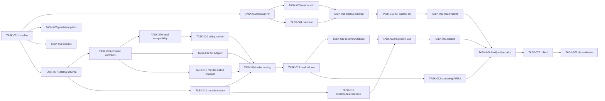

# Дорожная карта внедрения отказоустойчивого хранения PayPlanner

Версия 1.1, 2026-09-22. Базовая ревизия: `main@09ae8b58e74787a20d7f7d2361331b83731ab8b4` (EVID-001). После этапа аудита выполнена локальная реализация; production rollout и приёмка реальных провайдеров остаются отдельными управляемыми этапами.

## 1. Статус и правило ведения

- Прогресс реализации: **9/26 задач (35%)**. TASK-007..013 (кроме внешней приёмки TASK-006), TASK-017 и TASK-020 имеют локально проверенную реализацию; остальные инженерные задачи продолжаются, а TASK-021/025 требуют отдельной production-приёмки. Production и реальные provider accounts не изменялись.
- Статусы: `[ ]` не начато, `[~]` в работе, `[x]` реализовано и проверено, `[!]` заблокировано, `[decision]` требуется бизнес-решение, `[acceptance]` требуется приёмка на реальной среде.
- Нельзя отмечать задачу `[x]`, пока не выполнены её тесты, проверка миграций/кодировки и указанный gate.
- После каждого рабочего сеанса обновлять статус, evidence, фактические команды, отклонения и `Checkpoint` в конце файла. Не удалять старые ID или результаты.
- Любое включение production-функции выполняется отдельным подтверждённым change window. Этот документ сам по себе не разрешает deployment или доступ к production.

## 2. Целевые этапы

| Этап | Результат | Задачи | Gate выхода |
|---|---|---|---|
| STG-00 | Воспроизводимый baseline и зафиксированные решения | TASK-001 | Все текущие контракты охарактеризованы; владельцы UNKNOWN назначены |
| STG-01 | Восстановление и резервирование перестают быть недоказанными | TASK-002..004 | Успешный disposable restore; безопасная retention; manifest |
| STG-02 | Персистентные пути и секреты безопасны | TASK-005..006 | Deploy не удаляет bytes; новые секреты не сохраняются открыто |
| STG-03 | Каталог объектов и provider abstraction | TASK-007..010 | Additive schema, legacy compatibility, policy dry-run |
| STG-04 | Надёжная запись, чтение и failover | TASK-011..017 | Durable operations, UNKNOWN semantics, repair/delete/failback |
| STG-05 | Полный backup set и restore DB+files+keys | TASK-018..019 | Две независимые проверенные копии и полный restore drill |
| STG-06 | Миграция существующих данных | TASK-020..021 | Dry-run, resume, reconcile; 100% catalog coverage |
| STG-07 | Потоковая передача и совместимый UX/API | TASK-022 | Нет больших MemoryStream; legacy/native UX сохранён |
| STG-08 | Наблюдаемость, тесты и управляемое включение | TASK-023..025 | Fault/security/perf gates и поэтапный rollout |
| STG-09 | Документация и выпуск | TASK-026 | Runbooks, «Что нового», acceptance, rollback pack |

## 3. Карточки задач

### TASK-001 — Зафиксировать baseline и решения

- **Статус/приоритет:** `[ ]`, P0. **Связи:** REQ-001,016,018,020; RISK-020,021,024,027; DEC-001..012. **Зависимости:** нет.
- **Результат:** characterization tests описывают фактические local/S3/Yandex/backup/API контракты; владельцы отвечают на UNKNOWN из `STORAGE_AUDIT.md`.
- **Точки кода:** `backend/Services/Storage/*`, `backend/Services/DatabaseBackupService.cs`, `backend/Controllers/TasksController.cs`, `backend/Controllers/V2/CasesV2Controller.cs`, `backend/PayPlanner.Api.Tests/*`, `src/components/S3Storage/*`, `src/components/YandexDisk/*`.
- **Действия/контракты:** закрепить URL, permission, delete, filename, range, OAuth, CRM sync и retry semantics; утвердить RPO/RTO, required copy count, data classes, provider independence, legal retention и допустимый bounded staging.
- **Данные/config:** изменений нет; решения записать как DEC с владельцем/датой. Секреты не копировать в fixtures/logs.
- **Проверка:** текущие targeted tests TEST-001; добавить characterization tests для всех существующих endpoints и legacy rows. Команды: filtered `dotnet test`, релевантные `vitest`, `npm run lint`, `npx tsc --noEmit`.
- **Готово:** baseline green; нет неявного изменения native S3/Yandex и legacy URL; все blocking UNKNOWN имеют owner/date.
- **Стоп/откат/output:** при расхождении кода и документации останавливается проектирование конкретного контракта; код не менять. Output: signed decision log и test inventory.

### TASK-002 — Закрыть P0 резервного копирования

- **Статус/приоритет:** `[~]`, P0, локальная часть реализована; production qualification требует отдельного разрешения. **Связи:** REQ-008,011,016; RISK-002,003,019,026; EVID-081..092,123,124. **Зависимости:** TASK-001.
- **Результат:** scheduler не падает из-за одного недоступного каталога; cleanup не удаляет последнюю пригодную копию; S3 destination либо подтверждён, либо явно `DEGRADED/FAILED`.
- **Точки кода:** `DatabaseBackupService.cs`, `DatabaseBackupSchedulerService.cs`, `DatabaseAdminController.cs`, backup tests; внешне — permissions/quotas/account state.
- **Действия:** preflight write/rename/delete; per-destination error isolation; retention только после verified copy policy; manual retry idempotent; alert с BackupId/destination без секрета.
- **Данные/config:** существующий SystemSettings читается обратно совместимо; новые status fields additive. Внешний владелец проверяет каталог и HostKey `UserSuspended` отдельным change ticket.
- **Проверка:** TEST-110,115; permission denied, disk full, suspended provider, timeout, partial upload, concurrent scheduler, cleanup boundary. Disposable paths only.
- **Готово:** scheduler продолжает работу после isolated failure; последняя verified копия защищена; инциденты имеют фактический статус.
- **Стоп/откат/output:** не удалять локальные dumps при неполной cloud verification; feature flag отключает новый cleanup. Output: incident evidence + safer scheduler patch.

### TASK-003 — Создать безопасный restore-drill harness

- **Статус/приоритет:** `[~]`, P0; SQLite restore выполняется в disposable каталоге, PostgreSQL validation-only безопасен по умолчанию, реальный PostgreSQL drill требует отдельной тестовой БД. **Связи:** REQ-009,016; RISK-001,011,026; DEC-008. **Зависимости:** TASK-002.
- **Результат:** оператор может восстановить выбранную копию только в новую disposable DB/директорию и получить отчёт целостности.
- **Точки:** новый backend admin/CLI service рядом с `DatabaseBackupService`; tests; `scripts/` для локального orchestration; без production endpoint по умолчанию.
- **Действия:** validate manifest/version; restore PostgreSQL/SQLite отдельно; запрет target=current DB/path; timeout/cancel; post-restore counts/FK/hash; dry-run default.
- **Config:** отдельные restore credentials/target allowlist; destructive confirmation token для будущего controlled mode.
- **Проверка:** TEST-111,112; clean DB path, incompatible version, corrupt dump, missing key/file, wrong target. Команды используют disposable local/test DB с email/background services disabled.
- **Готово:** clean restore воспроизводим; исходная БД неизменна; RPO/RTO замерены.
- **Стоп/откат/output:** любое совпадение target с active connection блокирует операцию. Output: machine-readable drill report/runbook draft.

### TASK-004 — Ввести manifest и инвентаризацию backup

- **Статус/приоритет:** `[~]`, P0; DB manifest и verify реализованы, полный BackupSet относится к TASK-018/019. **Связи:** REQ-008,009,019; RISK-001,003,011,019; DEC-007. **Зависимости:** TASK-002.
- **Результат:** каждый BackupId имеет immutable manifest с DB dump, required file classes, checksum, size, timestamps, app/schema version, encryption/key reference и copy states.
- **Точки:** `DatabaseBackupService.cs`, backup settings/results models, EF entities/migration при выбранной схеме, controller DTOs/tests.
- **Действия:** manifest written last after parts; incomplete never restorable; canonical JSON/hash; inventory API pagination; backward compatibility для legacy dump as `LEGACY_UNVERIFIED`.
- **Проверка:** TEST-110..112; manifest tamper, missing part, duplicate retry, multi-destination divergence.
- **Готово:** restore выбирает только complete compatible manifest; status отражает каждую copy.
- **Стоп/откат/output:** dual-read legacy/new; migration reversible до использования новых rows. Output: schema/API contract and tests.

### TASK-005 — Перенести release-local пользовательские файлы в persistent storage

- **Статус/приоритет:** `[~]`, P0; persistent roots/dual-read/deploy migration реализованы, production acceptance не выполнялась. **Связи:** REQ-002,012; RISK-004,005; EVID-021,022,090,091,126. **Зависимости:** TASK-001.
- **Результат:** profile photos и e-signature bytes не находятся под deploy tree и не зависят от `rsync --delete`.
- **Точки:** `ProfileController.cs`, `ElectronicSignatureService.cs`, startup/static file config, `.github/workflows/deploy.yml`, модели URL/path, tests.
- **Действия:** configurable persistent roots; dual-read old/new; atomic copy+hash; URL compatibility; deploy mount/preflight; после verify — lazy/explicit migration.
- **Config/data:** новые roots вне release; backup class assignment; traversal/symlink protection. Не удалять old bytes до acceptance+retention.
- **Проверка:** TEST-103,116; deploy simulation, old URL, concurrent upload, duplicate filename, traversal, rollback.
- **Готово:** fresh deploy не теряет файлы; legacy records читаются; bytes включаемы в manifest.
- **Стоп/откат/output:** flag возвращает legacy read-first; no delete. Output: persistent-path patch + migration evidence.

### TASK-006 — Защитить S3 credentials и endpoints

- **Статус/приоритет:** `[~]`, P0; encryption/migrate-on-read и endpoint/SSRF policy реализованы, внешняя custody/rotation key ring требует решения владельца. **Связи:** REQ-013,018; RISK-006,013,014,023; DEC-006. **Зависимости:** TASK-001.
- **Результат:** новые секреты хранятся через protected secret reference; API никогда не возвращает secret; endpoint проходит SSRF policy.
- **Точки:** `S3StorageService.cs`, `S3StorageController.cs`, settings/admin DTOs, DataProtection/secret service, audit logs, tests/UI masked fields.
- **Действия:** encrypt-at-rest/migrate-on-read с key ID; rotate/test without reveal; HTTPS default; deny loopback/link-local/private unless explicit admin allowlist; DNS rebinding checks; least privilege guide.
- **Данные/config:** reversible dual decrypt for legacy plaintext; key backup/restore rule; no logging request headers/query signatures.
- **Проверка:** TEST-115; serialization, key rotation, invalid ciphertext, malicious endpoints/redirects, permission denial.
- **Готово:** no new plaintext; old connections operate/migrate; secret scan clean.
- **Стоп/откат/output:** не очищать legacy value до verified decrypt/reference; disable creation on missing key ring. Output: migration and security evidence.

### TASK-007 — Добавить каталог объектов/реплик/операций

- **Статус/приоритет:** `[x]`, P0; SQLite/PostgreSQL clean/upgrade migrations и invariants проверены локально. **Связи:** REQ-001..007,012,019; RISK-007..010,017,018; DEC-002..005,009. **Зависимости:** TASK-001.
- **Результат:** additive PostgreSQL schema для `StorageObject`, immutable `ObjectGeneration`, `ObjectReplica`, `StorageOperation`, `StorageTombstone` и policy snapshot.
- **Точки:** `backend/Data/PaymentContext.cs`, `backend/Models`, `backend/Migrations`, service interfaces, model/migration tests.
- **Действия:** stable ObjectId; owner/data class; logical name/MIME/size/hash; generation/version; provider/locator/etag/providerVersion/status; unique idempotency key; optimistic concurrency; tombstone wins.
- **Data/indexes:** indexes owner+class, object+generation, replica+status, operation+status+nextAttempt; bounded payload, no secret; legacy source reference.
- **Проверка:** TEST-102,105,113,116; upgrade and clean DB, rollback-before-use, duplicates/concurrency, index plans.
- **Готово:** migration applies both paths; no existing row rewritten; invariants enforced.
- **Стоп/откат/output:** rollout schema-only first; feature disabled. Output: ERD/migration/evidence.

### TASK-008 — Определить capability-based provider contracts

- **Статус/приоритет:** `[x]`, P0; contracts/registry/typed outcomes реализованы и проверены. **Связи:** REQ-003,004,017; RISK-012,022; DEC-001,011. **Зависимости:** TASK-007.
- **Результат:** registry различает core object IO и optional capabilities, не объявляя Yandex S3-совместимым.
- **Точки:** новые `backend/Services/Storage` interfaces/DTOs; DI registration; fake providers/tests.
- **Действия:** Put/OpenRead/Head/Delete; capabilities range, multipart, conditional, versioning, presign, server-copy, trash; typed outcomes `Succeeded/NotFound/Conflict/Unavailable/Unknown`.
- **Контракты:** cancellation/deadline; retry classification; provider-neutral locator opaque; stream ownership explicit.
- **Проверка:** TEST-101,104,105,107; contract suite runs against fakes and optional adapters.
- **Готово:** policy may query capabilities; unsupported fails before IO; native provider methods remain accessible separately.
- **Стоп/откат/output:** no controllers switched yet. Output: interfaces/capability matrix/tests.

### TASK-009 — Реализовать local provider и legacy compatibility

- **Статус/приоритет:** `[x]`, P0; local и read-only legacy-local providers готовы, traversal/delete safety и legacy fallback проверены. **Связи:** REQ-002,012,017; RISK-004,008,009; DEC-001,002. **Зависимости:** TASK-008.
- **Результат:** текущие task/case/chat/messenger/e-sign/profile paths читаются через local adapter без изменения внешнего поведения.
- **Точки:** existing storage/controllers/services from EVID-010..025; new adapter/resolver; tests.
- **Действия:** normalized safe path; no traversal/symlink escape; atomic temp+rename; streaming hash; legacy locator resolver; delete only under owned root.
- **Проверка:** TEST-103,114,116; all data classes, missing files, zero/large files, Unicode names, concurrent reads, legacy URLs.
- **Готово:** dual-read is byte-identical; writes can shadow-register catalog under flag.
- **Стоп/откат/output:** flag preserves direct legacy implementation. Output: compatibility report.

### TASK-010 — Реализовать policy engine в dry-run

- **Статус/приоритет:** `[x]`, P1; deterministic evaluator/explain endpoint готовы, defaults local-only, routing off. **Связи:** REQ-004,016,019; RISK-015,020,021,024; DEC-003,012. **Зависимости:** TASK-009.
- **Результат:** versioned policy selects eligible providers/copy count/write/read/retention per data class, initially observation-only.
- **Точки:** policy models/service, admin settings/controller/UI, audit events/tests.
- **Действия:** deterministic evaluation; capability/capacity/compliance filters; explain endpoint; policy snapshot on generation; reject impossible policy.
- **Config:** defaults remain local-only; feature flags per tenant/class; no provider auto-enabled.
- **Проверка:** TEST-104,109; table-driven rules, missing provider, conflicting retention, permission/capacity degraded.
- **Готово:** dry-run differences visible; zero actual routing change.
- **Стоп/откат/output:** one flag disables evaluator. Output: policy schema/explanations.

### TASK-011 — Добавить durable outbox/worker

- **Статус/приоритет:** `[x]`, P0; lease/retry/UNKNOWN/dead-letter/tombstone logic и admin retry реализованы и проверены. **Связи:** REQ-005,006,010,015; RISK-007,010,018; DEC-004,005. **Зависимости:** TASK-007.
- **Результат:** replication/verify/delete/repair operations survive restart and are idempotent.
- **Точки:** EF models/migration, `BackgroundService`, DI/startup, admin retry/status API, tests.
- **Действия:** transactional enqueue; lease/heartbeat; exponential jitter; max attempts/dead-letter; operation/generation idempotency; cancellation; per-provider concurrency budgets.
- **Config:** global/per-provider limits, timeouts, pause switch; background services remain explicitly disabled in local safety runs.
- **Проверка:** TEST-106,108,113; crash between IO/commit, duplicate workers, expired lease, poison item, shutdown.
- **Готово:** no duplicate generation/delete resurrection; backlog bounded and observable.
- **Стоп/откат/output:** pause workers without losing rows. Output: durable state machine evidence.

### TASK-012 — Усилить S3 adapter

- **Статус/приоритет:** `[x]`, P1; compatibility wrapper и streaming download подключены, native API сохранён; multipart остаётся честно unsupported. **Связи:** REQ-003,005,007,014,017; RISK-007,010,012,016,025; DEC-001,004,011. **Зависимости:** TASK-006,008,011.
- **Результат:** S3 adapter поддерживает streaming, Head, conditional create, multipart, abort, range и version/checksum capture там, где capability подтверждена.
- **Точки:** `S3StorageService.cs`, AWS SDK config/models, controller/API tests; сохранить admin native routes/UI.
- **Действия:** bounded streams; threshold multipart; upload IDs persisted; complete/abort; `If-None-Match`/version only when supported; Head reconciliation; continuation pagination; presign policy.
- **Проверка:** TEST-104..107,114; AWS-compatible emulator/test account only by explicit env gate; non-AWS HostKey capabilities remain UNKNOWN until certified.
- **Готово:** interrupted multipart cleaned/recoverable; no full-memory large transfer; existing list/copy/delete remain compatible.
- **Стоп/откат/output:** per-connection capability override/disable multipart. Output: adapter conformance report.

### TASK-013 — Обернуть Yandex Disk без потери native функций

- **Статус/приоритет:** `[x]`, P1; native wrapper и streaming download подключены opt-in, OAuth/native API сохранены. **Связи:** REQ-003,017; RISK-012,022; DEC-001,011. **Зависимости:** TASK-008,011.
- **Результат:** optional provider wrapper uses native REST upload/download/metadata while OAuth, root, copy/move/trash, CRM sync and UI continue unchanged.
- **Точки:** `YandexDiskService.cs`, controller, UI, new adapter, tests.
- **Действия:** translate native errors; stream upload/download; resource path opaque; retry upload-URL acquisition safely; retain trash vs permanent delete semantics.
- **Проверка:** TEST-101,104,107,113; existing Yandex tests plus fake HTTP faults/token expiry/rate limits.
- **Готово:** native regression suite green; no claim of S3 semantics; provider participation opt-in per class.
- **Стоп/откат/output:** wrapper flag off leaves current service untouched. Output: native compatibility evidence.

### TASK-014 — Включить write routing с честным UNKNOWN

- **Статус/приоритет:** `[~]`, P0; orchestration write, idempotent commit, durable mirror queue и UNKNOWN semantics готовы opt-in; продуктовые call sites ещё не включены. **Связи:** REQ-004..006,015; RISK-007,008,010,015,018; DEC-003..005. **Зависимости:** TASK-010..013.
- **Результат:** new writes select policy-compliant destination, commit catalog atomically, enqueue mirrors and never convert ambiguous timeout to false success/fallback duplicate.
- **Точки:** storage orchestration service; task/case/chat/messenger/e-sign/profile call sites behind flags; API DTO/error mapping/tests.
- **Действия:** idempotency key; streaming hash/temp generation; primary outcome; UNKNOWN persisted; Head/hash reconciliation; ack only at required durability; degraded status explicit.
- **Проверка:** TEST-104..106,109,116; failure before/during/after provider commit and DB commit; retry/restart/concurrency.
- **Готово:** no lost acknowledged write and no split generation; all-failed is error/PENDING.
- **Стоп/откат/output:** shadow mode then one low-risk class; legacy writer remains rollback path until backfill. Output: transition matrix evidence.

### TASK-015 — Реализовать read selection/failover

- **Статус/приоритет:** `[~]`, P0; same-generation verified fallback и stable admin download готовы; подключение всех продуктовых download endpoints остаётся за per-class flags. **Связи:** REQ-007,014,017; RISK-008,009,016; DEC-003,010. **Зависимости:** TASK-014.
- **Результат:** stable application endpoint selects a verified same-generation replica; direct URLs can be regenerated; proxy fallback occurs only before response bytes.
- **Точки:** download endpoints in task/case/chat/messenger/e-sign/profile, resolver, API/UI tests.
- **Действия:** rank health/locality/cost; Head/hash/size validation; range forwarding; signed URL short TTL; mark suspect replica and enqueue repair; audit chosen source.
- **Проверка:** TEST-107,114,116; missing/corrupt primary, range, client retry, provider down midstream, authorization.
- **Готово:** byte-identical fallback with no authorization bypass; p95 measured.
- **Стоп/откат/output:** per-class read flag returns legacy resolver. Output: read-failover evidence.

### TASK-016 — Реализовать recovery, catch-up и safe failback

- **Статус/приоритет:** `[~]`, P0; circuit breaker, cooldown, reconciliation и debt report готовы; глобальный failback требует operator approval и provider qualification. **Связи:** REQ-006,010,015; RISK-008,010,018,026; DEC-003..005. **Зависимости:** TASK-015,017.
- **Результат:** recovered preferred provider does not become primary until all newer generations/tombstones reconcile and cooldown passes.
- **Точки:** health/circuit breaker, reconciliation worker/admin controls, audit/metrics/tests.
- **Действия:** breaker states; provider epoch; scan catalog debt; copy+verify; tombstone replay; zero-debt gate; canary reads/writes; manual global approve.
- **Проверка:** TEST-108,109,113; flapping provider, B-only writes, stale primary, corrupt catch-up, restart.
- **Готово:** no stale reads/resurrection; failback report proves debt=0/corrupt=0.
- **Стоп/откат/output:** remain on current healthy provider; no automated global failback. Output: recovery report.

### TASK-017 — Tombstone, delete и reconciliation

- **Статус/приоритет:** `[x]`, P0; tombstone, retention/legal hold, delete queue и no-resurrection reconciliation проверены локально. **Связи:** REQ-010,019; RISK-009,017; DEC-002,005,009. **Зависимости:** TASK-011,014.
- **Результат:** logical delete is immediate/authorized; physical deletion follows retention/hold across replicas; repair cannot resurrect deleted objects.
- **Точки:** delete endpoints/services, catalog/outbox, retention worker, admin reconcile API/tests.
- **Действия:** tombstone generation; legal hold; per-replica delete state; orphan/missing/corrupt scans; dry-run/action modes; immutable audit.
- **Проверка:** TEST-113; delete during outage, retry, old generation, hold, orphan, race with upload/read.
- **Готово:** deterministic deletion and reconciliation reports; no path outside owned roots.
- **Стоп/откат/output:** physical deletion disabled independently; tombstone remains. Output: delete/reconcile evidence.

### TASK-018 — Каталог BackupSet/copies/fallback

- **Статус/приоритет:** `[~]`, P0; manifest/parts/copy result inventory и manifest-last upload готовы, отдельный durable BackupSet catalog остаётся незавершённым. **Связи:** REQ-008,009,011; RISK-001..003,011,019; DEC-007,008. **Зависимости:** TASK-003,004,007.
- **Результат:** backup set lifecycle and independent copy states are durable; fallback preserves identical BackupId/manifest, never silently chooses incomplete chain.
- **Точки:** backup entities/migrations/service/controller/UI/tests.
- **Действия:** states Preparing/Uploading/Verifying/Complete/Degraded/Failed/Expired; required copies; retry per destination; protection until newer complete set; explicit restore-point selection.
- **Проверка:** TEST-110..112; destination divergence, retention race, concurrent backup, stale state, legacy import.
- **Готово:** UI/API explains restorable vs copied; cleanup respects protection.
- **Стоп/откат/output:** old history remains readable; new scheduler can be disabled. Output: backup catalog evidence.

### TASK-019 — Полный backup DB+files+keys

- **Статус/приоритет:** `[~]`, P0; DB+persistent file roots входят в проверяемый комплект, cloud parts и manifest выгружаются в правильном порядке; две независимые production-копии не подтверждены. **Связи:** REQ-008,009,012,013; RISK-001,004,005,011,019,023; DEC-007,008. **Зависимости:** TASK-005,006,018.
- **Результат:** manifest covers DB, all file data classes, required settings and encrypted key material/recovery procedure; at least two independent verified copies per approved policy.
- **Точки:** backup inventory/streaming services, persistent roots, key export envelope, provider copies, restore harness/tests.
- **Действия:** consistent snapshot boundary; incremental/content-addressed file chunks if approved; encrypt client-side or verified provider-side; hash each part; external manifest copy; capacity preflight.
- **Проверка:** TEST-110..112; full clean-environment restore, missing/corrupt chunk, unavailable primary, wrong key, Unicode/large files.
- **Готово:** random-sample and full drill meet RPO/RTO; recovered UI downloads match hashes.
- **Стоп/откат/output:** never expire previous complete set until new set and drill criteria pass. Output: signed drill evidence.

### TASK-020 — Создать resumable migration CLI

- **Статус/приоритет:** `[x]`, P1; admin API поддерживает dry-run/apply, bounded batches, deterministic resume, hash verification и exception report без удаления source. **Связи:** REQ-012,018,019; RISK-009,015,017,023; DEC-002,009. **Зависимости:** TASK-016,017,019.
- **Результат:** dry-run-first CLI inventories legacy bytes/rows, registers objects, copies/verifies replicas and resumes from checkpoint.
- **Точки:** `scripts/` or backend admin CLI project; catalog/provider services reused; no ad-hoc DB writes.
- **Действия:** filters by class/tenant/ID; bounded batches; hash streaming; rate limits; conflict report; checkpoint/cancel; quarantine missing/mismatch; no source delete.
- **Проверка:** TEST-102,103,116; disposable fixture tree/DB, interrupt/resume, duplicates, changed source, insufficient space.
- **Готово:** repeat dry-run idempotent; counts/bytes/hashes reconcile.
- **Стоп/откат/output:** cancel leaves legacy authoritative and catalog rows reversible. Output: manifest/report/checkpoint.

### TASK-021 — Выполнить historical backfill по классам

- **Статус/приоритет:** `[acceptance]`, P1. **Связи:** REQ-012,016,019; RISK-009,017,020,021. **Зависимости:** TASK-020; owner approval/change window.
- **Результат:** all selected legacy rows/files cataloged and required replicas verified without user downtime or source deletion.
- **Порядок:** task → case → internal chat → messenger snapshots → e-sign → profile; each class canary, batch, reconcile, acceptance.
- **Действия:** preflight capacity/credentials; dry-run; dual-write; batch; sample/full verification; exceptions assigned; read flag only after gate.
- **Проверка:** TEST-103,116 plus real-environment read-only counts/hashes under approved runbook.
- **Готово:** 100% accounted as verified/missing-known/exception-owned; rollback window retained.
- **Стоп/откат/output:** error/latency thresholds pause; revert reads to legacy; never delete source. Output: per-class migration certificate.

### TASK-022 — Перевести transfer paths на streaming, сохранив UX/API

- **Статус/приоритет:** `[~]`, P1; S3/Yandex downloads и orchestration paths streaming, backup admin UI дополнен; остальные legacy upload/download call sites требуют canary integration. **Связи:** REQ-014,017; RISK-016,022,025; DEC-010,011. **Зависимости:** TASK-015.
- **Результат:** large upload/download avoids full buffering; existing task/case/native S3/Yandex screens and URLs remain compatible.
- **Точки:** controllers/services identified in EVID-011..025, S3/Yandex services, frontend API/components, reverse-proxy limits/tests.
- **Действия:** request streaming; bounded temp/multipart; backpressure/cancel; Range/Content-Disposition/ETag; optional direct upload session with finalize verification; progress/error UX.
- **Проверка:** TEST-114,116; frontend unit/lint/type/build, backend full tests, browser upload/download, slow/disconnect/large/concurrent cases.
- **Готово:** bounded memory benchmark; no native function regression; permissions unchanged.
- **Стоп/откат/output:** proxy path fallback feature flag. Output: performance/compatibility evidence.

### TASK-023 — Добавить health, metrics и alerts

- **Статус/приоритет:** `[~]`, P0; admin health показывает operation/replica debt, oldest pending и provider circuit state; внешние alerts/SLO owners не утверждены. **Связи:** REQ-015,020; RISK-002,003,010,018,026,027; DEC-012. **Зависимости:** TASK-011,018,019.
- **Результат:** readiness distinguishes app alive from storage/backup degraded; dashboards expose copy debt, oldest pending, errors, capacity, restore freshness and RPO breach.
- **Точки:** `HealthController.cs`, metrics/logging, notification system, admin storage/backup UI, tests.
- **Действия:** redacted structured events with ObjectId/OperationId/BackupId; per-provider breaker/status; alert dedup/escalation/runbook link; public health leaks no topology.
- **Проверка:** TEST-115; simulate outage/backlog/stale backup/full disk; verify alerts recover and no secrets.
- **Готово:** SLO/threshold owners approved; alert drills actionable.
- **Стоп/откат/output:** monitoring does not block IO except explicit readiness policy. Output: dashboard/alert evidence.

### TASK-024 — Провести fault, performance и security qualification

- **Статус/приоритет:** `[ ]`, P0. **Связи:** REQ-013..018; RISK-006..027. **Зависимости:** TASK-019,021..023.
- **Результат:** expanded matrix proves success/failure/permission/boundary/concurrency contracts and identifies certified provider capabilities.
- **Действия:** run TEST-101..116; latency/throughput/memory/cost baseline; chaos timeouts/drop/restart/corruption; auth/IDOR/traversal/SSRF/secret scan; migration upgrade+clean DB; restore drills.
- **Команды/gates:** full backend tests; `npm run test:unit`; `npm run lint`; `npx tsc --noEmit`; `npm run audit:encoding`; `npm run build`; relevant migration/security/browser tests. Real-provider suites opt-in, isolated, non-production.
- **Готово:** zero open critical/high correctness/security defects; RPO/RTO and memory targets met; capability matrix evidenced.
- **Стоп/откат/output:** failed gate blocks rollout, never weakened/skipped. Output: qualification report with raw references.

### TASK-025 — Выполнить поэтапный rollout и cutover

- **Статус/приоритет:** `[acceptance]`, P0. **Связи:** все REQ; RISK-001..027. **Зависимости:** TASK-024; approved change plan.
- **Результат:** schema → shadow catalog → dual-write → canary read → class rollout → failover drill → optional failback; each phase observable/reversible.
- **Действия:** predeploy verified backup+restore point; migrations; flags tenant/class percentages; watch error/latency/debt; freeze destructive cleanup; signoffs; post-deploy revision/health/service/frontend checks.
- **Gate:** GitHub Actions successful expected revision; public API/frontend/service worker/VPS revision verified only when user authorizes production work.
- **Готово:** observation window passed, debt within SLO, real acceptance signed, rollback pack retained.
- **Стоп/откат/output:** threshold breach disables new routing/reads, preserves catalog/outbox and legacy source; DB rollback only if safe/no new rows depend on schema. Output: rollout log.

### TASK-026 — Завершить документацию, runbooks и выпуск

- **Статус/приоритет:** `[~]`, P1; эксплуатационный runbook и объединённая запись «Что нового» добавлены, финальная документация зависит от production acceptance. **Связи:** REQ-016,020; RISK-020,021,026,027. **Зависимости:** TASK-025.
- **Результат:** operator/user/admin documentation matches proven behavior; release note explains visible changes; roadmap archived only after acceptance.
- **Точки:** `docs/`, admin manuals, `backend/AppReleases/releases.json`, OpenAPI/help text, active roadmap.
- **Действия:** runbooks outage/UNKNOWN/all-failed/restore/key loss/migration/rollback; capability limitations; ownership/escalation; correct false multipart/key-protection claims.
- **Проверка:** docs links/encoding, screenshots/UI text, operator tabletop restore and failover.
- **Готово:** no unowned UNKNOWN/P0; release note approved; implementation roadmap 100% and moved to archive per repository rules.
- **Стоп/откат/output:** documentation cannot claim capabilities not evidenced. Output: final acceptance pack.

## 4. Сквозные gates и rollback-инварианты

1. **Данные:** source bytes не удаляются до двух verified copies, полного reconciliation и истечения утверждённого rollback window.
2. **Запись:** timeout после отправки bytes означает `UNKNOWN`, а не автоматический success/fallback; повтор использует тот же idempotency/generation key (DEC-004).
3. **Чтение:** только та же generation и verified replica; midstream provider splice запрещён (DEC-010).
4. **Удаление:** tombstone старше/новее сравнивается по generation; repair не воскрешает данные (DEC-005).
5. **Failback:** cooldown, catch-up, verify, debt=0/corrupt=0 и явный operator gate.
6. **Backup:** новый set не освобождает старый, пока manifest/copies/restore criteria не выполнены.
7. **Секреты:** key material восстанавливается отдельной проверенной процедурой; никакие токены/пароли не попадают в отчёты и логи.
8. **Совместимость:** native S3 admin и Yandex OAuth/root/copy/move/trash/CRM sync имеют отдельные regression gates; legacy task/case/file URLs остаются рабочими.
9. **Локальная безопасность:** backend запускается только с `BackgroundServices__Enabled=false`, `Email__Enabled=false` и DB setting `notifications.email.enabled=false` при копии production DB.

## 5. Traceability

| Область | Requirement | Risks | Tasks | Tests/acceptance |
|---|---|---|---|---|
| Инвентаризация/совместимость | REQ-001,002,017,020 | RISK-004,012,020..022,027 | TASK-001,005,008,009,013,022,026 | TEST-001,101,103,116; AC-001,012,015 |
| Каталог/целостность | REQ-003,005,010,019 | RISK-007..010,017,018 | TASK-007,008,011,017 | TEST-102,105,106,113; AC-002,005,008 |
| Policy/write/failover | REQ-004,006,007,015 | RISK-008,010,015,018,024 | TASK-010,014..016,023 | TEST-104..109; AC-003,004,006,007,013 |
| Backup/restore | REQ-008,009,011,012,016 | RISK-001..005,011,019,026 | TASK-002..005,018..021 | TEST-103,110..112; AC-009,010,011,014 |
| Security | REQ-013,018 | RISK-006,013,014,023 | TASK-006,020,023,024 | TEST-115; AC-012,013 |
| Performance/API | REQ-014,017 | RISK-016,022,025 | TASK-012,013,015,022,024 | TEST-107,114,116; AC-006,012 |

## 6. Решения/UNKNOWN, требующие владельца

| Вопрос | Предлагаемый владелец | Блокирует | Срок до |
|---|---|---|---|
| RPO/RTO, required copy count и независимость destinations | Product owner + operations | TASK-004,019 | до STG-01 gate |
| Legal retention/hold/delete для каждого data class | Product owner/legal | TASK-010,017 | до STG-03 gate |
| Допустим ли direct upload и какие MIME/size limits | Security + product | TASK-022 | до STG-07 |
| HostKey account `UserSuspended`, bucket versioning/object lock/checksum/multipart | Operations/provider owner | TASK-002,012 | до S3 enablement |
| Yandex как runtime replica или только backup/native integration | Product + security | TASK-013,014 | до routing enablement |
| Secret vault/key custody/recovery owners | Security/operations | TASK-006,019 | до STG-02 gate |
| Capacity/cost/egress/quotas and alert thresholds | Operations/finance | TASK-010,019,023 | до rollout |

## 7. Checkpoint для следующей сессии

- **Последнее завершённое:** локальный storage foundation, catalog migrations, providers, durable worker, tombstone/reconcile, full fileset backup, restore harness, streaming, circuit breaker и resumable backfill; full local gates зафиксированы в EVID-130+.
- **Следующая конкретная задача:** владелец утверждает RPO/RTO/copy/retention/key-custody, затем `TASK-021` начинается с read-only dry-run одного canary-класса в согласованное окно.
- **Параллельный внешний P0:** operations уточняет актуальность EVID-123/124 и готовит отдельные non-production provider accounts без передачи credentials в чат.
- **Запрещено начинать:** production migration, file deletion, routing/failover enablement, secret rotation или restore поверх существующей БД.
- **Перед стартом:** перечитать `STORAGE_AUDIT.md`, `STORAGE_IMPLEMENTATION_TASK.md`, этот checkpoint, актуальный `git status`, active roadmaps и AGENTS.md; подтвердить новую baseline revision.

## 8. История

| Дата | Изменение | Реализация |
|---|---|---|
| 2026-09-22 | Создана полная дорожная карта STG-00..09 / TASK-001..026 по аудиту | 0/26, 0%; code/data/production unchanged |
| 2026-09-22 | Реализован локальный фундамент STG-01..04: safer backup, manifest, persistent paths, secret protection, catalog migrations, providers, policy dry-run и durable operations | 3/26, 12%; targeted tests green; production unchanged |
| 2026-09-22 | Расширены backup/restore, routing/read failover, circuit breaker, streaming, tombstone/reconcile, historical backfill, admin API/UI и runbook | 9/26, 35%; local full gates green; production/provider accounts unchanged |

## 9. Паспорт целевого изменения: сейчас, цель и границы

**Сейчас:** PostgreSQL хранит metadata/path, рабочие bytes task/case/chat/messenger в основном находятся в persistent local filesystem; profile/e-signature имеют release-local риски. S3 и Yandex Disk — отдельные работающие административные/native интеграции, а не реплики runtime-объектов. Backup охватывает DB dump и может доставляться в несколько destinations, но не образует доказанный согласованный restore DB+files+keys (EVID-010..025, EVID-040..050, EVID-060..068, EVID-080..092).

**Цель:** единый логический объект имеет неизменяемые generations и проверенные replicas; policy отдельно управляет runtime writes/reads, DB+file backup и archive. Отказ операции локализуется: чтение использует пригодную копию той же версии, новая запись — только разрешённый writer, backup — другое допустимое destination с тем же manifest. После recovery выполняются catch-up и tombstone reconciliation, а failback разрешается после gate. Без пригодной копии/назначения результат — `DEGRADED`, `PENDING`, `UNKNOWN` или ошибка, но не ложный успех.

**В границах:** все найденные data classes, local/S3/Yandex, backup/restore, schema, workers, API/UI compatibility, migration, observability, security и runbooks. **Вне границ:** подключение не найденных providers, HA самой PostgreSQL/compute/region, обещание абсолютной доступности, выбор коммерческих тарифов и production-работы без отдельного поручения. Google Drive, OneDrive, Dropbox, Azure Blob, WebDAV, SFTP, Mail Cloud и rclone — `NOT APPLICABLE/NOT FOUND`, не backlog по умолчанию.

## 10. Архитектурные решения и policy-матрица

Решения DEC-001..012 определены в `STORAGE_IMPLEMENTATION_TASK.md`: capability-based adapters; immutable generation; durable replica/operation catalog; policy snapshots; idempotency и UNKNOWN reconciliation; tombstones; independent BackupSet; restore-first; non-destructive migration; stable download endpoint; native-contract preservation; explicit owner gates.

| Класс | Runtime source/target | Protection ack | Backup/tier | Failover/failback |
|---|---|---|---|---|
| Task/case/chat/messenger files | legacy local → policy writer + replicas | не ниже утверждённого required copies; стартово local ack + durable mirror | hot full file backup; archive только после RTO/retention decision | verified same generation; catch-up before failback |
| E-sign/profile | persistent local root → тот же catalog | atomic write+hash; no release tree | hot, поскольку нужен постоянный UX-доступ | legacy dual-read до acceptance |
| DB | PostgreSQL source of truth | transaction semantics unchanged | full dump + manifest + ≥2 approved independent copies (предложение, требует DEC owner) | backup delivery fallback; restore only explicit point |
| Keys/settings required for restore | protected secret/key custody | reference + recoverable key procedure | encrypted recovery package separate from ordinary files | manual security gate |
| S3 native admin objects | текущий remote object | прежний native contract | не автоматически runtime/backup без policy | capability-certified per connection |
| Yandex native/CRM objects | Yandex REST/OAuth native | прежний native contract | может быть backup destination; runtime replica only opt-in | no invented S3 behavior |

Hot означает online/readily restorable copy. Warm/cold/archive не включаются, пока provider retrieval time/cost/immutability и RTO не подтверждены официально и тестом; рабочие файлы нельзя единолично помещать в cold/archive.

## 11. Подробные карточки этапов

| Этап | Вход | Работы/параллельность | Выход и доказательство | Stop/owner |
|---|---|---|---|---|
| STG-00 | baseline EVID-001 | TASK-001; owner decisions параллельно tests | characterization green, signed DEC log | неизвестный critical contract блокирует зависящую задачу; engineering+product |
| STG-01 | STG-00 | TASK-002; после него TASK-003 и 004 параллельно | disposable restore и verified manifest/retention | production incident unresolved остаётся external block; ops |
| STG-02 | STG-00 | TASK-005 и 006 параллельно | persistent paths, protected credentials, rollback verified | no key custody/path capacity — stop; security+ops |
| STG-03 | STG-00/02 decisions | TASK-007→008→009→010 | schema clean/upgrade, compatibility, dry-run explanations | any legacy regression — flag off; engineering |
| STG-04 | STG-03 | TASK-011/012/013, затем 014→015; 017 до 016 | failure matrix TEST-104..109/113/114 | false success/stale read/resurrection — release block |
| STG-05 | STG-01/02/04 catalog | TASK-018→019 | complete BackupSet and clean full restore | no complete old backup is expired; ops/security |
| STG-06 | STG-04/05 | TASK-020→021 per data class | accounted historical coverage and retained rollback source | mismatch/error threshold pauses; owner acceptance |
| STG-07 | read failover | TASK-022 | bounded memory and API/native UX regression green | p95/memory/auth regression blocks rollout |
| STG-08 | all prior | TASK-023, затем 024→025 | qualified build, monitored canary/cutover | CI/alert/RPO threshold failure rolls flags back |
| STG-09 | accepted rollout | TASK-026 | truthful docs/release/runbooks and archived roadmap | any unowned P0/UNKNOWN prevents operational-ready claim |

Критический путь: `001→002→003/004→018→019→024→025→026` и `001→007→008→009→010→014→015→016→020→021→024`. TASK-005/006 и adapter work 012/013 допускают параллельность после своих gates; schema/data migration и destructive cleanup никогда не выполняются параллельно с неподтверждённым restore.

## 12. Сквозная schema/data migration

1. Применить additive schema TASK-007 при выключенных storage flags; проверить upgrade и clean DB, затем оставить soak period.
2. Включить shadow catalog для новых local writes: bytes остаются legacy-authoritative; сравнить counts/hash/status.
3. Включить durable operations и adapters без routing; capability probes только в изолированной/явно разрешённой среде.
4. Включить dual-write для одного низкорискового data class и canary tenant; ack policy не ужесточать/ослаблять без решения.
5. TASK-020 dry-run инвентаризирует snapshot; live изменения/удаления ловятся dual-write/outbox, затем повторный delta/reconcile.
6. TASK-021 копирует партиями, verifies hash/size/generation и сохраняет source. Exceptions получают owner, а не скрываются из denominator.
7. Переключить read selector только после 100% accounted coverage для класса; stable URL/API сохраняется.
8. Physical source cleanup — отдельный будущий irreversible gate после полного BackupSet, restore drill, acceptance и retention; не входит автоматически в migration completion.

Rollback до cutover: выключить flags и читать legacy. После появления новых provider-only generations возможен только roll-forward/copy-back с сохранением catalog; удаление schema/rows запрещено. Migration artifacts: inventory manifest, checkpoint, exception register, per-class certificate and final reconcile.

## 13. Backup/restore, rollout и эксплуатационная готовность

**До опасных действий:** получить current verified BackupSet, сохранить external manifest/key recovery procedure, восстановить его в disposable environment, проверить DB counts/FK и выборочные/полные file hashes. Restore поверх действующей DB никогда не используется как проверка.

**Rollout:** schema-only → shadow → canary write → canary read → один класс → один tenant cohort → остальные классы → controlled provider outage drill → observation → optional failback. На каждом шаге фиксируются revision, flags, error/latency/backlog/capacity, RPO age, expected/actual copies и rollback owner. Stop thresholds утверждаются до включения; по умолчанию любое расхождение hash, ложный ack, unauthorized access, tombstone resurrection или неограниченный backlog — немедленный stop.

**Эксплуатационная готовность:** AC-001..015 выполнены; TEST-101..116 green на заявленных средах; latest full restore meets approved RPO/RTO; alerts/tabletop runbooks приняты; all P0 closed; no unowned UNKNOWN; provider capability labels соответствуют evidence; old integrations and single-storage mode прошли regression; observation window завершён.

## 14. Среды, команды и уровни подтверждения

| Уровень | Среда | Проверки/команды | Что доказывает |
|---|---|---|---|
| L1 static | local repo, no credentials | `dotnet build`, `npm run lint`, `npx tsc --noEmit`, `npm run audit:encoding` | compile/types/style/encoding, не runtime durability |
| L2 unit/contract | isolated mocks/fakes | filtered `dotnet test`; affected `vitest` | state/error/capability contracts |
| L3 integration | disposable DB/filesystem/emulator, synthetic data | full backend tests; `npm run test:unit`; migration clean+upgrade; local restore | DB/IO/concurrency/restore behavior |
| L4 provider qualification | dedicated non-production account, opt-in credentials | adapter suite for each exact provider/version/config | только протестированные capabilities |
| L5 preproduction | production-like sanitized environment | full build/browser/perf/fault/restore drills | end-to-end and operational gates |
| L6 production acceptance | separately authorized change window | canary metrics, revision/health, read/write/backup and controlled recovery | deployment/real configuration, не абсолютную гарантию |

Перед любым local backend run: `BackgroundServices__Enabled=false`, `Email__Enabled=false`, а для копии production DB — `notifications.email.enabled=false`; endpoints/credentials проверяются на отсутствие production. Фактические команды и exit codes после реализации добавляются как новые EVID, а строки этого раздела остаются планом.

## 15. Preservation/non-regression matrix

| Конфигурация | Должна сохраниться | Gate |
|---|---|---|
| Legacy local only | старые paths/URLs, upload/download/delete/permissions | TEST-103,116 + оба task-card варианта |
| S3 single connection | list/upload/download/copy/delete/admin audit | existing S3 suite + TEST-101/104/114 |
| S3 multiple saved connections | явный connectionId и независимые backup attempts | TEST-101,110; no implicit cross-account fallback |
| Yandex single/multiple OAuth | OAuth popup, roots, list/upload/download/copy/move/trash/permanent delete, CRM sync/logs | existing Yandex suite + TEST-101/107/113 |
| Local+S3 mixed | policy-selected writes and verified fallback, legacy read | TEST-104..109/114/116 |
| Local+Yandex mixed | только явно разрешённые классы; native semantics intact | TEST-101/104/107/113/116 |
| DB backup local+S3+Yandex | one BackupId/manifest, independent results/retry | TEST-110..112 |
| Provider-only new generation | catalog remains source for locator; rollback is copy-back, not schema deletion | TEST-108/109/116 |

Task business logic that touches files must be verified in both legacy and new task cards and with the administrator switch, per project instructions. No existing backend is removed, force-disabled or silently remapped.

## 16. Полный failover/recovery план

| Событие | Автоматическое действие | Запрещённое действие | Recovery |
|---|---|---|---|
| Preferred read missing/down | choose healthy verified same-generation replica before headers | stale generation or midstream splice | mark suspect, enqueue verify/repair |
| Direct URL fails/expires | client repeats stable endpoint; service issues URL for another verified replica | reuse signed URL as object identity | audit selection; repair original |
| Writer fails before bytes | retry budget, then next eligible writer if idempotency proves no commit | report success | create generation at successful writer, mirror |
| Writer response lost | persist `UNKNOWN`, reconcile Head/hash/version with same key | blind write to B creating conflicting version | finalize success or safely continue after proof |
| Mirror fails | ack only if protection policy met; otherwise `DEGRADED/PENDING` or error | silently lower required copies | durable retry/backpressure/alert |
| All writers fail | bounded staging only if explicitly configured; otherwise error/PENDING | unbounded local temp or false success | operator/provider recovery then resume |
| Backup destination fails | continue other approved destinations with same BackupId/manifest | declare incomplete set restorable | retry failed copy; protect prior set |
| Provider returns | breaker half-open canary | immediate global failback | copy B-only generations/tombstones, verify debt=0, approve |
| Catalog/DB unavailable | no new authoritative metadata commit | orphan bytes considered success | operation-specific error; reconcile staged/orphan data |

Timeout/retry/concurrency budgets are provider/operation scoped, bounded and configurable after qualification. Shared credentials/account/lifecycle/region do not count as independent failure domains. Backpressure pauses background mirrors before exhausting DB/disk; user-facing unrelated functions remain available when their dependencies are healthy.

## 17. Ручные действия, отложенное и регламент продолжения

**Владелец/product:** утвердить RPO/RTO, protection count, retention/legal hold, data residency, acceptable degraded behavior and cost envelope. **Operations:** provision independent capacity/credentials, verify permissions/versioning/immutability, resolve historical incidents, own change/rollback windows. **Security:** approve secret store/key custody, endpoint allowlist and provider qualification. **Codex/engineering после разрешения:** реализует задачи по dependency order, ведёт evidence/status и не выполняет owner-only production decisions.

Отложено с причиной: cold/archive (нет подтверждённых provider/RTO/cost decisions), PITR/WAL chain (текущая реализация full dumps; отдельный проект после restore foundation), cross-region compute/DB HA (вне storage scope), новые cloud adapters (нет текущей интеграции/бизнес-требования), dedup/chunking (только если measurement TASK-019 оправдает сложность).

Регламент новой сессии: прочитать AGENTS.md и шесть отчётов; проверить branch/commit/status и active roadmaps; сверить checkpoint; получить отдельное разрешение на implementation; выбрать только READY task с выполненными dependencies; перед правками создать targeted test; после работы обновить status/evidence/history/progress, выполнить risk-based gate и остановиться на следующем checkpoint. Нельзя восстанавливать план из памяти чата или объявлять этап завершённым без artifacts/evidence.
