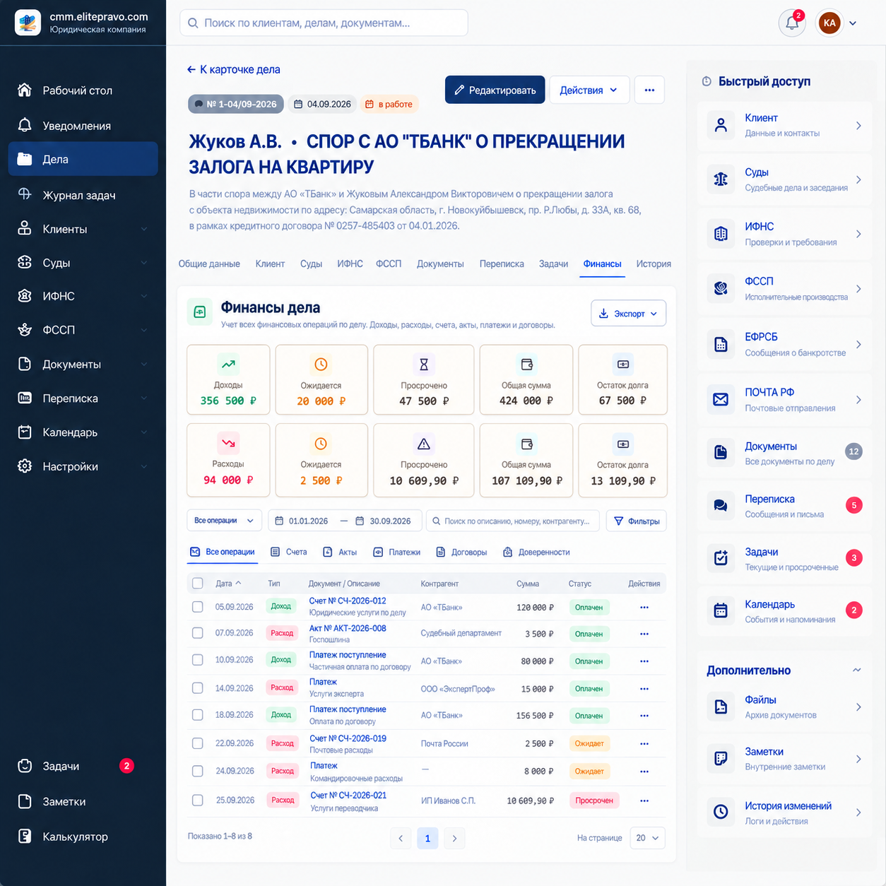
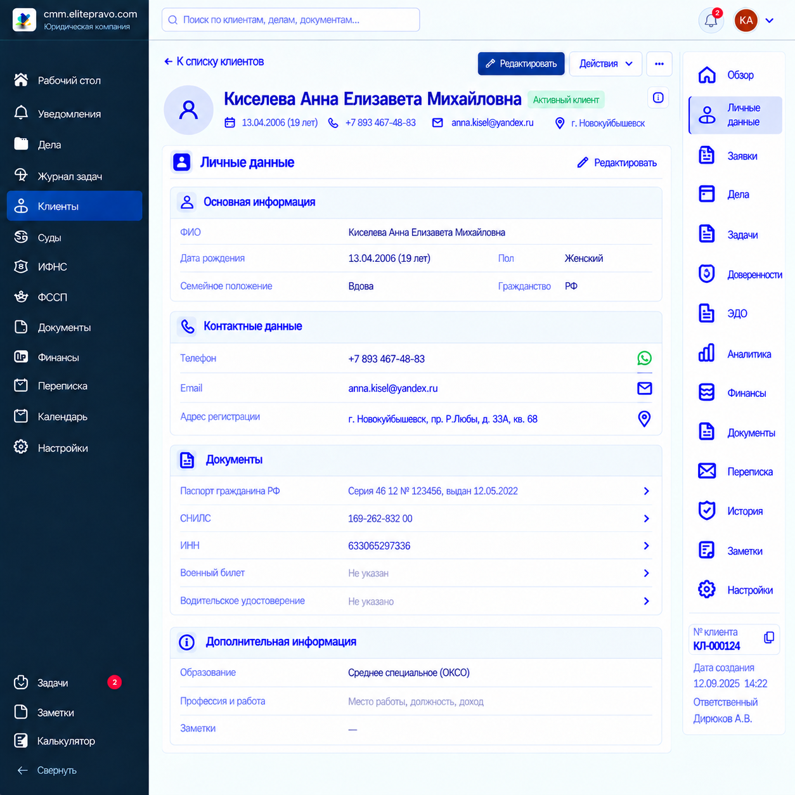

# PayPlanner — интерфейс, макеты и быстрые изменения

Рабочий блок [единого плана](payplanner-unified-roadmap-2026-10-14.md). Исходные решения и доказательства сохранены в карте покрытия. **Прогресс: 1/13 (7.7%)**: всего 13 пакетов, завершено 1, в работе 5, не начато 7, заблокировано 0, решений 0, отдельной приёмки 0. Это готовность полного объёма данного блока, а не отмена ранее выпущенных отдельных улучшений.

## Общие условия

**Граница текущего выпуска, 25 октября:** UI/REQ128–136 установлены как **9448c76f / 1.14.136**: полный frontend **3419/3419**, адресные 189 и браузерные 58 подтверждены; [протокол доставки](deployment-manual-2026-10-25.md). Backend R8 9808+5 сохранён по неизменным проверенным входам, успешные проверки при доставке не повторялись. Вся форма редактора акта на 390 px не принята; SETTINGS 137–142 не установлены: сборка R14, адресный backend 892, полный frontend 3527 и полное semantic format завершены; R11 выполняет первую из четырёх полных backend-частей 10007+5, успешный полный backend и CI ещё не подтверждены. CI 40156586337 неуспешен, локальный результат не является CI. Статусы полных пакетов и общий **9/167 (5.4%)** не меняются; прежние результаты ниже сохраняют свои даты и область.

Исходные макеты — [каталог 18 оригиналов](yougile-sources/mockups/README.md). Пользователь подтвердил вымышленные значения макетов. Реальные изображения из MAX описаны в [визуальной сверке](yougile-sources/unified-2026-10-14/max-media-audit.md), полный альбом остаётся локально вне Git. История и точные сообщения — в [инвентаризации карточек](yougile-sources/unified-2026-10-14/yougile-inventory.json) и [сверке MAX](yougile-sources/unified-2026-10-14/max-requirements-audit.md).

Последние замечания PAY-32 распространяются и на PAY-23/PAY-25: цвета, расположение, иконки, текст без лишних рамок, меньше зрительной перегрузки; сомнительное размещение согласовать до реализации. Отдельно оценивать соответствие изображению и функциональную готовность. Прежнее требование карточек сохранить действующие действия и общий интерфейс CRM не даёт разрешения перепроектировать глобальное меню по декоративному левому столбцу макета.

Видео владельца «ИЗМЕНЕНИЕ МАСШТАБА 4» добавляет обязательную проверку реального zoom: 80/90/100/110% и увеличенный масштаб до 170%, отдельно от viewport. Левое меню остаётся стабильным, рабочая таблица адаптирует колонки/переносы, значения и действия доступны; при невозможности уместить таблицу прокрутка находится внутри неё. Не уменьшать шрифт всей CRM ради одного журнала. [Источник и таймкоды](yougile-sources/unified-2026-10-14/max-media-audit.md).

Голосовое владельца 15 сентября 14:53 требует проверить палитру на больших недорогих мониторах сотрудников: нынешнее восприятие отличается от экрана разработчика. Финальную читаемость подтверждать на рабочих устройствах. Последующее предложение разработчика о настройке цвета каждого элемента — вариант, не согласованная отдельная функция.

Доступы:

- **C0:** исходники, статические макеты, mock API и компонентные проверки; без БД/VPS. Такой пакет подходит Claude Code без доступа к системе.
- **C1:** отдельная синтетическая БД и локальный API. Пакет также может делать Claude Code, если среда предоставлена. Backend обязательно запускать с `BackgroundServices__Enabled=false`, `Email__Enabled=false`.
- **C2:** рабочая CRM, реальные роли или внешние подключения; отдельный этап приёмки. Интерфейсная работа не требует предоставления production-секретов.

Размер: быстрый — подпись/иконка/расположение существующего элемента, обычно до одного рабочего дня; средний — один экран с состояниями и адаптивностью, несколько дней; длительный — новый общий API, история разных источников или новые финансовые правила. Это оценка формы работы, а не обещание срока. Если быстрый пакет начинает менять обработчик, контракт или расчёт, выделить зависимость и повысить риск.

Низкий риск: связанные компонентные проверки, lint/типизация и визуальная сверка. Состояния/фильтры/страницы — средний риск, нужны проверки успеха/ошибки/позднего ответа/выбора. Новые API, права, финансовые итоги и внешние источники — высокий риск, отдельные backend-пакеты. Перед окончательным push frontend-изменений: полный unit, lint, tsc, encoding и build; backend только при затронутом контракте/логике. Не запускать полный gate после каждой правки расстояния. Пользовательские изменения сопровождаются общей понятной записью «Что нового» по уже принятому формату.

## Порядок выполнения

Сначала VIS-00; затем независимые C0-части VIS-12, VIS-05, VIS-07, VIS-03 и VIS-01. Внутри каждой карточки начать с цветов, подписей, иконок и плотности при сохранённом контракте. Затем обработчики/страницы/права и новые источники. Финансовые несоответствия из MAX и проверка доступности источников актов имеют собственный приоритет до расширения финансовых действий; косметика не исправляет сумму или выдачу чужого документа.

## Пакеты работ

### VIS-00 — сравнение макета, текущего экрана и сохранённых действий

- [x] Составить по каждой карточке таблицу «элемент макета → существующий элемент/действие → изменение → отдельная зависимость».

**Проверено 23 октября:** [карта VIS-00](payplanner-visual-comparison-2026-10-23.md) содержит 12/12 самостоятельных таблиц PAY-19…29 и PAY-32, 18/18 оригиналов сверены по SHA-256, 14 уникальных изображений просмотрены, 92 локальные ссылки проверены. Существующие действия и PAY-24 на 53 задачах сохранены; отсутствие подтверждённых источников ФССП/Почты/новых итогов явно отделено от косметики. Это завершение документальной карты, а не реализации VIS-01…12 или живой приёмки. Код приложения и БД этим пунктом не менялись, повторные прикладные проверки не нужны.

**Объём:** PAY-19…29 и PAY-32. Сравнивать заголовок, табы, центральную область, правую навигацию, фильтры, нижние действия и состояния. Для каждого нового видимого значения определить существующий источник; не рисовать вымышленные счётчики или нерабочие кнопки. Записать спорные места и уже принятую часть. **Frontend:** исходные размеры и текущие компоненты. **Backend:** чтение контрактов, без изменения. **Доступ:** C0, средний размер. **DoD:** все 12 карточек имеют таблицу и ссылку на оригинал, остаток отделён от готового; смежные макеты не смешаны — PAY-26 это ФССП, PAY-27 Почта РФ, PAY-28 финансы. Отдельно сохраняется приёмка PAY-24 на 53 задачах.

### VIS-01 — PAY-19: журнал задач

- [~] Привести существующие представления журнала к согласованной композиции, сохранив выбор, фильтры и настройки колонок.

**C0-срез проверен 24 октября в отдельном NEXT-каталоге:** по шести оригинальным изображениям PAY-19 (четыре уникальных) уменьшены только три внешних вертикальных отступа заголовка, показателей и блока фильтров/представлений: `mb-6` → `mb-3`. Разметка, обработчики, запросы, выбор и настройки не менялись. Семь прежних адресных сценариев прошли (**7 passed**, 423 filtered-not-run), lint файла — native 0. Визуальная матрица **12/12**: список/доска × 390/1024/1440 × standard/graphite; просмотрены все 30 снимков, подтверждены отступы 12 px, выбор одной строки, персональные колонки и внутренняя прокрутка без внешнего переполнения. Proof `D:/PayPlannerRelease/20261024-act-optional-catalog-next/vis01-c0-r2/browser-qualification.json`, SHA `7f6c51df…`. Первая попытка с отсутствующим read-only stub сохранена отдельно и не объявлена успешной; код продукта для исправления стенда не менялся. Один полный NEXT frontend ещё впереди. Это только C0-отступы: остальные требования VIS-01, zoom и рабочая приёмка открыты; прогресс блока **1/13 (7.7%)**, общий **9/167 (5.4%)**.

**Исходники:** шесть [изображений PAY-19](yougile-sources/mockups/README.md), включая список, копии списка, доску, таблицу и карточку задачи. **Уже есть:** выпущенные фильтры и ранее принятые настройки колонок/доска; повторно их не писать. **Frontend:** `src/components/Tasks/TaskJournal.tsx`, `TaskJournalColumnSettings.tsx`; разделить косметику и поведение списка/доски. **Backend:** только при несовпадении контракта серверных фильтров/сводок. **Остаток:** исходные размеры, цвета и плотность; корректные выделенные строки и счётчик при фильтре/переходе страницы; сохранение персональных колонок. **Доступ/размер:** C0 для оформления, C1 для массовых действий, средний. **Проверки/DoD:** список/доска/таблица, загрузка/ошибка/пусто, длинные названия, клавиатура, 390/1024/1440 и темы; «выделить всё» действует на явно показанный набор, без скрытых операций над неизвестными строками.

### VIS-02 — PAY-20: обе карточки задачи

- [ ] Завершить визуальный объём карточки и сохранить одинаковые правила в старом и новом окне.

**Источник:** [макет задачи](yougile-sources/mockups/PAY-20-01-task-card.png) и отдельное изображение в PAY-19. **Frontend:** найти обе формы и их общие панели, не создавать третью. **Backend:** переиспользовать `TasksController` и существующие права/согласования. **Объём:** поля/комментарии/файлы/результат/срок/ссылки/нижние кнопки, компактное расположение; несохранённые данные при изменении вкладки и отказе сохранения. **Доступ/размер:** C0 косметика, C1 поведение, средний; новые бизнес-правила относятся к блоку задач. **Проверки/DoD:** администратор переключает общую форму, обе формы сохраняют одинаковые данные; ограниченный исполнитель может выполнять разрешённые действия с результатом/файлами без права менять все поля. Запрос переноса остаётся доступен и проходит текущий маршрут согласования. Макет не отменяет ранее принятые PAY-10/11/12/15.

### VIS-03 — PAY-21: обзор дела и быстрый доступ

- [~] Завершить композицию обзора дела и точность переходов/счётчиков.

**C0 source подготовлен отдельно:** переносы длинного заголовка и мобильная компоновка обзора дела сохранены в будущем UI-срезе; полное поведение, проверки и приёмка VIS-03 ещё открыты. VIS-05/VIS-07 уже в работе и повторно не учитываются. Текущий R8 frontend — квалифицированные3372; адресный набор189 selected/375 catalog, 186 filtered и прогноз3419 не являются новым native full-результатом.

**Уже есть:** компактный быстрый доступ опубликован. **Frontend:** `src/components/Cases/CaseDetailPage.tsx`, `src/components/Clients/CaseModal.tsx`; номер/дата/статус, заголовок/описание, действия, табы и правый столбец. **Backend:** существующие сводки; отсутствующие значения — отдельная задача контракта. **Остаток:** соответствие [обзору](yougile-sources/mockups/PAY-21-01-case-overview.png), доступность всех прежних переходов, актуальные счётчики с учётом прав. **Доступ/размер:** C0 оформление, C1 связывание, средний. **DoD:** длинное дело не сдвигает кнопки за экран, правый блок перестраивается на мобильном; номер/статус и переход «назад» согласованы в обеих формах; скрытый по правам раздел не раскрывает число его записей.

### VIS-04 — PAY-22: суд и инстанции

- [ ] Завершить визуальную карту судебного дела без выдумывания данных источника.

**Источники:** [обзор суда](yougile-sources/mockups/PAY-22-01-court-overview.png), [апелляционная инстанция](yougile-sources/mockups/PAY-22-02-court-instances-appeal.png), PAY-3 и отдельные судебные снимки. **Frontend:** суд/номер/UID, инстанция, судья, заседание, движение, участники/документы, последняя проверка и ошибка. **Backend:** семантика инстанций/источников относится к судебному блоку; карточка апелляции сама не означает незавершённую апелляцию. **Доступ/размер:** C0 расположение на фикстурах, C1 контракт/права, C2 источник, средний/длительный. **DoD:** различены заседание, завершение рассмотрения, вынесение/публикация решения, обжалование/вступление в силу; отсутствующие значения обозначены честно; существующие ручные подтверждения и документы доступны в обеих карточках дела.

### VIS-05 — PAY-23: документы дела

- [~] Завершить оформление и масштабирование документов по макету и новым замечаниям.

**C0-срез, уточнение 27 октября:** иконки по фактическому MIME и переносы длинных названий уже входят в код установленного выпуска `e85d1f22` (коммит `9448c76f`, запись «Что нового» 1.14.129). Прежняя отметка о том, что это только будущие исходники, устарела. Исходное статическое доказательство — `D:/PayPlannerRelease/20261024-roadmap-ui-followup/vis05/static-boundary-proof.json`, SHA `3cbb2945…`; это не подтверждение отдельной живой визуальной приёмки всех форматов и разрешений. Полный VIS-05 не закрыт: остаются соответствие макету и проверки страниц, выбора и прав.

**Уже есть:** таблица, самостоятельное обновление документов; загрузка не должна сохранять несохранённую карточку дела. **Frontend:** название/подпись, дата/время, тип, автор, размер, иконка формата, меню строки; [оригинал](yougile-sources/mockups/PAY-23-01-case-documents.png). Снять лишние рамки там, где требует последний комментарий. **Backend:** проверить реальные страницы/поиск и выбор документа при 51+ записях; отсутствие нужного файла за первой страницей нельзя обходить загрузкой всего архива. **Доступ/размер:** C0 быстрые цвета/иконки, C1 страницы/выбор/права — средний. **DoD:** первая/последующая страницы, фильтр/сортировка/обновление/поздний ответ, версия/скачивание/пусто/ошибка; длинные имена и разные форматы, 390/1024/1440; повтор/ожидание управляемой загрузки сохраняет существующую identity, данные формы и прежние версии.

### VIS-06 — PAY-24: соответствие макету после рабочей приёмки

- [ ] Сверить оставшийся визуальный объём с оригиналом, сохранив принятые массовые операции.

**Доказано:** [рабочая приёмка](yougile-sources/continuation-2026-10-12/pay24-production-acceptance-2026-10-14.json) — 53 синтетические задачи, две роли, обе формы, страницы 50+1, сводки, сохранение и согласования, статус/исполнитель/CSV. Эти механизмы повторно не разрабатывать. **Источник:** [таблица задач дела](yougile-sources/mockups/PAY-24-01-case-tasks.png). **Frontend:** сравнение размеров/цветов/иконок/плотности и отображения результатов; backend не менять ради оформления. **Доступ/размер:** C0 визуальная часть — быстрый/средний; C1 если меняется выбор/обработчик. **DoD:** нет регрессии принятого набора, неполный выбор и частичный отказ отражены честно; задача открывается существующей общей формой, обе карточки сохраняют правила. Дополнительные новые требования из MAX учитываются в отдельном блоке задач.

### VIS-07 — PAY-25: полная лента событий

- [~] Отделить косметику существующих событий от новой объединённой ленты и завершить обе части.

**C0-срез, уточнение 27 октября:** подпись судебных событий и вертикальная лента уже входят в установленный выпуск `e85d1f22` (коммит `9448c76f`, запись «Что нового» 1.14.130); прежнее описание будущего пакета устарело. Статическое доказательство исходного среза — `D:/PayPlannerRelease/20261024-roadmap-ui-followup/vis07/static-boundary-proof.json`, SHA `4e9a3424…`. Это не подтверждение живой визуальной приёмки или завершения общей ленты: новые источники, права, страницы и дедупликация остаются открытыми. Полный VIS-07 не закрыт.

**Уже есть:** опубликованные фильтры судебных событий. Это не полная лента действий, документов, переписки и статусов. **Frontend:** [дата/время, вертикальная линия, цветная иконка, название/описание, файл, источник и раскрытие](yougile-sources/mockups/PAY-25-01-case-events.png), сводные секции снизу и компактный правый блок. **Backend:** общий доступный журнал с устойчивой сортировкой/ключом события, страницами, источником и ссылками; не создавать дубли событий при повторной синхронизации. **Доступ/размер:** C0 оформление имеющегося списка — быстрый; C1 новая лента — длительный. **DoD:** ручное/судебное/документное/задача/переписка события различаются, время локальное, ссылка проверяет доступ; выборка и счётчики учитывают одинаковые фильтры, 51+ событий не теряются. PAY-32-замечания к цветам/рамкам также применяются.

**Зависимость решения:** для каждого источника определить факт и дату получения/отправки, дедупликацию, автора и ответственного. Сам факт загрузки файла не является отправкой в суд, автор записи не подставляется как ответственный. Этот остаток сохранён из прежнего PAY-25-плана; оформление текущих событий можно делать независимо.

### VIS-08 — PAY-26: журнал ФССП

- [ ] Привести журнал исполнительного производства к отдельному макету ФССП.

**Источник:** [оригинал](yougile-sources/mockups/PAY-26-01-case-fssp.png). **Frontend:** поиск и фильтр, дата/время, действие, номер ИП/подразделение, понятный статус, переход в запись; документы постановления/запроса/уведомления. **Backend:** существующие сведения исполнения; новый внешний адаптер и его права/законность чтения — судебный/интеграционный блок, не косметика. **Доступ/размер:** C0 оформление, C1 данные, C2 реальный источник, средний/длительный. **DoD:** пусто/ошибка/устарело/последняя проверка, длинное название, страницы, прямой доступ ограниченной роли; нет обещания автоматической ФССП по изображению с примером. Возбуждение ИП не равно фактическому поступлению денег.

### VIS-09 — PAY-27: Почта РФ

- [ ] Завершить самостоятельный журнал отправлений в деле.

**Источник:** [оригинал](yougile-sources/mockups/PAY-27-01-case-post.png). **Frontend:** входящее/исходящее письмо/бандероль, дата/время, отправитель/получатель, трек, тема/содержание, статус и переход; фильтр и поиск. **Backend:** проверить существующие записи/трек-обновления, доступ и связи документа; реальный внешний API выделить отдельно. **Доступ/размер:** C0 оформление, C1 данные, C2 трекинг; средний/длительный. **DoD:** ручной документ не помечается доставленным без основания, отдельные состояния отправлено/получено/ошибка, доступное вложение и ссылка, повтор не размножает запись, неполный трек даёт понятный отказ.

### VIS-10 — PAY-28: финансы дела

- [ ] Завершить визуальную сводку и серверное соответствие финансовых источников.

**Источник:** [оригинал](yougile-sources/mockups/PAY-28-01-case-finance.png), финансовые изображения MAX. **Frontend:** отдельно доходы/расходы, ожидается/просрочено/всего/остаток; диапазон дат, поиск/фильтры, операции/счета/акты/платежи/договоры/доверенности, сортировка, страницы и меню/экспорт. **Backend:** существующие финансы дела и фактические денежные операции, один источник итогов. Новый расчёт/экспорт — высокий риск. **Доступ/размер:** C0 внешний вид — средний; C1 контракт/финансы — длительный. **DoD:** цена счёта, график, фактическая оплата и остаток не складываются как разные доходы; строки/сводки/экспорт имеют одинаковые фильтры и права; две компании, частичная оплата/аванс/возврат/отмена, старые документы. Служебный JSON не показывается в комментариях; неизвестную категорию операции не выбирать по догадке.

### VIS-11 — PAY-29: мессенджер

- [ ] Завершить визуальную часть поверх существующего внутреннего мессенджера.

**Источник:** [оригинал](yougile-sources/mockups/PAY-29-01-messenger.png) и полный текст PAY-29; PAY-1 — функциональный источник. **Frontend:** `src/components/Messenger/InternalMessenger.tsx`: список типов чатов, поиск, непрочитанные, активная переписка/участники, составление/ответ/упоминания, вложения/действия, компактность и мобильный переход. **Backend:** существующие InternalChat API/SignalR; новые права/доставка/напоминания относятся к мессенджерному блоку. **Доступ/размер:** C0 оформление — средний; C1 два сотрудника/повтор/файлы. **DoD:** черновик отдельный по чату/сотруднику, чтение не сбрасывает непрочитанные вне результата поиска, история >50, новый ответ сохраняет позицию, скрытые/архивные чаты; повтор после ожидания не создаёт второе сообщение или часть вложений. MAX-клиент не включается во все дела контакта автоматически.

### VIS-12 — PAY-32: физическое лицо, безрамочный текст и иконки

- [~] Завершить соответствие исходной карточке и свежим замечаниям владельца.

**Уже есть:** опубликованные поля/расположение и проверки длинного текста, тем/клавиатуры. Заказчик после ответа указал расхождение с дизайном — визуальная приёмка открыта. **Источник:** [оригинал](yougile-sources/mockups/PAY-32-01-individual-client.png), сообщения `1791960634844`, `1791960707329`, `1791960740864`, `1791960861752`, `1791960945696`, `1791961080486`. **Frontend:** шапка с контактами и действиями, группы основной/контактной информации, документы, дополнительная информация, правое меню и реквизиты карточки; режим чтения показывает текст, а не набор полей ввода. Не убирать существующие данные только потому, что они не помещены в один снимок. **Backend:** прежние API/права/история, без новой модели клиента ради вида. **Доступ/размер:** C0 быстрые рамки/цвета/иконки; остальная композиция средняя, C1 сохранение/права. **DoD:** текст читается без лишних рамок, цвета/иконки/порядок сопоставлены с макетом, длинные ФИО/несколько телефонов/адресов/документов, пустые значения, редактирование/отмена/ошибка/несохранённый ввод, темы и 390/1024/1440. Паспортные поля скрываются правами, а не только CSS. Сомнительные новые размещения вынести на конкретное решение до реализации.

**Локальный C0-срез 24 октября, отдельная рабочая копия:** в режиме чтения только «Основная информация» физлица переведена на компактные пары подпись/текст без рамок заблокированных полей, с синей иконкой, разделителями и переносом длинных значений. Все данные, редактирование/отмена, остальные разделы и паспортные права сохранены. Адресный файл прошёл **44/44**, ESLint двух файлов — **0**, общий TypeScript банковского и визуального черновиков — **0**, все **634 входа** совпали до/после. На реальном компоненте с синтетическим API проверены **12/12 сочетаний** 390/1024/1440 px, светлой/графитовой темы и длинных/пустых значений; чтение → изменение → отмена восстанавливает сведения. Просмотрены **36 снимков состояний и 12 снимков окна**, переполнения и обрезания основного текста нет. Ошибок исполнения приложения и внешних запросов нет; отдельно сохранены **15 строк favicon.ico 404** временного стенда, поэтому полностью чистая консоль не заявляется. Доказательства: `D:/PayPlannerRelease/20261024-client-detail-visual/visual-qualification.json`.

Этот срез **не включён в main или текущий выпуск**. Черновик записи «Что нового» сохранён только в отдельной рабочей копии, `docs/development-client-detail-visual-2026-10-24.md`. После завершения связанного банковского этапа нужен один общий применимый frontend-барьер и проверка кодировки окончательного пакета; успешные адресные проверки без изменения входов не повторять. Остальная композиция, реальные роли и весь VIS-12 остаются открытыми. Прогресс блока **1/13 (7.7%)**, общий **9/167 (5.4%)** не изменён.

**Сверка и ход разработки 15 октября:** Быстрый выбор месяца и исторического года уже реализован в общем `SystemDateInput`: заголовок «Выбрать месяц и год», ввод года, выбор месяца и дня, «Применить». В карточке клиента поле рождения и форма паспортов используют этот контрол. Подтверждён выбор `15.03.1985` в паспортной форме с прежним `onUpdateEntry(0, issueDate, 1985-03-15)`; новый календарь не нужен. Новые проверки выявили очистку в отключённом поле и сохранение открытого календаря при смене `disabled/readOnly`. Добавлена общая защита изменения значения, скрыта очистка заблокированных полей, календарь закрывается при потере редактирования и не открывается обратно сам. Регрессии охватывают date/time/datetime-local и оба режима ограничения. После исправления прошли полный frontend unit 2733/2733, интеграции 320/320, lint, TypeScript и production build. На синтетическом экране шириной 390 px проверены закрытие календаря при потере редактирования, сохранение даты и отсутствие очистки. После отдельного изменения CI-валидатора итоговая unit-проверка также прошла: 2735/2735. Остальные требования рамок/иконок/композиции и рабочая приёмка не закрыты этим изменением. Запись включена в одну общую заметку 1.14.89. [Отчёт и область проверки](development-2026-10-15-max-profile.md).

## Дополнительные изображения группы MAX

15 июля,15:36: запрошен фильтр дела; он уже виден17июля и присутствует в текущем TaskJournal. VIS-01/TSK-10 проверяют оформление/поиск/права/полную выборку и новые пожелания, не создают фильтр заново.15 июля,15:44: понятные значки отмены/дублирования с вспомогательным текстом (VIS-02), используя существующие handlers/права в обеих формах.10 июля: меню «Отложить»10 мин/30 мин/1 час/1 день относится к MSG-05, не только оформлению окна. [Источники и подписи](yougile-sources/unified-2026-10-14/max-group-media-audit.md).

## Правило закрытия

Пакет получает `[x]` только после всей своей реализации, применимых проверок/кодировки и данных там, где они нужны. Фактическая ручная приёмка фиксируется отдельным пунктом общего приёмочного блока, если требуется реальная роль/источник. Один успешный снимок не закрывает обработчики, права и сохранение. Комментарии/перемещение YouGile требуют отдельного одобрения конкретного черновика; этот план их не публикует.

## Критерии из полной фотосверки группы MAX

Ниже перечислены прочитанные источники и основной владелец каждого критерия. Исторический дефект сначала сопоставляется с текущим кодом; позднее исправление сохраняется. Повторный макет не создаёт вторую задачу. Дополнительные связанные пакеты указаны в общем реестре.

- **VIS-01 · 15 июля 2026, 15:36** ([снимок 68/0](yougile-sources/unified-2026-10-14/max-group-media-audit.md#max-68-0)): Журнал задач: пользователь просит отдельный выбор дела, которого нет рядом с поиском; фильтры статуса/исполнителя/типа/приоритета сохраняются.
- **VIS-02 · 15 июля 2026, 15:44** ([снимок 69/0](yougile-sources/unified-2026-10-14/max-group-media-audit.md#max-69-0)): Карточка: отмена и дублирование нужны понятными значками с вспомогательным текстом, а не только в меню. Не добавлять новое действие молча: использовать существующий handler и права; обе формы.
- **VIS-02 · 16 июля 2026, 17:37** ([снимок 91/0](yougile-sources/unified-2026-10-14/max-group-media-audit.md#max-91-0)): Выбор клиента открыт позади мастера создания задачи. Вложенный справочник должен быть сверху, с корректным focus/клавиатурой; выбор/отмена сохраняет текущий черновик и исходное дело.
- **VIS-01 · 17 июля 2026, 18:43** ([снимок 102/0](yougile-sources/unified-2026-10-14/max-group-media-audit.md#max-102-0)): 17июля в журнале уже присутствует выбор дела, которого не было на снимке15июля. Проверять актуальный фильтр/полную разрешённую выборку и читаемый список, а не заявлять поле отсутствующим по раннему изображению.
- **VIS-01 · 22 июля 2026, 22:03** ([снимок 115/0](yougile-sources/unified-2026-10-14/max-group-media-audit.md#max-115-0)): 22июля: выбор контрагента должен происходить через поисковую строку, не длинный dropdown; автор просит перенести связанные селекторы и вернуть прежнюю ширину поиска/соседнего поля. Сохранить фильтр по делу и полный разрешённый поиск.
- **VIS-00 · 23 июля 2026, 10:11** ([снимок 116/0](yougile-sources/unified-2026-10-14/max-group-media-audit.md#max-116-0)): 23июля стрелки указывают на бейджи приоритета и «Неоплачиваемая — не для счёта» в строке задачи. Точная желаемая правка текстом не задана: зафиксировать как визуальный референс для согласования, не приписывать снимку доработку заметок-стикеров или новую финансовую норму.
- **VIS-02 · 27 июля 2026, 19:17** ([снимок 128/0](yougile-sources/unified-2026-10-14/max-group-media-audit.md#max-128-0)): Список участников выглядит общей кучей: не ясно, кто согласующий и кто наблюдатель. Роли/очередь/выбранные лица нужно визуально разделить и сохранять раздельно; удаление человека относится к явной роли.
- **VIS-01 · 3 сентября 2026, 20:39** ([снимок 218/0](yougile-sources/unified-2026-10-14/max-group-media-audit.md#max-218-0)): Стрелки к меткам обычного приоритета; рядом независимые «Без счёта» и «Не для счёта». Различать приоритет и финансовый признак, не считать визуальную метку доказательством расчёта.
- **VIS-12 · 7 сентября 2026, 13:15** ([снимок 229/0](yougile-sources/unified-2026-10-14/max-group-media-audit.md#max-229-0)): В дате рождения и выдачи паспорта заголовок календаря не позволяет выбирать месяц и год. Нужен быстрый выбор прошлых дат, ручной ввод и проверка корректности без пошагового листания десятилетий.
- **VIS-12 · 7 сентября 2026, 13:20** ([снимок 230/0](yougile-sources/unified-2026-10-14/max-group-media-audit.md#max-230-0)): Повтор той же аннотации к выбору месяца/года в дате рождения и выдачи паспорта; отдельной новой функции не задаёт.
- **VIS-02 · 16 сентября 2026, 12:13** ([снимок 303/0](yougile-sources/unified-2026-10-14/max-group-media-audit.md#max-303-0)): Выделить границы рабочих блоков без перегруза; клиент и дело должны иметь активные ссылки на профиль с сохранением ввода. Согласующие и наблюдатели визуально разделены.
- **VIS-02 · 16 сентября 2026, 12:21** ([снимок 308/0](yougile-sources/unified-2026-10-14/max-group-media-audit.md#max-308-0)): Референс компактной правой панели карточки: статус, исполнитель, дата, подзадачи, файлы, приоритет, поля, метки и автор; не обещать пользовательские поля без согласованной модели.
- **VIS-02 · 16 сентября 2026, 12:22** ([снимок 309/0](yougile-sources/unified-2026-10-14/max-group-media-audit.md#max-309-0)): Референс компактного вида карточки; переключение представления должно сохранять введённые поля и использовать одну модель сохранения.
- **VIS-02 · 16 сентября 2026, 12:22** ([снимок 309/1](yougile-sources/unified-2026-10-14/max-group-media-audit.md#max-309-1)): Референс расширенного вида: поля слева, комментарии/файлы/таймер справа. Учитывать узкий экран и сохранение локального ввода при переключении.
- **VIS-00 · 16 сентября 2026, 13:27** ([снимок 317/0](yougile-sources/unified-2026-10-14/max-group-media-audit.md#max-317-0)): Пустая доска PayPlanner в YouGile на историческую дату: организационный источник, новых требований к CRM на снимке нет.
- **VIS-00 · 16 сентября 2026, 13:39** ([снимок 333/0](yougile-sources/unified-2026-10-14/max-group-media-audit.md#max-333-0)): Повтор пустой доски YouGile с участниками проекта; организационный контекст, отдельного продуктового требования нет.
- **VIS-00 · 16 сентября 2026, 14:03** ([снимок 349/0](yougile-sources/unified-2026-10-14/max-group-media-audit.md#max-349-0)): Экран ожидания подтверждения доступа к компании YouGile; организационный источник без нового требования CRM.
- **VIS-01 · 17 сентября 2026, 17:03** ([снимок 406/0](yougile-sources/unified-2026-10-14/max-group-media-audit.md#max-406-0)): Явное пожелание кнопки сворачивания блока автоконтроля; состояние предпочтения индивидуально, критические счётчики сохраняются видимыми.
- **VIS-01 · 21 сентября 2026, 17:56** ([снимок 419/0](yougile-sources/unified-2026-10-14/max-group-media-audit.md#max-419-0)): Журнал с группировкой по дате и стрелкой на название контрольной задачи. Нужны читаемый полный заголовок и переход без потери контекста; конкретная клиентская работа не является ТЗ продукта.
- **VIS-01 · 28 сентября 2026, 22:50** ([снимок 483/0](yougile-sources/unified-2026-10-14/max-group-media-audit.md#max-483-0)): Макет компактного журнала: сворачиваемые фильтры, быстрые роли, список/доска/календарь, аккуратные статусы/приоритеты, страницы и общий поиск. Макет не меняет серверную семантику.
- **VIS-01 · 28 сентября 2026, 23:00** ([снимок 487/0](yougile-sources/unified-2026-10-14/max-group-media-audit.md#max-487-0)): Макет доски: просрочено/сегодня/в работе/выполнено, компактные карточки с типом, сроком и комментариями. Группы по сроку могут пересекать статус; правила должны быть явно определены.
- **VIS-01 · 28 сентября 2026, 23:10** ([снимок 488/0](yougile-sources/unified-2026-10-14/max-group-media-audit.md#max-488-0)): Полный макет журнала: роли/исполнитель/клиент/дело/даты/загрузка/вложения, экспорт, анализ оплаты с пояснением, сортировка/колонки/страницы. Сохранять договорную логику, не копировать вымышленные числа как расчёт.
- **VIS-02 · 29 сентября 2026, 00:05** ([снимок 491/0](yougile-sources/unified-2026-10-14/max-group-media-audit.md#max-491-0)): Макет карточки задачи: сворачиваемые блоки, принять в работу, недельное расписание, чат/файлы/таймер/активность и ссылки связей. Оплату/правила сохранять из действующего API, текст макета не выдаёт новых прав.
- **VIS-03 · 29 сентября 2026, 00:27** ([снимок 492/0](yougile-sources/unified-2026-10-14/max-group-media-audit.md#max-492-0)): Макет обзора дела: безрамочный текст, ключевые события, быстрый доступ к клиенту/судам/ИФНС/ФССП/документам/переписке/задачам/календарю и дополнительные файлы/заметки/история.
- **VIS-04 · 29 сентября 2026, 01:52** ([снимок 494/0](yougile-sources/unified-2026-10-14/max-group-media-audit.md#max-494-0)): Судебный макет с четырьмя инстанциями, номером/УИД/судьёй/сторонами/движением, ближайшим событием, критическим сроком, обжалованием и документами. Даты и правовые сроки макета не являются нормативной формулой.
- **VIS-00 · 29 сентября 2026, 01:52** ([снимок 494/1](yougile-sources/unified-2026-10-14/max-group-media-audit.md#max-494-1)): Вариант того же судебного макета без верхнего переключателя инстанций/блока обжалования; выбрать согласованный вариант, остальные требования сохранить.
- **VIS-06 · 29 сентября 2026, 02:50** ([снимок 495/0](yougile-sources/unified-2026-10-14/max-group-media-audit.md#max-495-0)): Макет задач дела: строки с типом/исполнителем/сроком/статусом, флажки, добавить задачу и боковой быстрый доступ. Основная функциональная PAY-24 область принята, дизайн проверяется отдельно.
- **VIS-06 · 29 сентября 2026, 02:50** ([снимок 495/1](yougile-sources/unified-2026-10-14/max-group-media-audit.md#max-495-1)): Повтор макета задач дела в другом файле; отдельного нового поведения нет.
- **VIS-03 · 29 сентября 2026, 02:50** ([снимок 495/2](yougile-sources/unified-2026-10-14/max-group-media-audit.md#max-495-2)): Макет обзора дела со сворачиваемыми сторонами/движением/документами/сроками/задачами/перепиской/историей, номер/копирование, ближайшее событие и ссылка на материалы.
- **VIS-05 · 29 сентября 2026, 02:50** ([снимок 495/3](yougile-sources/unified-2026-10-14/max-group-media-audit.md#max-495-3)): Макет документов дела: поиск/фильтры, тип/дата/автор/размер, выбор строк, меню, добавить и страницы. Более 50 документов проверяются независимо от задач.
- **VIS-03 · 29 сентября 2026, 02:50** ([снимок 495/4](yougile-sources/unified-2026-10-14/max-group-media-audit.md#max-495-4)): Повтор макета обзора со сворачиваемыми блоками; новых функций относительно предыдущего варианта нет.
- **VIS-04 · 29 сентября 2026, 02:50** ([снимок 495/5](yougile-sources/unified-2026-10-14/max-group-media-audit.md#max-495-5)): Повтор судебного макета с инстанциями и обжалованием, сохраняется как вариант той же спецификации.
- **VIS-07 · 29 сентября 2026, 02:59** ([снимок 496/0](yougile-sources/unified-2026-10-14/max-group-media-audit.md#max-496-0)): Макет полной ленты событий: заседание, поступление/отправка документа, определение, подача и регистрация с файлами и переходами. Судебный фильтр — только часть общего объёма PAY-25.
- **VIS-11 · 30 сентября 2026, 12:29** ([снимок 505/0](yougile-sources/unified-2026-10-14/max-group-media-audit.md#max-505-0)): Макет мессенджера: широкая лента, чаты/категории, информация/участники/файлы справа, упоминание/вложение и доставки. Звонок на макете остаётся отдельной интеграцией, не обязательным handler редизайна.
- **VIS-12 · 5 октября 2026, 04:17** ([снимок 528/0](yougile-sources/unified-2026-10-14/max-group-media-audit.md#max-528-0)): Макет личных данных клиента: основной текст без тяжёлых рамок, контакты/документы/дополнительное, боковые разделы и номер/автор. Фиктивные паспортные поля — визуальный пример, права/маскирование сохраняются.
- **VIS-00 · 14 октября 2026, 18:20** ([снимок 607/0](yougile-sources/unified-2026-10-14/max-group-media-audit.md#max-607-0)): Новое изображение журнала: пометки «поднять наверх», «вернуть», «вниз пока» возле фильтров/сортировки/анализа оплаты задач/автоконтроля. Сохранить буквальные аннотации; точное расположение неоднозначных стрелок подтверждается перед реализацией, бизнес-расчёты не меняются одной перестановкой.

## Оригиналы и конкретные быстрые критерии

[14 дополнительных макетов из MAX](yougile-sources/unified-2026-10-14/max-mockup-gallery.md) дополняют 18 оригиналов YouGile. В VIS-12 проверить выбор месяца/года по заголовку календаря даты рождения и выдачи паспорта, ручной ввод и далёкие прошлые даты без листания десятилетий; переиспользовать SystemDateInput. В VIS-01 сохранять группировку и существующие фильтры, добавить ясные пояснения финансовых счётчиков/сворачивание, согласовать точные стрелки нового снимка 14 октября 18:20 через VIS-00. В VIS-11 длинный текст не прыгает при наборе/scroll/новом сообщении, область редактирования читаема на рабочем мониторе. Функциональный остаток этих экранов — TSK/MSG/CAL/DOC, без повторного определения правил в CSS.

- **VIS-01 · 14 октября 2026, 19:39/19:55** ([снимок 608/0](yougile-sources/unified-2026-10-14/max-group-media-audit.md#max-608-0)): Новый снимок 14 октября 19:39: клонировать строку поиска; уточнение 19:55 прямо запрещает убирать её вместо клонирования. Блок анализа оплаты убрать из журнала в бухгалтерскую часть работы по счетам. Место второй строки согласовать по VIS-00; оба поля используют одно состояние/фильтр и один запрос, без дубля handlers. Перенос анализа сохраняет счета, права, очередь и данные.

## VIS-00/10 — денежный образец КУБ, 17 октября

[исследование КУБ](kub-reference-analysis-2026-10-16.md), [каталог форм F01–F12](yougile-sources/kub-audit-2026-10-16/forms-and-flows.md) F01/F06/F08–F10 и [оригинальные снимки](yougile-sources/kub-audit-2026-10-16/screenshots.md). Сначала сопоставить исходный макет заказчика, текущий экран и наблюдаемую механику КУБ, сохранив действия/права. **Прогресс 0/13 (0%)**, исследование не закрывает визуальный пакет.

C0: компактный заголовок с видимой компанией/счётом/валютой/периодом/факт-планом, четыре объяснимых показателя, плотная таблица и быстрые документы из контекста; дата документа/срок/дата оплаты подписаны раздельно. При отсутствии НДС не держать пустую колонку, при скидке показать соответствующие поля и итог; длинные строки/адреса не обрезать. Явно указывать, относится ли сводка к фильтру таблицы: в КУБ пустой поиск не обнуляет верхние карточки. Денежная вкладка контрагента сохраняет кошелёк, поэтому текущий отбор должен быть заметен. Сохранение не теряет карточку и положение в журнале. Подготовить fixtures для загрузки, пустоты, ошибки, запрета и неизвестной исторической записи; проверить390/1024/1440 и печатныйA4. C1 финансовые обработчики и серверные права остаются у BANK/DOC, C0 не меняет формулу самовольно.
