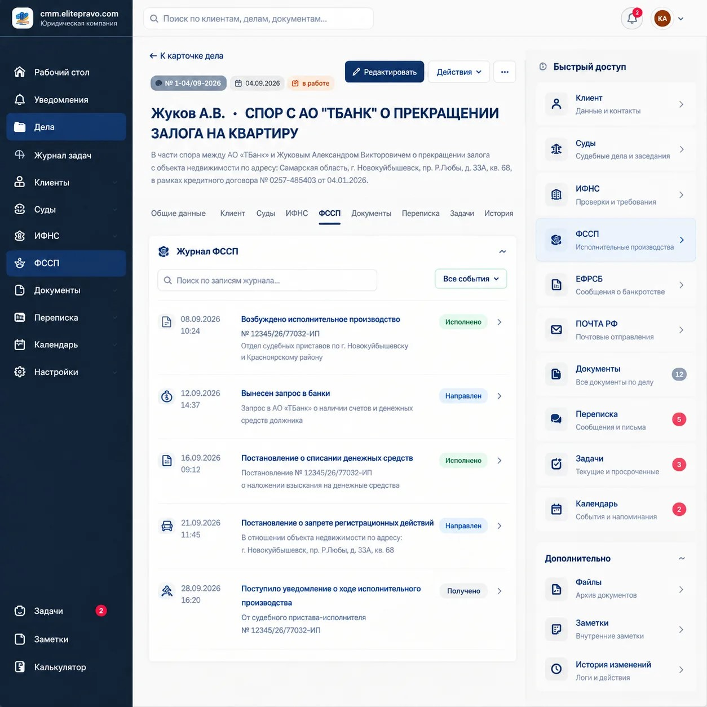
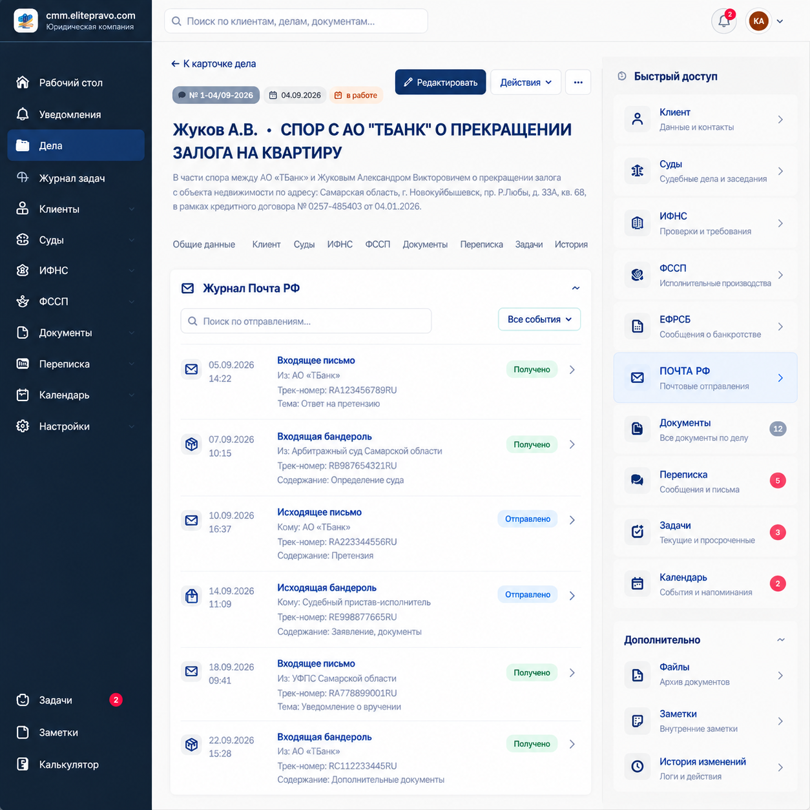

# PayPlanner — интерфейс, макеты и быстрые изменения

Рабочий блок [единого плана](payplanner-unified-roadmap-2026-10-14.md). Исходные решения и доказательства сохранены в карте покрытия. **Прогресс: 1/13 (7.7%)**: всего 13 пакетов, завершено 1, в работе 8, не начато 4, заблокировано 0, решений 0, отдельной приёмки 0. Это готовность полного объёма данного блока, а не отмена ранее выпущенных отдельных улучшений.

## Общие условия

**VIS-04, компоновка и состояния 29 октября:** боковые блоки обзора появляются от 1280 px, реквизиты сохраняют читаемую ширину; проверены **390/1024/1280/1440/1600 px**, один связанный компонентный сценарий **1/1**, типы application/tooling и ESLint. Полный родитель корректно различает назначение решения, завершённое рассмотрение, решение, апелляцию и срок без жалобы; прежняя форма сохраняет ручные даты и документы. Заметка **1.14.391** неактивна, серверная приёмка и обязательный CI впереди; [границы](development-vis04-court-audit-2026-10-28.md#компоновка-ноутбука-и-судебные-состояния--29-октября). Готовый UI включается в следующий исправленный итоговый кандидат до единого CI. VIS-04 `[~]`, блок **1/13 (7.7%)**, общий **9/167 (5.4%)**.

**VIS-04, полная страница 29 октября:** участники проверены внутри настоящего родительского экрана на синтетических данных при **390/1024/1440/1600 px**, без горизонтального переполнения. Раскрытие **6→26→37** не добавляет запросов; повтор после отказа в обзоре и редакторе перечитывает только участников. Корректны пустой список и ожидание; ошибок консоли и внешних запросов после настройки стенда нет. Приложение и прежние 13 адресных результатов не менялись и не повторялись; [границы доказательства](development-vis04-court-audit-2026-10-28.md#полная-родительская-страница--29-октября). Полный DoD макетов, CI и рабочая приёмка остаются открыты. VIS-04 `[~]`, UI **1/13 (7.7%)**, общий **9/167 (5.4%)**.

**VIS-04, отдельная подготовка 28 октября:** в `feature/court-overview-followup` подготовлены раскрываемый список всех активных участников процесса и явный отказ чтения с повтором в обзоре и редакторе. **13 уникальных адресных сценариев**, ESLint и типизация приложения прошли; отдельный настоящий компонент осмотрен в браузере на 390/1024/1440/1600 px, переполнение длинных имён исправлено. Подробности, неудачные попытки и ограничения сохранены в [протоколе](development-vis04-court-audit-2026-10-28.md#отдельная-подготовка-списка-участников--28-октября). Изменения не включены в текущий кандидат main; браузерная проверка полной карточки, CI и рабочая приёмка впереди. Записи 1.14.389/390 неактивны. VIS-04 `[~]`, блок **1/13 (7.7%)**, общий **9/167 (5.4%)**.

**Переход к счёту, 28 октября:** на изолированном синтетическом стенде проверен настоящий переход через приложение: доходные счета → анализ оплаты → выбор задачи → форма счёта с клиентом и услугой → отмена и повторное открытие очереди с сохранённым выбором. API и учётная запись синтетические, счёт не сохранялся; внешних запросов и необработанных ошибок приложения не было. Один запрос значка сайта получил 404 из-за ограничений стенда. [Доказательства и хеши](D:/PayPlannerRelease/20261028-accounting-billing-app-visual/evidence.json). Рабочая приёмка, проверка сохранения на реальном окружении и обязательный CI остаются впереди. VIS-01 `[~]`, блок **1/13 (7.7%)**, общий план **9/167 (5.4%)**.

**Граница текущего выпуска, 25 октября:** UI/REQ128–136 установлены как **9448c76f / 1.14.136**: полный frontend **3419/3419**, адресные 189 и браузерные 58 подтверждены; [протокол доставки](deployment-manual-2026-10-25.md). Backend R8 9808+5 сохранён по неизменным проверенным входам, успешные проверки при доставке не повторялись. Вся форма редактора акта на 390 px не принята; SETTINGS 137–142 не установлены: сборка R14, адресный backend 892, полный frontend 3527 и полное semantic format завершены; R11 выполняет первую из четырёх полных backend-частей 10007+5, успешный полный backend и CI ещё не подтверждены. CI 40156586337 неуспешен, локальный результат не является CI. Статусы полных пакетов и общий **9/167 (5.4%)** не меняются; прежние результаты ниже сохраняют свои даты и область.

Исходные макеты — [каталог 18 оригиналов](yougile-sources/mockups/README.md). Пользователь подтвердил вымышленные значения макетов. Реальные изображения из MAX описаны в [визуальной сверке](yougile-sources/unified-2026-10-14/max-media-audit.md), полный альбом остаётся локально вне Git. История и точные сообщения — в [инвентаризации карточек](yougile-sources/unified-2026-10-14/yougile-inventory.json) и [сверке MAX](yougile-sources/unified-2026-10-14/max-requirements-audit.md).

Последние замечания PAY-32 распространяются и на PAY-23/PAY-25: цвета, расположение, иконки, текст без лишних рамок, меньше зрительной перегрузки; сомнительное размещение согласовать до реализации. Отдельно оценивать соответствие изображению и функциональную готовность. Прежнее требование карточек сохранить действующие действия и общий интерфейс CRM не даёт разрешения перепроектировать глобальное меню по декоративному левому столбцу макета.

Видео владельца «ИЗМЕНЕНИЕ МАСШТАБА 4» добавляет обязательную проверку реального zoom: 80/90/100/110% и увеличенный масштаб до 170%, отдельно от viewport. Левое меню остаётся стабильным, рабочая таблица адаптирует колонки/переносы, значения и действия доступны; при невозможности уместить таблицу прокрутка находится внутри неё. Не уменьшать шрифт всей CRM ради одного журнала. [Источник и таймкоды](yougile-sources/unified-2026-10-14/max-media-audit.md).

Голосовое владельца 15 сентября 14:53 требует проверить палитру на больших недорогих мониторах сотрудников: нынешнее восприятие отличается от экрана разработчика. Финальную читаемость подтверждать на рабочих устройствах. Последующее предложение разработчика о настройке цвета каждого элемента — вариант, не согласованная отдельная функция.

Доступы:

- **C0:** исходники, статические макеты, mock API и компонентные проверки; без БД/VPS. Такой пакет подходит Claude Code без доступа к системе.
- **C1:** отдельная синтетическая БД и локальный API. Пакет также может делать Claude Code, если среда предоставлена. Backend обязательно запускать с `BackgroundServices__Enabled=false`, `Email__Enabled=false`.
- **C2:** рабочая CRM, реальные роли или внешние подключения; отдельный этап приёмки. Интерфейсная работа не требует предоставления production-секретов.

Размер: быстрый — подпись/иконка/расположение существующего элемента, обычно до одного рабочего дня; средний — один экран с состояниями и адаптивностью, несколько дней; длительный — новый общий API, история разных источников или новые финансовые правила. Это оценка формы работы, а не обещание срока. Если быстрый пакет начинает менять обработчик, контракт или расчёт, выделить зависимость и повысить риск.

Низкий риск: связанные компонентные проверки, lint/типизация и визуальная сверка. Состояния/фильтры/страницы — средний риск, нужны проверки успеха/ошибки/позднего ответа/выбора. Новые API, права, финансовые итоги и внешние источники — высокий риск, отдельные backend-пакеты. Перед окончательным push frontend-изменений: полный unit, lint, tsc, encoding и build; backend только при затронутом контракте/логике. Не запускать полный gate после каждой правки расстояния. Пользовательские изменения сопровождаются общей понятной записью «Что нового» по уже принятому формату.

## Порядок выполнения

Сначала VIS-00; затем независимые C0-части VIS-12, VIS-05, VIS-07, VIS-03 и VIS-01. Внутри каждой карточки начать с цветов, подписей, иконок и плотности при сохранённом контракте. Затем обработчики/страницы/права и новые источники. Финансовые несоответствия из MAX и проверка доступности источников актов имеют собственный приоритет до расширения финансовых действий; косметика не исправляет сумму или выдачу чужого документа.

## Пакеты работ

### VIS-00 — сравнение макета, текущего экрана и сохранённых действий

- [x] Составить по каждой карточке таблицу «элемент макета → существующий элемент/действие → изменение → отдельная зависимость».

**Проверено 23 октября:** [карта VIS-00](payplanner-visual-comparison-2026-10-23.md) содержит 12/12 самостоятельных таблиц PAY-19…29 и PAY-32, 18/18 оригиналов сверены по SHA-256, 14 уникальных изображений просмотрены, 92 локальные ссылки проверены. Существующие действия и PAY-24 на 53 задачах сохранены; отсутствие подтверждённых источников ФССП/Почты/новых итогов явно отделено от косметики. Это завершение документальной карты, а не реализации VIS-01…12 или живой приёмки. Код приложения и БД этим пунктом не менялись, повторные прикладные проверки не нужны.

**Объём:** PAY-19…29 и PAY-32. Сравнивать заголовок, табы, центральную область, правую навигацию, фильтры, нижние действия и состояния. Для каждого нового видимого значения определить существующий источник; не рисовать вымышленные счётчики или нерабочие кнопки. Записать спорные места и уже принятую часть. **Frontend:** исходные размеры и текущие компоненты. **Backend:** чтение контрактов, без изменения. **Доступ:** C0, средний размер. **DoD:** все 12 карточек имеют таблицу и ссылку на оригинал, остаток отделён от готового; смежные макеты не смешаны — PAY-26 это ФССП, PAY-27 Почта РФ, PAY-28 финансы. Отдельно сохраняется приёмка PAY-24 на 53 задачах.

### VIS-01 — PAY-19: журнал задач

**Браузерный возврат и подпись дела, 28 октября:** на изолированном стенде с настоящими компонентами выбор задачи сохранился после посещения клиента и дела. Два необязательных запроса справочников клиента не были реализованы в синтетическом API, внешних обращений не было; иконка стенда вернула 404. Кнопка дела ошибочно называлась «Реестр дел» при возврате к анализу; после проверки её подпись исправлена на «К анализу оплаты задач», обычное название сохранено. Реальный компонент **1/1** и маршруты **2/2**, ESLint, типизация, кодировка прошли. Браузерная проверка выполнялась до изменения подписи, а не после; [доказательства и хеши](D:/PayPlannerRelease/20261028-billing-case-return-label/evidence.json). Реальные данные, приёмка и CI остаются впереди; запись 1.14.355 неактивна. VIS-01 `[~]`, блок **1/13 (7.7%)**, общий **9/167 (5.4%)**.

**Возврат из клиента и дела, 28 октября:** воспроизведена потеря выделения в обоих переходах. Очередь теперь сохраняется на время просмотра связанных карточек и сбрасывается при отзыве доступа к счетам или задачам; вне этих переходов она не удерживается. Адресные проверки маршрутов, прав и очереди **11/11**, ESLint, типизация и кодировка прошли. [Команды и хеши](D:/PayPlannerRelease/20261028-billing-related-navigation/evidence.json). Дополнительная браузерная проверка и её ограничения указаны выше; реальные данные, приёмка и CI остаются впереди. Запись 1.14.354 неактивна. VIS-01 `[~]`, блок **1/13 (7.7%)**, общий **9/167 (5.4%)**.

**Возврат из карточки организации, 28 октября:** адресный сценарий воспроизвёл переход из анализа оплаты в общий справочник без возврата к выбору. Карточка организации теперь открывается внутри бухгалтерского сценария, после закрытия сохраняется очередь и её выделение; доступ к карточке по-прежнему проверяется. Новые проверки возврата, отказа и отзыва/восстановления прав **3/3**, связанные проверки очереди **4/4**, ESLint, типизация и кодировка прошли; [команды и хеши](D:/PayPlannerRelease/20261028-billing-organization-return/evidence.json). Проверки с подменой компонентов и прав, рабочая приёмка и CI остаются впереди; запись 1.14.353 неактивна. Последующий результат по клиенту и делу указан выше. VIS-01 `[~]`, блок **1/13 (7.7%)**, общий **9/167 (5.4%)**.

**Анализ оплаты в бухгалтерии, 28 октября — локально:** панель убрана из обычного журнала и открывается из «Доходных счетов» при доступе к задачам и счетам; создание документа требует отдельного права. Используется прежняя очередь и подготовка черновика; фильтры анализа хранятся отдельно от журнала. После успешного создания счёта отправляется сигнал обновления очереди; при отказе сигнал не отправляется. Адресные проверки: очередь/фильтры/черновик **7/7**, маршрутизация и отзыв прав **4/4**, экран счетов и приём черновика **2/2**, успешная/неуспешная запись, обновление очереди и счёт без задач **4/4**, глобальный счётчик **1/1**. Отдельный синтетический стенд реальной панели проверен на 390/1440 px; переход через приложение до формы счёта и обратно проверен на синтетических данных, как описано выше. Рабочие права/данные и полный CI ещё не проверены. Записи 1.14.351/352 неактивны; VIS-01 `[~]`, блок **1/13 (7.7%)**, общий **9/167 (5.4%)**.

**Подготовка переноса анализа оплаты, 28 октября:** существующая панель была выделена в переиспользуемый компонент без изменения её места, счётчиков, фильтров или подготовки счёта. Четыре адресных сценария журнала прошли, включая группы, готовый черновик, завершённую работу и доступ только на чтение. Последующее локальное подключение описано выше; блок **1/13 (7.7%)**, общий **9/167 (5.4%)**.

**Решение пользователя, 28 октября:** сохранить действующее поле поиска и разместить второе над таблицей задач; оба поля управляют одним общим поиском. Локальная реализация и адресные проверки описаны ниже; приёмка и CI остаются впереди. VIS-01 `[~]`, блок **1/13 (7.7%)**, общий план **9/167 (5.4%)**.

**Второе поле поиска, 28 октября — реализовано локально:** над таблицей добавлено поле, связанное с существующим запросом; при загрузке списка оно остаётся доступным. Адресные сценарии подтвердили синхронизацию обоих полей, сохранение ввода при ожидании, сброс массового выбора и переход на первую страницу — **3/3**. Ещё **3/3** существующих сценария проверили персональные настройки, представления и прежний поиск; ESLint, типизация и кодировка успешны. Синтетические тесты не заменяют визуальную проверку реального браузера, рабочую приёмку и полный CI. Запись 1.14.318 неактивна; VIS-01 `[~]`, блок **1/13 (7.7%)**, общий план **9/167 (5.4%)**.

**Браузерная проверка поиска, 28 октября:** настоящий журнал на изолированном синтетическом стенде осмотрен на 390×844 и 1440×900; новое поле находится непосредственно над таблицей, ввод в каждом поле отражается в другом. На узком экране поле и таблица находятся внутри доступной ширины страницы; ошибок приложения и внешних сетевых обращений не зафиксировано. Снимки и стенд: `D:/PayPlannerRelease/20261028-task-second-search-visual/`. Первая попытка адаптации стенда завершилась синтаксической ошибкой временного сценария, исправленного до запуска; продуктовый код не менялся. Проверены светлая тема и синтетические данные; рабочая приёмка и полный CI остаются впереди. Стенд и тестовый браузер остановлены. VIS-01 `[~]`, блок **1/13 (7.7%)**, общий **9/167 (5.4%)**.

**Быстрая смена поиска, 28 октября:** ранее выделенная задача снова появлялась выбранной, если ввести и очистить поиск до отложенного обновления списка. Выделение теперь сбрасывается при изменении поискового текста. Новый сценарий сначала воспроизвёл ошибку, затем вместе с выбором страницы, фильтрацией и сменой статуса прошли **5/5** адресных сценариев; ESLint и типизация приложения успешны. Тесты синтетические, реальная приёмка и полный CI остаются открыты. Запись 1.14.302 неактивна; VIS-01 `[~]`, блок **1/13 (7.7%)**, общий **9/167 (5.4%)**. Логи `D:/PayPlannerRelease/20261028-vis01-fast-search-red.log` и `D:/PayPlannerRelease/20261028-vis01-fast-search-green.log`.

- [~] Привести существующие представления журнала к согласованной композиции, сохранив выбор, фильтры и настройки колонок.

**Смена контрагента в фильтре дела, 28 октября:** адресный сценарий подтвердил, что при задержке нового списка фильтр оставался доступен с данными предыдущего контрагента. Выбор теперь отключён при загрузке и отсутствии права просмотра дел; варианты дополнительно ограничены выбранным физическим или юридическим лицом. Проверены задержка/устаревший список, обычная смена и сохранение фильтра, юридическое лицо и отсутствие права: 3/3 и 2/2 компонентных сценария. Это синтетический frontend с подменой данных, не проверка реального отзыва прав или backend API. Подготовлена неактивная запись 1.14.278; полный VIS-01 и выпускной gate остаются открыты. Блок **1/13 (7.7%)**, общий **9/167 (5.4%)**.

**Журнал объединённого кандидата, 28 октября:** семь выбранных компонентных сценариев частичного выбора, перехода страницы, ошибок, повтора и смены фильтра прошли. Дополнительный сценарий задерживает ответ второй страницы, переключает фильтр и подтверждает, что поздний ответ не возвращает старые строки и массовый выбор; 1/1, ESLint теста успешен. Первоначальный вариант пробовал вернуться кнопкой страницы во время загрузки, но она в этом состоянии скрыта; заменён на доступную смену фильтра. Доказательство `D:/PayPlannerRelease/20261028-merge-financial-focused/task-journal-merged-evidence.json`; тесты синтетические, без рабочей браузерной приёмки. VIS-01 `[~]`, блок **1/13 (7.7%)**, общий **9/167 (5.4%)**.

**Ошибка загрузки журнала, 27 октября:** после неудачного обновления теперь остаётся предупреждение о возможной неполноте данных с повтором, в том числе после повторной ошибки; успешный запрос убирает предупреждение. Адресный сценарий двух отказов и успешного повтора прошёл, отдельно проверено сохранение сброса прежнего выбора. Неактивная запись 1.14.226; полная приёмка и выпускной gate остаются открыты. VIS-01 в работе, блок 1/13 (7.7%), общий план 9/167 (5.4%).

**Смена фильтра во время загрузки, 27 октября:** тест воспроизвёл доступность прежнего массового выбора после переключения статуса до ответа сервера. При смене параметров серверного списка предыдущие строки и выбор очищаются, показывается загрузка. Новый сценарий и связанные проверки выбора, фильтров, поиска и страниц прошли 12/12; неактивная запись 1.14.225. Реальная приёмка и выпускной gate остаются открыты; VIS-01 в работе, блок 1/13 (7.7%), общий план 9/167 (5.4%).

**Переход при медленной загрузке, 27 октября:** тест воспроизвёл доступность прежних строк и массовых действий после смены номера страницы до ответа сервера. При переходе выбор сбрасывается, строки скрываются и показывается загрузка; при отказе загрузки прежний выбор не возвращается, переход назад доступен. Два адресных сценария задержки и ошибки прошли; подготовлена неактивная запись 1.14.224. Другие изменения фильтров, полная приёмка и выпускной gate остаются открыты. VIS-01 в работе, блок 1/13 (7.7%), общий план 9/167 (5.4%).

**Выбор при переходе страницы, 27 октября:** новый адресный тест выбирает задачу на первой странице, переходит на вторую и проверяет, что массовая панель исчезает, а действие над выбранной строкой второй страницы отправляет только её ID. Сценарий прошёл 1/1 на синтетических данных; он не проверяет поздний ответ во время перехода или все массовые операции. VIS-01 остаётся в работе; блок 1/13 (7.7%), общий план 9/167 (5.4%).

**Частичный выбор страницы, 27 октября:** общий флажок теперь показывает промежуточное состояние, когда выбраны только некоторые доступные строки текущей страницы. До исправления тест подтвердил отсутствие этого состояния; после исправления проверены частичный/полный/пустой выбор и применение массового действия только к строке после фильтра: два адресных сценария прошли (`D:/PayPlannerRelease/20261027-vis01-partial-selection-green.log`, `20261027-vis01-selection-filter.log`). ESLint, проверка типов приложения и кодировка успешны. Запись 1.14.217 неактивна. Остальные сценарии макета, реальная приёмка и выпускной gate открыты; блок 1/13 (7.7%), общий план 9/167 (5.4%).

**Сверка 27 октября:** три компактных отступа, описанные ниже, уже присутствуют в текущем HEAD; повторно их не переносили. После связанных изменений журнала прошли 7 адресных сценариев фильтров, колонок, массового действия, представлений и доски; 106 сценариев отфильтрованы и не запускались. Доказательство `D:/PayPlannerRelease/20261027-vis01-current/qualification.json`. Остальные требования VIS-01 и рабочая приёмка остаются открыты; блок 1/13 (7.7%), общий прогресс 9/167 (5.4%).

**Свёрнутый автоконтроль, 27 октября:** добавлен критический счётчик при сворачивании и предупреждение при ошибке обновления. Адресно проверены сохранение настройки, счётчик при общем и критическом фильтре и отказ загрузки сводки; на синтетическом экране 390 px счётчик виден без горизонтального переполнения (`D:/PayPlannerRelease/20261027-vis02-quick-actions-browser/automation-critical-390.png`). Изменение локальное; полная приёмка VIS-01 и выпускной gate остаются открыты, общий прогресс 9/167 (5.4%).

**Контрагент и дело на узком экране, 27 октября:** текст в первой колонке переносится с учётом закреплённой ширины действий, не попадая под неё. Проверены действующие настройки колонок и закрепление действий (2 адресных теста), TypeScript и ESLint; синтетические экраны 390 и 1440 px сохранены в `D:/PayPlannerRelease/20261027-vis02-quick-actions-browser/journal-names-final-390.png` и `journal-names-final-1440.png`. Проверка реального масштаба 80–170%, других ширин и полная приёмка VIS-01 остаются открыты.

**Дополнительная узкая проверка журнала, 27 октября:** на синтетическом viewport 320 px ширина содержимого и страницы составила 320 px, правая граница текста контрагента 125,2 px, закреплённые действия начинались с 138,2 px. После изменения минимальной ширины прошли 2 адресных теста колонок и закрепления, ESLint и TypeScript; снимок `D:/PayPlannerRelease/20261027-vis02-quick-actions-browser/journal-names-final-320.png`. Реальный масштаб и остальные условия VIS-01 остаются открыты.

**Повторная попытка масштаба, 28 октября:** защищённый синтетический стенд журнала поднят без backend, но средство управления окном остановилось: не удалось достаточно надёжно определить адрес окна браузера в Windows. Изменение масштаба не выполнялось и матрица 80–170% остаётся открытой. Собственный браузер и стенд остановлены; рабочие данные не использовались.

**Попытка проверки масштаба, 27 октября:** на отдельном синтетическом окне Edge клавиша, переданная Playwright, не изменила измеренные параметры браузера. Прямое управление выбранным окном Windows вернуло `GetCursorPos: доступ запрещён`; изменение масштаба и требуемая матрица 80–170% не подтверждены. Тестовое окно и стенд остановлены. Размер viewport не выдан за реальный zoom; повторить проверку в доступном интерактивном окружении.

**Сверка 27 октября:** три описанных ниже компактных отступа уже присутствуют в исходниках установленной ревизии `e85d1f22`; в её каталоге активна запись **1.14.127 «Компактнее журнал задач»**. Нижнее описание NEXT относится к прежнему этапу и не означает, что этот срез нужно переносить заново. Остальные требования списка, доски, прав и рабочей приёмки остаются открытыми; прогресс блока **1/13 (7.7%)**, общий **9/167 (5.4%)** не изменён.

**C0-срез проверен 24 октября в отдельном NEXT-каталоге:** по шести оригинальным изображениям PAY-19 (четыре уникальных) уменьшены только три внешних вертикальных отступа заголовка, показателей и блока фильтров/представлений: `mb-6` → `mb-3`. Разметка, обработчики, запросы, выбор и настройки не менялись. Семь прежних адресных сценариев прошли (**7 passed**, 423 filtered-not-run), lint файла — native 0. Визуальная матрица **12/12**: список/доска × 390/1024/1440 × standard/graphite; просмотрены все 30 снимков, подтверждены отступы 12 px, выбор одной строки, персональные колонки и внутренняя прокрутка без внешнего переполнения. Proof `D:/PayPlannerRelease/20261024-act-optional-catalog-next/vis01-c0-r2/browser-qualification.json`, SHA `7f6c51df…`. Первая попытка с отсутствующим read-only stub сохранена отдельно и не объявлена успешной; код продукта для исправления стенда не менялся. Один полный NEXT frontend ещё впереди. Это только C0-отступы: остальные требования VIS-01, zoom и рабочая приёмка открыты; прогресс блока **1/13 (7.7%)**, общий **9/167 (5.4%)**.

**Исходники:** шесть [изображений PAY-19](yougile-sources/mockups/README.md), включая список, копии списка, доску, таблицу и карточку задачи. **Уже есть:** выпущенные фильтры и ранее принятые настройки колонок/доска; повторно их не писать. **Frontend:** `src/components/Tasks/TaskJournal.tsx`, `TaskJournalColumnSettings.tsx`; разделить косметику и поведение списка/доски. **Backend:** только при несовпадении контракта серверных фильтров/сводок. **Остаток:** исходные размеры, цвета и плотность; корректные выделенные строки и счётчик при фильтре/переходе страницы; сохранение персональных колонок. **Доступ/размер:** C0 для оформления, C1 для массовых действий, средний. **Проверки/DoD:** список/доска/таблица, загрузка/ошибка/пусто, длинные названия, клавиатура, 390/1024/1440 и темы; «выделить всё» действует на явно показанный набор, без скрытых операций над неизвестными строками.

### VIS-02 — PAY-20: обе карточки задачи

**Длинное название в прежней форме, 28 октября:** новая форма уже поддерживала перенос; в прежней длинное название было однострочным. Теперь поле прежней формы расширяется по содержимому при просмотре и редактировании, включая длинную строку без пробелов; переносы при вводе не попадают в сохраняемое название. Адресно прошли сохранение названия и фокус из меню **2/2**, затем изменены только CSS-классы высоты. ESLint и TypeScript прошли. Изолированный браузер с синтетическими данными показал на 390 и 1440 px отсутствие переполнения текста и страницы; первоначальная проверка выявила фиксированную высоту, исправленную до итоговой визуальной проверки. Снимок `output/playwright/legacy-title-390.png`; внешних запросов и ошибок стенда нет. Это не рабочая приёмка и не полный VIS-02; запись 1.14.294 неактивна. Блок **1/13 (7.7%)**, общий **9/167 (5.4%)**.

**Подписи действий, 28 октября:** в компактном меню новой карточки добавлены пояснения к отмене и дублированию, как в прежней форме; обработчики и права сохранены. Текст копирования уточнён в обеих формах: статус и результат в копию не переносятся. Три адресных теста старого и нового меню прошли, ESLint и проверка кодировки успешны; первая попытка запуска не стартовала из-за неподдерживаемого параметра, затем команда исправлена. Типизация приложения прошла до последнего изменения только текстовых подписей. На синтетическом экране 390×844 видны обе подписи, ширина каждой кнопки равна ширине содержимого; нарушений сетевой изоляции и ошибок нет. Проверка рабочих устройств, других разрешений и общий выпускной gate остаются открыты. Скриншот `D:/PayPlannerRelease/20261028-task-menu-hints-visual/menu-final-390.png`. Неактивная запись 1.14.268; VIS-02 `[~]`, блок **1/13 (7.7%)**, общий **9/167 (5.4%)**. Логи `D:/PayPlannerRelease/20261028-task-menu-hints-tests-retry.log` и `D:/PayPlannerRelease/20261028-task-menu-hints-eslint.log`.

- [~] Завершить визуальный объём карточки и сохранить одинаковые правила в старом и новом окне.

**Черновик при отказе сохранения, 27 октября:** два новых адресных теста проверили старую и новую карточки: после ошибки сохранения введённые название и описание остаются в полях и передаются при повторной попытке. 2/2 прошли на синтетических данных. Это проверка отдельных полей, а не полная приёмка карточек или подтверждение сохранения на рабочем сервере. VIS-02 остаётся в работе; блок 1/13 (7.7%), общий план 9/167 (5.4%).

**Подсказка результата, 27 октября:** в прежней карточке завершённой задачи сотрудник без права изменения видел предложение завершить задачу; теперь, как и в новой форме, показывается отсутствие права. В первоначальном адресном запуске новая форма прошла, прежняя выявила ошибку (`D:/PayPlannerRelease/20261027-vis02-result-permission-red.log`); после текстового исправления повторён только затронутый тест прежней формы 1/1 и дополнительно прошли две проверки сохранения/завершения (`20261027-vis02-result-permission-green.log`, `20261027-vis02-result-related.log`). ESLint, типы приложения и кодировка проверены. Права и обработчики не менялись. Запись 1.14.218 неактивна; полный VIS-02 и выпускной gate остаются открыты, блок 1/13 (7.7%), общий план 9/167 (5.4%).

**Узкий локальный срез 27 октября:** в обеих формах добавлены быстрые кнопки копирования и отмены с подписями, существующими правами и прежним подтверждением отмены; действия в меню сохранены. Финальный адресный набор 11/11 и 51 проверка карточки на предшествующей версии этого же изменения прошли; ESLint и TypeScript успешны. На изолированном стенде визуально проверены обе формы при 390 и 1440 px; скриншоты `D:/PayPlannerRelease/20261027-vis02-quick-actions-browser/`. Найден отдельный остаток: длинный заголовок новой карточки обрезается на узком экране, его исправление и повторная визуальная проверка ещё впереди. Полный VIS-02 не закрыт, необходим общий выпускной gate; общая готовность 9/167 (5.4%).

**Название на узком экране, 27 октября:** в новой форме поле визуально переносит длинное название, а при вводе и сохранении остаётся одной строкой. На синтетическом экране 390 px проверены длинная фраза и строка без пробелов: размеры поля соответствуют содержимому; `D:/PayPlannerRelease/20261027-vis02-quick-actions-browser/modern-title-390.png`. До точечной корректировки ссылки прошли 52 проверки карточек и 4 проверки сохранения черновика при обновлении учёта; после неё отдельно прошли 2 проверки названия и фокуса старой формы, TypeScript успешен. Остальные требования VIS-02 и общий gate открыты; прогресс блока 1/13 (7.7%), общий 9/167 (5.4%).

**Поиск клиента в мастере, 27 октября:** встроенный список находится внутри мастера; исправлена потеря прежнего клиента и дела при отмене нового поиска. Пока поиск не завершён, действия с учётом недоступны; выбор другого клиента очищает прежнее дело. Адресно прошли 5 сценариев поиска и привязки; на синтетическом экране 390 px подтверждены расположение списка, блокировка проверки договора и восстановление клиента/дела по Esc (`D:/PayPlannerRelease/20261027-vis02-quick-actions-browser/wizard-search-390.png`). Это локальное изменение, полный VIS-02 и выпускной gate не закрыты.

**Клавиатура поиска, 27 октября:** добавлены перемещение стрелками, видимая подсветка, `aria-activedescendant` и выбор Enter; Esc сохраняет прежний выбор. Адресные проверки поиска и сохранности привязки прошли, затем после уточнения границ индекса повторены только 2 затронутых сценария. На синтетическом экране 390 px выбор второго клиента стрелками и Enter подтверждён (`D:/PayPlannerRelease/20261027-vis02-quick-actions-browser/wizard-keyboard-390.png`). Полный VIS-02 и выпускной gate остаются открыты.

**Роли участников, 27 октября:** обе формы уже разделяют согласующих и наблюдателей. Подписи кнопок удаления уточнены по роли, чтобы различать действия и при назначении одного сотрудника в обе группы. Прошли 10 адресных проверок, включая удаление одной роли с сохранением другой и проверку сохранения/повторного открытия; TypeScript и ESLint успешны. Полный VIS-02 и выпускной gate остаются открыты, общий прогресс 9/167 (5.4%).

**Переходы и черновик, 27 октября:** переходы к клиенту, организации и делу из обеих карточек открывают новую вкладку, сохраняя несохранённое поле исходной задачи. Для организации добавлен прямой маршрут с проверкой идентификатора; доступ к разделу и данным остаётся под действующими проверками. Прошли 70 тестов маршрутизации/навигации и 55 тестов карточки, включая обе формы, черновик и запрет просмотра раздела; TypeScript и ESLint успешны. Сквозная приёмка новых вкладок в рабочей CRM и общий выпускной gate ещё впереди; VIS-02 остаётся в работе.

**Переключение вида, 27 октября:** добавлена адресная проверка, что несохранённые название и описание переживают переключение компактного и расширенного вида и затем сохраняются. Проверка прошла; полной приёмкой карточки или выпускным gate она не является.

**Источник:** [макет задачи](yougile-sources/mockups/PAY-20-01-task-card.png) и отдельное изображение в PAY-19. **Frontend:** найти обе формы и их общие панели, не создавать третью. **Backend:** переиспользовать `TasksController` и существующие права/согласования. **Объём:** поля/комментарии/файлы/результат/срок/ссылки/нижние кнопки, компактное расположение; несохранённые данные при изменении вкладки и отказе сохранения. **Доступ/размер:** C0 косметика, C1 поведение, средний; новые бизнес-правила относятся к блоку задач. **Проверки/DoD:** администратор переключает общую форму, обе формы сохраняют одинаковые данные; ограниченный исполнитель может выполнять разрешённые действия с результатом/файлами без права менять все поля. Запрос переноса остаётся доступен и проходит текущий маршрут согласования. Макет не отменяет ранее принятые PAY-10/11/12/15.

### VIS-03 — PAY-21: обзор дела и быстрый доступ

**Действия в шапке на узком экране, 28 октября:** на синтетической карточке с правом редактирования при 320 и 390 px подпись кнопки редактирования выходила за её границы; при 320 px то же происходило с созданием задачи. Для узкой ширины кнопки теперь располагаются в один столбец, при большей сохраняется прежняя сетка. На 320/390/1024/1440 px измерены ширина кнопок и текста, отсутствие внешнего переполнения и ошибок стенда; снимок `output/playwright/case-header-actions-320.png`. Два адресных теста быстрых переходов, ESLint и TypeScript успешны. Это синтетический обзор, не проверка реальных ролей, всех счётчиков или полного CI; запись 1.14.299 неактивна. VIS-03 `[~]`, блок **1/13 (7.7%)**, общий **9/167 (5.4%)**.

**Краткая сводка и права, 28 октября:** существующая проверка непустого реестра дополнена проверкой отдельного маршрута обзора дела: отсутствие права на задачи, только свои задачи и полный доступ возвращают соответствующие числа и отметку видимости; при отсутствии права последняя дата скрыта. 3/3 сценария прошли на синтетической SQLite, формат и кодировка успешны. Первая попытка не дошла до проверки из-за отсутствующей сборки миграций в тестовом каталоге; после подключения частичной тестовой сборки выполнен повтор. Это не проверка полной миграции, PostgreSQL или рабочих ролей. VIS-03 `[~]`, блок **1/13 (7.7%)**, общий **9/167 (5.4%)**. Доказательства `D:/PayPlannerRelease/20261028-case-overview-visibility/evidence.json`.

- [~] Завершить композицию обзора дела и точность переходов/счётчиков.

**Серверная сводка объединённого кандидата, 28 октября:** `ApplyTaskSummaryAsync` ограничивает возвращаемые значения по доступным задачам; при неполном доступе скрывает производные сведения автоконтроля. На синтетической SQLite прошли 14 выбранных существующих сценариев карточки, фильтра и экспорта. В непустом реестре дополнительно проверены отсутствие доступа, собственные задачи и полный доступ к задачам и заявкам: два первых варианта прошли сразу, третий сначала ожидал полную сводку без права заявок и получил частичную; после исправления тестовой роли на полный доступ прошёл отдельно. TRX и отпечатки — `D:/PayPlannerRelease/20261028-merge-financial-focused/case-registry-evidence.json`. Это не полный аудит всех маршрутов, миграций или реальная приёмка; историческое предупреждение ниже не означает отсутствия уже подготовленной защиты. VIS-03 остаётся `[~]`, блок **1/13 (7.7%)**, общий **9/167 (5.4%)**.

**Судебный обзор и границы данных, 27 октября:** воспроизведены сохранение названий документов прежнего дела при переходе и показ числа активных/просроченных задач без права просмотра задач. Список документов ограничен текущим делом, сводка задач скрыта без права; семь адресных сценариев прошли (`D:/PayPlannerRelease/20261027-vis03-court-privacy.log`), ESLint, TypeScript и кодировка изменённых файлов прошли. Записи 1.14.202/203 неактивны. Отдельный риск: серверный `ApplyTaskSummaryAsync` агрегирует задачи без явной проверки права просмотра задач; необходимо проверить все выдающие сводку маршруты и тесты прав, не считать исправление интерфейса защитой API. Серверная пагинация документов, все права и приёмка VIS-03 остаются открыты; блок 1/13 (7.7%), общий 9/167 (5.4%).

**Навигация по разделам, 27 октября:** адресный сценарий последовательно выбирает все девять доступных пунктов быстрого доступа и проверяет соответствующую вкладку и единственное обозначение текущего раздела. После устранения неоднозначного селектора тест прошёл 1/1 (`D:/PayPlannerRelease/20261027-vis03-quick-links.log`). Проверка не подтверждает содержимое всех разделов или права на сервере; VIS-03 остаётся в работе, общий прогресс 9/167 (5.4%).

**Отзыв доступа в обзоре, 27 октября:** добавлен адресный сценарий открытия задач с последующим отзывом прав на задачи и финансы. После отзыва скрываются содержимое задач, финансовая сводка и оба пункта быстрого доступа; тест прошёл 1/1 (`D:/PayPlannerRelease/20261027-vis03-revoke.log`). Это проверка интерфейса на синтетических данных, не проверка серверных прав или всех счётчиков; VIS-03 остаётся в работе, общий прогресс 9/167 (5.4%).

**Мобильная проверка обзора, 27 октября:** на изолированном синтетическом экране 390 px длинные номер, название и описание переносились, основные кнопки оставались в пределах окна; ширина страницы и содержимого — 390 px. Быстрый доступ «Задачи» открыл таблицу задач дела, «Реестр дел» вызвал переход назад. Ошибок стенда и внешних сетевых запросов не обнаружено. Две первые попытки выбрать кнопку неверным доступным именем завершились таймаутом; повтор с фактическим aria-label успешен. Скриншот и отпечатки: `D:/PayPlannerRelease/20261027-vis03-mobile/qualification.json`. Это не проверка всех переходов, прав, счётчиков, других размеров или реального zoom; VIS-03 остаётся в работе.

**Сверка 27 октября:** подготовленный перенос длинных номеров и описания уже присутствует в текущем исходнике, повторное применение не требуется. После связанных изменений карточки дела адресно прошли 2 сценария загрузки обзора и быстрых переходов; 165 сценариев отфильтрованы и не запускались. Доказательство `D:/PayPlannerRelease/20261027-vis03-current/qualification.json`. Мобильная визуальная приёмка и полный объём прав и счётчиков остаются открыты; блок 1/13 (7.7%), общий прогресс 9/167 (5.4%).

**C0 source подготовлен отдельно:** переносы длинного заголовка и мобильная компоновка обзора дела сохранены в будущем UI-срезе; полное поведение, проверки и приёмка VIS-03 ещё открыты. VIS-05/VIS-07 уже в работе и повторно не учитываются. Текущий R8 frontend — квалифицированные3372; адресный набор189 selected/375 catalog, 186 filtered и прогноз3419 не являются новым native full-результатом.

**Уже есть:** компактный быстрый доступ опубликован. **Frontend:** `src/components/Cases/CaseDetailPage.tsx`, `src/components/Clients/CaseModal.tsx`; номер/дата/статус, заголовок/описание, действия, табы и правый столбец. **Backend:** существующие сводки; отсутствующие значения — отдельная задача контракта. **Остаток:** соответствие [обзору](yougile-sources/mockups/PAY-21-01-case-overview.png), доступность всех прежних переходов, актуальные счётчики с учётом прав. **Доступ/размер:** C0 оформление, C1 связывание, средний. **DoD:** длинное дело не сдвигает кнопки за экран, правый блок перестраивается на мобильном; номер/статус и переход «назад» согласованы в обеих формах; скрытый по правам раздел не раскрывает число его записей.

### VIS-04 — PAY-22: суд и инстанции

- [~] Завершить визуальную карту судебного дела без выдумывания данных источника.

**Сверка существующей реализации, 28 октября:** обзор, инстанции, движение, участники, сроки и состояния источника уже есть в `CourtTab`; переписывать их заново не требуется. Оба исходных макета просмотрены, соответствие и конкретные непроверенные границы записаны в [аудите VIS-04](development-vis04-court-audit-2026-10-28.md). Сохранены успешные результаты трёх неизменённых тестовых файлов предыдущего CI, но полный CI и визуальная/рабочая приёмка остаются открыты. VIS-04 начат, UI **1/13 (7.7%)**, общий **9/167 (5.4%)**.

**Источники:** [обзор суда](yougile-sources/mockups/PAY-22-01-court-overview.png), [апелляционная инстанция](yougile-sources/mockups/PAY-22-02-court-instances-appeal.png), PAY-3 и отдельные судебные снимки. **Frontend:** суд/номер/UID, инстанция, судья, заседание, движение, участники/документы, последняя проверка и ошибка. **Backend:** семантика инстанций/источников относится к судебному блоку; карточка апелляции сама не означает незавершённую апелляцию. **Доступ/размер:** C0 расположение на фикстурах, C1 контракт/права, C2 источник, средний/длительный. **DoD:** различены заседание, завершение рассмотрения, вынесение/публикация решения, обжалование/вступление в силу; отсутствующие значения обозначены честно; существующие ручные подтверждения и документы доступны в обеих карточках дела.

### VIS-05 — PAY-23: документы дела

**Метки типов документов, 28 октября:** по исходному макету типы в таблице дела выделены компактными цветными метками: судебный акт, договор и остальные типы различаются оформлением; само название, поиск, фильтры и действия не изменены. Два существующих сценария поиска, фильтров и версий прошли; ESLint и TypeScript успешны. Изолированный браузер на вымышленных документах проверил отображение на 390/1024/1440 px, содержимое ячеек и отсутствие внешнего переполнения страницы; нарушений сетевой изоляции и ошибок стенда нет. Скриншот `output/playwright/document-type-badges-1440.png`. Судебный акт в браузерной фикстуре отдельно не представлен; рабочая приёмка, страницы/права и полный CI открыты. Запись 1.14.295 неактивна; VIS-05 `[~]`, блок **1/13 (7.7%)**, общий **9/167 (5.4%)**.

**Независимые документы без ключа, 28 октября:** исправлено определение актуальной версии в списке дела, реестре и карточке: документы без ключа не объединяются. Проверены SQLite и PostgreSQL на синтетических данных, группировка обычных версий и недоступность чужого дела: 3/3 адресных теста, реестр аудита 1/1, форматирование затронутых файлов. Первая попытка остановилась из-за отсутствия владельца в тестовых данных, затем данные исправлены. Реальные файлы, серверная пагинация и полная проверка регистра ключей остаются вне этого среза. Запись 1.14.267 неактивна; VIS-05 `[~]`, блок **1/13 (7.7%)**, общий **9/167 (5.4%)**. Доказательства `D:/PayPlannerRelease/20261028-case-doc-version/evidence.json`.

**Поиск по форме букв, 28 октября:** локальный поиск по уже загруженным документам сопоставляет канонически эквивалентные формы Unicode, не меняя имя, идентификатор или группировку версий. Тест воспроизвёл пропуск файла с составной буквой; после исправления прошли 5/5 выбранных сценариев поиска и истории, затем 2/2 после уточнения теста для обоих вариантов запроса. ESLint, TypeScript приложения и проверка кодировки прошли. Это не серверный поиск и не полная Unicode-эквивалентность всех локалей; пагинация, права и рабочая приёмка остаются открыты. Запись 1.14.266 неактивна; VIS-05 `[~]`, блок **1/13 (7.7%)**, общий **9/167 (5.4%)**. Доказательства `D:/PayPlannerRelease/20261028-case-document-unicode/evidence.json`.

- [~] Завершить оформление и масштабирование документов по макету и новым замечаниям.

**Группы версий и разные алфавиты, 27 октября:** обнаружены различия сравнения ключей на сервере и в браузере. Подготовлена передача идентификатора группы, вычисленного сервером по существующему правилу; старый сервер без идентификатора не объединяет не-ASCII ключи по догадке. Шесть адресных сценариев интерфейса прошли (`D:/PayPlannerRelease/20261027-doc-groups-frontend.log`); серверный тест групп и последних версий прошёл 1/1 (`D:/PayPlannerRelease/20261027-doc-groups-backend.log`). После исправления замечания ESLint прошли три затронутых сценария (`D:/PayPlannerRelease/20261027-doc-groups-fallback.log`), ESLint и TypeScript; кодировка восьми изменённых файлов проверена. Исторические данные не меняются. Серверная пагинация и полная приёмка остаются открыты, запись 1.14.201 неактивна; блок 1/13 (7.7%), общий план 9/167 (5.4%).

**Ошибка и повтор загрузки, 27 октября:** во вкладке документов отказ теперь отображается отдельно от пустого списка и позволяет повторить запрос; повторный отказ остаётся видимым, а поздний отказ после переключения вкладок не затирает новую выборку. Три адресных сценария включают существующий поиск. При исследовании 51+ выявлено, что карточка загружает все версии с проверкой наличия файлов, тогда как постраничный реестр имеет другие правила версии и наличия файла; безопасная серверная пагинация и её приёмка остаются открытыми. Неактивная запись 1.14.199; блок 1/13 (7.7%), общий план 9/167 (5.4%).

**История версий и 51+, 27 октября:** исправлено отображение истории при различии регистра ключей; пустой ключ не объединяется с похожим настоящим. На 60 синтетических документах поиск нашёл и открыл последнюю запись, но проверка использовала нынешнюю полную загрузку и не доказывает серверную пагинацию. Прошли 5 адресных сценариев, ESLint и TypeScript. Разные ключи с многобуквенным преобразованием регистра проверены отдельно; полная Unicode-эквивалентность сравнения сервера и браузера не подтверждена. Неактивная запись 1.14.200; блок 1/13 (7.7%), общий план 9/167 (5.4%).

**Синтетическая браузерная проверка документов, 27 октября:** быстрый доступ открыл список трёх вымышленных PDF, PNG и DOCX; длинное имя и имя без пробелов переносились на 390 px, PNG отображался с иконкой изображения. Поиск оставил нужный договор и после очистки вернул все три строки, меню сведений открылось после внутренней прокрутки. На 390/1024/1440 px ширина всей страницы соответствовала окну; на 390 px таблица прокручивалась внутри контейнера. Ошибок стенда и внешних запросов после добавления двух отсутствовавших read-only заглушек не было. Скриншоты и отпечатки: `D:/PayPlannerRelease/20261027-vis05-documents/qualification.json`. Это не проверка реальных прав, загрузки/скачивания, серверных страниц 51+ или рабочего zoom; VIS-05 остаётся в работе.

**Сверка 27 октября:** описанный ниже срез иконок, переносов и компактных строк уже присутствует в текущем HEAD `5dd66746` (файл включён изменением `9448c76f`); повторно его не переносили. После связанной визуальной правки карточки дела адресно прошли 16 проверок PAY-23, 151 сценарий отфильтрован и не запускался. Результат и контрольные суммы после запуска: `D:/PayPlannerRelease/20261027-vis05-current/qualification.json`. Серверная выборка, полный объём оформления и рабочая приёмка остаются открыты; статус `[~]`, блок 1/13 (7.7%), общий прогресс 9/167 (5.4%).

**Подготовлен отдельный C0-срез, 24 октября:** в `roadmap-ui-followup` оформлены иконки по фактическому MIME и переносы длинных названий документов. Обработчики, ID, версии, даты/размеры и запросы сохранены; статическое доказательство — `D:/PayPlannerRelease/20261024-roadmap-ui-followup/vis05/static-boundary-proof.json`, SHA `3cbb2945…`. Это только исходники будущего пакета: native-проверки и визуальная приёмка ещё не выполнялись, в текущий R6-выпуск код не включён. Полный VIS-05 не закрыт.

**C0-срез, уточнение 27 октября:** иконки по фактическому MIME и переносы длинных названий уже входят в код установленного выпуска `e85d1f22` (коммит `9448c76f`, запись «Что нового» 1.14.129). Прежняя отметка о том, что это только будущие исходники, устарела. Исходное статическое доказательство — `D:/PayPlannerRelease/20261024-roadmap-ui-followup/vis05/static-boundary-proof.json`, SHA `3cbb2945…`; это не подтверждение отдельной живой визуальной приёмки всех форматов и разрешений. Полный VIS-05 не закрыт: остаются соответствие макету и проверки страниц, выбора и прав.

**Уже есть:** таблица, самостоятельное обновление документов; загрузка не должна сохранять несохранённую карточку дела. **Frontend:** название/подпись, дата/время, тип, автор, размер, иконка формата, меню строки; [оригинал](yougile-sources/mockups/PAY-23-01-case-documents.png). Снять лишние рамки там, где требует последний комментарий. **Backend:** проверить реальные страницы/поиск и выбор документа при 51+ записях; отсутствие нужного файла за первой страницей нельзя обходить загрузкой всего архива. **Доступ/размер:** C0 быстрые цвета/иконки, C1 страницы/выбор/права — средний. **DoD:** первая/последующая страницы, фильтр/сортировка/обновление/поздний ответ, версия/скачивание/пусто/ошибка; длинные имена и разные форматы, 390/1024/1440; повтор/ожидание управляемой загрузки сохраняет существующую identity, данные формы и прежние версии.

### VIS-06 — PAY-24: соответствие макету после рабочей приёмки

**Компактные строки задач, 28 октября:** уменьшены только вертикальные отступы ячеек списка; текст названия и результата не обрезается, выбор, меню и обработчики не менялись. Прошли **13/13** выбранных сценариев карточки, включая строки, выбор, меню и открытие; ESLint, TypeScript и кодировка успешны. На синтетических 390/1024/1440 px проверены внутренняя прокрутка таблицы, отсутствие внешнего переполнения и сохранение выбора при изменении ширины; ошибок стенда и внешних запросов нет. Снимок `output/playwright/case-task-compact-1440.png`. Это не повтор полной рабочей приёмки или проверка серверных 51+; VIS-06 `[~]`, блок **1/13 (7.7%)**, общий **9/167 (5.4%)**. Запись 1.14.296 неактивна.

**Смена области доступа, 27 октября:** воспроизведено сохранение старых строк при изменении области задач без отзыва права просмотра. Добавлен ключ области сотрудника, задач и заявок: прежние строки и счётчики скрываются, сводка дела перечитывается, старые задачи исчезают из выбора источника документа. Четыре адресных сценария карточки и 9/9 тестов механизма страниц прошли; после точечной правки мемоизации затронутые сценарии повторно прошли 2/2 (`D:/PayPlannerRelease/20261027-case-task-scope-final.log`), ESLint, TypeScript и кодировка успешны. Ключ реагирует на смену сотрудника, роли, права просмотра и области задач/заявок; изменение состава подразделения без изменения этих полей требует отдельной проверки. Реальные сеансы и полный gate остаются открыты, запись 1.14.211 неактивна; блок 1/13 (7.7%), общий план 9/167 (5.4%).

**Единая карточка списка, 27 октября:** заголовок, таблица и переходы по страницам размещены в общей компактной области; фильтры, подсказки, выбор, состояния и обработчики сохранены. Прошли 13 адресных тестов (154 не выбирались), ESLint, TypeScript и кодировка. На синтетических 390/1024/1440 px внешнего горизонтального переполнения нет; на 390 px подтверждены выбор строки и вызов открытия задачи без выполнения массовой операции. Неактивная запись 1.14.172; доказательства `D:/PayPlannerRelease/20261027-vis06-card-layout/qualification.json`. Полная приёмка, рабочие роли, 51+ и выпускной gate остаются открыты; VIS-06 в работе, общий прогресс 9/167 (5.4%).

**Локальный визуальный срез 27 октября:** изменены цвет кнопки создания, фон и границы списка, регистр заголовков; выбор, фильтры, обработчики и поля сохранены. PAY-24: 25 адресных тестов прошли, ESLint успешен; синтетическое представление настоящей таблицы с заглушкой массовых действий проверено при 390/1024/1440 px, ширина страницы соответствует экрану. Доказательства: `D:/PayPlannerRelease/20261027-vis06-case-tasks/`. Полное соответствие макету и рабочая приёмка не подтверждены; VIS-06 остаётся в работе, блок 1/13 (7.7%), общий прогресс 9/167 (5.4%).

**Сверка исходника и макета 27 октября:** в текущем коде уже присутствуют таблица задач, выбор, меню строк, счётчики, фильтр и страницы; перед визуальными изменениями сохранять все действия и область выбора. Макет PAY-24 показывает компактный заголовок и таблицу внутри единого блока, с синей кнопкой добавления и обычным регистром подписей колонок; текущие исходники используют отдельный блок фильтра, зелёную кнопку и заглавные подписи таблицы. Это сравнение источников и кода, не браузерная приёмка; сначала уточнить размещение, затем проверить 390/1024/1440 px и существующие обработчики. VIS-06 не закрыт, общий прогресс 9/167 (5.4%).

- [~] Сверить оставшийся визуальный объём с оригиналом, сохранив принятые массовые операции.

**Доказано:** [рабочая приёмка](yougile-sources/continuation-2026-10-12/pay24-production-acceptance-2026-10-14.json) — 53 синтетические задачи, две роли, обе формы, страницы 50+1, сводки, сохранение и согласования, статус/исполнитель/CSV. Эти механизмы повторно не разрабатывать. **Источник:** [таблица задач дела](yougile-sources/mockups/PAY-24-01-case-tasks.png). **Frontend:** сравнение размеров/цветов/иконок/плотности и отображения результатов; backend не менять ради оформления. **Доступ/размер:** C0 визуальная часть — быстрый/средний; C1 если меняется выбор/обработчик. **DoD:** нет регрессии принятого набора, неполный выбор и частичный отказ отражены честно; задача открывается существующей общей формой, обе карточки сохраняют правила. Дополнительные новые требования из MAX учитываются в отдельном блоке задач.

### VIS-07 — PAY-25: полная лента событий

**Разделители судебных событий, 28 октября:** в существующей ленте добавлены тонкие линии между записями по макету; последняя запись без нижней линии. Порядок, фильтры, даты и источник не менялись. Два адресных теста журнала и позднего ответа прошли, ESLint и TypeScript успешны. На синтетических 390/1024/1440 px проверены линии, перенос длинных названий и отсутствие внешнего переполнения; ошибок и внешних запросов нет. Снимок `output/playwright/case-event-separators-1440.png`. Объединённая лента разных источников, рабочие права/данные и полный CI остаются открыты; запись 1.14.297 неактивна. VIS-07 `[~]`, блок **1/13 (7.7%)**, общий **9/167 (5.4%)**.

**Синтетическая проверка ленты, 27 октября:** быстрый доступ открыл два вымышленных судебных события; время показано в часовом поясе сотрудника, длинное название и строка без пробелов перенеслись на 390 px. Поиск сократил список до одного события, сброс восстановил оба; на 390/1024/1440 px внешнего горизонтального переполнения нет. Внешних запросов, ошибок стенда и запрещённых изменений не выявлено. Скриншоты и отпечатки: `D:/PayPlannerRelease/20261027-vis07-events/qualification.json`. Это проверка только существующих судебных событий; объединённая лента, другие источники, права, 51+ событий и рабочая приёмка остаются открыты.

**Сверка 27 октября:** компактная лента судебных событий из описанного ниже отдельного среза уже присутствует в HEAD `5dd66746` (изменение файла `9448c76f`); повторно её не переносить. Адресные PAY-25 проверки текущего кандидата — 8 passed, 159 filtered. Общая лента, остальные источники и рабочая приёмка не закрыты; общий прогресс 9/167 (5.4%).

- [~] Отделить косметику существующих событий от новой объединённой ленты и завершить обе части.

**C0-срез, уточнение 27 октября:** подпись судебных событий и вертикальная лента уже входят в установленный выпуск `e85d1f22` (коммит `9448c76f`, запись «Что нового» 1.14.130); прежнее описание будущего пакета устарело. Статическое доказательство исходного среза — `D:/PayPlannerRelease/20261024-roadmap-ui-followup/vis07/static-boundary-proof.json`, SHA `4e9a3424…`. Это не подтверждение живой визуальной приёмки или завершения общей ленты: новые источники, права, страницы и дедупликация остаются открытыми. Полный VIS-07 не закрыт.

**Уже есть:** опубликованные фильтры судебных событий. Это не полная лента действий, документов, переписки и статусов. **Frontend:** [дата/время, вертикальная линия, цветная иконка, название/описание, файл, источник и раскрытие](yougile-sources/mockups/PAY-25-01-case-events.png), сводные секции снизу и компактный правый блок. **Backend:** общий доступный журнал с устойчивой сортировкой/ключом события, страницами, источником и ссылками; не создавать дубли событий при повторной синхронизации. **Доступ/размер:** C0 оформление имеющегося списка — быстрый; C1 новая лента — длительный. **DoD:** ручное/судебное/документное/задача/переписка события различаются, время локальное, ссылка проверяет доступ; выборка и счётчики учитывают одинаковые фильтры, 51+ событий не теряются. PAY-32-замечания к цветам/рамкам также применяются.

**Зависимость решения:** для каждого источника определить факт и дату получения/отправки, дедупликацию, автора и ответственного. Сам факт загрузки файла не является отправкой в суд, автор записи не подставляется как ответственный. Этот остаток сохранён из прежнего PAY-25-плана; оформление текущих событий можно делать независимо.

### VIS-08 — PAY-26: журнал ФССП

- [ ] Привести журнал исполнительного производства к отдельному макету ФССП.

**Источник:** [оригинал](yougile-sources/mockups/PAY-26-01-case-fssp.png). **Frontend:** поиск и фильтр, дата/время, действие, номер ИП/подразделение, понятный статус, переход в запись; документы постановления/запроса/уведомления. **Backend:** существующие сведения исполнения; новый внешний адаптер и его права/законность чтения — судебный/интеграционный блок, не косметика. **Доступ/размер:** C0 оформление, C1 данные, C2 реальный источник, средний/длительный. **DoD:** пусто/ошибка/устарело/последняя проверка, длинное название, страницы, прямой доступ ограниченной роли; нет обещания автоматической ФССП по изображению с примером. Возбуждение ИП не равно фактическому поступлению денег.

### VIS-09 — PAY-27: Почта РФ

- [ ] Завершить самостоятельный журнал отправлений в деле.

**Источник:** [оригинал](yougile-sources/mockups/PAY-27-01-case-post.png). **Frontend:** входящее/исходящее письмо/бандероль, дата/время, отправитель/получатель, трек, тема/содержание, статус и переход; фильтр и поиск. **Backend:** проверить существующие записи/трек-обновления, доступ и связи документа; реальный внешний API выделить отдельно. **Доступ/размер:** C0 оформление, C1 данные, C2 трекинг; средний/длительный. **DoD:** ручной документ не помечается доставленным без основания, отдельные состояния отправлено/получено/ошибка, доступное вложение и ссылка, повтор не размножает запись, неполный трек даёт понятный отказ.

### VIS-10 — PAY-28: финансы дела

- [ ] Завершить визуальную сводку и серверное соответствие финансовых источников.

**Источник:** [оригинал](yougile-sources/mockups/PAY-28-01-case-finance.png), финансовые изображения MAX. **Frontend:** отдельно доходы/расходы, ожидается/просрочено/всего/остаток; диапазон дат, поиск/фильтры, операции/счета/акты/платежи/договоры/доверенности, сортировка, страницы и меню/экспорт. **Backend:** существующие финансы дела и фактические денежные операции, один источник итогов. Новый расчёт/экспорт — высокий риск. **Доступ/размер:** C0 внешний вид — средний; C1 контракт/финансы — длительный. **DoD:** цена счёта, график, фактическая оплата и остаток не складываются как разные доходы; строки/сводки/экспорт имеют одинаковые фильтры и права; две компании, частичная оплата/аванс/возврат/отмена, старые документы. Служебный JSON не показывается в комментариях; неизвестную категорию операции не выбирать по догадке.

### VIS-11 — PAY-29: мессенджер

- [ ] Завершить визуальную часть поверх существующего внутреннего мессенджера.

**Источник:** [оригинал](yougile-sources/mockups/PAY-29-01-messenger.png) и полный текст PAY-29; PAY-1 — функциональный источник. **Frontend:** `src/components/Messenger/InternalMessenger.tsx`: список типов чатов, поиск, непрочитанные, активная переписка/участники, составление/ответ/упоминания, вложения/действия, компактность и мобильный переход. **Backend:** существующие InternalChat API/SignalR; новые права/доставка/напоминания относятся к мессенджерному блоку. **Доступ/размер:** C0 оформление — средний; C1 два сотрудника/повтор/файлы. **DoD:** черновик отдельный по чату/сотруднику, чтение не сбрасывает непрочитанные вне результата поиска, история >50, новый ответ сохраняет позицию, скрытые/архивные чаты; повтор после ожидания не создаёт второе сообщение или часть вложений. MAX-клиент не включается во все дела контакта автоматически.

### VIS-12 — PAY-32: физическое лицо, безрамочный текст и иконки

**Ошибка сохранения заметки, 28 октября:** новый компонентный сценарий подтвердил, что после временного отказа сохранения введённая заметка остаётся в редактируемой форме, а повтор отправляет тот же текст и показывает его после успеха. Проверка прошла 1/1; остальные 53 сценария не запускались, ESLint теста успешен. Это синтетический API, реальные роли и работа с данными не проверены; код продукта не менялся. VIS-12 `[~]`, блок **1/13 (7.7%)**, общий **9/167 (5.4%)**. Лог `D:/PayPlannerRelease/20261028-vis12-save-retry.log`.

**Пустые сведения при просмотре, 28 октября:** поле, состоящее только из пробелов, показывалось пустым внутри заполненной группы; синтетический тест воспроизвёл это (0/1). Общий текстовый просмотр таких групп теперь показывает «Не указано» и не изменяет сохранённое значение. Новый сценарий подтвердил отображение, исходные пробелы при редактировании, отмену без записи — **1/1**; существующий сценарий четырёх групп и отмены прошёл **1/1** до уточнения только селектора нового теста. ESLint и TypeScript успешны. Дата рождения и выбора месяца/года уже были реализованы и повторно не переписывались. Реальные роли, остальные поля и полный CI остаются открыты; запись 1.14.298 неактивна. VIS-12 `[~]`, блок **1/13 (7.7%)**, общий **9/167 (5.4%)**.

**Дополнительные сведения на 1024 px, 28 октября:** на изолированном компоненте с синтетическими данными раскрыты четыре группы образования, профессий, работы и родственников. В снимках видны заполненные и пустые значения без полей ввода в каждой группе; ширина страницы и окна 1024 px. Визуально просмотрены снимки образования и родственников. В консоли только 404 favicon синтетического стенда. Доказательства и хеш компонента/снимков: `D:/PayPlannerRelease/20261028-vis12-additional-1024/`; это светлая тема, проверка не подтверждает реальные роли, все темы или полный VIS-12. Код приложения не менялся; VIS-12 `[~]`, блок **1/13 (7.7%)**, общий **9/167 (5.4%)**.

**Подписи выбора, 28 октября:** видимые подписи открывают списки пола и семейного положения и переводят фокус к дате рождения; списки имеют доступные названия и корректно закрываются по Escape. Отсутствие доступного имени пола воспроизведено до исправления. После исправления 3/3 сценария выбора, подписей и режима просмотра, затем 2/2 изменённых сценария выбора и сохранения даты; ESLint, типизация приложения и кодировка успешны. Расположение и данные не менялись. Запись 1.14.270 неактивна; полный VIS-12 и выпускной gate открыты. Блок **1/13 (7.7%)**, общий **9/167 (5.4%)**. Логи `D:/PayPlannerRelease/20261028-vis12-select-labels-red.log` и `D:/PayPlannerRelease/20261028-vis12-select-date-final.log`.

**Подписи основных полей, 28 октября:** фамилия, имя, отчество, ИНН и СНИЛС при редактировании связаны с видимыми подписями; нажатие переводит фокус в соответствующее поле, а программы чтения получают название. До исправления адресный тест не находил доступное имя фамилии; после исправления 3/3 выбранных сценария прошли, включая дату рождения и режим просмотра. ESLint, типизация приложения и кодировка успешны; визуальное расположение и правила сохранения не менялись. Неактивная запись 1.14.269; полный VIS-12 и выпускной gate открыты. Блок **1/13 (7.7%)**, общий **9/167 (5.4%)**. Логи `D:/PayPlannerRelease/20261028-vis12-labels-red.log` и `D:/PayPlannerRelease/20261028-vis12-labels-tests.log`.

**Дополнительная информация, 28 октября:** четыре группы «Образование», «Профессии», «Работа и должности» и «Родственники» в режиме просмотра используют существующее текстовое представление без отключённых полей и кнопок редактирования. Режим изменения сохранён; переход между группами не сбрасывает несохранённый ввод, отмена восстанавливает прежние значения. На синтетических данных 3 выбранных компонентных сценария прошли, после дополнительного уточнения даты повторён только изменённый сценарий 1/1; остальные 47/49 сценариев не запускались. ESLint, TypeScript приложения и кодировка прошли. В браузере проверены текст четырёх групп, пустые отдельные поля и отсутствие внешнего переполнения при 390 и 1440 px; проверены снимки образования и родственников. Известный 404 favicon стенда не относится к приложению; фактические роли, 1024 px, остальные темы и полный VIS-12 не приняты. Доказательства `D:/PayPlannerRelease/20261028-vis12-additional/evidence.json`; запись 1.14.260 неактивна, полный обязательный CI впереди. VIS-12 `[~]`, блок **1/13 (7.7%)**, общий **9/167 (5.4%)**.

**Дата рождения, 28 октября:** в карточке клиента календарь раньше имел техническую подпись `birthDate` для программы чтения экрана. Подпись заменена на «Дата рождения». Новый адресный сценарий сначала воспроизвёл проблему, затем проверил выбор 15 марта 1945 года через месяц/год и сохранение даты в синтетический профиль: 1/1, 48 остальных сценариев не запускались; ESLint, типы приложения и кодировка успешны. Подготовлена неактивная запись 1.14.247; доказательства `D:/PayPlannerRelease/20261028-vis01-zoom/vis12-birthdate-evidence.json`. Реальные роли, полный VIS-12 и выпускной CI остаются открыты. Блок **1/13 (7.7%)**, общий **9/167 (5.4%)**.

- [~] Завершить соответствие исходной карточке и свежим замечаниям владельца.

**Паспортный API на объединённом кандидате, 28 октября:** три адресных сценария SQLite прошли: чтение и изменение разрешённого клиента, отказ для чужого клиента, отсутствие права и отзыв в существующей HTTP-сессии. Синтетический TestServer использует тестовую авторизацию; отпечатки и TRX — `D:/PayPlannerRelease/20261028-merge-financial-focused/passport-access-evidence.json`. Проверен отдельный паспортный endpoint, а не все поля профиля и реальные роли; весь VIS-12 остаётся `[~]`, блок **1/13 (7.7%)**, общий **9/167 (5.4%)**.

**Документы на 1024 px, 27 октября:** на синтетической карточке проверены паспорт, свидетельство о рождении и военный билет в режиме просмотра: значения видны, отключённых полей ввода нет, ширина страницы и окна 1024 px. Скриншот `D:/PayPlannerRelease/20261027-vis12-documents-1024/documents-1024.png`, SHA-256 `a02dd3b8fe89014fc4575c0ee4691631c125d3d9d800a11bd5c58f36ca02b94c`; на стенде зафиксирован только известный 404 favicon, ошибок приложения и неожиданных вызовов нет. Эта проверка не подтверждает реальные роли, другие темы или полную приёмку. VIS-12 остаётся в работе, блок 1/13 (7.7%), общий план 9/167 (5.4%).

**Место рождения из адресного справочника, 27 октября:** сохранённое поле `birthPlaceFias` отсутствовало в режиме просмотра паспорта; теперь оно показывается отдельно от записи как в паспорте и только при заполненном значении. Адресный тест подтвердил отсутствие поля до изменения, затем прошёл 1/1 (`D:/PayPlannerRelease/20261027-vis12-birthplace-green.log`); пустое поле прошло в первоначальном запуске, карточка с отменой изменения — 1/1 (`20261027-vis12-birthplace-card.log`). На синтетическом стенде проверены 390/1024/1440 px, значения и отсутствие внешнего переполнения; снимки и хеши `D:/PayPlannerRelease/20261027-vis12-fias-visual/qualification.json`. Первоначальная фикстура вернула пустые данные, после исправления синтетических списков поле проверено повторно; 404 favicon относится к стенду. ESLint, типы приложения и кодировка проверены. Права и данные не менялись. Запись 1.14.219 неактивна; реальные роли, полный VIS-12 и release gate остаются открыты, блок 1/13 (7.7%), общий план 9/167 (5.4%).

**Пустое значение после изменения:** соответствующий затронутый сценарий дополнительно прошёл 1/1 на итоговом компоненте (`D:/PayPlannerRelease/20261027-vis12-birthplace-empty-final.log`); пустая строка адресного справочника не добавляет лишнюю подпись.

**Граница доступа к паспорту, 27 октября:** обнаруженный отдельный API паспортов ограничен областью видимости клиентов; адресные и HTTP-сценарии описаны в [SEC-01](payplanner-access-security-roadmap-2026-10-14.md). Это локальное исправление на синтетической SQLite, не приёмка реальных ролей и не закрытие VIS-12.

**Свидетельства и военные билеты, 27 октября:** поля в режиме просмотра переведены в текст, существующий режим редактирования сохранён. Два адресных сценария карточки проверили данные паспорта, свидетельства и билета, редактирование и отмену (`D:/PayPlannerRelease/20261027-vis12-document-read-tests.log`); ESLint, TypeScript и кодировка успешны. На синтетических экранах 390/1440 px подтверждены значения, отсутствие полей ввода и внешнего переполнения, ошибок приложения и неожиданных запросов нет; снимки `D:/PayPlannerRelease/20261027-vis12-passport-view/documents-390.png` и `documents-1440.png`. Реальные роли, 1024 px и полная приёмка VIS-12 остаются открыты; запись 1.14.209 неактивна, блок 1/13 (7.7%), общий план 9/167 (5.4%).

**Паспорт в режиме просмотра, 27 октября:** паспортные поля показываются текстом без отключённых элементов ввода, а режим редактирования и прежние права не изменены. Проверены все отображаемые поля и даты, переход к редактированию и отмена: форма 7/7, карточка 3/3; ESLint, TypeScript и кодировка успешны. На синтетических 390/1440 px ширина страницы соответствует окну, имена и значения переносятся, ошибок приложения и неожиданных запросов нет; известный 404 favicon относится к стенду. Снимки `D:/PayPlannerRelease/20261027-vis12-passport-view/`. На снимке также видны остающиеся поля свидетельств с рамками — они ещё не переработаны. Реальные права/данные, 1024 px и полный VIS-12 не приняты; запись 1.14.208 неактивна, блок 1/13 (7.7%), общий план 9/167 (5.4%).

**Адреса в режиме просмотра, 27 октября:** в личных данных физлица основной и дополнительные адреса с типами, полным адресом и составными полями показываются текстом без отключённых элементов ввода; режим редактирования и все прежние данные сохранены. Локально прошли 53/53 адресных теста карточки и формы до последующей корректировки только сетки; после неё успешны ESLint, TypeScript и проверка кодировки. На синтетических 390/1024/1440 px нет внешнего переполнения; изменение адреса с последующей отменой восстановило исходное значение. Известный 404 favicon синтетического стенда не относится к приложению. Запись 1.14.171 неактивна; [доказательство](D:/PayPlannerRelease/20261027-vis12-address-read/qualification.json). Полный VIS-12 и выпускной gate остаются открыты, блок 1/13 (7.7%), общий план 9/167 (5.4%).

**Сверка 27 октября:** ранее подготовленное безрамочное чтение телефонов и email уже присутствует в текущем исходнике. После последующих изменений карточки адресно прошли 3 сценария: просмотр и отмена правок контактов, ограниченная роль и сохранение раскрываемых данных; 43 сценария отфильтрованы и не запускались. Доказательство `D:/PayPlannerRelease/20261027-vis12-current/qualification.json`. Сверка всего макета, паспортных прав и визуальная приёмка остаются открыты; блок 1/13 (7.7%), общий прогресс 9/167 (5.4%).

**Сверка 27 октября:** описанный ниже базовый C0-срез уже входит в установленную ревизию `e85d1f22`: строки оформления блока происходят из `89689498`, который входит в её историю. В каталоге этой ревизии есть активная запись **1.14.121 «Основные данные физического лица»**. Утверждение ниже об отсутствии этого среза в выпуске историческое и больше не задаёт очередь. Повторно переносить код или создавать заметку не нужно; полное соответствие остальным разделам, проверка рабочих ролей и приёмка VIS-12 остаются открытыми. Прогресс блока **1/13 (7.7%)**, общий **9/167 (5.4%)** не изменён.

**Уже есть:** опубликованные поля/расположение и проверки длинного текста, тем/клавиатуры. Заказчик после ответа указал расхождение с дизайном — визуальная приёмка открыта. **Источник:** [оригинал](yougile-sources/mockups/PAY-32-01-individual-client.png), сообщения `1791960634844`, `1791960707329`, `1791960740864`, `1791960861752`, `1791960945696`, `1791961080486`. **Frontend:** шапка с контактами и действиями, группы основной/контактной информации, документы, дополнительная информация, правое меню и реквизиты карточки; режим чтения показывает текст, а не набор полей ввода. Не убирать существующие данные только потому, что они не помещены в один снимок. **Backend:** прежние API/права/история, без новой модели клиента ради вида. **Доступ/размер:** C0 быстрые рамки/цвета/иконки; остальная композиция средняя, C1 сохранение/права. **DoD:** текст читается без лишних рамок, цвета/иконки/порядок сопоставлены с макетом, длинные ФИО/несколько телефонов/адресов/документов, пустые значения, редактирование/отмена/ошибка/несохранённый ввод, темы и 390/1024/1440. Паспортные поля скрываются правами, а не только CSS. Сомнительные новые размещения вынести на конкретное решение до реализации.

**Локальный C0-срез 24 октября, отдельная рабочая копия:** в режиме чтения только «Основная информация» физлица переведена на компактные пары подпись/текст без рамок заблокированных полей, с синей иконкой, разделителями и переносом длинных значений. Все данные, редактирование/отмена, остальные разделы и паспортные права сохранены. Адресный файл прошёл **44/44**, ESLint двух файлов — **0**, общий TypeScript банковского и визуального черновиков — **0**, все **634 входа** совпали до/после. На реальном компоненте с синтетическим API проверены **12/12 сочетаний** 390/1024/1440 px, светлой/графитовой темы и длинных/пустых значений; чтение → изменение → отмена восстанавливает сведения. Просмотрены **36 снимков состояний и 12 снимков окна**, переполнения и обрезания основного текста нет. Ошибок исполнения приложения и внешних запросов нет; отдельно сохранены **15 строк favicon.ico 404** временного стенда, поэтому полностью чистая консоль не заявляется. Доказательства: `D:/PayPlannerRelease/20261024-client-detail-visual/visual-qualification.json`.

Этот срез **не включён в main или текущий выпуск**. Черновик записи «Что нового» сохранён только в отдельной рабочей копии, `docs/development-client-detail-visual-2026-10-24.md`. После завершения связанного банковского этапа нужен один общий применимый frontend-барьер и проверка кодировки окончательного пакета; успешные адресные проверки без изменения входов не повторять. Остальная композиция, реальные роли и весь VIS-12 остаются открытыми. Прогресс блока **1/13 (7.7%)**, общий **9/167 (5.4%)** не изменён.

**Сверка и ход разработки 15 октября:** Быстрый выбор месяца и исторического года уже реализован в общем `SystemDateInput`: заголовок «Выбрать месяц и год», ввод года, выбор месяца и дня, «Применить». В карточке клиента поле рождения и форма паспортов используют этот контрол. Подтверждён выбор `15.03.1985` в паспортной форме с прежним `onUpdateEntry(0, issueDate, 1985-03-15)`; новый календарь не нужен. Новые проверки выявили очистку в отключённом поле и сохранение открытого календаря при смене `disabled/readOnly`. Добавлена общая защита изменения значения, скрыта очистка заблокированных полей, календарь закрывается при потере редактирования и не открывается обратно сам. Регрессии охватывают date/time/datetime-local и оба режима ограничения. После исправления прошли полный frontend unit 2733/2733, интеграции 320/320, lint, TypeScript и production build. На синтетическом экране шириной 390 px проверены закрытие календаря при потере редактирования, сохранение даты и отсутствие очистки. После отдельного изменения CI-валидатора итоговая unit-проверка также прошла: 2735/2735. Остальные требования рамок/иконок/композиции и рабочая приёмка не закрыты этим изменением. Запись включена в одну общую заметку 1.14.89. [Отчёт и область проверки](development-2026-10-15-max-profile.md).

## Дополнительные изображения группы MAX

15 июля,15:36: запрошен фильтр дела; он уже виден17июля и присутствует в текущем TaskJournal. VIS-01/TSK-10 проверяют оформление/поиск/права/полную выборку и новые пожелания, не создают фильтр заново.15 июля,15:44: понятные значки отмены/дублирования с вспомогательным текстом (VIS-02), используя существующие handlers/права в обеих формах.10 июля: меню «Отложить»10 мин/30 мин/1 час/1 день относится к MSG-05, не только оформлению окна. [Источники и подписи](yougile-sources/unified-2026-10-14/max-group-media-audit.md).

## Правило закрытия

Пакет получает `[x]` только после всей своей реализации, применимых проверок/кодировки и данных там, где они нужны. Фактическая ручная приёмка фиксируется отдельным пунктом общего приёмочного блока, если требуется реальная роль/источник. Один успешный снимок не закрывает обработчики, права и сохранение. Комментарии/перемещение YouGile требуют отдельного одобрения конкретного черновика; этот план их не публикует.

## Критерии из полной фотосверки группы MAX

Ниже перечислены прочитанные источники и основной владелец каждого критерия. Исторический дефект сначала сопоставляется с текущим кодом; позднее исправление сохраняется. Повторный макет не создаёт вторую задачу. Дополнительные связанные пакеты указаны в общем реестре.

- **VIS-01 · 15 июля 2026, 15:36** ([снимок 68/0](yougile-sources/unified-2026-10-14/max-group-media-audit.md#max-68-0)): Журнал задач: пользователь просит отдельный выбор дела, которого нет рядом с поиском; фильтры статуса/исполнителя/типа/приоритета сохраняются.
- **VIS-02 · 15 июля 2026, 15:44** ([снимок 69/0](yougile-sources/unified-2026-10-14/max-group-media-audit.md#max-69-0)): Карточка: отмена и дублирование нужны понятными значками с вспомогательным текстом, а не только в меню. Не добавлять новое действие молча: использовать существующий handler и права; обе формы.
- **VIS-02 · 16 июля 2026, 17:37** ([снимок 91/0](yougile-sources/unified-2026-10-14/max-group-media-audit.md#max-91-0)): Выбор клиента открыт позади мастера создания задачи. Вложенный справочник должен быть сверху, с корректным focus/клавиатурой; выбор/отмена сохраняет текущий черновик и исходное дело.
- **VIS-01 · 17 июля 2026, 18:43** ([снимок 102/0](yougile-sources/unified-2026-10-14/max-group-media-audit.md#max-102-0)): 17июля в журнале уже присутствует выбор дела, которого не было на снимке15июля. Проверять актуальный фильтр/полную разрешённую выборку и читаемый список, а не заявлять поле отсутствующим по раннему изображению.
- **VIS-01 · 22 июля 2026, 22:03** ([снимок 115/0](yougile-sources/unified-2026-10-14/max-group-media-audit.md#max-115-0)): 22июля: выбор контрагента должен происходить через поисковую строку, не длинный dropdown; автор просит перенести связанные селекторы и вернуть прежнюю ширину поиска/соседнего поля. Сохранить фильтр по делу и полный разрешённый поиск.
- **VIS-00 · 23 июля 2026, 10:11** ([снимок 116/0](yougile-sources/unified-2026-10-14/max-group-media-audit.md#max-116-0)): 23июля стрелки указывают на бейджи приоритета и «Неоплачиваемая — не для счёта» в строке задачи. Точная желаемая правка текстом не задана: зафиксировать как визуальный референс для согласования, не приписывать снимку доработку заметок-стикеров или новую финансовую норму.
- **VIS-02 · 27 июля 2026, 19:17** ([снимок 128/0](yougile-sources/unified-2026-10-14/max-group-media-audit.md#max-128-0)): Список участников выглядит общей кучей: не ясно, кто согласующий и кто наблюдатель. Роли/очередь/выбранные лица нужно визуально разделить и сохранять раздельно; удаление человека относится к явной роли.
- **VIS-01 · 3 сентября 2026, 20:39** ([снимок 218/0](yougile-sources/unified-2026-10-14/max-group-media-audit.md#max-218-0)): Стрелки к меткам обычного приоритета; рядом независимые «Без счёта» и «Не для счёта». Различать приоритет и финансовый признак, не считать визуальную метку доказательством расчёта.
- **VIS-12 · 7 сентября 2026, 13:15** ([снимок 229/0](yougile-sources/unified-2026-10-14/max-group-media-audit.md#max-229-0)): В дате рождения и выдачи паспорта заголовок календаря не позволяет выбирать месяц и год. Нужен быстрый выбор прошлых дат, ручной ввод и проверка корректности без пошагового листания десятилетий.
- **VIS-12 · 7 сентября 2026, 13:20** ([снимок 230/0](yougile-sources/unified-2026-10-14/max-group-media-audit.md#max-230-0)): Повтор той же аннотации к выбору месяца/года в дате рождения и выдачи паспорта; отдельной новой функции не задаёт.
- **VIS-02 · 16 сентября 2026, 12:13** ([снимок 303/0](yougile-sources/unified-2026-10-14/max-group-media-audit.md#max-303-0)): Выделить границы рабочих блоков без перегруза; клиент и дело должны иметь активные ссылки на профиль с сохранением ввода. Согласующие и наблюдатели визуально разделены.
- **VIS-02 · 16 сентября 2026, 12:21** ([снимок 308/0](yougile-sources/unified-2026-10-14/max-group-media-audit.md#max-308-0)): Референс компактной правой панели карточки: статус, исполнитель, дата, подзадачи, файлы, приоритет, поля, метки и автор; не обещать пользовательские поля без согласованной модели.
- **VIS-02 · 16 сентября 2026, 12:22** ([снимок 309/0](yougile-sources/unified-2026-10-14/max-group-media-audit.md#max-309-0)): Референс компактного вида карточки; переключение представления должно сохранять введённые поля и использовать одну модель сохранения.
- **VIS-02 · 16 сентября 2026, 12:22** ([снимок 309/1](yougile-sources/unified-2026-10-14/max-group-media-audit.md#max-309-1)): Референс расширенного вида: поля слева, комментарии/файлы/таймер справа. Учитывать узкий экран и сохранение локального ввода при переключении.
- **VIS-00 · 16 сентября 2026, 13:27** ([снимок 317/0](yougile-sources/unified-2026-10-14/max-group-media-audit.md#max-317-0)): Пустая доска PayPlanner в YouGile на историческую дату: организационный источник, новых требований к CRM на снимке нет.
- **VIS-00 · 16 сентября 2026, 13:39** ([снимок 333/0](yougile-sources/unified-2026-10-14/max-group-media-audit.md#max-333-0)): Повтор пустой доски YouGile с участниками проекта; организационный контекст, отдельного продуктового требования нет.
- **VIS-00 · 16 сентября 2026, 14:03** ([снимок 349/0](yougile-sources/unified-2026-10-14/max-group-media-audit.md#max-349-0)): Экран ожидания подтверждения доступа к компании YouGile; организационный источник без нового требования CRM.
- **VIS-01 · 17 сентября 2026, 17:03** ([снимок 406/0](yougile-sources/unified-2026-10-14/max-group-media-audit.md#max-406-0)): Явное пожелание кнопки сворачивания блока автоконтроля; состояние предпочтения индивидуально, критические счётчики сохраняются видимыми.
- **VIS-01 · 21 сентября 2026, 17:56** ([снимок 419/0](yougile-sources/unified-2026-10-14/max-group-media-audit.md#max-419-0)): Журнал с группировкой по дате и стрелкой на название контрольной задачи. Нужны читаемый полный заголовок и переход без потери контекста; конкретная клиентская работа не является ТЗ продукта.
- **VIS-01 · 28 сентября 2026, 22:50** ([снимок 483/0](yougile-sources/unified-2026-10-14/max-group-media-audit.md#max-483-0)): Макет компактного журнала: сворачиваемые фильтры, быстрые роли, список/доска/календарь, аккуратные статусы/приоритеты, страницы и общий поиск. Макет не меняет серверную семантику.
- **VIS-01 · 28 сентября 2026, 23:00** ([снимок 487/0](yougile-sources/unified-2026-10-14/max-group-media-audit.md#max-487-0)): Макет доски: просрочено/сегодня/в работе/выполнено, компактные карточки с типом, сроком и комментариями. Группы по сроку могут пересекать статус; правила должны быть явно определены.
- **VIS-01 · 28 сентября 2026, 23:10** ([снимок 488/0](yougile-sources/unified-2026-10-14/max-group-media-audit.md#max-488-0)): Полный макет журнала: роли/исполнитель/клиент/дело/даты/загрузка/вложения, экспорт, анализ оплаты с пояснением, сортировка/колонки/страницы. Сохранять договорную логику, не копировать вымышленные числа как расчёт.
- **VIS-02 · 29 сентября 2026, 00:05** ([снимок 491/0](yougile-sources/unified-2026-10-14/max-group-media-audit.md#max-491-0)): Макет карточки задачи: сворачиваемые блоки, принять в работу, недельное расписание, чат/файлы/таймер/активность и ссылки связей. Оплату/правила сохранять из действующего API, текст макета не выдаёт новых прав.
- **VIS-03 · 29 сентября 2026, 00:27** ([снимок 492/0](yougile-sources/unified-2026-10-14/max-group-media-audit.md#max-492-0)): Макет обзора дела: безрамочный текст, ключевые события, быстрый доступ к клиенту/судам/ИФНС/ФССП/документам/переписке/задачам/календарю и дополнительные файлы/заметки/история.
- **VIS-04 · 29 сентября 2026, 01:52** ([снимок 494/0](yougile-sources/unified-2026-10-14/max-group-media-audit.md#max-494-0)): Судебный макет с четырьмя инстанциями, номером/УИД/судьёй/сторонами/движением, ближайшим событием, критическим сроком, обжалованием и документами. Даты и правовые сроки макета не являются нормативной формулой.
- **VIS-00 · 29 сентября 2026, 01:52** ([снимок 494/1](yougile-sources/unified-2026-10-14/max-group-media-audit.md#max-494-1)): Вариант того же судебного макета без верхнего переключателя инстанций/блока обжалования; выбрать согласованный вариант, остальные требования сохранить.
- **VIS-06 · 29 сентября 2026, 02:50** ([снимок 495/0](yougile-sources/unified-2026-10-14/max-group-media-audit.md#max-495-0)): Макет задач дела: строки с типом/исполнителем/сроком/статусом, флажки, добавить задачу и боковой быстрый доступ. Основная функциональная PAY-24 область принята, дизайн проверяется отдельно.
- **VIS-06 · 29 сентября 2026, 02:50** ([снимок 495/1](yougile-sources/unified-2026-10-14/max-group-media-audit.md#max-495-1)): Повтор макета задач дела в другом файле; отдельного нового поведения нет.
- **VIS-03 · 29 сентября 2026, 02:50** ([снимок 495/2](yougile-sources/unified-2026-10-14/max-group-media-audit.md#max-495-2)): Макет обзора дела со сворачиваемыми сторонами/движением/документами/сроками/задачами/перепиской/историей, номер/копирование, ближайшее событие и ссылка на материалы.
- **VIS-05 · 29 сентября 2026, 02:50** ([снимок 495/3](yougile-sources/unified-2026-10-14/max-group-media-audit.md#max-495-3)): Макет документов дела: поиск/фильтры, тип/дата/автор/размер, выбор строк, меню, добавить и страницы. Более 50 документов проверяются независимо от задач.
- **VIS-03 · 29 сентября 2026, 02:50** ([снимок 495/4](yougile-sources/unified-2026-10-14/max-group-media-audit.md#max-495-4)): Повтор макета обзора со сворачиваемыми блоками; новых функций относительно предыдущего варианта нет.
- **VIS-04 · 29 сентября 2026, 02:50** ([снимок 495/5](yougile-sources/unified-2026-10-14/max-group-media-audit.md#max-495-5)): Повтор судебного макета с инстанциями и обжалованием, сохраняется как вариант той же спецификации.
- **VIS-07 · 29 сентября 2026, 02:59** ([снимок 496/0](yougile-sources/unified-2026-10-14/max-group-media-audit.md#max-496-0)): Макет полной ленты событий: заседание, поступление/отправка документа, определение, подача и регистрация с файлами и переходами. Судебный фильтр — только часть общего объёма PAY-25.
- **VIS-11 · 30 сентября 2026, 12:29** ([снимок 505/0](yougile-sources/unified-2026-10-14/max-group-media-audit.md#max-505-0)): Макет мессенджера: широкая лента, чаты/категории, информация/участники/файлы справа, упоминание/вложение и доставки. Звонок на макете остаётся отдельной интеграцией, не обязательным handler редизайна.
- **VIS-12 · 5 октября 2026, 04:17** ([снимок 528/0](yougile-sources/unified-2026-10-14/max-group-media-audit.md#max-528-0)): Макет личных данных клиента: основной текст без тяжёлых рамок, контакты/документы/дополнительное, боковые разделы и номер/автор. Фиктивные паспортные поля — визуальный пример, права/маскирование сохраняются.
- **VIS-00 · 14 октября 2026, 18:20** ([снимок 607/0](yougile-sources/unified-2026-10-14/max-group-media-audit.md#max-607-0)): Новое изображение журнала: пометки «поднять наверх», «вернуть», «вниз пока» возле фильтров/сортировки/анализа оплаты задач/автоконтроля. Сохранить буквальные аннотации; точное расположение неоднозначных стрелок подтверждается перед реализацией, бизнес-расчёты не меняются одной перестановкой.

## Оригиналы и конкретные быстрые критерии

[14 дополнительных макетов из MAX](yougile-sources/unified-2026-10-14/max-mockup-gallery.md) дополняют 18 оригиналов YouGile. В VIS-12 проверить выбор месяца/года по заголовку календаря даты рождения и выдачи паспорта, ручной ввод и далёкие прошлые даты без листания десятилетий; переиспользовать SystemDateInput. В VIS-01 сохранять группировку и существующие фильтры, добавить ясные пояснения финансовых счётчиков/сворачивание, согласовать точные стрелки нового снимка 14 октября 18:20 через VIS-00. В VIS-11 длинный текст не прыгает при наборе/scroll/новом сообщении, область редактирования читаема на рабочем мониторе. Функциональный остаток этих экранов — TSK/MSG/CAL/DOC, без повторного определения правил в CSS.

- **VIS-01 · 14 октября 2026, 19:39/19:55** ([снимок 608/0](yougile-sources/unified-2026-10-14/max-group-media-audit.md#max-608-0)): Новый снимок 14 октября 19:39: клонировать строку поиска; уточнение 19:55 прямо запрещает убирать её вместо клонирования. По решению пользователя от 28 октября вторую строку разместить над таблицей задач; оба поля используют одно состояние/фильтр и один запрос, без дубля handlers. Блок анализа оплаты убрать из журнала в бухгалтерскую часть работы по счетам. Перенос анализа сохраняет счета, права, очередь и данные. Локальная реализация и проверки поиска описаны выше; приёмка и CI остаются впереди.

## VIS-00/10 — денежный образец КУБ, 17 октября

[исследование КУБ](kub-reference-analysis-2026-10-16.md), [каталог форм F01–F12](yougile-sources/kub-audit-2026-10-16/forms-and-flows.md) F01/F06/F08–F10 и [оригинальные снимки](yougile-sources/kub-audit-2026-10-16/screenshots.md). Сначала сопоставить исходный макет заказчика, текущий экран и наблюдаемую механику КУБ, сохранив действия/права. **Прогресс 0/13 (0%)**, исследование не закрывает визуальный пакет.

C0: компактный заголовок с видимой компанией/счётом/валютой/периодом/факт-планом, четыре объяснимых показателя, плотная таблица и быстрые документы из контекста; дата документа/срок/дата оплаты подписаны раздельно. При отсутствии НДС не держать пустую колонку, при скидке показать соответствующие поля и итог; длинные строки/адреса не обрезать. Явно указывать, относится ли сводка к фильтру таблицы: в КУБ пустой поиск не обнуляет верхние карточки. Денежная вкладка контрагента сохраняет кошелёк, поэтому текущий отбор должен быть заметен. Сохранение не теряет карточку и положение в журнале. Подготовить fixtures для загрузки, пустоты, ошибки, запрета и неизвестной исторической записи; проверить390/1024/1440 и печатныйA4. C1 финансовые обработчики и серверные права остаются у BANK/DOC, C0 не меняет формулу самовольно.
