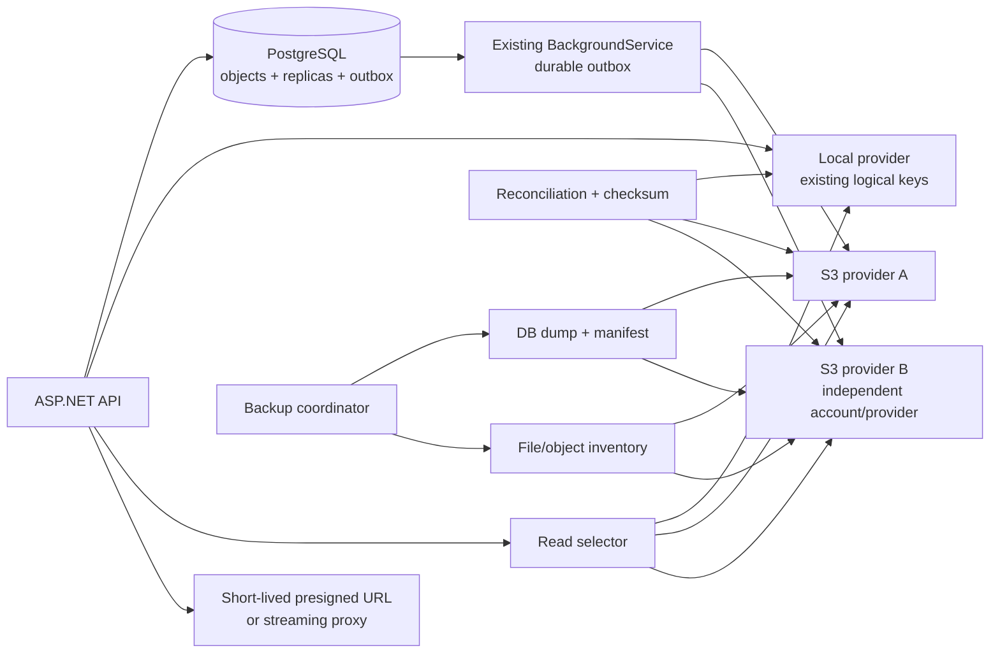

# Аудит файлового хранения, S3, резервного копирования и восстановления

Дата аудита: 22 сентября 2026 года
Режим: `ANALYZE_ONLY` — код, конфигурация и production-инфраструктура не изменялись.
Объект аудита: репозиторий PayPlanner и read-only проверка VPS `185.46.10.202`.

## 1. Executive Summary

PayPlanner сейчас использует не единое объектное хранилище, а несколько независимых механизмов:

- основные документы задач и дел хранятся на локальном диске VPS в `/opt/payplanner/shared/files`, а PostgreSQL содержит метаданные и относительные пути;
- S3 — отдельный административный файловый менеджер и один из получателей резервных копий БД; рабочие документы CRM автоматически в S3 не реплицируются;
- Yandex Disk — отдельный файловый менеджер, канал синхронизации документов и второй получатель резервных копий БД;
- фотографии профиля и электронные подписи используют каталоги внутри каталога приложения и не входят в общий постоянный `FileStorage`;
- полноценного backup/restore для всех пользовательских файлов нет.

Критические факты production на момент проверки:

1. **BROKEN / P0:** настроенный HOSTKEY S3 отвечает `UserSuspended`. Последний сохранённый приложением успешный результат выгрузки — `2026-09-22 00:00:23 UTC`, но текущие read-only запросы списка и свойств bucket отклонены. Поэтому versioning, lifecycle, encryption, Object Lock и фактическое наличие объектов сейчас **НЕ ПОДТВЕРЖДЕНЫ**.
2. **BROKEN / P0:** фоновый планировщик backup БД падает при обходе `/opt/payplanner/shared/backups/manual-pre-09ae8b58-20260922-021158` с `UnauthorizedAccessException`. Причина в рекурсивном обходе всех подкаталогов при retention cleanup ([DatabaseBackupService.cs:668](../backend/Services/DatabaseBackupService.cs#L668)) и недоступных для пользователя сервиса правах ручного каталога. После ошибки scheduler ждёт 30 секунд и повторяет цикл ([DatabaseBackupSchedulerService.cs:21](../backend/Services/DatabaseBackupSchedulerService.cs#L21)). Следующие плановые backup до устранения причины не создаются.
3. **HIGH:** `/opt/payplanner/shared/files` содержит 81 рабочий файл (около 145 МБ), но не входит ни в deploy-backup, ни в автоматический offsite backup. Потеря диска VPS означает потерю содержимого задач и дел даже при сохранной БД.
4. **HIGH:** S3 Access Key и Secret Key сохраняются открытым текстом внутри JSON `SystemSettings`, хотя административный API маскирует их в ответе ([S3StorageService.cs:115](../backend/Services/S3StorageService.cs#L115), [S3StorageService.cs:148](../backend/Services/S3StorageService.cs#L148)). Yandex OAuth-токен, в отличие от S3, защищается Data Protection ([YandexDiskService.cs:1100](../backend/Services/YandexDiskService.cs#L1100), [YandexDiskService.cs:1296](../backend/Services/YandexDiskService.cs#L1296)).
5. **HIGH:** проверенной процедуры полного восстановления нет. Код умеет создавать `pg_dump`, но не выполняет `pg_restore --list`, тестовый restore или восстановление файлов. Endpoint «импорт SQLite» является импортом бизнес-данных, а не disaster recovery ([DatabaseAdminController.cs:214](../backend/Controllers/DatabaseAdminController.cs#L214)).
6. **HIGH:** одна запись пользователя с URL `/user-photos/...` существует в production БД, но живых файлов `wwwroot/user-photos` на VPS нет. Деплой синхронизирует backend с `rsync --delete` ([deploy.yml:334](../.github/workflows/deploy.yml#L334)), а профиль сохраняет фото в `backend/wwwroot` ([ProfileController.cs:203](../backend/Controllers/ProfileController.cs#L203)). Это подтверждённый разрыв метаданных и файла.
7. **MEDIUM:** S3 download и Yandex download полностью буферизуют файл в RAM ([S3StorageService.cs:995](../backend/Services/S3StorageService.cs#L995), [YandexDiskService.cs:790](../backend/Services/YandexDiskService.cs#L790)); при лимите S3 upload 50 ГБ это неприемлемо для больших файлов.

Положительные факты:

- на production все 43 файла задач и 38 документов дел, зарегистрированные в БД, физически присутствуют; отсутствующих и лишних файлов в этих двух каталогах не найдено;
- database backup уже умеет последовательно выгружать один dump в несколько выбранных S3-подключений и отдельно в Yandex Disk ([DatabaseBackupService.cs:697](../backend/Services/DatabaseBackupService.cs#L697));
- targeted-тесты S3/Yandex/backup/upload прошли: **96/96**;
- секретов production в отслеживаемых `appsettings*.json` не найдено; совпадения secret scanner находятся только в тестовых фикстурах.

Итог: текущая схема подходит для одного VPS при отсутствии аварий, но **не обеспечивает гарантированное восстановление**, **не является multi-S3 для рабочих файлов** и в текущий момент имеет два активных отказа backup-контура.

## 2. Storage Inventory

| Тип данных | Физическое место | Метаданные | Ограничения / проверка | Production |
|---|---|---|---|---|
| Файлы задач | `FileStorage/task-files/{taskId}` | `TaskJournalFiles.StoragePath` | 25 МБ; произвольный тип; версии | 43/43 на диске |
| Документы дел | `FileStorage/case-documents/{caseId}` | `ClientCaseDocuments.StoragePath` | 25 МБ; произвольный тип; версии | 38/38 на диске |
| Файл задачи, связанной с делом | две физические копии: task + case | две записи | нет общей identity/checksum | подтверждено кодом |
| Вложения внутреннего чата | `FileStorage/internal-chat-files/{threadId}` | `InternalChatAttachments` | 20 МБ, до 10 файлов, blacklist executable | 0 записей |
| Снимки документов для мессенджеров | `FileStorage/messenger-document-deliveries/yyyy/MM` | `MessengerDocumentDeliveries.SnapshotPath`, SHA-256 | до 25 МБ, одноразовая ссылка | 0 записей |
| Вложения внешнего согласования | исходный `case-documents` | `ExternalWorkOrderApprovalAttachments`, SHA-256 | allowlist типов, проверка hash при download | 0 записей |
| Электронная подпись | по умолчанию `backend/storage/electronic-signatures` | абсолютный `SnapshotPath`, SHA-256 | только PDF до 25 МБ | 0 записей; persistent path не настроен |
| Фото профиля | `backend/wwwroot/user-photos/{userId}` | `Users.PhotoUrl` | JPG/PNG/WEBP, 4 МБ | 1 URL, 0 файлов — BROKEN |
| Логотип юрлица | PostgreSQL, `LegalEntities.LogoDataUrl` | в той же колонке | data URL, лимит 12 000 000 символов | хранится в backup БД |
| Генерируемые PDF/Word/CSV/Excel | RAM/HTTP response | обычно не сохраняются | transient | backup не нужен, пока не сохранены как документ |
| Импорт таблиц/банковских выписок | RAM на время запроса | результат импорта в БД | загрузка целиком в `byte[]` | OOM-риск для больших файлов |
| Резервные копии PostgreSQL | `/opt/payplanner/shared/backups` | файлы + последние 100 результатов в `SystemSettings` | `pg_dump`, 4 раза/сутки, retention 8 дней | 562 МБ / 49 файлов |
| Объекты S3-файлового менеджера | HOSTKEY bucket | отдельной объектной таблицы нет | до 50 ГБ; CRUD по выбранному connection | bucket сейчас недоступен |
| Объекты Yandex Disk | `disk:/PayPlanner` и настроенные подпути | настройки/последние результаты в БД | отдельный интеграционный канал | наличие backup-объектов не проверено напрямую |
| Data Protection keys | `/opt/payplanner/shared/dataprotection` | XML keys | нужны для расшифровки токенов/контактов | 3 файла, offsite backup не подтверждён |
| Deploy rollback | `/opt/payplanner/deploy-backups` | копия backend/frontend/revision | не содержит `/shared/files` и БД | 3,1 ГБ |

Источники: [TaskJournalFile.cs:5](../backend/Models/TaskJournalFile.cs#L5), [ClientCaseDocument.cs:5](../backend/Models/ClientCaseDocument.cs#L5), [TasksController.cs:2816](../backend/Controllers/TasksController.cs#L2816), [CasesV2Controller.cs:4728](../backend/Controllers/V2/CasesV2Controller.cs#L4728), [InternalChatController.cs:315](../backend/Controllers/InternalChatController.cs#L315), [MessengerDocumentDeliveryService.cs:188](../backend/Services/MessengerDocumentDeliveryService.cs#L188), [ElectronicSignatureService.cs:165](../backend/Services/ElectronicSignatureService.cs#L165), [ProfileController.cs:162](../backend/Controllers/ProfileController.cs#L162).

## 3. Existing Storage Architecture

```mermaid
flowchart LR
    UI[Frontend / API clients] --> API[ASP.NET API]
    API --> PG[(PostgreSQL metadata)]
    API --> LOCAL[/shared/files\nprimary business files]
    API --> APPDIR[backend/wwwroot + backend/storage\nprofile/e-signature]
    API --> S3[S3 admin file manager]
    API --> YD[Yandex Disk manager/sync]
    BACKUP[DatabaseBackupService] --> DUMP[/shared/backups]
    DUMP --> S3
    DUMP --> YD
    LOCAL -. no automatic backup .-> X[Single VPS disk risk]
```

Классификация: **гибридная, частично локальная архитектура**, но не единый hybrid object storage. Источник истины для бизнес-документа — сочетание строки PostgreSQL и локального файла: одна сторона без другой недостаточна. S3 manager работает напрямую с bucket и не ведёт каталог объектов в БД.

Абстракция `ICaseDocumentStorage` существует, но реализация только локальная ([CaseDocumentStorage.cs:5](../backend/Services/Cases/CaseDocumentStorage.cs#L5), [CaseDocumentStorage.cs:38](../backend/Services/Cases/CaseDocumentStorage.cs#L38)). Файлы задач и чата обходят её и работают с `FileStream` напрямую ([TasksController.cs:2858](../backend/Controllers/TasksController.cs#L2858), [InternalChatController.cs:356](../backend/Controllers/InternalChatController.cs#L356)). Единой абстракции `IObjectStorage` нет.

Поведение при сбоях:

- S3 недоступен: рабочие задачи/дела продолжают работать; S3 manager и S3-копия backup не работают.
- локальный `shared/files` недоступен: метаданные остаются, но download документов ломается; read failover в S3 отсутствует.
- PostgreSQL недоступен: авторизация и разрешение путей невозможны, даже если файлы целы.
- bucket потерян: S3 manager-объекты потеряны; рабочие local-файлы не затронуты; backup БД остаётся только локально/Yandex при наличии.
- VPS-диск потерян: PostgreSQL, local backup и все business files могут быть потеряны; восстановление только БД из cloud не вернёт содержимое документов.

## 4. Existing Backup Architecture

```mermaid
flowchart TD
    SCHED[In-process BackgroundService\n00/06/12/18 local] --> CLEAN[Retention cleanup]
    CLEAN --> PGDUMP[pg_dump custom]
    PGDUMP --> LOCAL[/shared/backups]
    LOCAL -->|sequential| S3A[Selected S3 connections]
    LOCAL -->|sequential| YD[Yandex Disk]
    S3A --> HIST[Last 100 result records]
    YD --> HIST
    FILES[/shared/files] -. absent .-> CLOUD[Offsite backup]
```

Что реализовано:

- PostgreSQL `pg_dump` custom/plain с blobs ([DatabaseBackupService.cs:552](../backend/Services/DatabaseBackupService.cs#L552));
- SQLite `VACUUM INTO` для legacy/dev ([DatabaseBackupService.cs:479](../backend/Services/DatabaseBackupService.cs#L479));
- локальное расписание, retention, ручное создание и ручной retry failed cloud upload;
- несколько S3 connection IDs для одного backup и отдельный Yandex target;
- ошибка cloud upload не удаляет локальный dump ([DatabaseBackupService.cs:746](../backend/Services/DatabaseBackupService.cs#L746)).

Чего нет:

- backup `/shared/files`, `wwwroot/user-photos`, e-signature storage и Data Protection keys;
- manifest/checksum backup-а и post-upload verification;
- `pg_restore --list`, автоматический restore в disposable DB, PITR/WAL archive;
- durable retry queue; история хранится в JSON и обрезается до 100 результатов;
- правило retention «удалять локально только после N подтверждённых независимых копий»;
- backup конфигурации, инструкции и реестра версий как единого DR-комплекта.

Текущая оценка RPO/RTO:

- фактический RPO БД при исправном расписании — до 6 часов; сейчас из-за active scheduler failure — **неограниченно растущий**;
- RPO рабочих файлов при потере VPS — **полная потеря с момента создания системы**, потому что offsite-копия не подтверждена;
- RTO — **НЕ ПОДТВЕРЖДЕНО**, так как restore не тестировался.

Рекомендация: DB RPO ≤ 1 часа или WAL/PITR; file primary RPO = 0 после успешной локальной записи, offsite replica lag ≤ 15 минут; full-system RTO ≤ 4 часов, переключение чтения на реплику ≤ 15 минут.

## 5. Multi-S3 Capability

| Возможность | Статус | Доказательство |
|---|---|---|
| Несколько сохранённых S3 connections | IMPLEMENTED | JSON-массив connections, CRUD ([S3StorageService.cs:115](../backend/Services/S3StorageService.cs#L115)) |
| Выбор нескольких S3 для backup БД | IMPLEMENTED | цикл по `ConnectionIds` ([DatabaseBackupService.cs:697](../backend/Services/DatabaseBackupService.cs#L697)) |
| Параллельная запись бизнес-файла в ≥2 S3 | NOT IMPLEMENTED | upload принимает один `id` ([S3StorageService.cs:328](../backend/Services/S3StorageService.cs#L328)) |
| Primary/fallback/read priority | NOT IMPLEMENTED | модель connection не содержит ролей/priority |
| Sync write modes `PRIMARY_ONLY`, `MIRROR_ALL`, `ASYNC_MIRROR` | NOT IMPLEMENTED | соответствующих policy/worker/state нет |
| Durable async replication | NOT IMPLEMENTED | backup upload выполняется inline, бизнес-файлы не реплицируются |
| Replica state/checksum/retry counters | PARTIALLY IMPLEMENTED | только последние backup results; общей таблицы replicas нет |
| Read failover | NOT IMPLEMENTED | download всегда из явно выбранного connection или local path |
| Автоматический repair | NOT IMPLEMENTED | есть только ручной retry failed DB backup |
| Независимые провайдеры | PARTIALLY IMPLEMENTED | S3 + Yandex для DB backup; два независимых S3 не настроены |

## 6. Download Architecture

- Local DB backup и internal chat используют `PhysicalFile` с Range ([DatabaseAdminController.cs:198](../backend/Controllers/DatabaseAdminController.cs#L198), [InternalChatController.cs:512](../backend/Controllers/InternalChatController.cs#L512)).
- Task/case download используют `PhysicalFile`, но без явного `enableRangeProcessing`; поддержка Range **НЕ ПОДТВЕРЖДЕНА** для этих endpoints.
- S3 download — backend proxy, который сначала копирует объект целиком в `MemoryStream`, затем отдаёт ответ ([S3StorageService.cs:995](../backend/Services/S3StorageService.cs#L995)). Presigned URL, streaming proxy и Range отсутствуют.
- Yandex download запрашивает provider URL с `ResponseHeadersRead`, но затем копирует весь файл в `MemoryStream`/`byte[]` ([YandexDiskService.cs:790](../backend/Services/YandexDiskService.cs#L790)).
- Messenger public link — короткоживущий, одноразовый, атомарно consumed; файл остаётся local ([MessengerDocumentDeliveryService.cs:460](../backend/Services/MessengerDocumentDeliveryService.cs#L460)).

Рекомендация: маленькие файлы можно proxy-stream; большие S3-объекты — authorize API → presigned GET на 5–10 минут. Для fallback endpoint должен выбирать доступную реплику до выдачи URL. Не логировать URL/query signature; `Content-Disposition` формировать сервером; для local и proxy добавить Range.

## 7. Data Integrity

Текущие гарантии:

- path traversal блокируется в local storage и S3 relative paths;
- upload задач/дел компенсирует ошибку DB удалением только что записанного файла;
- messenger snapshot, e-signature и external approval вычисляют SHA-256; external approval повторно проверяет hash при download ([ExternalWorkOrderApprovalService.cs:490](../backend/Services/ExternalWorkOrderApprovalService.cs#L490));
- production reconciliation для task/case: 81 DB file record, 81 physical file, missing=0, orphan=0.

Пробелы:

- у `TaskJournalFile` и `ClientCaseDocument` нет checksum, storage provider, replica status, soft-delete marker;
- S3 upload не фиксирует ETag/version ID/checksum, не выполняет read-after-write verification ([S3StorageService.cs:959](../backend/Services/S3StorageService.cs#L959));
- hard delete сначала удаляет DB metadata, затем best-effort physical file; сбой оставляет orphan ([CasesV2Controller.cs:5061](../backend/Controllers/V2/CasesV2Controller.cs#L5061));
- internal chat soft-deletes сообщение, но сразу физически удаляет attachments и metadata ([InternalChatController.cs:419](../backend/Controllers/InternalChatController.cs#L419));
- нет reconciliation job, quarantine или repair queue;
- backup dump не имеет собственного SHA-256 manifest и restore verification.

Транзакционные границы должны быть: stream → temporary key/file → checksum → atomic promote → DB object + primary replica + outbox в одной DB transaction. Удаление: soft delete metadata → durable deletion job → hard delete replicas после retention. S3 не участвует в DB transaction, поэтому нужна transactional outbox, а не попытка «распределённой транзакции».

## 8. Migration Capability

Существующая миграция только одноразово переносит legacy `App_Data` в `/shared/files` при deploy ([deploy.yml:282](../.github/workflows/deploy.yml#L282)). Она не вычисляет checksum, не переносит в S3 и не поддерживает resume.

| Требование | Статус |
|---|---|
| Local → S3 | NOT IMPLEMENTED |
| S3 A → S3 B | NOT IMPLEMENTED |
| Проверка целостности | NOT IMPLEMENTED |
| Dry-run | NOT IMPLEMENTED |
| Resume/checkpoint | NOT IMPLEMENTED |
| Idempotency | NOT IMPLEMENTED для общего migration tool |
| Сохранение object keys | NOT APPLICABLE сейчас; должно стать обязательным |
| Миграция без остановки | NOT IMPLEMENTED |

Требуемая схема без downtime: зарегистрировать существующие local paths как неизменные logical keys; новые записи dual-write через outbox; backfill батчами; после каждого объекта сравнивать size+SHA-256; checkpoint по ID; повторный запуск идемпотентен; read сначала primary, затем verified replica; переключение primary только после 100% verified и soak period.

## 9. Security Findings

1. **HIGH:** S3 credentials в БД открытым текстом ([S3StorageService.cs:148](../backend/Services/S3StorageService.cs#L148)). Перенести в environment/secret manager либо шифровать Data Protection с key rotation; в БД хранить secret reference.
2. **MEDIUM:** custom S3 endpoint проверяется только как HTTP/HTTPS URI. Администратор с компрометированной учётной записью может направить backend к внутреннему адресу; требуется запрет loopback/link-local/private ranges или явный allowlist.
3. **MEDIUM:** нет подтверждения bucket encryption/versioning/Object Lock/public access block из-за `UserSuspended`; состояние **НЕ ПОДТВЕРЖДЕНО**.
4. **MEDIUM:** S3 upload разрешает любой content type/extension до 50 ГБ ([S3StorageController.cs:136](../backend/Controllers/S3StorageController.cs#L136)); это админская функция, но нужны quota, malware scanning hook и multipart limits.
5. **POSITIVE:** controller защищён auth+permission, операции аудируются, secret в response маскируется ([S3StorageController.cs:14](../backend/Controllers/S3StorageController.cs#L14)).
6. **POSITIVE:** Yandex OAuth token защищён Data Protection и не возвращается целиком.
7. **POSITIVE:** tracked-конфиги содержат placeholders, не production secrets. Secret scan дал совпадения только в тестах.
8. **HIGH:** Data Protection keys сами являются критичной частью restore, но offsite backup **НЕ ПОДТВЕРЖДЁН**. Без них защищённые Yandex tokens, контакты и одноразовые ссылки могут стать нечитаемыми.

## 10. Gap Analysis

| Область | Статус | Комментарий |
|---|---|---|
| Local primary для задач/дел | IMPLEMENTED | Работает и согласован с production DB |
| Персистентность всех типов файлов | BROKEN | profile/e-signature вне shared root; profile уже имеет missing file |
| S3 admin storage | BROKEN | код реализован, production provider suspended |
| Multi-target DB backup | PARTIALLY IMPLEMENTED | S3+Yandex есть, scheduler сейчас падает |
| Backup всех файлов | NOT IMPLEMENTED | `/shared/files` не копируется offsite |
| Restore automation | NOT IMPLEMENTED | endpoint/runbook с верификацией нет |
| Restore test | NOT VERIFIED | доказательств регулярного восстановления нет |
| Multi-S3 business storage | NOT IMPLEMENTED | нет policy/replicas/failover |
| Async replication | NOT IMPLEMENTED | нет durable outbox |
| Presigned download | NOT IMPLEMENTED | только proxy/memory/local |
| Multipart upload | NOT IMPLEMENTED | один `PutObject` |
| Integrity/reconciliation | PARTIALLY IMPLEMENTED | hash только в отдельных модулях |
| Soft delete/retention | PARTIALLY IMPLEMENTED | DB backup retention; files hard-delete |
| Health/readiness storage | NOT IMPLEMENTED | `/api/health` всегда `{status:"ok"}` ([HealthController.cs:8](../backend/Controllers/HealthController.cs#L8)) |
| Metrics/alerts | PARTIALLY IMPLEMENTED | generic last job state/logs, storage-specific alert нет |
| Horizontal scaling | NOT IMPLEMENTED | local filesystem locks deployment to one node |
| Documentation accuracy | BROKEN | документ заявляет protected S3 keys/multipart, код этого не делает ([administration-storage-business-rules.md:38](administration-storage-business-rules.md#L38)) |

## 11. Risk Register

| ID | Severity | Вероятность | Риск | Последствие | Мера |
|---|---|---|---|---|---|
| R1 | P0 | Уже произошёл | Scheduler backup падает на permissions | новые backup не создаются | исправить права/расположение manual backup, сделать cleanup устойчивым к недоступному subtree |
| R2 | P0 | Уже произошёл | HOSTKEY S3 suspended | S3 backup и manager недоступны | восстановить account, проверить bucket, добавить второй независимый provider и alert |
| R3 | Critical | Средняя | Потеря VPS disk | потеря всех task/case files | offsite encrypted file backup + restore drill |
| R4 | High | Средняя | Компрометация БД | утечка S3 keys | secret reference/encryption/rotation |
| R5 | High | Уже произошёл | Deploy удаляет profile files | broken avatars | перенести в shared object storage и backfill |
| R6 | High | Низкая/средняя | E-signature в release dir | потеря юридически значимых artifacts | dedicated persistent immutable storage |
| R7 | High | Средняя | Backup есть, restore не работает | ложное ощущение защищённости | automated restore verification |
| R8 | Medium | Средняя | 50 ГБ download в memory | OOM/restart API | streaming/presigned/Range |
| R9 | Medium | Средняя | DB delete до physical delete | orphan storage/cost | soft-delete + outbox + reconciliation |
| R10 | Medium | Средняя | Один local node | нет HA/horizontal scale | object storage replicas; stateless API |
| R11 | Medium | Средняя | S3 list только первая 1000 | неполный UI | cursor pagination |
| R12 | Medium | Низкая | custom endpoint SSRF | доступ к internal network | endpoint policy/allowlist |

## 12. Recommended Target Architecture

Минимальная, без Kubernetes/Kafka и без ломки существующих ключей:



Начальный режим: `PRIMARY_ONLY=local` для backward compatibility плюс `ASYNC_MIRROR` в два независимых cloud targets для critical classes. API считает upload успешным после durable local write и commit DB+outbox; пользователь не ждёт оба S3. `MIRROR_ALL` оставить опциональным только для малых юридически значимых artifacts. Reads: primary → verified replicas по priority/health. Никогда не читать replica со статусом не `AVAILABLE` или checksum mismatch.

## 13. Database Changes

Предлагаемые таблицы:

1. `StorageProviders`: `Id`, `Name`, `Kind(local|s3|yandex)`, `Endpoint`, `Region`, `Bucket`, `RootPrefix`, `SecretReference`, `Role`, `ReadPriority`, `WritePolicy`, `Enabled`, `HealthStatus`, timestamps. Никаких plaintext secrets.
2. `StorageObjects`: `Id`, `LogicalKey` unique, `OwnerType`, `OwnerId`, `OriginalFileName`, `ContentType`, `SizeBytes`, `Sha256`, `State`, `RetentionUntil`, `DeletedAt`, timestamps.
3. `StorageObjectReplicas`: `(StorageObjectId, ProviderId)` unique, `PhysicalKey`, `Status(PENDING/UPLOADING/AVAILABLE/FAILED/DELETING/DELETED/CORRUPT)`, `ProviderVersionId`, `ETag`, `VerifiedSha256`, `RetryCount`, `NextAttemptAt`, `LastErrorCode`, timestamps.
4. `StorageOperations`/outbox: `OperationId`, `ObjectId`, `ProviderId`, `Type`, `IdempotencyKey` unique, lease fields, attempts, next retry, payload, status.
5. `BackupSets` и `BackupReplicas`: dump/file-manifest/checksum/provider/status/verification/restore-test result.

Существующие `StoragePath` не удалять на первом этапе. Добавить nullable `StorageObjectId`, выполнить backfill и dual-read, затем сделать обязательным. Object key сохранять без переименования.

## 14. Configuration Changes

- `FileStorage__RootPath=/opt/payplanner/shared/files` оставить.
- Явно задать `ElectronicSignature__StorageRoot=/opt/payplanner/shared/files/electronic-signatures`.
- Profile storage направить в `FileStorage/profile-photos`, URL выдавать через авторизованный endpoint или CDN/object URL.
- Provider secrets вынести в `/opt/payplanner/shared/payplanner.env`/secret store: `StorageProviders__{id}__AccessKeyRef`, не сохранять значение в `SystemSettings`.
- Добавить policy: replica count, provider priority, max parallel transfers, retry backoff, presign TTL, checksum verification, soft-delete retention.
- Настроить independent second S3 account/provider, не только второй bucket в том же failure domain.
- В runtime health добавить disk free, PostgreSQL, writable primary, cloud provider state, backup age, replication lag.

## 15. Code Changes

1. Ввести `IObjectStorageProvider` (`PutAsync`, `OpenReadAsync(range)`, `DeleteAsync`, `Exists/Head`, `PresignGet`, capabilities) и adapters Local/S3/Yandex.
2. Перевести task, case, chat, messenger, profile, e-signature на orchestration service без изменения пользовательских API.
3. Добавить transactional outbox + idempotent background replication worker с bounded concurrency и exponential backoff+jitter.
4. Добавить read selector/failover и health cache; не делать сетевой health probe на каждый download.
5. Добавить SHA-256 при первичной записи, provider version ID/ETag и периодическую reconciliation.
6. Заменить S3/Yandex memory downloads на streaming; для больших S3 объектов — presigned.
7. Для S3 upload использовать multipart/TransferUtility выше порога, abort incomplete multipart, ограничить concurrency.
8. Сделать cursor pagination S3 list.
9. Исправить retention cleanup: обрабатывать только допустимые backup-файлы, не падать на одном недоступном subtree, логировать/метриковать skipped paths.
10. Сделать delete двухфазным и восстанавливаемым до retention deadline.
11. Исправить документацию, чтобы она не утверждала несуществующее шифрование/multipart.

## 16. Backup Plan

- Немедленно восстановить scheduler и S3 account; вручную создать новый DB dump только после исправления и проверить checksum/`pg_restore --list`.
- DB: hourly custom dump либо continuous WAL/PITR; ежедневный full; SHA-256 manifest; локальная + две independent offsite verified replicas.
- Files: ежедневный inventory плюс инкрементальная object replication; backup должен включать business files, profile, chat, messenger, e-signature, Data Protection keys и storage metadata.
- Retention: hourly 48 часов, daily 30 дней, monthly 12 месяцев — окончательные сроки утвердить с владельцем данных и юридическими требованиями.
- Immutable: versioning/Object Lock/WORM для backup bucket, отдельные credentials с запретом delete для writer; фактическая поддержка провайдера должна быть проверена.
- Retention не удаляет local backup, пока нет минимум двух verified offsite replicas.
- Ежедневный job сверяет manifest/HEAD; еженедельный sample download+hash; ежемесячный full restore drill.

## 17. Restore Plan

1. Объявить incident, заморозить writes или включить maintenance/read-only.
2. Зафиксировать recovery point и проверить manifest/checksum всех частей.
3. Восстановить PostgreSQL в новую БД, не поверх production: `createdb` → `pg_restore --list` → `pg_restore --clean --if-exists --exit-on-error` в isolated target.
4. Прогнать schema/model checks, counts, critical financial constraints и auth smoke tests.
5. Восстановить Data Protection keys до запуска приложения.
6. Восстановить logical object keys в primary storage; сверить count/size/SHA-256 с manifest.
7. Запустить reconciliation: missing/orphan/corrupt должны быть 0 либо перечислены как accepted exceptions.
8. Переключить connection string/storage provider атомарно; выполнить smoke tests download/upload/range.
9. Только после acceptance открыть writes; сохранить incident evidence.

Существующий код такой процедуры не выполняет. Наличие `pg_restore 18.6` на VPS подтверждено, но успешный restore production dump **НЕ ПОДТВЕРЖДЁН**.

## 18. Migration Plan

Фазы:

1. Inventory/dry-run: DB records, disk paths, sizes, hashes; никаких writes.
2. Schema deployment: nullable object/replica/outbox tables.
3. Register current local files с прежними relative keys; выявить missing/orphan.
4. Dual-write for new files: local commit + outbox.
5. Backfill batches с checkpoint, rate limit и low-priority IO; upload с тем же key.
6. Verify remote HEAD/size/hash; для S3 multipart хранить собственный SHA-256, не полагаться на ETag.
7. Retry только failed/pending; idempotency key `objectId/providerId/version`.
8. Soak 7–14 дней, read fallback drills.
9. При желании сменить primary, не удаляя local copy до завершения retention и acceptance.

Rollback: выключить dual-write feature flag; local остаётся primary; новые DB таблицы additive; remote objects не удалять; читать по legacy `StoragePath`. Это сохраняет обратную совместимость.

## 19. Testing Plan

- Unit: key normalization, provider capabilities, retry classification, checksum, policy selection, delete retention.
- Integration: Local + MinIO/S3-compatible test container, multipart, presign TTL, Range, pagination >1000, version IDs.
- DB: outbox transaction rollback, duplicate jobs/idempotency, concurrent workers/leases.
- Fault injection: provider timeout/403/500, truncated stream, checksum mismatch, disk full, DB commit failure, worker kill/restart, one provider unavailable.
- Migration: dry-run, resume after crash, same key preservation, re-run without duplicates, 0-byte and large files.
- Backup: corrupt dump, missing manifest, one target failed, retention must preserve last verified copies.
- Restore: disposable PostgreSQL plus restored file tree; automated business smoke suite.
- Security: SSRF endpoints, path traversal, permission checks, leaked presigned URLs, secret masking/rotation.
- Performance: memory stays bounded on 10–50 ГБ streams; upload/download throughput; API latency unaffected by async mirror.
- Production acceptance: canary files, no destructive operations, explicit approval before any provider switch.

В рамках аудита безопасно выполнены 96 targeted unit/controller tests: S3 service/controller, DB backup S3, Yandex service/controller, upload validation — все прошли.

## 20. Rollback Plan

- Все schema changes additive; legacy `StoragePath` остаётся до завершения миграции.
- Feature flags отдельно отключают orchestration, async mirror, read failover и presigned downloads.
- При деградации cloud запись продолжает local primary+outbox; UI не блокируется.
- При ошибке нового read selector вернуть legacy local read.
- Не удалять старые files/object keys и не менять keys in-place.
- Provider credentials rotate independently; предыдущие отключать только после проверки новых.
- Backup/restore изменения сначала испытывать на disposable paths/DB.
- Rollback release не должен трогать `/shared/files`, provider objects, outbox rows и backup sets.

## 21. Acceptance Criteria

1. Все persistent file types зарегистрированы в inventory и используют persistent root/object provider.
2. Для каждого active object есть checksum и минимум две `AVAILABLE` independent replicas согласно policy.
3. Upload возвращает успех после durable primary+outbox; провайдерный сбой не теряет задачу.
4. Read автоматически использует verified fallback; checksum mismatch исключает replica.
5. Большие файлы не буферизуются целиком в RAM; Range/presign работают.
6. Migration поддерживает dry-run/resume/idempotency и сохраняет keys.
7. Delete является soft-delete с retention; hard delete асинхронен и аудируем.
8. DB + files + keys восстанавливаются в disposable environment с нулём missing/corrupt objects.
9. Backup age, replica lag, provider health и restore-test age имеют alerts.
10. S3 secrets отсутствуют в plaintext БД/logs/frontend; rotation проверена.
11. Production S3 versioning/encryption/public access/lifecycle/Object Lock задокументированы фактическими API-ответами.
12. Full CI, security and restore gates проходят; manual production acceptance выполнена.

## Evidence

### Код и конфигурация

- S3 connection CRUD/credentials: [S3StorageService.cs:85](../backend/Services/S3StorageService.cs#L85), [S3StorageService.cs:115](../backend/Services/S3StorageService.cs#L115).
- S3 client/Put/Get/List: [S3StorageService.cs:840](../backend/Services/S3StorageService.cs#L840), [S3StorageService.cs:882](../backend/Services/S3StorageService.cs#L882), [S3StorageService.cs:959](../backend/Services/S3StorageService.cs#L959), [S3StorageService.cs:995](../backend/Services/S3StorageService.cs#L995).
- S3 authorization/API: [S3StorageController.cs:14](../backend/Controllers/S3StorageController.cs#L14), [S3StorageController.cs:136](../backend/Controllers/S3StorageController.cs#L136), [S3StorageController.cs:170](../backend/Controllers/S3StorageController.cs#L170).
- DB backup create/retention/replication: [DatabaseBackupService.cs:441](../backend/Services/DatabaseBackupService.cs#L441), [DatabaseBackupService.cs:552](../backend/Services/DatabaseBackupService.cs#L552), [DatabaseBackupService.cs:668](../backend/Services/DatabaseBackupService.cs#L668), [DatabaseBackupService.cs:697](../backend/Services/DatabaseBackupService.cs#L697).
- Backup scheduler: [DatabaseBackupSchedulerService.cs:21](../backend/Services/DatabaseBackupSchedulerService.cs#L21).
- Local storage: [CaseDocumentStorage.cs:15](../backend/Services/Cases/CaseDocumentStorage.cs#L15), [TasksController.cs:2850](../backend/Controllers/TasksController.cs#L2850), [CasesV2Controller.cs:4733](../backend/Controllers/V2/CasesV2Controller.cs#L4733).
- Chat/messenger/e-signature: [InternalChatController.cs:315](../backend/Controllers/InternalChatController.cs#L315), [MessengerDocumentDeliveryService.cs:185](../backend/Services/MessengerDocumentDeliveryService.cs#L185), [ElectronicSignatureService.cs:156](../backend/Services/ElectronicSignatureService.cs#L156).
- Yandex token/download: [YandexDiskService.cs:1037](../backend/Services/YandexDiskService.cs#L1037), [YandexDiskService.cs:1100](../backend/Services/YandexDiskService.cs#L1100), [YandexDiskService.cs:790](../backend/Services/YandexDiskService.cs#L790).
- Deploy persistence/rollback: [deploy.yml:168](../.github/workflows/deploy.yml#L168), [deploy.yml:282](../.github/workflows/deploy.yml#L282), [deploy.yml:324](../.github/workflows/deploy.yml#L324), [deploy.yml:334](../.github/workflows/deploy.yml#L334).
- Health endpoint: [HealthController.cs:8](../backend/Controllers/HealthController.cs#L8).

### Production read-only snapshot

Снято 22.09.2026 около 02:50–03:00 UTC командами `systemctl show`, `find`, `du`, read-only SQL, `journalctl` и S3 GET/LIST/configuration API. Credentials и secret values не выводились.

- revision `09ae8b58e74787a20d7f7d2361331b83731ab8b4`, service active;
- PostgreSQL 306 МБ;
- `/shared/files` 145 МБ, 82 файла вместе с migration marker;
- task 43/43, case 38/38, missing/orphan 0;
- `/shared/backups` 562 МБ, 49 файлов;
- deploy backups 3,1 ГБ;
- local scheduled backup `2026-09-22 00:00:22 UTC`, 15 270 157 bytes;
- ручной pre-deploy backup `manual-pre-09ae8b58-20260922-021158` содержит dump, listing, release archive и checksums;
- S3 configured: один enabled HOSTKEY connection; API отвечает `UserSuspended`;
- Yandex configured/enabled; последние 100 записанных результатов success, последний `00:00:25 UTC`; фактический remote object listing **НЕ ПОДТВЕРЖДЁН**;
- scheduler logs: повторяющийся `UnauthorizedAccessException` на ручном backup directory;
- profile: 1 DB URL `/user-photos/...`, live files 0;
- e-signature, messenger delivery, internal chat attachments, external work-order attachments: 0 записей.

### Неподтверждённое

- S3 bucket versioning, lifecycle, encryption, Object Lock, public access: **НЕ ПОДТВЕРЖДЕНО** из-за suspended account.
- Фактическое наличие и checksum Yandex remote backup: **НЕ ПОДТВЕРЖДЕНО**; подтверждена только success-history приложения.
- Успешный end-to-end restore любого production backup: **НЕ ПОДТВЕРЖДЕНО**.
- Provider-side durability/SLA/geo-redundancy: **НЕ ПОДТВЕРЖДЕНО**.
- Фактические egress/storage costs: **НЕ ПОДТВЕРЖДЕНО**, потому что S3 inventory недоступен.

## Exact IMPLEMENTATION TASK

> Реализовать единый отказоустойчивый storage layer PayPlanner с сохранением всех существующих logical keys и обратной совместимости. Сначала устранить текущие P0: восстановить работу scheduler backup и HOSTKEY S3, не удаляя существующие backup/object data. Затем вынести profile/e-signature в persistent root, включить offsite backup `/shared/files` и Data Protection keys, добавить checksum manifest и автоматический restore test. После этого добавить additive таблицы `StorageObjects`, `StorageProviders`, `StorageObjectReplicas`, `StorageOperations`, зарегистрировать существующие local-файлы без перемещения, внедрить durable transactional outbox и async mirror минимум в два независимых S3-compatible provider. Реализовать verified read failover, multipart upload, streaming/Range и короткоживущие presigned downloads, soft delete/retention, reconciliation/repair, health metrics/alerts и resumable idempotent migration CLI с dry-run. S3 secrets убрать из plaintext `SystemSettings`. Ни один этап не должен менять существующие object keys или требовать остановки CRM; удаление legacy paths разрешено только после полного verified restore drill и письменной acceptance.

## Final Verdict

- **CURRENT STATE:** local-first business files + PostgreSQL metadata; отдельные S3/Yandex managers; DB dump replication. Два активных отказа backup-контура.
- **TARGET STATE:** persistent logical object catalog, local/S3 providers, durable async multi-provider replication, verified failover, complete backup and tested restore.
- **WHAT IS MISSING:** file backup, restore automation/test, multi-S3 business replication, checksums/replica states, presign/multipart, health/alerts, secure S3 secret storage.
- **DATA LOSS RISKS:** критический риск потери `/shared/files`; profile уже имеет missing physical file; e-signature path небезопасен для будущих данных.
- **BACKUP STATUS:** **BROKEN NOW**; последний DB backup существует, но scheduler падает; files не входят в backup.
- **RESTORE STATUS:** **NOT IMPLEMENTED / NOT VERIFIED**.
- **MULTI-S3 STATUS:** **PARTIALLY IMPLEMENTED** только для DB backup selection; для business files — **NOT IMPLEMENTED**.
- **MIGRATION STATUS:** legacy local move есть; general local↔S3/S3↔S3 — **NOT IMPLEMENTED**.
- **SECURITY STATUS:** permission model приемлемый; plaintext S3 secrets и неподтверждённые bucket controls требуют исправления.
- **RECOMMENDED IMPLEMENTATION ORDER:** P0 scheduler → P0 S3 account/alerts → P0 complete file/key backup + restore drill → P1 persistent paths/secrets → P1 object catalog/outbox/replicas → P1 migration/reconciliation/failover → P2 multipart/presign/performance → P2 lifecycle/immutable/advanced DR.
