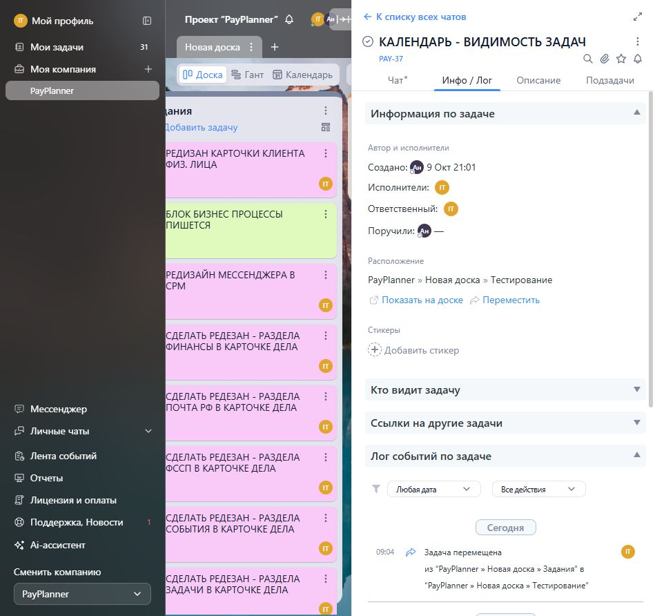
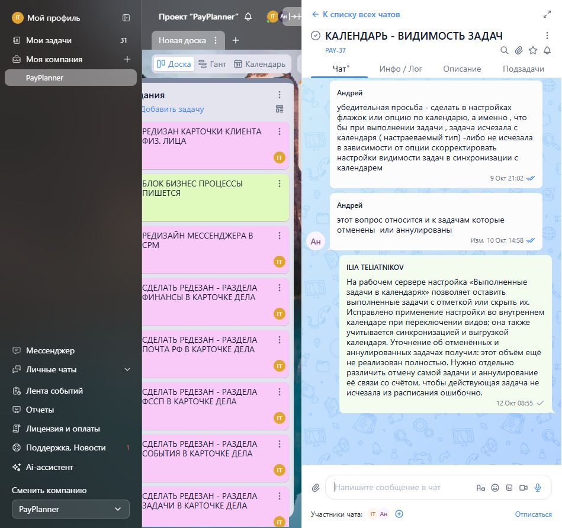

# YouGile PayPlanner — публикация 12 октября 2026

По отдельным командам пользователя «опубликуй ответы … после перенеси карточки в тестирование» и «опубликуй ответы по карточкам … подготовь коммиты и запуш» опубликован [подготовленный пакет](yougile-payplanner-drafts-2026-10-12.md). Компания только **PayPlanner**, `a9848b434609`, проект `daa8d6c1-cce6-4c0c-985a-6bdc5a4b5eb4`, доска «Новая доска». Другие компании не изменялись.

Перед отправкой перечитаны последние сообщения выбранных карточек; дубликатов подготовленных ответов не обнаружено. Каждый ответ подтверждён в чате с автором и временем, затем выполнен перенос. Повторная навигация к каждой карточке подтвердила ровно одно новое сообщение с ожидаемым ID и расположение «PayPlanner » Новая доска » Тестирование». PAY-37 дополнительно проверена после перезагрузки страницы. Карточки не отмечались полностью выполненными, описания и другие поля не редактировались.

**Результат: 8/8 ответов опубликованы и подтверждены, 100%; 7/7 требуемых переносов выполнены, 100%.** MAX уже находился в тестировании и повторно не переносился.

| Карточка | Новый message ID | Результат | Что нельзя считать завершённым |
| --- | --- | --- | --- |
| [PAY-31](https://ru.yougile.com/team/a9848b434609/PayPlanner#PAY-31), заявки | `1791770099532` | Ответ + перенос | Полное ТЗ, решения о переходах/ролях, документы/чат, перенос истории и сквозная приёмка |
| [PAY-33](https://ru.yougile.com/team/a9848b434609/PayPlanner#PAY-33), компании | `1791770142887` | Ответ + перенос | Печать в реальном масштабе, момент фиксации и нумерация |
| [PAY-34](https://ru.yougile.com/team/a9848b434609/PayPlanner#PAY-34), документы | `1791770145894` | Ответ + перенос | Полный комплект, оформление и бухгалтерская приёмка |
| [PAY-35](https://ru.yougile.com/team/a9848b434609/PayPlanner#PAY-35), КУДиР | `1791770148928` | Ответ + перенос | Налоговая модель, утверждённая форма/PDF, сверка бухгалтером |
| [PAY-36](https://ru.yougile.com/team/a9848b434609/PayPlanner#PAY-36), банки | `1791770151952` | Ответ + перенос | Реальные адаптеры Точки/Сбера, доступы, чтение и разнесение выписок |
| [PAY-37](https://ru.yougile.com/team/a9848b434609/PayPlanner#PAY-37), календарь | `1791770154960` | Ответ + перенос | Новое правило отменённых/аннулированных задач и внешняя рабочая приёмка |
| [PAY-38](https://ru.yougile.com/team/a9848b434609/PayPlanner#PAY-38), ИИ | `1791770022207` | Консультация + перенос | Подключения ИИ нет; выбор сервиса, данные/стоимость и пилот открыты |
| [PAY-14](https://ru.yougile.com/team/a9848b434609/PayPlanner#PAY-14), MAX | `1791770157987` | Ответ; уже в тестировании | Доставка одному реальному сотруднику и массовое включение не приняты |

Точные опубликованные тексты и результаты проверки: [машинный протокол](yougile-sources/2026-10-12/publication.json). Ответы о доступности относятся к ранее установленному и проверенному продукту **1.14.68**, ревизия `a0cd2368d3f0e068a76303d385fb54f77f2b176f`; этот документ не является новым выпуском приложения.

## Остальные карточки и новые требования

30 остальных карточек не получили повторного ответа и не перемещались: индивидуальные основания сохранены в пакете. Сверены 38 известных карточек и список доступных чатов; новых заданий сверх PAY-38 в просмотренном интерфейсе нет. Скрытые/архивные карточки не проверены полной серверной выгрузкой. Новое уточнение PAY-37 и PAY-38 уже записаны в отдельные активные Roadmap. [Подробные задания](yougile-execution-roadmap-2026-10-12.md) и [категории работы/доступов](yougile-work-categories-2026-10-12.md) предназначены для Codex и Claude Code.

Передача текущей части в тестирование не увеличивает готовность полного ТЗ: шесть больших планов **21/81, 26%**, новый календарный объём **0/6, 0%**, ИИ **1/12, 8%** (консультация), 31 пакет прежних карточек **1/31, 3%**. Эти уровни детализации пересекаются и не суммируются.

## Визуальное подтверждение

Документальные проверки: 38 уникальных строк категорий и общего индекса, 31/12/6 пунктов новых подробных планов, счётчики статусов, совпадение всех 8 опубликованных текстов с подготовленным пакетом, 22 изменённых/новых Markdown-файла без несуществующих локальных ссылок/якорей, JSON протокола и `git diff --check`. `npm run audit:encoding` проходит на 3052 текстовых файлах. Изменений приложения нет, его прежние успешные проверки не повторялись ради документации.

Следующие сообщения/переносы требуют новой существенной причины, локального черновика и отдельного разрешения. Сохранённые message ID исключают повторную публикацию этого пакета.
