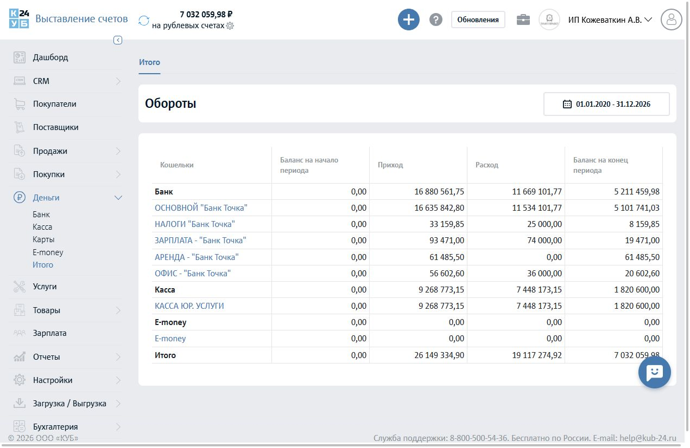
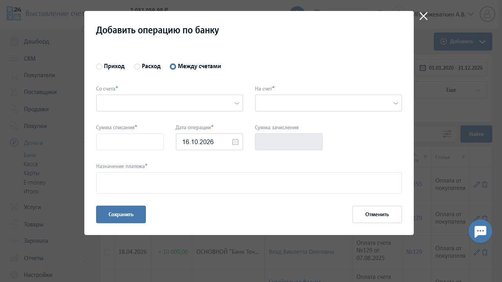
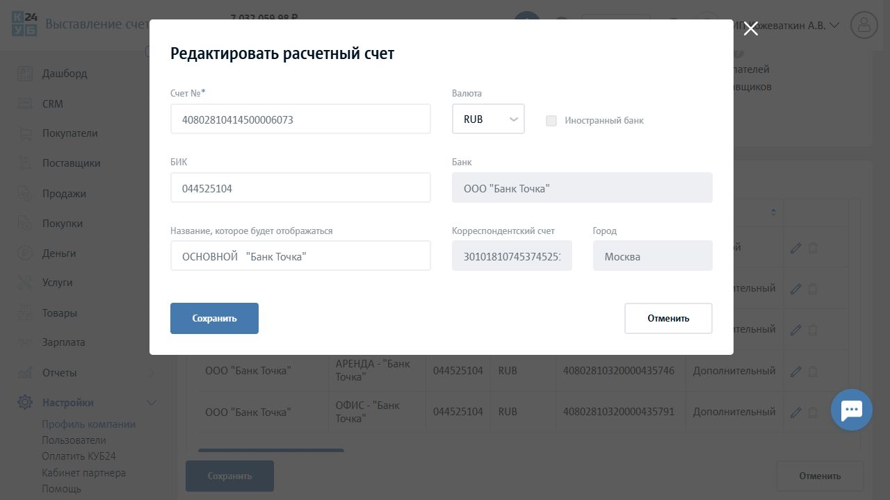
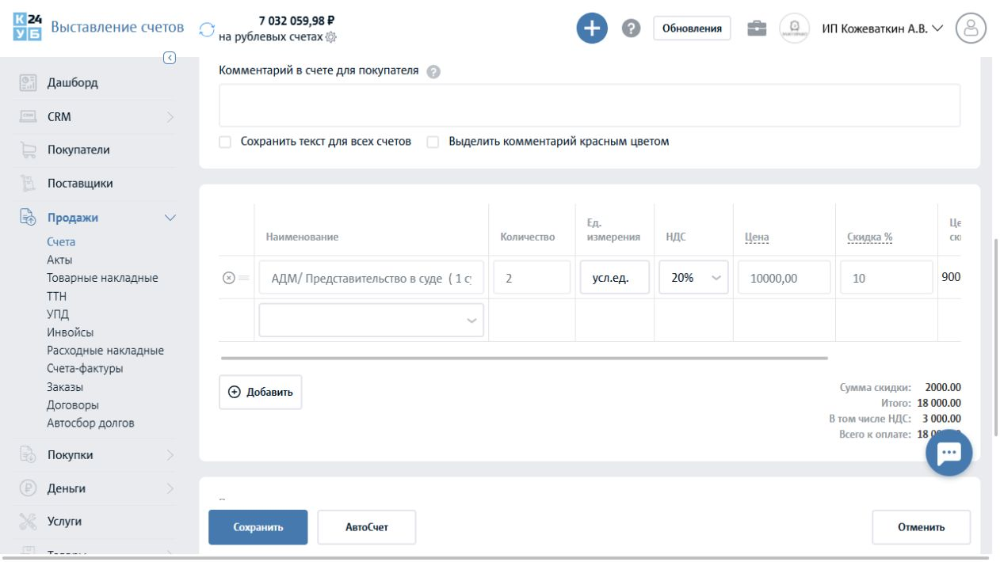

# КУБ — каталог оригинальных снимков

Исследование 16–17 октября 2026. **52 снимка**, оригинальные JPEG браузера без изменения значений. Пользователь отдельно разрешил сохранить реальные значения в Git. Формы входа/ПИН/пароли/токены отсутствуют. Даты файлов в [машинном манифесте](screenshots-manifest.json) даны в UTC; это время захвата, а не дата финансовой операции.

[Общий разбор](../../kub-reference-analysis-2026-10-16.md) · [Поля и сценарии](forms-and-flows.md). Полные страницы 04–06 содержат длинный журнал под модальным окном: для чтения формы используйте крупные 46–49. Оригиналы сохранены в полном разрешении; низкое качество миниатюры не означает уменьшенный исходник. Снимки 11/49/52 показывают нижнюю часть формы и не заменяют верхние поля.

| № | Состояние и смысл | Оригинал | Размер |
| --- | --- | --- | --- |
| 1 | Исходящие счета: пустой поиск, верхние итоги сохраняются | [JPEG](screens/01-outgoing-invoices-empty-search.jpg) | 1262×710 |
| 2 | Деньги → Итого: обороты и остатки по кошелькам | [JPEG](screens/02-money-turnovers.jpg) | 1271×827 |
| 3 | Банковский журнал: реальные даты, контрагент, назначение и документ | [JPEG](screens/03-bank-journal.jpg) | 1262×710 |
| 4 | Форма банковского прихода, полная страница; крупный вид 46 | [JPEG](screens/04-bank-income-form.jpg) | 1280×9584 |
| 5 | Форма банковского расхода, полная страница; крупный вид 48–49 | [JPEG](screens/05-bank-expense-form.jpg) | 1280×9584 |
| 6 | Форма перевода между собственными счетами, полная страница; крупный вид 47 | [JPEG](screens/06-bank-transfer-form.jpg) | 1280×9584 |
| 7 | Выбор импорта выписки:1 Сtxt/банк/иностранный банк | [JPEG](screens/07-statement-import.jpg) | 1280×720 |
| 8 | Кассовый журнал и ссылки на ПКО | [JPEG](screens/08-cash-journal.jpg) | 1262×710 |
| 9 | Существующий ПКО: дата, основание, печать/PDF | [JPEG](screens/09-cash-order-view.jpg) | 1262×710 |
| 10 | Редактирование кассовой операции и номера ПКО | [JPEG](screens/10-cash-order-edit.jpg) | 1280×727 |
| 11 | ПКО: раскрытые печатные основание и приложение, нижняя часть формы | [JPEG](screens/11-cash-order-print-fields.jpg) | 1280×727 |
| 12 | Профиль компании: общие реквизиты, счета, изображения | [JPEG](screens/12-company-profile.jpg) | 1271×2556 |
| 13 | Профиль компании: обзор настроек документов | [JPEG](screens/13-company-settings.jpg) | 1262×710 |
| 14 | Редактирование компании: тип, налоги, реквизиты и счета | [JPEG](screens/14-company-edit.jpg) | 1271×2879 |
| 15 | Настройки печати/подписи/QR/допномера и отсрочки | [JPEG](screens/15-company-document-options.jpg) | 1271×2789 |
| 16 | Редактирование банковского счёта в профиле | [JPEG](screens/16-bank-account-edit.jpg) | 1280×720 |
| 17 | Журнал исходящих счетов с документами и сроками | [JPEG](screens/17-invoice-journal.jpg) | 1262×710 |
| 18 | Создание исходящего счёта: верхняя часть | [JPEG](screens/18-invoice-create.jpg) | 1262×710 |
| 19 | Раскрытые дополнительные параметры счёта | [JPEG](screens/19-invoice-parameters.jpg) | 1262×710 |
| 20 | Включённые НДС и скидка: флажки параметров | [JPEG](screens/20-invoice-vat-discount.jpg) | 1262×710 |
| 21 | Оплаченный счёт: первичка, связанный акт и фактическая оплата | [JPEG](screens/21-invoice-paid-view.jpg) | 1271×1286 |
| 22 | Меню скачивания: PDF, PDF с подписью, Word | [JPEG](screens/22-invoice-download-actions.jpg) | 1262×710 |
| 23 | Связанный акт: основание, позиции и оперативные действия | [JPEG](screens/23-act-view.jpg) | 1271×1008 |
| 24 | Редактирование акта: основание и перенесённая услуга | [JPEG](screens/24-act-edit.jpg) | 1271×1122 |
| 25 | Покупатель: сводка обязательств и оплаченных счетов | [JPEG](screens/25-counterparty-summary.jpg) | 1262×710 |
| 26 | Деньги покупателя в выбранном контексте кассы | [JPEG](screens/26-counterparty-money.jpg) | 1262×710 |
| 27 | Параметры акта сверки контрагента | [JPEG](screens/27-reconciliation-options.jpg) | 1280×720 |
| 28 | ОДДС: доступная структура и ограничение подпиской | [JPEG](screens/28-cashflow-report-access-limit.jpg) | 1378×2184 |
| 29 | Общий журнал операций с текущим кошельком | [JPEG](screens/29-money-common-journal.jpg) | 1262×710 |
| 30 | Расширенный денежный фильтр: факт/план и источник | [JPEG](screens/30-money-filters.jpg) | 1262×710 |
| 31 | АвтоСверка банка: номер счёта, период, загрузка 1 Сtxt | [JPEG](screens/31-bank-reconciliation.jpg) | 1280×720 |
| 32 | Входящие счета: обязательства поставщикам | [JPEG](screens/32-purchase-invoices.jpg) | 1262×710 |
| 33 | Физлицо-поставщик: долг и неразнесённые оплаты отдельно | [JPEG](screens/33-supplier-settlements.jpg) | 1262×710 |
| 34 | Налоговый мастерИП: проверка исходных параметров | [JPEG](screens/34-tax-parameters.jpg) | 1262×710 |
| 35 | CRM: воронка сделок и журнал | [JPEG](screens/35-crm-deals.jpg) | 1262×710 |
| 36 | Пользователи: роли и отдельные доступы | [JPEG](screens/36-user-access-list.jpg) | 1262×710 |
| 37 | Тестовый менеджер: независимые права документов и оплат | [JPEG](screens/37-user-permissions.jpg) | 1262×710 |
| 38 | Справочник услуг: группы, единицы и цены | [JPEG](screens/38-services-catalog.jpg) | 1262×710 |
| 39 | Пакетная выгрузка документов: состав и история | [JPEG](screens/39-document-export.jpg) | 1262×710 |
| 40 | Договоры покупателей: журнал и реквизиты | [JPEG](screens/40-contracts-journal.jpg) | 1262×710 |
| 41 | Несохранённая форма договора: номер/дата/контрагент/вид основания | [JPEG](screens/41-contract-form.jpg) | 1280×720 |
| 42 | Автоправила разнесения: список условий | [JPEG](screens/42-bank-rules.jpg) | 1280×720 |
| 43 | Несохранённое правило: контрагент, текст, статья, проект и применение к истории | [JPEG](screens/43-bank-rule-form.jpg) | 1280×720 |
| 44 | Несколько банковских операций: табличный ввод, не расписание | [JPEG](screens/44-bank-multiple-operations.jpg) | 1280×720 |
| 45 | Плановые операции: отдельный режим формы | [JPEG](screens/45-bank-plan-form.jpg) | 1280×720 |
| 46 | Крупный вид банковского прихода | [JPEG](screens/46-bank-income-detail.jpg) | 1280×720 |
| 47 | Крупный вид перевода: два счёта, две суммы и дата | [JPEG](screens/47-bank-transfer-detail.jpg) | 1280×720 |
| 48 | Крупный вид банковского расхода: поставщик и дата | [JPEG](screens/48-bank-expense-detail.jpg) | 1280×720 |
| 49 | Нижние поля расхода: счета-основания и аналитика | [JPEG](screens/49-bank-expense-lower-fields.jpg) | 1280×720 |
| 50 | Таблица несохранённого счёта: НДС и скидка включены | [JPEG](screens/50-invoice-vat-discount-columns.jpg) | 1262×710 |
| 51 | Несохранённый расчёт:2×10000, скидка 10%,18000, в том числе НДС 20%=3000 | [JPEG](screens/51-invoice-calculation-example.jpg) | 1262×710 |
| 52 | Счёт после отключения НДС: сохранён итог скидки, нижняя часть формы | [JPEG](screens/52-invoice-without-vat-columns.jpg) | 1262×710 |

## Примеры ключевых механик

### Обороты по собственным счетам

### Перевод между счетами

### Профиль и банковский счёт

### Несохранённый расчёт скидки и НДС

Сохранение документа, проведение оплаты и отправка не выполнялись. Последний пример — ввод в несохранённую форму, а не новый счёт или движение денег. Наличие видимого права или кнопки не доказывает серверное применение правила. Ограничения и будущие проверки перечислены в общем разборе.
