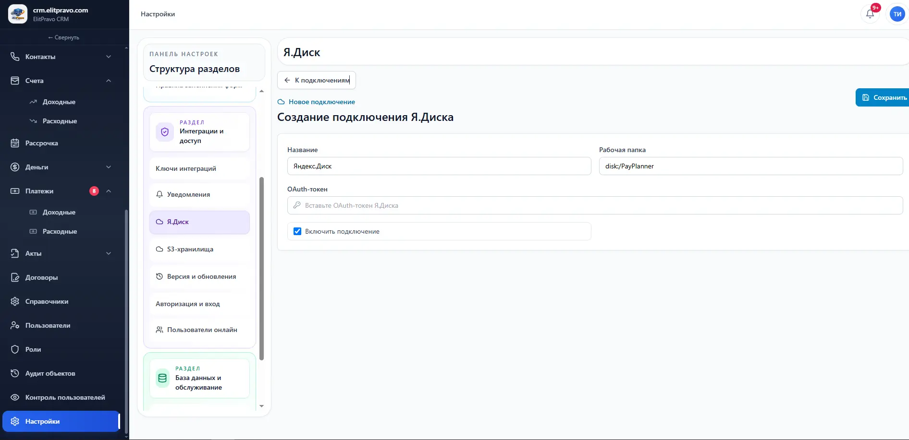

# Группа MAX — дополнительные фотографии и состояние чтения

История с создания 8 июля по 14 октября прочитана текстом. В группе174 медиаэлемента:173 фотографии и видео13июля (12,234с); также три именованных PNG14/27июля вне фотоальбома. Состояние сохранения и визуального чтения фиксируется раздельно. Именованные PNG сохранены штатной кнопкой MAX, проверены на диске и прочитаны; download event инструментом не получен, что не отменяет существование проверенных файлов.

Полный [реестр 173 фотографий](max-group-media-catalog.json) содержит дату/время, номер элемента и проверенные подписи. Оригиналы с клиентами и локальный альбом находятся вне Git: `D:/PayPlannerReview-20261012/unified-plan-audit-20261014/max-group-private-album.md`. Файл не считается прочитанным по одному наличию в папке; `reviewed` ставится после визуального просмотра. Историческая иллюстрация подтверждает жалобу на свою дату, не нынешний дефект автоматически.

**Прочитано фотографий: 173/173.** Сохранено источников: 173/173; именованных PNG3/3. После обновления MAX ссылки на ранее недоступные файлы восстановлены; источник14октября18:20 добавлен во время сверки.

[Макеты с вымышленными данными](max-mockup-gallery.md) и [короткое видео](max-group-video-audit.md).

| Дата/время · элемент/фото | Подпись и критерий | Основной пакет |
|---|---|---|
| 9 июля 2026, 20:47 · 6/0 | Рассрочный платёж содержит дело/договор/описание исходного счёта, но окно выбора не находит подходящий счёт. Исторический пример9июля: связь/поиск/права и повтор не должны заставлять создать дубликат существующего счёта. | DOC-04/BANK-03 |
| 10 июля 2026, 19:09 · 11/0 | Аннотированное окно согласования: нет возможности отложить проверку результата. Запрошено меню10мин/30мин/1час/1день, а не принудительное немедленное согласование; результат исполнителя пуст. | MSG-05/TSK-01/02 |
| 14 июля 2026, 12:22 · 39/0 | Окно задачи показывает автора и запрос переноса, но обычному исполнителю не видно завершения. Проверять отдельное право рабочего действия и различие автора/исполнителя; историческое изображение не доказывает нынешний дефект. | TSK-01/09 |
| 14 июля 2026, 22:43 · 60/0 | Исторический экран подключения Яндекс.Диска: название/рабочаяпапка/пустое поле токена/включение/сохранение. Поле пусто, клиентские записи не показаны; безопасный исходник приложен. | STG-USER/MSG-08 |
| 15 июля 2026, 15:30 · 66/0 | Аннотация к одному исполнителю: требуется выбор нескольких исполнителей и видимый список в карточке; пример автоматической контрольной задачи с понятным описанием. | TSK-09/CASE-02 |
| 15 июля 2026, 15:36 · 68/0 | Журнал задач: пользователь просит отдельный выбор дела, которого нет рядом с поиском; фильтры статуса/исполнителя/типа/приоритета сохраняются. | VIS-01/TSK-10 |
| 15 июля 2026, 15:44 · 69/0 | Карточка: отмена и дублирование нужны понятными значками с вспомогательным текстом, а не только в меню. Не добавлять новое действие молча: использовать существующий handler и права; обе формы. | VIS-02/TSK-09 |
| 15 июля 2026, 19:16 · 73/0 | В окне завершения задачи заказчик отметил место прикрепления файла вместе с результатом. Загрузка должна быть доступна без права менять остальные поля и завершаться атомарно с результатом либо сохранять ввод при отказе. | TSK-01/STG-014 |
| 15 июля 2026, 21:11 · 74/0 | В карточке показан ожидающий запрос переноса, автор/старый и новый сроки/причина/адресат решения, но нет действий согласовать/отказать. Понятное решение должно быть доступно уполномоченному адресату в этом контексте. | TSK-02/MSG-05 |
| 15 июля 2026, 21:13 · 77/0 | В строке журнала есть метка запроса переноса, но отсутствует быстрое действие. Заказчик прямо просит согласовывать и завершать без входа в карточку; использовать тот же диалог и серверные права/версию, не прямое изменение статуса. | TSK-02/10/VIS-01 |
| 15 июля 2026, 21:55 · 80/0 | Стрелкой выделена кнопка добавления задачи в журнале. Источник сопровождает договорную логику создания: платная/внутренняя и предупреждение о действующем договоре; существующая быстрая безклиентская задача сохраняется. | TSK-09/DOC-11 |
| 16 июля 2026, 12:31 · 84/0 | 16июля меню «Отложить» уже показывает10мин/30мин/1час/1день — позже исходной просьбы10июля. На этом же снимке согласующий отображается «Не указан» при ожидающем решении: проверить имя/роль/маршрут, не планировать заново уже присутствующее меню. | MSG-05/TSK-02/09 |
| 16 июля 2026, 13:24 · 86/0 | Последний согласующий выбирает завершить либо отправить исполнителю; заказчик просит явно объяснить, что при завершении исполнитель получит уведомление. Текст и фактический получатель должны соответствовать выбранному исходу. | TSK-02/09/MSG-04 |
| 16 июля 2026, 14:44 · 88/0 | Аннотация к кнопке завершения в журнале: для задачи на согласовании она не должна молча закрывать задачу. Должен открыться правильный диалог решения либо завершение недоступно с пояснением и отдельным согласованием; оба варианта используют один серверный workflow. | TSK-02/10/VIS-01 |
| 16 июля 2026, 17:37 · 91/0 | Выбор клиента открыт позади мастера создания задачи. Вложенный справочник должен быть сверху, с корректным focus/клавиатурой; выбор/отмена сохраняет текущий черновик и исходное дело. | VIS-02/TSK-09/REL-01 |
| 16 июля 2026, 18:00 · 96/0 | В мастере новой задачи16июля заказчик просит сразу строку поиска клиента по мере ввода вместо выбора длинного списка. На более позднем снимке17июля такая строка уже видна: сохранить реализацию, проверить поиск/права/ввод и обе формы. | TSK-09/VIS-02/CNT-01 |
| 16 июля 2026, 21:10 · 100/0 | Принудительный запрос срока остаётся для удалённой задачи; комментарий указывает удаление. Устаревшая очередь/ссылка должна корректно обработать недоступный объект и не навязывать повторное решение. | MSG-05/TSK-02/UX-01 |
| 17 июля 2026, 18:43 · 102/0 | 17июля в журнале уже присутствует выбор дела, которого не было на снимке15июля. Проверять актуальный фильтр/полную разрешённую выборку и читаемый список, а не заявлять поле отсутствующим по раннему изображению. | VIS-01/TSK-10 |
| 17 июля 2026, 21:33 · 103/0 | 17июля мастер содержит поисковое поле клиента; при отсутствии активных дел показывает предупреждение и общую внутреннюю задачу без клиента. Уточнения того же дня требуют внутреннюю/неоплачиваемую задачу и с выбранным клиентом без дела; сохранять контекст, не заставлять создавать дело только ради такой задачи. | TSK-09/DOC-11 |
| 17 июля 2026, 22:09 · 111/0 | Повторный вид того же мастера17июля: клиент найден, активных дел нет, переход к финансовой задаче требует дело; общая внутренняя кнопка теряет клиентский контекст. Сопоставить с принятой внутренней задачей с клиентом без дела. | TSK-09/DOC-11 |
| 22 июля 2026, 22:03 · 115/0 | 22июля: выбор контрагента должен происходить через поисковую строку, не длинный dropdown; автор просит перенести связанные селекторы и вернуть прежнюю ширину поиска/соседнего поля. Сохранить фильтр по делу и полный разрешённый поиск. | VIS-01/TSK-10/UX-01 |
| 23 июля 2026, 10:11 · 116/0 | 23июля стрелки указывают на бейджи приоритета и «Неоплачиваемая — не для счёта» в строке задачи. Точная желаемая правка текстом не задана: зафиксировать как визуальный референс для согласования, не приписывать снимку доработку заметок-стикеров или новую финансовую норму. | VIS-00/01/DOC-11 |
| 27 июля 2026, 13:23 · 117/0 | 27июля в диалоге согласования не отображается приложенный результатом файл; «Открыть задачу» не переводит к ней. Нужно видеть разрешённый файл/версию и открыть карточку, сохранив очередь и возможность вернуться к решению. | TSK-01/02/MSG-05/STG-W3 |
| 27 июля 2026, 17:06 · 119/0 | 27июля файл показан в актуальном списке задачи, но скачивание отвечает «Файл не найден в хранилище». Автор спрашивает, почему удалённый файл остаётся. Отличать удаление/архивную версию/потерю физической копии: актуальная ссылка не должна обещать доступные байты; историю не уничтожать автоматически. | TSK-01/STG-014/015/022 |
| 27 июля 2026, 17:06 · 120/0 | Автор просит проверить, какая дата действительно запрошена, а какая текущая. На снимке старый и запрошенный сроки различны; это требование проверки соответствия UI/запроса/сохранения/часового пояса, не достаточное доказательство текущего дефекта. | TSK-02/09 |
| 27 июля 2026, 19:17 · 128/0 | Список участников выглядит общей кучей: не ясно, кто согласующий и кто наблюдатель. Роли/очередь/выбранные лица нужно визуально разделить и сохранять раздельно; удаление человека относится к явной роли. | VIS-02/TSK-09/SEC-01 |
| 27 июля 2026, 19:18 · 129/0 | Карточка показывает «В работе», результат отправлен на согласование, нижнее действие сообщает «Задача находится на согласовании». Проверить понятное отображение основного статуса и текущего этапа, допустимые рабочие действия/сохранение; запрет не должен маскировать возможность загрузки результата исполнителем. | TSK-01/02/09/VIS-02 |
| 28 июля 2026, 11:18 · 134/0 | 28июля вход в CRM завершился ошибкой Failed to fetch. Исторический сетевой/серверный отказ, не подтверждение недоступности сегодняшнего выпуска; требуется понятная диагностика/повтор и сохранение ожидаемого маршрута при восстановлении. | REL-01/02/UX-01 |
| 6 августа 2026, 13:25 · 137/0 | 6августа принудительный запрос срока уже обработан, но диалог остаётся с активными действиями. При повторе/гонке получить итог, убрать обработанный элемент из очереди и не навязывать новый ответ; история сохранена. | MSG-05/TSK-02 |
| 6 августа 2026, 14:59 · 143/0 | 6августа стрелка указывает на постоянно видимый счётчик платных задач без счёта. Проверять его по полному каноническому набору оплачиваемых/включённых/внутренних/завершённых задач, не по одной странице; согласовать область счётчика и строк. | DOC-11/TSK-10 |
| 6 августа 2026, 15:27 · 146/0 | Профиль исполнителя показывает начислено/выплачено/к выплате по клиентам и задачам, сроки и ссылку на платёж. При переходе/оплате нужен правильный получатель и возврат в расчёты того же сотрудника, без потери фильтра и двойного начисления. | SAL-02/03/UX-01 |
| 6 августа 2026, 15:56 · 147/0 | Снимок длинного глобального меню с раскрытым разделом платежей. В связанной переписке6августа запрошены пользовательские порядок/сворачивание; сохранение права видимости каждого раздела и компактной плотности. | UX-02/SEC-01 |
| 11 августа 2026, 18:49 · 157/0 | Поле комментария с флажком «Доступен во внешнем календаре». Текст/действие должны быть читаемы; наружу идёт только явно разрешённый пользовательский комментарий, системная история изменений не экспортируется как комментарий. | CAL-05/TSK-01 |
| 12 августа 2026, 20:10 · 167/0 | 12августа к native browser push: название задачи на отдельной строке, без повторов, конкретное изменение вместо слова «Статус», читаемые переносы и фирменный значок. Форматировать title/body/icon в существующем канале; внешний вид системного окна ограничен браузером/ОС, это отдельно от CSS внутреннего popup. | MSG-04/08/REL-01 |
| 12 августа 2026, 21:12 · 170/0 | Пример web push назначения: кто назначил, краткое название и объект, значок CRM; требуется адресная доставка связанного события. Изображение показывает полученный push на свою дату, не доказывает работу всех подписок/пользователей текущей версии. | MSG-04/TSK-09 |
| 13 августа 2026, 13:02 · 171/0 | Референс КУБ13августа: общий порядок меню задаёт администратор/назначенное лицо, порядок сохраняется; пользователь может скрывать/возвращать разрешённые разделы через «Ещё разделы». Это разделение общего порядка и личной видимости, не только личная сортировка. | UX-02/SEC-01 |
| 13 августа 2026, 20:58 · 180/0 | Запрошена группа меню «Управление»: пользователи, роли, аудит объектов, контроль пользователей, справочники, настройки. Порядок и скрытие сохраняются, доступ к данным остаётся ролевым. | UX-02/SEC-01 |
| 13 августа 2026, 20:58 · 180/1 | Запрошена группа «Бухгалтерия»: счета, акты, договоры, деньги, платежи. Группировка навигации не объединяет независимые права просмотра счетов/актов/платежей. | UX-02/SEC-01 |
| 13 августа 2026, 21:02 · 181/0 | Выделена группа справочников клиентов/контактов: юридические лица, клиенты и контакты; текущий список «Ещё разделы» уже содержит флажки и кнопку порядка/названий. Проверять существующую основу и итоговую группировку, не создавать механизм заново. | UX-02/CNT-01/02 |
| 17 августа 2026, 16:22 · 185/0 | Печатный счёт: автор просит подстановку реквизитов покупателя из карточки клиента. Часть значений на снимке уже присутствует; проверить каждое требуемое поле, источник/права/снимок и читабельность блока, не подменять покупателя собственной компанией. | DOC-05/08/CMP-02 |
| 17 августа 2026, 20:45 · 187/0 | В журнале у назначенного исполнителя видна только кнопка просмотра при существующем согласующем. Рабочие действия ограниченной роли должны зависеть от этапа и отдельного права выполнения/отправки, а не общего редактирования. | TSK-01/02/09/SEC-01 |
| 17 августа 2026, 20:45 · 187/1 | Тот же ограниченный исполнитель17августа в режиме просмотра: поля/результат недоступны. Полный рабочий маршрут после доработки/повторной подачи проверяется отдельно от редактирования; крупное название не обрезается без способа прочитать полностью. | TSK-01/02/09/VIS-02 |
| 17 августа 2026, 20:45 · 187/2 | В карточке17августа уже есть «Оплата по результату», число дней после результата и пояснение, что платёж появляется после принятия работы/завершения. Сохранять эту основу; проверить фактическое единственное начисление/срок/повтор, а не считать весь механизм отсутствующим из-за пустой PAY-2. | SAL-01/02/03/TSK-02 |
| 17 августа 2026, 20:45 · 187/3 | 17августа согласующие и наблюдатели уже разделены заголовками/цветом/счётчиками; у согласующего виден этап «На доработку». Это более поздняя реализованная UI-основа к жалобе27июля; остаток — сохранение ролей/очереди/права/действия после доработки. | TSK-09/VIS-02 |
| 17 августа 2026, 20:45 · 187/4 | После доработки показан запрос переноса с прежней датой и нет понятного отдельного действия повторной подачи в видимой нижней части. Проверить возможность отправить исправленный результат, а не подменять её запросом срока; обе формы и ограниченный исполнитель. | TSK-01/02/09 |
| 26 августа 2026, 14:33 · 199/0 | 26августа единый контакт показан одновременно человеком и организацией, с разным состоянием телефонной синхронизации. Историческая проблема импорта/классификации; выяснять первичный тип и связи, не сливать и не удалять только по совпадению ФИО. | CNT-01/02/08 |
| 26 августа 2026, 14:37 · 203/0 | Повторный аннотированный снимок того же ошибочно классифицированного контакта: стрелка на «Организация». Исправление типа должно сохранять документы/дела/платежи/связанные лица и разрешённую телефонную книгу; отдельный dry-run и отчёт изменений. | CNT-02/08/SEC-01 |
| 27 августа 2026, 15:13 · 205/0 | 27августа печать поступления даёт общий «Платёжный ордер» вместо ожидаемого стандартного ПКО. Различать стандартную форму по умолчанию и пользовательский шаблон, не называть произвольную таблицу кассовой формой. | DOC-08 |
| 27 августа 2026, 17:39 · 207/0 | ПКО с отрывной квитанцией показывает НДС. Проверять сумму/ставку/источник налогового режима продавца и документа; физлицо-покупатель само по себе не определяет отсутствие НДС. В обеих половинах одинаковые реквизиты/дата/сумма/налог/подписи. | DOC-03/08/TAX-01/CMP-05 |
| 3 сентября 2026, 19:16 · 210/0 | 3сентября Word-планинг: большая пустота до заголовка, лишняя/безымянная последняя колонка, узкие дата/описание. Сохранить выбранные семь колонок и реальные группы клиент/дело, читаемый альбомный лист без пустых первых страниц. | TSK-12/DOC-08/CASE-06 |
| 3 сентября 2026, 19:23 · 212/0 | Планинг той же выборки после изменения формата: портретный лист, чрезмерно узкое описание и высокие строки. Нужны согласованная альбомная ориентация, ширины, переносы и повтор заголовков, не просто наличие DOCX-файла. | TSK-12 |
| 3 сентября 2026, 19:25 · 213/0 | Следующий Word-снимок: полные семь колонок/группы есть, но даты разрываются внутри года и описание сжимается; ручное изменение ширины не является исправлением генератора. Проверять все страницы/длинные строки и активные/все статусы. | TSK-12 |
| 3 сентября 2026, 20:04 · 214/0 | 3сентября стрелки на вкладки комментариев, файлов, таймера и активности. Полная работоспособность всех четырёх входит в остаток; таймер/учёт времени отделены от истории/системных комментариев и не превращаются автоматически в денежное начисление. | TSK-01/09/11/CRT-07 |
| 3 сентября 2026, 20:38 · 217/0 | Журнал: счётчик платных задач без счёта и подготовка общего счёта для одного клиента. Проверять полноту выборки, единый клиент, права и идемпотентность; массовые действия и автоконтроль уже видны. | DOC-11/TSK-10 |
| 3 сентября 2026, 20:39 · 218/0 | Стрелки к меткам обычного приоритета; рядом независимые «Без счёта» и «Не для счёта». Различать приоритет и финансовый признак, не считать визуальную метку доказательством расчёта. | VIS-01/DOC-11 |
| 3 сентября 2026, 21:37 · 225/0 | Фильтр клиента даёт пустые задачи, но автоконтроль показывает чужие дела. Проверить единый контекст фильтров/прав всех блоков и счётчиков, без раскрытия чужих дел. | CASE-01/TSK-10 |
| 7 сентября 2026, 13:11 · 226/0 | Карточка на согласовании: результат и два файла уже сохранены, участники и оплата видны. Сохранить основу и проверить чтение файлов согласующим, переход к окну согласования и доступ исполнителя. | TSK-01/02/09 |
| 7 сентября 2026, 13:15 · 229/0 | В дате рождения и выдачи паспорта заголовок календаря не позволяет выбирать месяц и год. Нужен быстрый выбор прошлых дат, ручной ввод и проверка корректности без пошагового листания десятилетий. | VIS-12 |
| 7 сентября 2026, 13:20 · 230/0 | Повтор той же аннотации к выбору месяца/года в дате рождения и выдачи паспорта; отдельной новой функции не задаёт. | VIS-12 |
| 8 сентября 2026, 22:14 · 231/0 | Пожелание рабочего стола и отдельного раздела зарплаты со штатными/внештатными работниками, обязательными отчётами и ведомостями; методика начисления обещана отдельно, не определена снимком. | SAL-01/02/03/UX-02 |
| 9 сентября 2026, 11:53 · 233/0 | В центре уведомлений стрелки у выбора нескольких строк. Нужны массовые действия с явной областью текущей страницы/всей выборки, подтверждением удаления и серверной проверкой адресатов. | MSG-04 |
| 9 сентября 2026, 11:55 · 239/0 | Сообщение об ошибке фоновой синхронизации Яндекс.Календаря слишком общее. Пользователь должен понимать причину и доступное действие без раскрытия токенов. | CAL-04/MSG-04 |
| 9 сентября 2026, 11:55 · 240/0 | Стрелка к общему флажку уведомлений: ожидается выбор всех строк и массовое изменение прочитанности/архива/удаления с ясной областью. | MSG-04 |
| 10 сентября 2026, 14:37 · 246/0 | Автоконтроль показывает ожидающие срока дела и неактивные кнопки. Нужен понятный срок/основание ожидания; ручное действие до срока требует явного правила, снимок не разрешает обход автоматически. | CASE-01/02 |
| 11 сентября 2026, 15:18 · 251/0 | Убрать лишний уровень «Работа с клиентами», оставить «Клиенты» и подразделы людей/организаций. Рабочий стол уже имеет заглушку, состав блоков нужно согласовать отдельно. | UX-02 |
| 11 сентября 2026, 15:23 · 253/0 | Явная красная отметка отсутствия задач и возврат ручной кнопки «Поставить задачу» даже при ожидании срока автоконтроля; ручное создание отдельно от автоматической очереди и паузы. | CASE-01/02/VIS-01 |
| 11 сентября 2026, 15:24 · 254/0 | Стрелка к статусу дела в карточке клиента. Нужен понятный актуальный статус и согласованность с реестром; сама стрелка не определяет новое бизнес-правило. | CASE-05/VIS-03 |
| 11 сентября 2026, 15:31 · 257/0 | Разбивать уведомления сплошными полосами с полной датой. Группировка по локальной дате пользователя, корректные границы страниц и разные дни при одном UTC-дне. | MSG-04 |
| 11 сентября 2026, 19:06 · 260/0 | Добавить подкатегории «Судебные дела» и «На контроле» в разделе дел, сохранив права и прямые маршруты. | UX-02/CASE-05 |
| 11 сентября 2026, 19:08 · 261/0 | Одновременно показаны «Обжалование» и «Решение вынесено». Требуется различать судебное событие, стадию и внутренний статус, а не взаимно затирать их. | CRT-02/03 |
| 11 сентября 2026, 19:08 · 261/1 | Связанные первая и апелляционная инстанции уже видны; пожелание автоматически добавлять последующие инстанции. Проверять стабильную связь по УИД/источнику и отсутствие дублей. | CRT-02 |
| 11 сентября 2026, 19:08 · 261/2 | Референс Правоплан: номер, УИД, суд/адрес, судья, стороны, ссылка в суд, участники, файлы и связанная история инстанций. Это внешний пример, не доказательство реализации PayPlanner. | CRT-02/VIS-04 |
| 11 сентября 2026, 19:08 · 261/3 | Референс реестра судебных дел с папками, поиском по номеру/УИД и фильтром инстанции; явно отделять от обычных дел CRM. | CRT-02/VIS-04 |
| 11 сентября 2026, 19:11 · 263/0 | Мобильный референс расписания судов: группы полной даты, время заседания, инстанция, суд, время обновления и переход в календарь; повторно приложен 15 сентября. | CRT-03/CAL-02 |
| 11 сентября 2026, 19:11 · 263/1 | Мобильный судебный референс: категория, номер первой инстанции, движения с датой события и датой публикации, стороны и третьи лица. Не смешивать дату заседания и обновления источника. | CRT-02/03 |
| 11 сентября 2026, 19:11 · 263/2 | Апелляционный референс с УИД и историей перенесённых заседаний; сохранять полный номер производства и цепочку инстанций без обрезания данных. | CRT-02/03 |
| 11 сентября 2026, 19:11 · 263/3 | Референс списка дел: последнее движение, следующий срок, суд и отметка обновления в компактной карточке; повтор в сообщении 15 сентября. | CRT-03/VIS-11 |
| 11 сентября 2026, 20:34 · 268/0 | Word-планинг: почти пустые первые две страницы перед длинной строкой. Проверять длинный результат, разрешение разрыва строк, повтор заголовка, полезную ширину и отсутствие пустых страниц; генератор уже существует. | TSK-12 |
| 11 сентября 2026, 20:40 · 274/0 | Просмотрен через MAX: Word-планинг по клиентам и делам, дата формирования/количество задач, семь колонок: номер/задача/описание/срок/статус/исполнитель/комментарий. Без повторения ФИО и содержания клиентских дел. Снимок связан с качеством печатного планинга. | DOC-08/TSK-07→CASE-06 |
| 12 сентября 2026, 20:18 · 277/0 | Поздний снимок уже содержит красную отметку «Нет активных задач» и ручную кнопку, ранее запрошенные 11 сентября. Финансовый анализ разделяет пять категорий; проверить непересекаемость/фильтры и объяснение чисел. | CASE-01/DOC-11/VIS-01 |
| 15 сентября 2026, 09:39 · 285/0 | Письмо о недоставке на тестовый адрес .local через рабочий SMTP. Подтверждает необходимость полной изоляции локальной почты, очистки очереди/учёток, а не только вымышленного адреса. | REL-01/MSG-04 |
| 15 сентября 2026, 18:58 · 289/0 | Дело: источник проверен без изменений, но сводка всё ещё «Нужна проверка». Требуется согласованность статуса проверки, времени/ошибки и обновления сводки, без ложного зелёного успеха. | CRT-03/CASE-05 |
| 15 сентября 2026, 18:58 · 294/0 | Мобильный референс расписания судов: группы полной даты, время заседания, инстанция, суд, время обновления и переход в календарь; повторно приложен 15 сентября. | CRT-03/CAL-02 |
| 15 сентября 2026, 18:58 · 294/1 | Мобильный судебный референс: категория, номер первой инстанции, движения с датой события и датой публикации, стороны и третьи лица. Не смешивать дату заседания и обновления источника. | CRT-02/03 |
| 15 сентября 2026, 18:58 · 294/2 | Апелляционный референс с УИД и историей перенесённых заседаний; сохранять полный номер производства и цепочку инстанций без обрезания данных. | CRT-02/03 |
| 15 сентября 2026, 18:58 · 294/3 | Референс списка дел: последнее движение, следующий срок, суд и отметка обновления в компактной карточке; повтор в сообщении 15 сентября. | CRT-03/VIS-11 |
| 16 сентября 2026, 12:08 · 301/0 | Стрелки к вводу комментария и загрузке файла: важна доступность без редактирования остальных полей. Комментарии отделены от системной активности, экспорт в календарь явным флажком. | TSK-09/MSG-01/STG-014 |
| 16 сентября 2026, 12:13 · 303/0 | Выделить границы рабочих блоков без перегруза; клиент и дело должны иметь активные ссылки на профиль с сохранением ввода. Согласующие и наблюдатели визуально разделены. | VIS-02/TSK-09 |
| 16 сентября 2026, 12:15 · 305/0 | YouGile-референс дублирования задачи: меню/файлы/подзадачи/автор. Копировать только согласованные поля, не результат, платёж и историю; обе формы. | TSK-09/VIS-02 |
| 16 сентября 2026, 12:16 · 306/0 | Референс повторения задачи: месяц/число/время/пропуск выходных/следующий повтор, создание после завершения предыдущей. Нужны отдельные правила календарного повтора и отсутствие дублей. | TSK-09 |
| 16 сентября 2026, 12:21 · 308/0 | Референс компактной правой панели карточки: статус, исполнитель, дата, подзадачи, файлы, приоритет, поля, метки и автор; не обещать пользовательские поля без согласованной модели. | VIS-02/TSK-09 |
| 16 сентября 2026, 12:22 · 309/0 | Референс компактного вида карточки; переключение представления должно сохранять введённые поля и использовать одну модель сохранения. | VIS-02/TSK-09 |
| 16 сентября 2026, 12:22 · 309/1 | Референс расширенного вида: поля слева, комментарии/файлы/таймер справа. Учитывать узкий экран и сохранение локального ввода при переключении. | VIS-02/TSK-11 |
| 16 сентября 2026, 12:22 · 309/2 | Повтор референса меню дублирования: отдельной новой функции не задаёт. | TSK-09 |
| 16 сентября 2026, 12:28 · 310/0 | amoCRM-референс дней рождения: включение/отключение, отслеживание и задача поздравления. Сохранить имеющийся BirthdayReminderBackgroundService, проверить годовой дубль, дату и адресата. | TSK-05 |
| 16 сентября 2026, 13:27 · 317/0 | Пустая доска PayPlanner в YouGile на историческую дату: организационный источник, новых требований к CRM на снимке нет. | VIS-00 |
| 16 сентября 2026, 13:33 · 332/0 | Пустой список бесед внешнего референса: нужны ясные состояния пусто/загрузка/ошибка и фильтр; не считать отсутствием чатов текущей CRM. | MSG-01/07 |
| 16 сентября 2026, 13:39 · 333/0 | Повтор пустой доски YouGile с участниками проекта; организационный контекст, отдельного продуктового требования нет. | VIS-00 |
| 16 сентября 2026, 13:42 · 334/0 | amoCRM-референс переписки: список диалогов, входящие/исходящие, автор, время, доставлено, история и вложения. Ориентир интерфейса, не разрешение подключать VK автоматически. | MSG-01/07 |
| 16 сентября 2026, 14:03 · 349/0 | Экран ожидания подтверждения доступа к компании YouGile; организационный источник без нового требования CRM. | VIS-00 |
| 16 сентября 2026, 14:31 · 354/0 | Карточка в режиме просмотра содержит файл, комментарии/таймер/активность и оплату. Текст самой юридической задачи — клиентские рабочие данные, не новая функция продукта. Проверять доступ исполнения при режиме просмотра. | TSK-09/11 |
| 17 сентября 2026, 09:35 · 359/0 | В меню карточки доступно только безвозвратное удаление, видны просмотр/платная без счёта. Проверить права, подтверждение, отдельные отмену/архив/дублирование, отсутствие удаления финансовой истории. | TSK-09/VIS-02 |
| 17 сентября 2026, 13:05 · 362/0 | Переходы «Все»/«Поручено мне» сопровождаются ошибкой загрузки журнала; нужна адресная характеризация фильтров, отклонённого ответа и сохранения предыдущего состояния. | TSK-10/REL-01 |
| 17 сентября 2026, 13:06 · 364/0 | Историческая ошибка входа Failed to fetch; понятное русское сообщение и диагностика сети отдельно от неверного пароля, без автоматического выхода при временном сбое. | REL-01 |
| 17 сентября 2026, 14:09 · 369/0 | Кнопка расписания из карточки: недельное модальное окно, выбор дня/времени, увеличение/уменьшение длительности и наглядные пересечения. Не ограничиваться существующим предупреждением о конфликте. | CAL-06/07/08 |
| 17 сентября 2026, 14:48 · 378/0 | Стрелки к быстрому завершению из строк журнала. Использовать общий диалог результата/файлов/согласования и серверные права, а не обход процесса прямым статусом. | TSK-01/10 |
| 17 сентября 2026, 15:08 · 386/0 | Уточнение анализа оплаты: категории и назначение ответственного за счета/акты/договоры. Автоконтроль отдельно имеет поиск, обновление и критические дела — сохранять уже показанную основу. | DOC-11/CASE-01 |
| 17 сентября 2026, 15:27 · 396/0 | Референс карточек автоконтроля: почему здесь/что дальше, ответственный, последнее движение, следующий контроль, будущий исполнитель/срок с часовым поясом и ручная постановка. | CASE-01/02/VIS-01 |
| 17 сентября 2026, 15:27 · 397/0 | Поздний рабочий экран уже содержит пояснения автоконтроля, исполнителя/срок, ручное действие. Сохранить основу, проверить соответствие фактическому созданию и компактность. | CASE-01/02 |
| 17 сентября 2026, 15:49 · 401/0 | Фото рабочего монитора: контрольные задачи ошибочно выглядят «Без счёта», приоритет/контроль/финансовые метки смешиваются. Автоконтроль не должен молча становиться оплачиваемой услугой. | DOC-11/CASE-02/VIS-01 |
| 17 сентября 2026, 17:03 · 406/0 | Явное пожелание кнопки сворачивания блока автоконтроля; состояние предпочтения индивидуально, критические счётчики сохраняются видимыми. | VIS-01/CASE-01 |
| 18 сентября 2026, 13:52 · 407/0 | Поздний экран уже разделяет уведомления полосой полной даты. Сохранить реализованную группировку, проверить смену часового пояса и страницы. | MSG-04 |
| 18 сентября 2026, 18:03 · 411/0 | Нужны быстрые фильтры «Я наблюдатель», «Я согласую», «На контроле» и объяснение ролей/приходящих уведомлений. Серверный доступ определяется участием, не только выбранной вкладкой. | TSK-10/09/MSG-04 |
| 18 сентября 2026, 18:05 · 413/0 | Пояснить разницу числа счетов к подготовке и числа платных задач без счета: несколько задач одного клиента могут объединяться; проверить фактическую группировку/источники, показать понятные подсказки. | DOC-11/VIS-01 |
| 21 сентября 2026, 14:36 · 415/0 | Быстрая задача: название, краткое описание, срок, сохранить и закрыть; позже привязать клиента/дело. Уже принятая PAY-10 основа не переоткрывается, проверяются дополнительные поля/сохранение. | TSK-08 |
| 21 сентября 2026, 17:56 · 419/0 | Журнал с группировкой по дате и стрелкой на название контрольной задачи. Нужны читаемый полный заголовок и переход без потери контекста; конкретная клиентская работа не является ТЗ продукта. | VIS-01/TSK-10 |
| 22 сентября 2026, 12:44 · 421/0 | Жалоба на отсутствие уведомлений мессенджера при «Все уведомления»; сырые упоминания @[9] видны в сообщении. Проверить адресата, настройки, доставку/прочитанность и показ имени вместо ID. | MSG-03/04 |
| 22 сентября 2026, 12:55 · 440/0 | Пункт «MAX для бизнеса»: иллюстрация входа к настройке бота, самостоятельного нового сценария CRM не содержит. | MAX-01/02 |
| 22 сентября 2026, 13:22 · 443/0 | Перенести календарь оплат в бухгалтерию, календарь задач оставить у журнала. Прямые ссылки и права сохраняются, финансовые события не перемешиваются с задачами. | UX-02/CAL-06 |
| 22 сентября 2026, 15:09 · 444/0 | Недельное расписание уже существует, но показывает только текущую задачу без других занятых интервалов исполнителя. Проверять полный диапазон недели, часовой пояс, права/маскирование и исключение редактируемой задачи из конфликтов. | CAL-06/07 |
| 23 сентября 2026, 18:51 · 445/0 | Яндекс.Диск сообщает недоступность защищённого токена и просит переподключение. Проверять сохранность ключа шифрования при перезапуске/обновлении и безопасное восстановление без потери файлов. | STG-USER/MSG-08 |
| 24 сентября 2026, 18:03 · 454/0 | Красная точка/счётчик непрочитанных на общем пункте мессенджера, чтобы видеть новое без ручного открытия. Счётчики по диалогам уже показаны; общая сумма должна учитывать доступ и состояние прочтения. | MSG-03/04/VIS-11 |
| 24 сентября 2026, 18:50 · 456/0 | Бот MAX прошёл модерацию и готов к разработке; сам токен не показан. Это основание подключения, не подтверждение доставки или идентификации клиента. | MAX-01 |
| 24 сентября 2026, 19:19 · 457/0 | Вкладка чата задачи возвращает Forbidden у участника/исполнителя. Проверить согласованность членства и task visibility, русский отказ, отсутствие раскрытия чужого чата. | MSG-01/SEC-01 |
| 28 сентября 2026, 12:22 · 479/0 | Слишком узкий редактор чата задачи, длинный текст прыгает при прокрутке. Нужны стабильная высота, доступная ширина, сохранение курсора/черновика и отсутствие скачков. | MSG-01/VIS-11 |
| 28 сентября 2026, 12:24 · 480/0 | Повтор жалобы на редактор чата задачи и скачки длинного текста; отдельной новой функции не задаёт. | MSG-01/VIS-11 |
| 28 сентября 2026, 20:49 · 481/0 | Роль юриста видит бухгалтерию/календарь оплат без соответствующих прав. Проверять меню, прямые маршруты и API; личная настройка меню не выдаёт доступ. Поздний снимок уже показывает фильтры наблюдателя/согласующего и объяснение ролей. | SEC-01/UX-02/TSK-10 |
| 28 сентября 2026, 22:50 · 483/0 | Макет компактного журнала: сворачиваемые фильтры, быстрые роли, список/доска/календарь, аккуратные статусы/приоритеты, страницы и общий поиск. Макет не меняет серверную семантику. | VIS-01 |
| 28 сентября 2026, 23:00 · 487/0 | Макет доски: просрочено/сегодня/в работе/выполнено, компактные карточки с типом, сроком и комментариями. Группы по сроку могут пересекать статус; правила должны быть явно определены. | VIS-01/TSK-10 |
| 28 сентября 2026, 23:10 · 488/0 | Полный макет журнала: роли/исполнитель/клиент/дело/даты/загрузка/вложения, экспорт, анализ оплаты с пояснением, сортировка/колонки/страницы. Сохранять договорную логику, не копировать вымышленные числа как расчёт. | VIS-01/DOC-11 |
| 29 сентября 2026, 00:05 · 491/0 | Макет карточки задачи: сворачиваемые блоки, принять в работу, недельное расписание, чат/файлы/таймер/активность и ссылки связей. Оплату/правила сохранять из действующего API, текст макета не выдаёт новых прав. | VIS-02/TSK-09/11 |
| 29 сентября 2026, 00:27 · 492/0 | Макет обзора дела: безрамочный текст, ключевые события, быстрый доступ к клиенту/судам/ИФНС/ФССП/документам/переписке/задачам/календарю и дополнительные файлы/заметки/история. | VIS-03/CASE-05 |
| 29 сентября 2026, 01:52 · 494/0 | Судебный макет с четырьмя инстанциями, номером/УИД/судьёй/сторонами/движением, ближайшим событием, критическим сроком, обжалованием и документами. Даты и правовые сроки макета не являются нормативной формулой. | VIS-04/CRT-02/03/04 |
| 29 сентября 2026, 01:52 · 494/1 | Вариант того же судебного макета без верхнего переключателя инстанций/блока обжалования; выбрать согласованный вариант, остальные требования сохранить. | VIS-00/04/CRT-02 |
| 29 сентября 2026, 02:50 · 495/0 | Макет задач дела: строки с типом/исполнителем/сроком/статусом, флажки, добавить задачу и боковой быстрый доступ. Основная функциональная PAY-24 область принята, дизайн проверяется отдельно. | VIS-06/TSK-10 |
| 29 сентября 2026, 02:50 · 495/1 | Повтор макета задач дела в другом файле; отдельного нового поведения нет. | VIS-06 |
| 29 сентября 2026, 02:50 · 495/2 | Макет обзора дела со сворачиваемыми сторонами/движением/документами/сроками/задачами/перепиской/историей, номер/копирование, ближайшее событие и ссылка на материалы. | VIS-03/CASE-05 |
| 29 сентября 2026, 02:50 · 495/3 | Макет документов дела: поиск/фильтры, тип/дата/автор/размер, выбор строк, меню, добавить и страницы. Более 50 документов проверяются независимо от задач. | VIS-05/STG-015 |
| 29 сентября 2026, 02:50 · 495/4 | Повтор макета обзора со сворачиваемыми блоками; новых функций относительно предыдущего варианта нет. | VIS-03 |
| 29 сентября 2026, 02:50 · 495/5 | Повтор судебного макета с инстанциями и обжалованием, сохраняется как вариант той же спецификации. | VIS-04/CRT-02 |
| 29 сентября 2026, 02:59 · 496/0 | Макет полной ленты событий: заседание, поступление/отправка документа, определение, подача и регистрация с файлами и переходами. Судебный фильтр — только часть общего объёма PAY-25. | VIS-07/CRT-03/CASE-05 |
| 29 сентября 2026, 03:25 · 497/0 | Макет журнала ФССП: события производства, запросы, постановления и статусы с датой/временем, поиском/фильтром. ЕФРСБ присутствует в быстром доступе; получить согласованный источник/контракт до автоматизации. | CRT-06/VIS-08 |
| 29 сентября 2026, 04:11 · 498/0 | Макет Почты РФ: входящие/исходящие письма/бандероли, трек, адресат/отправитель, содержание и статус, поиск/фильтр и переход. Реальная интеграция отделена от локального макета. | CRT-07/VIS-09 |
| 29 сентября 2026, 04:56 · 502/0 | Макет финансов дела: раздельные доход/расход, ожидается/просрочено/общая сумма/остаток, все операции и документы, даты/поиск/фильтры/экспорт/страницы. Финансовая сводка не суммирует счёт и его оплату дважды. | DOC-10/VIS-10 |
| 29 сентября 2026, 17:30 · 503/0 | Добавление собеседников доступно лишь в одном чате задачи. Проверить тип/участие/право управлять составом, общую доступность действия и восстановление членства, не выдавая доступ ко всем задачам. | MSG-02/SEC-01 |
| 29 сентября 2026, 17:46 · 504/0 | Разделить чаты заметными вкладками задачи/дела/личное/команда/архив, увеличить ширину списка и читаемость названий. Тип беседы и роли сохраняются. | MSG-01/07/VIS-11 |
| 30 сентября 2026, 12:29 · 505/0 | Макет мессенджера: широкая лента, чаты/категории, информация/участники/файлы справа, упоминание/вложение и доставки. Звонок на макете остаётся отдельной интеграцией, не обязательным handler редизайна. | VIS-11/MSG-01/02/07 |
| 30 сентября 2026, 12:29 · 506/0 | Поздний рабочий экран уже показывает красные точки категорий и счётчики диалогов. Сохранить результат, проверить общий счётчик меню и прочтение несколькими устройствами. | MSG-03/04 |
| 30 сентября 2026, 20:16 · 510/0 | Окно согласования: результат и файл доступны, отдельный срок/комментарий доработки, три решения; стрелка к комментарию. Проверять обязательность причины, сохранение ввода, точный эффект каждого решения и отсутствие перекрытия уведомлениями. | TSK-02/MSG-05 |
| 2 октября 2026, 21:00 · 513/0 | Завершённая автоконтрольная задача попала в платные без счёта; пользователю непонятны 66 клиентов и 319 задач. Проверить происхождение финансового признака, классификацию старых записей и отсутствие автоматического массового начисления. | DOC-11/CASE-02 |
| 2 октября 2026, 21:06 · 515/0 | Бухгалтеру нужен понятный маршрут выставления счёта по выполненным работам и исключения ошибочно попавшей контрольной задачи. Аннулирование связи со счётом отдельно от отмены самой задачи; история/оплаты неизменны. | DOC-11/CAL-02 |
| 3 октября 2026, 22:10 · 519/0 | В журнале задачи разных клиентов и внутренняя задача; нижняя строка показывает несоответствие клиента и названия. Проверять фактические связи/копирование/быстрое создание, а не исправлять по ФИО автоматически. | TSK-08/09/DOC-11 |
| 4 октября 2026, 01:13 · 525/0 | Повтор Forbidden во вкладке чата задачи и toast. Права участия должны совпадать для встроенного чата и отдельного мессенджера; отказ не теряет ввод. | MSG-01/SEC-01 |
| 4 октября 2026, 02:11 · 526/0 | Множество одинаковых ошибок синхронизации двух календарей. Нужны агрегирование/причина/повтор/ограничение retries и отдельный статус для каждого подключения, без спама уведомлениями. | CAL-03/04/MSG-04 |
| 4 октября 2026, 13:52 · 527/0 | Добавить переписку по делу отдельной категорией. Создание задачи из сообщения уже видно с обратной ссылкой; сохранить существующий сценарий, проверить связь дела и права. | MSG-01/07 |
| 5 октября 2026, 04:17 · 528/0 | Макет личных данных клиента: основной текст без тяжёлых рамок, контакты/документы/дополнительное, боковые разделы и номер/автор. Фиктивные паспортные поля — визуальный пример, права/маскирование сохраняются. | VIS-12/SEC-01 |
| 5 октября 2026, 14:19 · 529/0 | Несколько одинаковых задач из карточки одного дела с шаблонным названием/описанием. Проверить дубли при повторном нажатии/ошибке и реальный ввод, не удалять записи без подтверждения происхождения. | TSK-08/09/CASE-05 |
| 5 октября 2026, 19:13 · 533/0 | Длинный комментарий доработки сбрасывается через интервал. Обязательная проверка фонового обновления, переключения/откладывания модала, сетевой ошибки и сохранения ввода до успешной отправки. | MSG-05/TSK-02 |
| 8 октября 2026, 11:24 · 554/0 | Браузерные push: одинаковые изменения повторяются, заголовок и текст обрезаны. Проверять дедупликацию/свёртку, полезный изменённый атрибут, точный переход и разрешения. | MSG-04 |
| 8 октября 2026, 11:32 · 564/0 | Структура бухгалтерии: деньги отдельно по банку/кассе/картам/электронным деньгам/итого, платежи доходные/расходные. Это источник навигации и разных сущностей, не основание двойного учёта. | UX-02/DOC-10/BANK-05 |
| 9 октября 2026, 04:25 · 569/0 | Редактирование юрлица профиля компании: реквизиты, DaData, история и ответственный. Сохранить существующую форму и проверить полноту поля/снимки/отсутствие переписывания выданных документов. | CMP-01/03 |
| 9 октября 2026, 05:53 · 572/0 | Оформление счёта: компактная шапка/адрес в одной строке где помещается, корректные реквизиты/логотип/QR. Длинный адрес переносится без обрезания; снимок содержит реальные данные и не публикуется. | DOC-08/CMP-03 |
| 9 октября 2026, 05:55 · 574/0 | Сравнение с печатным источником: неожиданный столбец НДС и слишком длинные реквизиты покупателя. НДС определяется режимом продавца/снимком документа, не типом клиента; суммы печати совпадают с документом. | DOC-04/08/CMP-03 |
| 9 октября 2026, 18:03 · 581/0 | Google.Календарь показывает завершённые задачи серыми со статусом, часть отменённых тоже видна. Нужно отдельное правило готово/отменено/аннулирована связь со счётом, стабильная синхронизация и отсутствие ложного удаления активной задачи. | CAL-01/02/03 |
| 12 октября 2026, 02:31 · 587/0 | Внешний референс воронки: консультация→расчёт→согласование→договор/счёт→работа; в колонках написаны условия перехода. Не считать стадии/суммы универсально утверждёнными, сохранить условия в REQ-решениях. | REQ-01/02/03 |
| 12 октября 2026, 02:36 · 590/0 | Рабочие заявки уже содержат фильтры, этапы, связанный платёж, задачу и историю. Не разрабатывать основу заново; расширение проверяет оплату правильной услуги и условия автоматизации. | REQ-04/05/06 |
| 12 октября 2026, 22:12 · 591/0 | Отменённая задача всё ещё присутствует в Google.Календаре. Различать сохранение истории и занятость, повторную синхронизацию и удаление/восстановление конкретного события без чужих. | CAL-02/03 |
| 14 октября 2026, 08:51 · 599/0 | REG.RU сообщает технические работы Москва-3 и недоступность операций панели. Подтверждает исторический инфраструктурный инцидент; не причина автоматического объявления нынешнего VPS недоступным. | REL-01 |
| 14 октября 2026, 11:18 · 603/0 | Касса: инвентаризация и корректирующий ордер, начальный/конечный баланс, приход/расход/сверка и авансы. Много пустого места; визуальную компактность отделить от сохранности проводок. | BANK-05/VIS-10 |
| 14 октября 2026, 11:18 · 603/1 | Деньги «Итого»: свод по банку/кассе/картам/электронным деньгам и ОДДС, период/начало/приход/расход/конец. Проверить единую формулу/внутренние переводы без удвоения, реальные отрицательные остатки не скрывать. | BANK-05/VIS-10 |
| 14 октября 2026, 11:18 · 603/2 | Банк: счёт/импорт/журнал/правила, сверка, авансы и неизвестный счёт 46 операций. Проверить сопоставление банковского счёта и начального остатка, не считать зелёную арифметику доказательством правильного разнесения. | BANK-01/03/05/VIS-10 |
| 14 октября 2026, 18:20 · 607/0 | Новое изображение журнала: пометки «поднять наверх», «вернуть», «вниз пока» возле фильтров/сортировки/анализа оплаты задач/автоконтроля. Сохранить буквальные аннотации; точное расположение неоднозначных стрелок подтверждается перед реализацией, бизнес-расчёты не меняются одной перестановкой. | VIS-00/01/DOC-11/CASE-01 |

| 14 октября 2026, 19:39 · 608/0 | Новый снимок 14 октября 19:39: клонировать строку поиска; уточнение 19:55 прямо запрещает убирать её вместо клонирования. Блок анализа оплаты убрать из журнала в бухгалтерскую часть работы по счетам. Место второй строки согласовать по VIS-00; оба поля используют одно состояние/фильтр и один запрос, без дубля handlers. Перенос анализа сохраняет счета, права, очередь и данные. | VIS-01/DOC-11/UX-02/VIS-00 |

## Безопасный оригинал экрана подключения

Снимок14июля показывает прежний интерфейс. Токен не заполнен, клиентские записи отсутствуют.

## Именованные PNG, полностью прочитанные

[Реестр трёх источников](max-group-named-files-catalog.json).

- 14 июля 2026, 13:50, `2026-07-14_10-49-18.png`: Окно согласования с заполненным результатом, сроком/комментарием доработки и тремя рабочими действиями; отсутствует «Отложить». Переход к журналу не должен требовать немедленного согласования. Основной пакет: MSG-05/TSK-02.
- 27 июля 2026, 17:13, `2026-07-27_12-43-49.png`: Карточка в режиме просмотра: поля недоступны, результат только при завершении; нужен самостоятельный рабочий маршрут исполнителя. Оплата исполнителю показывается как подготовка расходного платежа после сохранения: различать плановое обязательство и начисление после принятия работы. Основной пакет: TSK-01/09/SAL-01/02.
- 27 июля 2026, 18:16, `2026-07-27_15-15-44.png`: Список согласований: столбец перед действиями сжат до вертикально расположенных букв. Таблица/колонки должны оставаться читаемыми на ноутбуке без уменьшения масштаба. Основной пакет: VIS-01/REL-01.

Уточнение 19:55, элемент 609: строку поиска именно клонировать; оригинал сохраняется.
