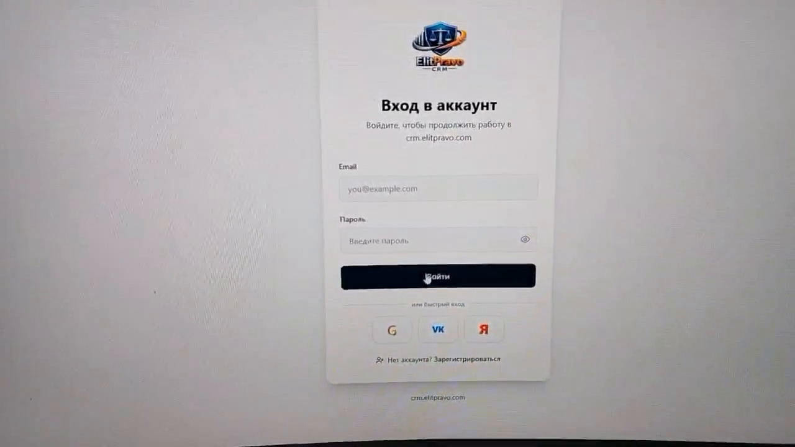

# Видео MAX: повторный вход при переходе

Источник: «СРМ — РАЗРАБОТКА», 13 июля, 23:51, переслано от сотрудника, элемент 37. Оригинал сохранён штатной кнопкой MAX и проверен: 4 658 836 байт, 12,234083 секунды, SHA-256 `67459c0cddf82a941408a0c4c36fd6bf5836b6d8f7183df4c49c351474dde33f`. Пять кадров 0/3/6/9/12 секунд прочитаны; звук распознан локально, речевых фрагментов не найдено. Аудиопик 10507, RMS 538.03 — это диагностика записи, не доказательство отсутствия любых звуков.

На записи виден вход через VK, открытый центр уведомлений, переход к календарю и возврат к форме входа. **REL-01/SEC-01:** воспроизвести переход после OAuth и после обычного входа, проверить срок/refresh/профиль, 401/403/сетевой сбой и несколько вкладок. Временная ошибка API не должна стирать сессию и введённый текст; истёкшая/отозванная сессия корректно требует входа. Проверять существующие обработчики; причина исторического сбоя не установлена одним видео.

Оригинал и остальные кадры находятся локально: `D:/PayPlannerReview-20261012/unified-plan-audit-20261014/max-group-video/`.
