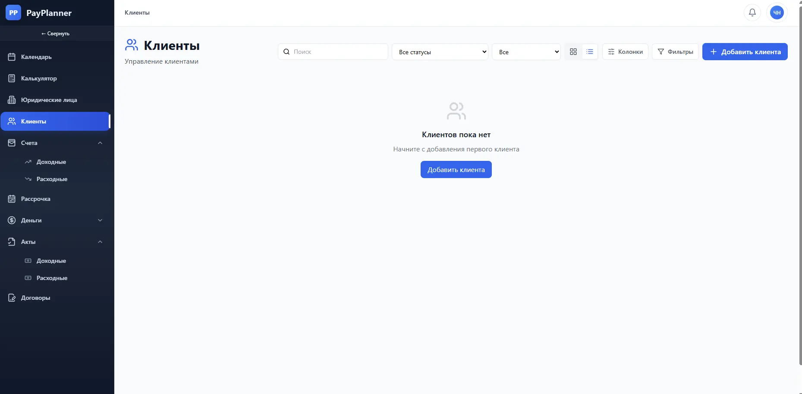
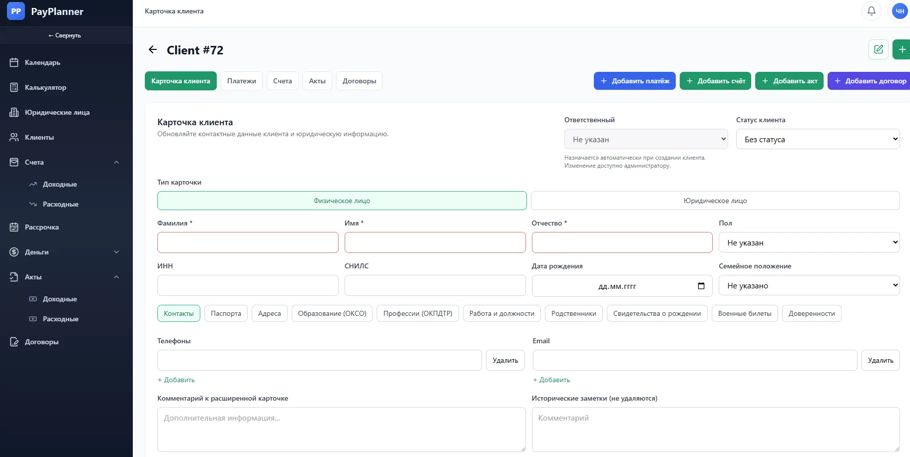
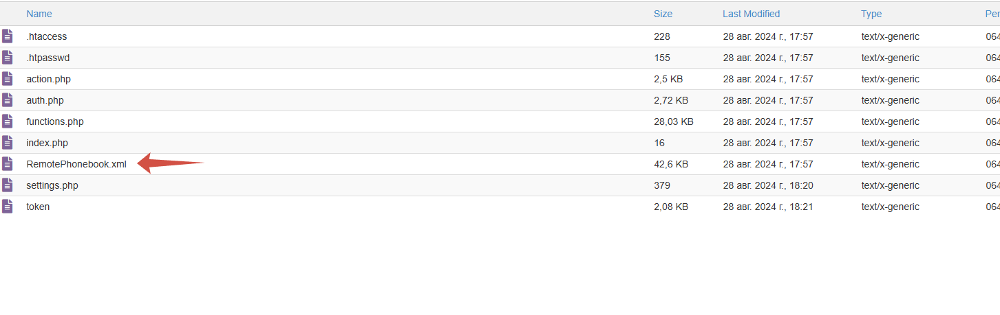

# MAX — визуальные источники и критерии проверки

Проверены 33 сохранённых изображения: 24 из чата Анны и девять именованных снимков владельца. Это полнота этой выборки, а не всех вложений четырёх чатов: 173 фотографии группы и короткое видео дополнительно изучены в [полной фотосверке](max-group-media-audit.md) и [видеосверке](max-group-video-audit.md). Звук видео «ИЗМЕНЕНИЕ МАСШТАБА 4» распознан локально и сопоставлен с просмотренными кадрами. Голосовое владельца 15 сентября раскрыто через встроенную расшифровку MAX. Исторический снимок подтверждает сообщение о поведении на его дату; текущий дефект устанавливается по ревизии и воспроизведению.

Оригиналы с клиентскими паспортами, контактами, делами и финансовыми записями находятся в защищённом локальном архиве вне Git. Подписи ниже передают весь рабочий смысл без идентификаторов клиентов и значений платежей. Доступный локально полный альбом: `D:/PayPlannerReview-20261012/unified-plan-audit-20261014/max-media-private-album.md`. Для другого агента подпись — постановка проверки, а не доказательство исправления. Пять безопасных оригиналов включены в репозиторий: две текстовые схемы актов, два пустых экрана клиентов и расположение XML-справочника.

| Источник / дата | ID или файл | Что видно и что проверить | Блок |
|---|---|---|---|
| Анна, 27 мая 19:12 2026 | `967f6b28cf4875e5` | Яндекс Диск: клиентская папка, отдельные папки дел и личных документов; структуру и разграничение доступа сохранять при подключении CRM. Файл с учётными данными не импортировать в общий поиск/чат. | хранение, документы, права |
| Анна, 17 мая 01:43 2026 | `dc833b93d354ecee` | Один номер счёта многократно показан у клиента, хотя в журнале счетов он один. Различать документ и взносы, проверить дедупликацию по устойчивому ID; не удалять реальные записи по одному совпадению номера. | PAY-34, список счетов клиента |
| Анна, 12 мая 11:20 2026 | `ff38c636b7cebb6d` | Настройки отправителя: канал, порядок, включение, отдельные сценарии и сохранённый пароль. Изображение не доказывает фактическую доставку; проверять настройки, очередь и получателя, локально SMTP выключен. | PAY-5, уведомления |
| Анна, 23 апреля 14:51 2026 | `a09867a3684f1a90` | Печатный счёт с указаниями на итог и график рассрочки. Сопоставить сумму документа, позиции, оплаченные взносы, остаток и исходный график; нельзя выводить только остаток как полную цену услуги. | PAY-34, печать и рассрочка |
| Анна, 23 апреля 14:52 2026 | `74ee99922a7ba0a0` | Эталон владельца с подписью «ВЕРНЫЙ СЧЕТ»: подробная услуга, основание-договор, полная сумма и четыре строки графика; сохранить историческую сумму и сверить все строки с редактором. | PAY-34, эталон печати |
| Анна, 23 апреля 14:52 2026 | `e573c440540a6d1a` | Журнал и раскрытые оплаты того же документа: сравнить суммы/статусы с двумя соседними печатными изображениями; фактические поступления и цена счёта — разные величины. | PAY-34, финансовая сверка |
| Анна, 22 апреля 17:55 2026 | `5a16c68b72078fed` | На печатном счёте отмечено отсутствующее адресное поле организации. Источник — профиль продавца и его исторический снимок; не подставлять адрес клиента или текущие реквизиты в выпущенный документ. | PAY-33, PAY-34 |
| Анна, 22 апреля 18:23 2026 | `89cab2f74aafda22` | Раскрытый счёт и его оплата выделены рамкой. Сверять связанность и итог документа, отдельно сохранять документ/плановый взнос/факт оплаты; смысл замечания уточняется соседним текстом, рамка сама не доказывает дефект. | PAY-34, счета и оплаты |
| Анна, 21 апреля 17:56 2026 | `0fec3a58cfb29ef6` | Три счета одного клиента с разными делами/статусами и фильтром. Общий клиент не должен смешивать документы дел, итоги фильтруются тем же набором, что строки. | PAY-34, PAY-28 |
| Анна, 21 апреля 19:16 2026 | `b9fbdae965437456` | Печатный акт: стрелка на основание, несколько услуг/часовая единица, итог и подписи сторон. Проверить корректную связь и дату основания, перенос длинных названий и печать суммы/единиц. Не вводить запрет акта без счёта. | PAY-34, акты |
| Анна, 17 апреля 20:31 2026 | `1e4496aa88a6ae38` | Редактор акта с пустыми суммой/названием/счётом и выбранным клиентом, отдельной историей и печатью. Установить, был ли документ сохранён без данных или поля не загрузились; сохранение/повторное открытие не должно терять позиции. | PAY-34, редактор акта |
| Анна, 16 апреля 11:19 2026 | `102df21e65f5a5df` | Предпросмотр счёта и боковая сводка: отмечен статус просрочки при показанном сроке оплаты. Проверять расчёт на фиксированной дате и по графику; по снимку без всех платежей нельзя установить причину статуса. | PAY-34, даты/статусы |
| Анна, 15 апреля 10:20 2026 | `766f3d0808516c13` | Фрагмент печатной таблицы услуг: длинное описание дела, нумерация, количество/единица/цена/сумма. Переносы и границы строки проверять без реальных персональных данных. | PAY-34, печатная таблица |
| Анна, 9 апреля 16:09 2026 | `b56f39efb7f7fc96` | Создание счёта из клиента завершилось общим сообщением «Не удалось сохранить счёт» при заполненной позиции. Нужны воспроизведение действующим API, понятная полевая ошибка и сохранение введённого при отказе. | PAY-34, создание счёта |
| Анна, 9 апреля 16:48 2026 | `c36d55185ab2a9fb` | Таблица платежей дела: повторные системные изменения статуса, оплаченная запись с исторической просрочкой. Не смешивать текущий статус и историческую задержку; проверить повтор сохранения/дубли истории. | PAY-28, PAY-34 |
| Анна, 9 апреля 16:48 2026 | `83ddc69f31e25289` | Редактор рассрочки: аванс, ставка, месяцы, первая дата, округление, последний корректирующий взнос, итог и остаток. Сумма графика должна совпадать с обязательством с учётом аванса/процентов и выбранного округления. | PAY-34, рассрочка |
| Анна, 9 апреля 16:48 2026 | `a1435b2b65d89c0d` | Тот же счёт после создания четырёх взносов: в редакторе видны план/факт и текущий статус. Повторное открытие восстанавливает график, изменение не теряет проведённые оплаты. | PAY-34, рассрочка |
| Анна, 8 апреля 14:35 2026 | `1f841ba8528619ff` | В колонке комментария показываются внутренний маркер invoice-items и экранированный JSON. Служебные данные не выводить как пользовательский текст; старые позиции сохранять и разбирать прежним совместимым способом. | PAY-28, PAY-34, быстрый интерфейсный дефект |
| Анна, 8 апреля 15:17 2026 | `ade93c249eb54b93` | Во вкладке «Счета» клиента три строки одного документа с разными сроками рассрочки. Счёт должен быть самостоятельной строкой с раскрываемым графиком, итоги документа и взносов не удваиваются. | PAY-34, список счетов клиента |
| Анна, 7 апреля 20:09 2026 | `5f32491f362b82af` | Из клиента открыта короткая форма дела, стрелка на поле названия и неуместный пример. Проверить название/описание/связь клиента и действие кнопки; современную расширенную форму оценивать отдельно. | PAY-21, быстрые подписи |
| Анна, 7 апреля 20:35 2026 | `30d6dc83fe407889` | У одного счёта отдельная крупная строка и шесть строк рассрочки; отмечено возможное двойное обязательство. Воспроизвести на синтетических данных, согласовать отмену прежнего плана при создании рассрочки и сохранить фактические оплаты. | PAY-34, финансовая регрессия |
| Анна, 7 апреля 20:35 2026 | `fd71cf48661192ea` | Календарь показывает одновременно отдельную строку и взнос одного счёта. Сопоставить с предыдущим изображением: календарь не исправлять сокрытием без проверки финансового источника. | PAY-34, календарь платежей |
| Анна, 19 марта 14:44 2026 | `731685097177c422` | Список клиентов показывает пустое состояние. Проверить права/фильтры/ошибку загрузки и импорт; пустой результат не доказывает, что данные удалены. | клиенты, приёмка |
| Анна, 19 марта 14:44 2026 | `d43fcd0f89285274` | Пустая карточка клиента с техническим заголовком, обязательными полями и вкладками персональных реквизитов. Проверить загрузку существующей карточки/ошибку/режим создания и сохранение. | PAY-32, приёмка |
| Андрей Владимирович, 19 марта 2026 | `2026-03-19_11-51-36.png` | Список клиентов: наименование, статус, телефон, дела, email, ответственный и действия. Только структура, реальные контакты в Git не переносить. | клиенты |
| Андрей Владимирович, 30 марта 2026 | `2026-03-30_15-56-56.png` | Исходная текстовая структура актов. Оригинал уже включён в безопасные источники. | PAY-34 |
| Андрей Владимирович, 30 марта 2026 | `2026-03-30_15-58-49.png` | Исходная текстовая схема маршрута актов. Оригинал уже включён в безопасные источники. | PAY-34 |
| Андрей Владимирович, 6 апреля 2026 | `2026-04-06_19-07-34.png` | Список файлов телефонной интеграции, стрелка на RemotePhonebook.xml: опираться на существующий генератор справочника, не читать расположенные рядом секреты. | PAY-9 |
| Андрей Владимирович, 6 апреля 2026 | `2026-04-06_19-07-09.png` | Расположение прежних contacts/report/webhooks/widgets: это контекст старой интеграции, не разрешение менять хостинг или переносить секреты. | PAY-8, PAY-9 |
| Андрей Владимирович, 6 апреля 2026 | `2026-04-06_19-09-45.png` | Тестовый клиент в плиточном виде и кнопки действий; сравнить вид таблицы/плиток и одинаковые связи. | клиенты |
| Андрей Владимирович, 7 апреля 2026 | `2026-04-07_12-57-16.png` | Подсказка редактирования задачи: режим только для чтения связан с включением другого окна администратором. Проверять обе формы и настройку выбора общей карточки. | PAY-20, PAY-11 |
| Андрей Владимирович, 7 апреля 2026 | `2026-04-07_18-37-28.png` | В расходном счёте выбран человек со статусом «Клиент», стрелка на поставщика. Роль контрагента в документе не обязана менять его сущность/все связи; названия и фильтр выбора согласованы с направлением счёта. | PAY-34 |
| Андрей Владимирович, 9 апреля 2026 | `2026-04-09_10-32-50.png` | Единый справочник физических контактов, стрелка на клиента: телефонная запись и клиентская карточка связаны, их изменения не создают независимую копию. | PAY-7, PAY-9 |

## Голосовое: цветопередача на рабочих мониторах

Источник: Андрей Владимирович, 15 сентября 2026, 14:53, голосовое 01:18. Полный текст доступен после раскрытия штатной кнопки расшифровки в MAX; источник прочитан в контексте соседних сообщений. Рабочее требование: продолжать развитие CRM и отдельно исправить восприятие цветовой гаммы на больших недорогих мониторах сотрудников. Качественный монитор разработчика не подтверждает читаемость у заказчика; сравнивать выбранные цвета, различимость элементов и перегрузку на рабочих экранах.

Предложение после голосового сделать персональную настройку цвета каждого элемента принадлежит разработчику. Это возможный вариант, а не согласованное требование владельца и не обязательная новая подсистема. Изменение палитры должно сначала решить наблюдаемую проблему, сохранять темы/доступность и сочетаться с последними замечаниями PAY-32/PAY-23/PAY-25. Итоговая проверка на мониторах сотрудников относится к приёмке; новых внешних отправок или изменений MAX не выполнялось.

## Видео: масштаб браузера и таблица

Источник: личный чат владельца, файл «ИЗМЕНЕНИЕ МАСШТАБА 4.mp4», длительность 87,725 секунды; исходный файл и расшифровка остаются в локальном защищённом архиве. Аудио распознано существующим локальным `faster_whisper`, русский язык, без передачи записи внешнему сервису; исходные кадры просмотрены отдельно. Автоматическая расшифровка содержит неуверенно распознанные отдельные слова, поэтому дословных цитат и новых финансовых правил по ней не вводится.

В 1,6–31,8 с владелец показывает КУБ при разных масштабах и обращает внимание на стабильное левое меню и масштабируемую таблицу справа. В 31,8–61,5 с показывает сохранение рабочей информации при сжатии и появление полосы прокрутки при сильном увеличении. В 61,5–86,5 с предлагает сравнить организацию колонок в разделе счетов. Рабочий смысл: проверить адаптацию таблиц к ширине и масштабу браузера, а не только уменьшить шрифт или добавить общую горизонтальную прокрутку всей страницы.

Критерии VIS-00 и всех таблиц: 80/90/100/110% и увеличенный масштаб (в примере до 170%), типичный рабочий экран и мобильная ширина; меню/действия остаются доступными, колонки сжимаются без потери значений, длинный текст читается; при физической невозможности уместить таблицу прокрутка ограничена её контейнером. Проверить различие реального zoom и простого изменения viewport. Перерасположение колонок не меняет финансовые суммы, фильтры или права.

## Безопасные исходные изображения

### 19 марта 14:44 2026 — клиенты, приёмка

Список клиентов показывает пустое состояние. Проверить права/фильтры/ошибку загрузки и импорт; пустой результат не доказывает, что данные удалены.

### 19 марта 14:44 2026 — PAY-32, приёмка

Пустая карточка клиента с техническим заголовком, обязательными полями и вкладками персональных реквизитов. Проверить загрузку существующей карточки/ошибку/режим создания и сохранение.

### 6 апреля 2026 — PAY-9

Список файлов телефонной интеграции, стрелка на RemotePhonebook.xml: опираться на существующий генератор справочника, не читать расположенные рядом секреты.

Две текстовые схемы актов и PDF-ТЗ размещены в [сверке MAX](max-requirements-audit.md) и [постраничной матрице](max-specification-requirements.md). Хеши всех 33 визуально прочитанных источников — в [машинном каталоге](max-media-catalog.json).
