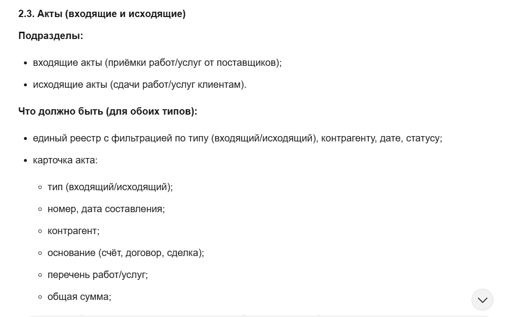
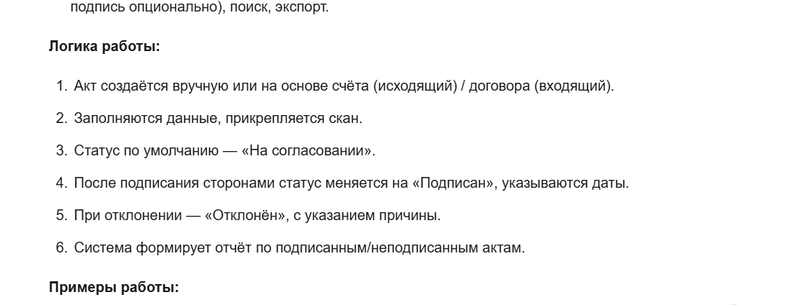

# MAX — сверка требований 14 октября 2026

Сверка выполняется под учётной записью пользователя, вход подтверждён им. Здесь сохранены только продуктовые требования; учётные данные, личные расчёты и сведения клиентов исключены. Текст четырёх чатов прочитан до доступного начала. Дополнительно просмотрены и описаны [33 сохранённых снимка](max-media-audit.md): 24 изображения Анны и девять именованных PNG владельца; 173 фотографии группы и короткое видео дополнительно изучены в отдельных каталогах; значимые голосовые и звук видео владельца описаны. Наличие прежнего ответа разработчика не считается доказательством исправления в текущей версии.

| Чат | Прочитанный диапазон | Полнота |
|---|---|---|
| СРМ - РАЗРАБОТКА | Создание группы 8 июля — 14 октября 2026 | Начало подтверждено, 610 элементов истории на контрольном чтении; текст, фотографии и видео изучены. Новый снимок 14 октября 19:39 и уточнение 19:55 внесены отдельно |
| АННА -ЮК ЭЛИТПРАВО ---ЮРИСТЫ | 19 марта — 8 октября 2026 | Начало подтверждено, 1396 элементов истории; текст и 24 фотографии прочитаны, три Word-файла разобраны |
| Елена Кожеваткина | 7–8 октября 2026 | Начало переписки и граница прокрутки подтверждены; новых требований к CRM нет |
| Андрей Владимирович | 19 марта — 14 октября 2026 | Текстовая история до начала прочитана; 11 файлов сохранены; значимое голосовое и видео масштаба изучены; девять PNG и PDF-ТЗ прочитаны |

Элементы истории включают даты, пересылки и группы вложений; это не число сообщений. Дни на границах блоков дополнительно сверены по тексту, чтобы не пропустить сообщения одного дня. Технические логи не используются как инструкция выполнить команды или передать токены.

## Группа разработки: требования июля–октября

Источник: [СРМ - РАЗРАБОТКА](https://web.max.ru/-76681665019256). Начало группы и нулевая позиция прокрутки проверены. Полный реестр входящих текстовых пожеланий повторно просмотрен; строки без текста сопоставлены с изображениями в полной фотосверке.

| Дата и время | Требование | Связь и проверка |
|---|---|---|
| 9 июля, 10:31; 10 июля, 19:27 | Причина запроса переноса срока, адресованный запрос постановщику, понятное согласование/отказ и выбор новой даты/времени, очередь согласования | Оба окна задачи и журнал, уведомление/отложить/отказ/конкурентный ответ. Часть маршрута проверена синтетической приёмкой PAY-24; всю просьбу не закрывать одним этим тестом |
| 9–10 июля; 15 июля | Несколько исполнителей/наблюдателей/согласующих, видимый выбранный список; результат перед согласованием, принудительное окно согласующему; администратор меняет постановщика | PAY-20/PAY-18, фактическое сохранение обеих форм, защита изменения автора и уведомление адресатам |
| 10 июля, 20:43 | Настраиваемый общий срок согласования | Правило отсчёта и персонального изменения, просрочка на согласовании и история |
| 13 июля, 21:51–21:53 | Стикеры: курсор не возвращается на прошлую строку; насыщенные цвета, жирность, размер | Существующие заметки, сохранение/конкуренция/многострочный ввод. Визуальный образец Simple Sticky Notes — референс, не требование установить внешнее приложение |
| 14 июля, 13:50–14:08 | Принудительные окна после «Отложить» не перекрывают всю работу и не требуют немедленно согласовать ради доступа к журналу | Отложенное состояние, навигация, повторный вход, новые события и очередь без повторного навязывания |
| 15 июля, 21:55; 16 июля, 17:39; 17 июля, 21:33–21:35 | Новая задача учитывает договор: по факту/фиксированный/без договора; выбор платной или внутренней, яркая метка, внутренние задачи с клиентом/делом либо без дела. Старые задачи не меняются автоматически | PAY-10/PAY-16, создать/изменить из обоих окон, настройка права выбора и отсутствие ретроактивного пересчёта |
| 15 июля, 22:19 | Утреннее окно о числе просроченных с «К задачам» и «Закрыть», настройку можно выключить | Личный фильтр, полная разрешённая выборка, время/часовой пояс, повтор и отключение |
| 16 июля, 12:32 | Чужую задачу редактировать/завершать/удалять разрешается тремя независимыми настройками роли | PAY-18, UI и прямые API, собственная задача, участник/постановщик/наблюдатель, аудит и уведомление исполнителю |
| 16 июля, 17:37; 27 июля, 18:16 | Выбор контрагента поверх формы и читаемый текст на ноутбуке | Модальные слои/focus/клавиатура/размеры; после выбора данные и текущий черновик сохраняются |
| 16 июля, 21:10–21:11 | Удалённая задача не вызывает повторных обращений и переходов | 404/403, уведомления и ссылки, cleanup кеша и выбранной карточки |
| 27 июля, 17:13–20:13; 17 августа, 20:45 | Повторная подача после доработки, удаление ошибочного согласующего и отсутствие назначенного согласующего не оставляют задачу без действий | Маршрут и возможный постановщик по умолчанию; не назначать новую роль молча, действующий этап, обе формы |
| 6 августа, 13:43–15:56; 25 августа, 21:20 | Закрытые задачи не всплывают заново; счётчики не стоят постоянно на «1»; платёж из сотрудника возвращает в профиль; настраиваемый порядок/сворачивание глобального меню | PAY-37 и отдельные UI-задачи. Исключение левого меню из поздних макетов не удаляет самостоятельную просьбу о настройке меню |
| 11–12 августа | ПКО не ломает ранее настроенные счета/акты; объяснение «Доступен во внешнем календаре» читаемо в форме | Общие печатные шаблоны и регрессия; раскрытые комментарии не обходят права на задачу |
| 13 августа, 21:02–21:03 | Компактный общий контакт → клиент/поставщик/агент; организации и сотрудники; закончить телефонию | PAY-7/PAY-8/PAY-9/PAY-32, справочник без дублей и лишних разделов, связь и быстрый ввод |
| 17 августа, 16:22 | Данные физлица в документе подставляются и располагаются читаемым списком | PAY-34, источники реквизитов и разрешения. Не путать адрес покупателя со строкой адреса продавца |
| 26 августа, 14:33–14:37 | Фильтры сохраняются после карточки; неверно преобразованные импортом контакты корректируются без разрыва связей | Сверка миграции/типа и архив/слияние; персональные записи не удалять по предположению |
| 3 сентября, 19:16–19:25; 11 сентября, 20:34–20:41 | Word-планинг без лишней колонки/плохих первых листов, альбомная ориентация, корректен для «Все», не только «Активные» | Отдельный оригинал планинга, границы/переносы/многострочный текст, все статусы и выбранные поля |
| 3 сентября, 19:17 | Стандартные ПКО/РКО по умолчанию, пользовательский шаблон — отдельный выбор | PAY-34, утверждённая форма и печать; сообщение о выпуске не доказывает правильный документ |
| 3 сентября, 20:38; 12 сентября, 20:18–20:20; 17/21 сентября | Платные задачи остаются в очереди счёта после завершения; правильный счётчик, активные ссылки и ответственный по выставлению, выбор задачи работает | PAY-16/PAY-36. Возможное блокирование завершения обсуждалось как вариант, окончательный маршрут требует решения; выполненную работу не терять |
| 3 сентября, 21:37; 11 сентября, 15:24 | Все забытые дела без активных задач попадают в контроль | Отдельно от последнего просмотра, условий 14 дней и новых действий; исключения/ответственный/дедупликация |
| 7 сентября, 13:11–13:12 | Если разрешено редактировать на согласовании, доступно сохранение | Серверные правила и кнопки согласованы; обе формы и роли |
| 9 сентября, 11:54–11:55 | «Выделить всё» показывает галочки, совпадающие со счётчиком | PAY-19/PAY-24, страницы/фильтры/частичный выбор и фактический набор операции |
| 11 сентября, 19:06–19:15; 15 сентября, 18:58–19:02 | Простые реальные данные суда, UID и инстанции; назначенное заседание уведомляет ответственного проверить подготовку юриста; движение показывает решение/обжалование | PAY-3/PAY-22/PAY-25, источник и актуальность, повторная синхронизация, даты/сроки и ручная проверка |
| 16 сентября, 12:08–12:16; 17 сентября, 09:46–14:51 | Файлы/комментарии при создании, работе, результате и завершении доступны исполнителю без права менять поля задачи | Оба окна, существующие файловые/комментарий API, отдельные разрешения, обновление при завершении и отказ загрузки |
| 16 сентября, 12:21–12:22 | Компактное меню и отдельные предложенные элементы обсуждаются | Не подменять утверждённые PAY-19…32 макеты собственным вариантом; оригинал фото и согласование расположения |
| 16 сентября, 13:42–14:03 | Внутренние личные/групповые чаты сначала; MAX-клиент с тремя делами не должен попадать во все чаты дел | PAY-1/PAY-29/PAY-14, явная маршрутизация контакта/дела; WhatCRM — обсуждавшийся вариант интеграции, не выбранный поставщик |
| 17 сентября, 16:31 | Счёт из фактически выполненных задач содержит список задач с датой завершения и происхождением поручения | PAY-16/PAY-34, текст/даты/ссылки и права на клиентский документ; без раскрытия внутренних комментариев |
| 18 сентября, 13:52–13:56 | Заметное уведомление о завершении с «Все понятно» и «К задаче»; нужен пользовательский мануал | PAY-5, подтверждение/переход/очередь/отключение и инструкция по реальным настройкам |
| 21 сентября, 14:43–17:56; 24–30 сентября | Изменение постановщика/срока, новая задача и сообщения оповещают адресно; уведомление сообщения открывает мессенджер, не чужой чат задачи; не исчезает мгновенно | PAY-5/PAY-1/PAY-29, живые рабочие браузеры нескольких сотрудников, действующие подписки, роутинг и повторная связь |
| 22 сентября, 12:45–12:54; 25 сентября, 17:43–17:58 | Число непрочитанных сообщений; единый MAX-бот с личной привязкой сотрудников, возможно клиентов; место файлов чата понятно | PAY-14/PAY-29, доказательство привязки/доставки владельцу и другому сотруднику, история/отписка и разграничение получателей |
| 23 сентября, 18:51; 30 сентября, 20:17 | Рабочий Яндекс.Диск и сохраняемые черновики после обновления | Storage-план, фактические ошибки/восстановление, черновик пользователя/объекта, очистка после сохранения |
| 29 сентября, 04:45 | Проверка идеи Rusprofile/BFOmetr для контрагентов | Обсуждаемое предложение, оценить договор/API/данные до включения в утверждённый интеграционный объём |
| 3–6 октября | Внешние календари правильно показывают задачи разных исполнителей, ошибки журнала понятны; автоматически созданная задача содержит цель и описание | PAY-37 и automation, реальные аккаунты/права/реплей. В переписке есть конкретная задача 783, её клиентские детали не помещаются в Git |
| 8 октября, 11:24 | Уведомления приходят только связанным сотрудникам, без всех задач организации | PAY-5, фильтр адресатов на сервере, администратор без подписки, роли и массовые операции |
| 9–12 октября | Профиль компании, корректные НДС/скидки, печать/подпись/шрифты/адрес, кнопки быстрого документа; секретарь видит разрешённые счета независимо от запрета платежей | PAY-33/PAY-34/PAY-18, модели собственных компаний, налоговая настройка, печатные образцы и независимая матрица |
| 12 октября, 02:28–02:36 | Карточки заявок и документов должны соответствовать ТЗ/макету; сомнительную логику обсуждать заранее | PAY-31/PAY-34, быстрый согласованный макет и отдельная реализация; не считать незавершённый технический экран принятой формой |
| 12 октября, 22:13 | Отменённая задача уходит из календаря по настройке | PAY-37, проверить именно статус отменённого объекта/связи, внутренний/Google/Яндекс и повторную синхронизацию |
| 12 октября, 23:34 | Нумерация счетов и актов начинается заново ежегодно; ранее выданные документы с НДС требуют сверки | PAY-33/PAY-34, история/уникальность/граница года, новые правила не перенумеровывают выданные документы |
| 14 октября, 11:18 | Операционный раздел показывает правильные остатки счетов, позволяет свести деньги | P0 финансовой сверки, исходные три снимка сохранены вне Git; начальные остатки/проведение/направление/счёт/валюта/переводы/сверка |

## Дополнения ранней истории Анны

- 6 апреля: прежний Yealink-справочник синхронизирует физические контакты, включая представителей организаций; действующую схему и формат сохранять. Это точнее, чем предположение выгружать произвольные названия всех юрлиц.
- 7–9 апреля: один счёт на общую сумму; в календаре только график рассрочки либо единый платёж, не оба одновременно. Длинные позиции, несколько услуг и создание из клиента/платежа сохраняются без белого экрана, потери текста или селектов.
- 8 апреля, 18:09: историческая дата и исходный номер документа разрешены с проверкой уникальности; автоматические номера тоже не пересекаются.
- 9 апреля, 18:58–19:00: текущий день/неделя/месяц обновляется со временем; пользовательский период сохраняет собственные границы.
- 13–15 апреля: печать без подписи/печати и PDF с ними — разные действия; QR принят пользователем исторически. Услуги из правильного справочника с категориями, сумма строки, длинное описание, скидка, комментарий клиента, выбранный НДС, график под таблицей, частичный акт на остаток услуг и создание дела без закрытия счёта.
- 14 апреля, 04:23: договор до исполнения обязательств отключает конечную дату; сумма фиксированная или по связанным счетам. Эти режимы уточняют разные формулы общего PDF-ТЗ.
- 15 апреля, 09:29: предупреждение о несохранённом счёте/графике перед уходом; сохранение калькулятора не должно выглядеть как сохранение всего документа.
- 10 июня, 22:28: выполненная работа по договору «по факту» не теряется без счёта — исходный бизнес-сценарий очереди платных задач.
- 11 июня, 13:34–14:37: при одном платеже срок счёта и платежа меняется согласованно; при рассрочке общий срок нельзя редактировать как единственный платёж, правка отдельных дат понятна. Последовательность и итог графика сохраняются.
- 11 июня, 15:45–17:40: статусы подписания актов/договоров настраиваются без дублирующих элементов и пропавшего признака; в этот день есть историческое подтверждение исправления, текущая реализация сверяется отдельно.

## Дополнение из чата Анны

Источник: [чат MAX](https://web.max.ru/267834520). Точное сообщение находится по дате и времени.

### Дополнение из ранней истории апреля–мая

| Дата и время | Требование | Что проверить и сохранить в плане |
|---|---|---|
| 16 апреля | Статус просрочки меняется после переноса срока оплаты; операции доступны и для организаций; три отдельных поля ФИО; технический код адреса скрыт | Общий финансовый расчёт, обновление после сохранения, права и защита полей, одинаковые действия физлица/юрлица |
| 16–18 апреля | Создание дела из счёта; удобный выбор услуги/категории в отдельном окне; сумма договора не создаёт циклической зависимости от ещё не созданного счёта | Заказ-наряд/предварительный расчёт, связи и кнопки; категории сохраняются в данных, даже если убраны из видимой таблицы |
| 18–20 апреля | Ввести долг поставщику по основанию, затем погашать платежами; в банк/кассу попадают проведённые операции с реквизитами | Счёт/начисление/реальная операция, начальный долг и расчёты отдельно от планового графика |
| 21 апреля | Платёж сохраняется из счёта для любого клиента; у акта правильные основание/дата счёта и разрешённые реквизиты клиента | Общие формы платежа, серверное сохранение/перезагрузка, документы после редактирования и роли |
| 22–23 апреля | Полнота и период импорта КУБ обсуждались; новые счета двух систем могут иметь разные номера; старые клиенты не нужны в рабочем списке | Согласовать область импорта/архива, идентификацию дубля не ограничивать номером. Проверка позиций/платежей/актов/договоров, протокол расхождений и пробный запуск без изменения рабочих данных |
| 22 апреля, 01:33–01:34 | Профиль компании редактирует счета/телефоны, юридический и фактический адрес, руководителя и бухгалтера | PAY-33, реквизиты подтягиваются в документы, права и источники значений |
| 23–24 апреля | Одинаковые суммы и статусы счёта в журнале, карточке и вкладках клиента; связи договора со счетами, актами, платежами и кассовыми/банковскими операциями | Единственный финансовый расчёт и происхождение связи; проверка мигрированных записей и полной цепочки документов |
| 24 апреля, 03:44–03:45; 29–30 апреля | Аннулирование/удаление платежа из его карточки и связанных окон; отмена счёта и связанных актов/плановых платежей; расторжение договора | Финансовый след и фактическое поступление сохраняются; явно определить отмену начисления, возврат и остаток аванса; действие/подтверждение с учётом роли |
| 24 апреля, 11:59–13:54 | Расходный счёт показывает поставщика как выставившую сторону и нашу организацию как покупателя, не чужую нашу печать/эмблему | Существующие отдельные шаблоны доходного/расходного документа, реквизиты сторон и долг поставщику |
| 24 апреля, 18:55–19:02 | Увеличение суммы счёта после частичной оплаты и выставления акта, перерасчёт остатка рассрочки | Сохранить проведённые оплаты; способ распределения новой суммы и аннулирования/замены акта требует решения. Не удалять платежи для исправления графика |
| 24–25 апреля | Физлицо/ИП/организация может быть поставщиком; прежний расход по делу не делает клиента поставщиком автоматически | Признак и тип контрагента, выбор поставщика, импорт и классификация без искажения существующей роли |
| 28 апреля, 12:57–12:58 | Переплата допускается и пересчитывает остаток | Остаток на авансе, распределение, возврат, повторный платёж и разные валюты |
| 28 апреля, 21:08 | Отдельные кассовый и банковский журналы; ПКО при принятии наличных | PAY-34/PAY-36, первичный документ из существующего модуля, связи и права |
| 30 апреля, 12:20–15:10 | Исправление импортированных счетов не создаёт дополнительные полные платежи; позиции/количество/цены из КУБ не теряются | Проверить сопоставление импорта, расхождения итогов и связи. Коррекцию существующих рабочих записей выполнять только отдельным обратимым процессом с журналом |
| 30 апреля, 17:20 | Рассрочка в расходном счёте | График поставщику, сумма/остаток и отсутствие зеркального доходного начисления |
| 4–5 мая | Изменение ошибочно выбранного клиента/суммы счёта корректно меняет связанные плановые записи, без нового лишнего платежа | Фактические операции не переносить молча: определить допустимость изменения и ручную коррекцию; транзакции/конкуренция/повтор сохранения |
| 12–13 мая | Контакты, физлица и организации, задачи и финдокументы подчиняются «свои / свой отдел / все»; выбор клиента для задачи без открытия запрещённой карточки регулируется отдельно | PAY-18, ролевые права выбора и просмотра, одинаковая защита API для физлица/организации; не давать роль администратора ради списка |
| 13 мая, 11:24 | Неактивная учётная запись блокируется | JWT/сессии/повторный вход, ранее открытая вкладка и фоновые запросы |
| 13 мая, 17:28 | Фильтр задач сохраняется после работы в карточке | PAY-19, маршруты, оба окна и персональные настройки |
| 14–15 мая | После согласования исполнитель видит «Согласовано» и следующий шаг; срок согласования обсуждался отдельно | Статус, обязательное сообщение и финальный выбор; отдельный срок согласования обозначить как решение, если правила не утверждены |
| 19 мая, 00:10–00:12; 22 мая, 20:59–21:00; 26 мая, 19:19 | Привлечённый исполнитель, флаг оплаты, сумма и дата/по результату в задаче; плановый платёж в ожидании либо после выполнения; баланс и история в профиле. Обсуждались +5 дней от принятия результата/работы и исключающая точная дата | PAY-2, детали условия требуют сверки текущего утверждённого правила; нельзя одновременно принять несовместимые способы даты. Оба окна, повторный результат, отмена и согласование |
| 20 мая, 19:24 | Правильная детализация рабочего времени | PAY-4, изображение и фактическая длительность, выбранный период и несколько исполнителей |
| 22 мая, 11:57–12:13 | Печатный отчёт по задачам по Word «ПЛАНИНГ ПО КЛИЕНТАМ» | Оригинал в MAX; не считать произвольный CSV эквивалентом формы. Все/активные/исполнители/периоды, счётчик и доступ |
| 22 мая, 14:48 | Страничная карточка задачи вместо неудобного всплывающего окна | PAY-20, совместить с более поздним утверждённым макетом и переключателем, не навязывать третий вариант без решения |
| 22 мая, 19:02–19:06 | Первая/апелляция/кассация/Верховный суд; жалобы и частные жалобы в соответствующей инстанции | PAY-22, разные исходные ссылки и история, не ограничиваться одним полем суда |
| 25 мая, 18:14 | Типы «Судебное заседание» и «Встреча» | Существующий справочник типов, обе карточки, фильтры/экспорт/календарь |
| 26 мая, 22:16–22:32 | Счётчик отчёта меняется с фильтром; все незавершённые задачи за весь период; прежний отчёт доступен до появления нового | PAY-19/PAY-24, полная серверная выборка, согласование/доработка/просрочка, не только видимая страница |
| 27 мая, 19:11–21:56 | Файлы на Яндекс.Диске: организация → клиент → дело, в CRM ссылки, место и доступ сотрудникам | Хранилище/права/синхронизация и отсутствие потери файла; ранее предложенный S3 не является выбранным заказчиком вариантом |
| 27 мая, 22:08–22:22 | Каждый сотрудник подключает свой календарь; руководитель собирает их в один обзор | Права чужого календаря и события правильного адресата, не копировать всё в каждый календарь |
| 29 мая, 13:27–15:15 | Акт сохраняет комментарий и позиции; окно помещается на ноутбуке и 27-дюймовом мониторе | PAY-34, сохранение и печать после изменения, доступная нижняя кнопка без уменьшения масштаба |
| 29 мая, 20:55–22:43 | Остаток счёта закрывается несколькими платежами/авансом; ПКО и акт сверки по приложенным формам PDF/XLS | PAY-34/PAY-36, реальные исходники вне Git, разные суммы/частичная оплата и двусторонняя сверка |

### Позднейшие сообщения июня–октября

| Дата и время | Требование | Что проверить и сохранить в плане |
|---|---|---|
| 29 мая, 22:49 | Платёж исполнителю создаётся после принятия работы | Отличить плановый расход от начисленного обязательства; проверить настройки оплаты по результату, обе карточки, повторные переходы статуса |
| 3 июня, 16:15–16:16 | Выполненные задачи скрываются либо получают другой цвет; время суда совпадает с календарём | PAY-37, часовые пояса и реальные внешние события; прежнее сообщение не заменяет приёмку |
| 3 июня, 20:49 | Долг перед исполнителями принадлежит предприятию, а не создателю задачи | Подписи, получатель платежа, расчёты исполнителя и организации |
| 4 июня, 10:48–10:49 | Комментарий платежа не должен заменять комментарий счёта | Отдельное хранение и сохранение полей; регрессия редактирования и распределения |
| 8 июня, 13:03 | Администратор может завершать без результата по отдельному разрешению | Не распространять исключение на остальные роли; проверить оба окна задач |
| 8–9 июня | Дубли событий Google и отсутствующий календарь сотрудника | Идемпотентность синхронизации, принадлежность, реальные аккаунты и права |
| 9 июня, 13:16–13:21 | Счёт-оферта сохраняет форму счёта и дополняет её текстом оферты | Найти приложенный PDF; содержание требует утверждённого шаблона, без самостоятельной правовой редакции |
| 10 июня, 23:39–23:43 | Автоконтроль дел без новых задач должен снова находить забытые дела | Условия 14 дней, активные/завершённые задачи, новые действия и исключения; сверить с roadmap case inactivity |
| 11 июня, 20:01–20:24 | Возврат клиенту расходным платежом, связь со счётом/договором | Тип операции, права, возврат и баланс, закрытый и частично оплаченный счёт |
| 12 июня, 02:11–02:18 | Непривязанные поступления — нераспределённые авансы на балансе клиента; видны в сверке | Явный статус, предупреждение при проведении, очередь распределения и обоснованное игнорирование; не считать поступление признанной выручкой автоматически |
| 15 июня, 13:46 | Исправить печатную форму ПКО, подписи и печати | Сверить исходник, Word/PDF, утверждённую форму и размеры |
| 15 июня, 13:47 | Запрет просмотра платежей должен действовать и через вкладки клиента | Самостоятельные разрешения платежей/счетов/актов, прямые API и вложенные экраны |
| 15 июня, 13:50 | Заметки как рабочие напоминания без создания задач | Найти изображение; сверить уже реализованные заметки, не создавать дублирующий механизм |
| 15 июня, 13:56 | Секретарь подключает календари сотрудников | Согласовать модель делегирования и доступ к чужому календарю |
| 15 июня, 21:17 | Мгновенное оповещение о назначении и переносе задачи | PAY-5, push/внутренние сообщения, адресаты и восстановление связи |
| 17–18 июня | Различимые календари сотрудников и доступный список исполнителей | Ролевое отображение, цвет и создание задачи; 18 июня есть подтверждение исторического исправления, текущая регрессия проверяется отдельно |
| 19 июня, 20:09–20:12 | Уведомления справа снизу, читаемый размер и накопление при закрытом браузере | Настройки отключения, очередь после входа, отсутствие повторов и чужих уведомлений |
| 19 июня, 20:13 | Снять преждевременно отмеченную оплату | Не удалять фактическую операцию без финансового следа; отмена отметки и пересчёт связанных сущностей |
| 22 июня, 18:02 | Кнопка отключения уведомлений после подключения | Реальное состояние разрешения браузера и подписки |
| 23 июня, 05:01–05:22 | Новая компактная карточка, все функции сохранены; результат при завершении | PAY-20, исходные фото, настройка переключения старой/новой карточки; определить роль/персональную настройку уведомлений |
| 23 июня, 12:29 | Дата оплаты синхронно обновляется в счёте и платеже | Условия автоматического изменения и ручного значения, несколько платежей, рассрочка |
| 23 июня, 15:03–18:07 | Поиск адреса DaData выдаёт ошибку | Конфигурация, отказ поставщика, ручной ввод без потери данных |
| 26 июня, 17:23 | Журнал содержит реально совершённые операции, не плановые | Понятные независимые статусы проведения/оплаты/сверки, переход к источнику, пример КУБ |
| 26 июня, 21:11–21:12 | Последний согласующий выбирает завершение или возврат исполнителю | Уже есть производственная проверка PAY-24 части маршрута; проверить полный объём по обеим карточкам и правам |
| 27 июня, 11:50 | Журнал задач корректно адаптируется при масштабе 90% | Визуальная проверка таблицы, столбцов и закреплённых действий |
| 29 июня, 20:07–20:14 | Доработка с комментарием и обязательным крупным уведомлением; принятые согласования сохраняются | Запись причины, повторная подача, кто участвует во втором цикле, подтверждение ознакомления, сообщение о завершении |
| 29 июня — 3 июля | После обновления сохраняется текущая страница; ссылки не ведут в уведомления/на вход | Маршруты, права, восстановление сессии, ссылки из уведомлений и карточки клиента |
| 2 июля, 19:06–20:55 | Оплата исполнителю доступна по признаку привлечённого; отдельный получатель обсуждался | PAY-2: получатель и основной ответственный — возможное бизнес-решение; просрочка и ставки исполнителя |
| 3–6 июля | У ряда сотрудников не работают подписка/проверка уведомлений и карточки организации | Проверить живой пользовательский сценарий и изображения ошибок, не полагаться на административную учётную запись |

## Дополнение из личного чата владельца

Источник: [чат MAX](https://web.max.ru/180186973). URL подтверждён в открытой вкладке. Точное сообщение находится по дате и времени.

| Дата и время | Требование | Что проверить и сохранить в плане |
|---|---|---|
| 19 марта, 14:53 | Массово передавать клиентов другому ответственному | Выбор строк и массовое назначение с проверкой прав, полный объём выборки и доступ нового ответственного |
| 30 марта, 13:57–14:15; 7 апреля, 21:46; 23 апреля, 19:00–19:52 | Расход связывает поставщика, клиента и дело; общая кредиторка организации ведётся без клиентского дела | Взаиморасчёты, номер/дата платёжного документа для безнала/СБП, плановый и фактический расход, рентабельность дела и календарь; не путать плательщика с получателем |
| 31 марта, 00:46 | Полное исходное ТЗ «CRM-модуль для юристов» | PDF 33 страницы сохранён и прочитан; [33 группы требований](max-specification-requirements.md), правила согласования сверять с более поздними уточнениями |
| 6 апреля, 13:33 | Платёж может существовать до счёта | Аванс, дальнейшее распределение и документальное основание, без обхода прав |
| 6 апреля, 21:24; 7 апреля, 15:43 | Сохранить рабочий телефонный справочник на REG.RU; обновление раз в сутки, номер с «7» вместо «8» | PAY-9, совместимый формат ФИО/телефон, существующий скрипт и ежедневная выгрузка; сторонние сервисы не добавлять по предположению |
| 7 апреля, 12:31–13:57 | Поиск без потери фокуса и без зависимости от регистра | Быстрый непрерывный ввод, отложенный запрос и поиск по полной выборке |
| 7 апреля, 14:33–15:09; 9 апреля, 14:32–14:37 | Единый справочник, клиенты/сторонние, физлица/организации; представитель связан с организацией; быстрый ввод и обязательные поля | Синхронизация контактных данных в обе стороны, активная ссылка на полную карточку, права на поля, изменение ширины/порядка колонок и полный текст ячейки при наведении |
| 7 апреля, 20:12; 9 апреля, 19:49–19:51 | Рассрочка сразу в счёте, итог не задваивается | Общая сумма, график, повторное сохранение и отдельные платежи; проверить текущие финансовые регрессии |
| 9 апреля, 19:49–21:22 | Собственная компания отдельно от сторонних контрагентов; печать/подпись только собственных организаций; QR-код счёта | PAY-33/PAY-34, профиль и его права, будущие офисы, заполнение реквизитов и ограничения загрузки печати |
| 14 мая, 13:50 | Автоконтроль не назначает задачу случайному юристу | Источник ответственного и резервная роль; повторный запуск не создаёт дубль |
| 15 мая, 19:32–21:02 | Стандартные кассовые формы и понятные подсказки по работе юристов | ПКО/РКО/платёжное поручение, существующие руководства и инструкции вместо дублирующего onboarding |
| 18 июня, 15:25 | Владелец проверяет видимость прав под пользовательской ролью | Безопасный механизм проверки, без обхода авторизации и выдачи лишних прав |
| 23 июня, 21:43–21:50 | Долг и платежи исполнителей видны в календаре; юристам закрыты лишние разделы | PAY-2/PAY-18, расчёты по получателю и матрица разрешений, прямой API и пользовательская приёмка |
| 25 июня, 20:00–20:01 | Исполнители отображаются списком без рамки после выбора; компактный календарь времени с длительностью | PAY-20, оригинальные фото, различимые цвета на ноутбуке; несколько исполнителей не должны теряться при сохранении |
| 29 июня, 19:11–19:43 | В платеже и календаре явно видно, кому платим; расчёты связаны с профилем исполнителя | PAY-2, поставщик/исполнитель, сводные расчёты и подписи; обсуждавшийся вариант связи не выдавать за принятое решение |
| 29 июня, 19:53 | После перезагрузки и входа сохраняется последняя рабочая страница | Восстановление маршрута и фильтров с проверкой прав |
| 29 июня, 19:58 | Сортировка нажатием на заголовки журналов | Проверить каждую колонку, сортировку на сервере при пагинации |
| 2 июля, 22:29 | Таблица адаптируется к масштабу, пример КУБ в видео | Вложение «ИЗМЕНЕНИЕ МАСШТАБА 4.mp4», отдельный просмотр обязателен |
| 14 июля, 22:50–22:55 | Рабочий диск отдельно от архивного; папка на дело и индикатор свободного места | Существующие storage-модули, права и место; не переносить архивы автоматически |
| 30 июля, 14:35–21:16 | Обсуждался отдельный удалённый Windows с Word, браузером и профилями | Отдельная инфраструктурная потребность, требует решения и расчёта; не включать как согласованную установку на VPS CRM |
| 13 августа, 21:08–21:11 | OnlinePBX и телефонный справочник из CRM через Excel на REG.RU | PAY-8/PAY-9, схема существующего скрипта, доступ к телефону, запись/входящие и маршрутизация |
| 15 сентября, 14:56–14:57 | Палитра и возможная настраиваемая тема | Возможность обсуждалась, отдельно от обязательного соответствия утверждённым макетам; голосовое 01:18 ещё не разобрано |
| 1 октября, 13:14–13:16 | Запрет платежей не должен закрывать счета и акты | Независимые разрешения, UI/API, вкладки клиента и дела; высокий риск |
| 1 октября, 20:52–21:00 | Лиды и этапы воронки до заключения договора; дело после договора/счёта | PAY-31/PAY-30: условия конвертации и связи без дублирования клиента, сравнить с доской PAY-15 |
| 3 октября, 13:16 | Ответ клиенту через MAX: ограничения бота и вариант агрегатора/API | PAY-14, отдельное решение канала; бот не может писать произвольному клиенту до разрешённого контакта |

## Сохранённые изображения группы разработки

Оригиналы хранятся вне Git: `D:/PayPlannerReview-20261012/unified-plan-audit-20261014/max-media/`. Четыре файла проверены визуально и по SHA; реестр `crm-development-current-manifest.private.json`. Три снимка финансового раздела от 14 октября показывают проблему сверки остатков и неизвестного счёта. Четвёртый файл — техническое уведомление, не продуктовый макет. Остальные фотографии и вложения ещё каталогизируются.

Полная выгрузка YouGile: 68/68 вложений сохранены; восемь экземпляров Word-файлов содержат семь уникальных спецификаций. Это факт получения источников, не завершение их семантического анализа.

## Файлы личного чата владельца

Две исходные иллюстрации ТЗ включены в репозиторий после визуальной проверки. Источник: личный чат владельца, 30 марта 2026, 18:57 и 18:59. Они описывают входящие/исходящие акты, поля карточки и маршрут подписания. Наличие картинки не означает реализации перечисленных требований.

В `D:/PayPlannerReview-20261012/unified-plan-audit-20261014/max-owner-files/` сохранены все 11 именованных вложений, обнаруженных в текстовой истории: девять PNG, полное PDF-ТЗ и MP4-пример масштаба КУБ. Хеши и размеры — в `max-owner-files-manifest.private.json`. Снимки 30 марта про структуру и согласование актов проверены визуально и не содержат клиентских значений. Снимок 7 апреля показывает обрезанный адрес и подсказку ПКМ вместо полного текста ячейки; содержит реальные контакты и остаётся вне Git. Видео просмотрено по кадрам 0/30/60/75 секунд: таблица КУБ изменяет размер вместе с рабочей областью; аудиодорожка ещё требует разбора. Остальные снимки требуют визуальной сверки. Безымянные фотографии и голосовые сообщения не входят в число 11 файлов и не считаются изученными.
